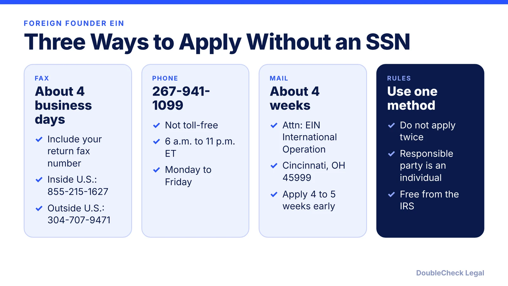
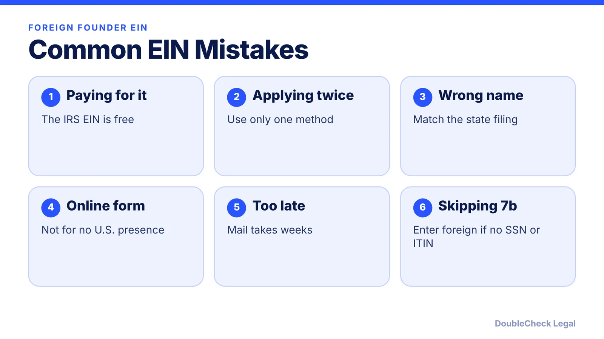

*No Social Security number? You can still get an EIN. Here are the IRS methods, numbers, timing, and the form line most foreign founders get wrong.*

**Key takeaways:**

- The online EIN form is not for applicants with no U.S. presence; use fax, phone, or mail.
- On Form SS-4 line 7b, enter "foreign" if you have no SSN or ITIN and cannot get one.
- Fax takes about four business days; mail about four weeks, per the IRS.
- The responsible party must be an individual; use only one method.

## 1. The quick answer

**Quick answer:** If you have no Social Security number or ITIN, you can still get an EIN. The IRS says the online application is not for applicants with no U.S. presence, so you apply with Form SS-4 by fax, phone, or mail. On line 7b, enter "foreign" if you have no SSN or ITIN and are not eligible for one. The IRS does not charge for an EIN.

## 2. Filling out Form SS-4

Per the IRS instructions: the responsible party must be an individual, and a foreign applicant may have any duly authorized person sign the form. Use only one filing method for the same entity, since duplicates cause problems. The form also allows a third-party designee to receive the EIN for you. Your company must already exist (the state filing comes first), because the form asks for the legal name and formation details.

Order of operations: [form the company](/blog/start-us-company-as-non-us-resident/), then apply for the EIN. For the standard process, see [how to get an EIN for your business for free](/blog/how-to-get-an-ein-for-your-business-free/).

## 3. Timing and mistakes

Plan for delays. The IRS says fax takes about four business days and mail about four weeks. For status questions, the IRS lists 800-829-4933. Typical mistakes: applying through a paid site that charges for a free number, using the wrong entity name, and applying twice. If your bank or payment processor needs the EIN, build that timeline into your launch plan.

## Where DoubleCheck fits

[DoubleCheck](https://www.contactdoublecheck.com) helps businesses and founders start legal work with AI, verify it, and, when professional advice is warranted, connect with an independent attorney, including for immigration questions. Attorney availability and practice areas vary. Attorneys on DoubleCheck are independent professionals; an attorney-client relationship forms only if an attorney accepts your engagement.

**Sources:** [IRS Form SS-4 instructions](https://www.irs.gov/instructions/iss4).

## FAQ

**Can I get an EIN without a Social Security number?**

Yes. The IRS accepts Form SS-4 by fax, phone, or mail from applicants with no SSN or ITIN. Enter "foreign" on line 7b if that applies.

**Is the EIN free?**

Yes. The IRS charges nothing for an EIN. Third-party sites that charge fees are optional service providers.

**How long does a foreign EIN take?**

Per the IRS instructions, about four business days by fax and about four weeks by mail. Phone applications are handled during IRS call hours.

**Who can sign the SS-4 for a foreign company?**

The IRS instructions say foreign applicants may have any duly authorized person sign.

---

*General information only. This article is not legal, tax, investment, or accounting advice.*
