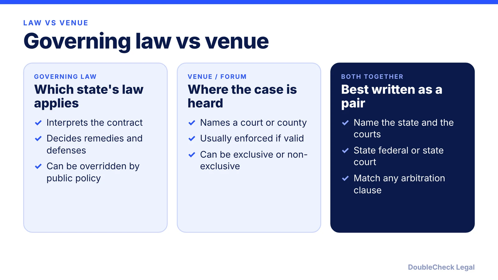
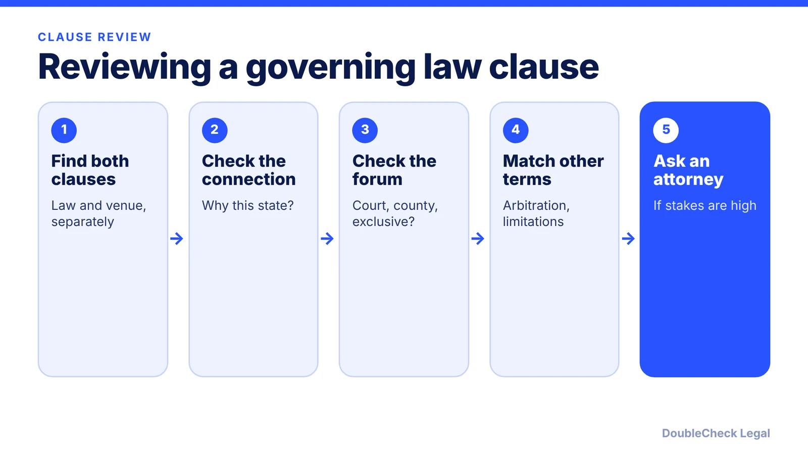

*What governing law and venue clauses do, which state law applies, when a court will not follow your choice, and a drafting checklist, as of November 2026.*

**Key takeaways:**

- Governing law decides which state law applies; venue decides where the case is heard; write both.
- Per Revision Legal, courts generally uphold the choice but may override it for no substantial relationship or a fundamental policy of another state.
- Atlantic Marine (2013) makes valid forum selection clauses hard to escape.
- Check consumer and employee rules, deadlines and any arbitration clause for consistency.

## 1. The quick answer

**Quick answer:** A governing law clause says which state's law interprets and enforces your contract; a venue (or forum) clause says where a dispute is heard. They are separate choices, and courts will usually honor both, with exceptions. Per Revision Legal (modified May 31, 2026), most states apply the Restatement (Second) of Conflict of Laws test, which generally upholds the choice but can override it when the chosen state has no substantial relationship to the deal or when applying it would violate a fundamental policy of a state with a materially greater interest. For forum selection, the U.S. Supreme Court held in *Atlantic Marine* (decided December 3, 2013) that a valid clause should be enforced in all but the most unusual cases.

So which state law applies? Usually the one named in the clause, if the clause is valid. If there is no clause, a court applies its own conflict rules, looking at facts such as where the contract was signed and performed.

## 2. Choice of law, jurisdiction and venue: the three terms

People mix these up, so here are the definitions as Revision Legal (John Di Giacomo, modified May 31, 2026) uses them:

- **Choice of law:** which state's or country's substantive law governs how the contract is interpreted and enforced.
- **Jurisdiction:** which court system has authority to hear the dispute.
- **Venue:** the specific location where the case is heard.

A clause that says "this agreement is governed by Delaware law" settles the first and says nothing about the second or third. A clause that says "exclusive venue lies in the state and federal courts in [county], [state]" settles venue but not the law. Careful contracts handle all three and say whether federal courts, state courts or both are allowed. Revision Legal adds that ambiguity here can undermine an otherwise valid clause and recommends naming the county and federal district, not only the state.

If your contract also contains an arbitration clause, the hearing location and rules are set there, and the two clauses need to fit together. See [arbitration clause explained](/blog/arbitration-clause-explained-small-business-contracts-pros-cons/) for how to line them up.

## 3. When a court will not follow your choice

Courts generally respect these clauses, but the exceptions are real.

**Choice of law.** Revision Legal describes two classic limits under the Restatement approach: the chosen state has no substantial relationship to the parties or the deal, or applying its law would offend a fundamental policy of another state with a materially greater interest. A Delaware Court of Chancery decision in 2021, summarized by Reed Smith, shows the second limit in action. The court declined to enforce a Delaware choice-of-law clause as to a California securities claim, because California barred waiver of that claim and had a materially greater interest. This outcome turned on the facts of that case, so do not read it as a rule for every contract.

**Consumers and employees.** Revision Legal notes that courts apply heightened scrutiny to consumer contracts, especially take-it-or-leave-it forms selecting a distant forum, and that some states void choice-of-law clauses that would strip employees of home-state protections. If you sign these kinds of contracts, check state-specific rules. See [independent contractor vs employee](/blog/independent-contractor-vs-employee/) if the label matters to which protections apply.

**Forum selection.** Per the American Bar Association's Business Law Today summary of *Atlantic Marine Construction Co. v. U.S. District Court*, the party resisting the clause carries the burden, a court may not weigh the plaintiff's choice of forum, and only public-interest factors can defeat it. The same analysis applies whether the chosen forum is federal, state or foreign. Practically, that means a venue clause in a signed business contract is hard to escape after a dispute starts.

**Delaware's statute for larger contracts.** Delaware Code Title 6, Section 2708 lets parties agree in writing that Delaware law governs, and presumes a significant, material and reasonable relationship to Delaware if the parties are subject to Delaware jurisdiction. It does not apply to contracts involving less than $100,000, per the statute text on the Delaware Code site. Other states have their own rules, which vary, so a Delaware clause in a small contract is not automatically safer.

## 4. How to choose a state for your clause

There is no universally best state. The question is which choice reduces risk and cost for you.

- **Your home state.** Revision Legal says selecting your home forum reduces cost, but negotiating power between the parties usually decides whose choice prevails. A local venue means lower travel and local counsel costs if you ever have to sue or defend.
- **A neutral state.** Neutral choices can make sense when both sides are in different states, but you need a real connection or a statute like Delaware Section 2708 to support it.
- **Where the other party is.** If you are the plaintiff, you may need to sue where the defendant is or can be reached. Consider whether a judgment would be enforceable there.
- **Your entity and your customers.** A company incorporated in Delaware and operating elsewhere may still be sued where it does business. See [Delaware corporation doing business in California](/blog/delaware-corporation-doing-business-in-california/) for how that works.

Use this rule of thumb: pick the law you or your attorney can actually evaluate, and a venue you can afford to appear in. For international deals, Revision Legal notes that enforcing a foreign court judgment can be difficult and that arbitral awards are often easier to enforce across borders. It also says the U.S. had signed but not ratified the Hague Choice of Court Convention when the article was written, a status that may have changed.

## 5. Drafting and review checklist

Before you sign, or when you write your own clause:

- **Name the state and the courts.** For example, the state courts and federal courts located in a named county. Say whether the venue is exclusive.
- **State the basis for federal court**, such as diversity or a federal question, if you want federal courts listed (Revision Legal).
- **Acknowledge mandatory laws** for consumers or employees instead of trying to waive them (Revision Legal).
- **Check the whole contract for a consistent story.** The [entire agreement clause](/blog/entire-agreement-merger-clause-explained-what-it-wipes-out/), [assignment clause](/blog/assignment-clause-explained-can-your-contract-be-transferred/) and any arbitration language should not point in different directions.
- **Check deadlines.** The state you pick can change how long you have to sue; see [statute of limitations for breach of contract by state](/blog/statute-of-limitations-breach-of-contract-by-state-small-business/).
- **Check what you can recover.** Remedies vary by state; see [breach of contract remedies](/blog/breach-of-contract-remedies-what-you-can-recover-small-business/).

## 6. When to get an attorney to look at it

A governing law and venue clause is often boilerplate, and for a small, low-stakes contract a careful read may be enough. It deserves a closer look when the contract is large, long-term or with a counterparty in another state or country; when your business is regulated; or when employees or consumers are involved. The same applies if you are not sure which state's law protects you.

AI tools can summarize the clause, flag a mismatch between the law and the court, and suggest questions. They can get state-specific rules wrong, so use the output as a checklist and confirm it. See [how to verify an AI-generated legal document](/blog/verify-ai-generated-legal-document/), [contract red flags for small business](/blog/contract-red-flags-small-business/) and [what makes a contract legally binding](/blog/what-makes-a-contract-legally-binding/). If you need a person to check it, [how to choose a good lawyer](/blog/how-to-choose-good-lawyer/) covers what to ask for.

## Where DoubleCheck fits

[DoubleCheck](https://www.contactdoublecheck.com) helps businesses and founders start legal work with AI, verify it, and, when professional advice is warranted, connect with an independent attorney, including for immigration questions. Attorney availability and practice areas vary. Attorneys on DoubleCheck are independent professionals; an attorney-client relationship forms only if an attorney accepts your engagement.

**Sources:** [Revision Legal, Choice of Law and Venue Clauses Explained (modified May 31, 2026)](https://revisionlegal.com/corporate/choice-of-law-venue-contract-clauses/); [American Bar Association Business Law Today, Atlantic Marine summary (Jan. 2014)](https://businesslawtoday.org/2014/01/u-s-supreme-court-reaffirms-that-forum-selection-clauses-are-presumptively-enforceable/); [Delaware Code, Title 6, Chapter 27, Subchapter I](https://delcode.delaware.gov/title6/c027/sc01); [Reed Smith, Delaware Court of Chancery declines to enforce Delaware choice of law (2021)](https://www.reedsmith.com/de/perspectives/2021/03/delaware-court-of-chancery-declines-to-enforce-delaware-choice-of-law). Blocked: none for this post.

## FAQ

**Which state law applies to my contract?**

Usually the state named in a valid governing law clause. Per Revision Legal (May 2026), most states apply the Restatement (Second) test, which generally upholds the clause but can override it when the chosen state has no substantial relationship to the deal or applying it would violate a fundamental policy of a state with a materially greater interest. Without a clause, courts apply their own rules.

**What is the difference between governing law and venue?**

Governing law is the state law used to interpret and enforce the contract. Venue is the specific place where a case is heard. Revision Legal also distinguishes jurisdiction, which is which court system has authority. A good clause addresses all three.

**Are venue and forum selection clauses enforceable?**

Usually yes. In Atlantic Marine (decided December 3, 2013), the Supreme Court said a valid forum selection clause should be enforced in all but the most unusual cases, per the American Bar Association. Consumer and employee contracts get closer scrutiny.

**Can I pick Delaware law for a small contract?**

Delaware Code Title 6, Section 2708 does not apply to contracts involving less than $100,000, per the Delaware Code site. Other states treat these clauses under their own rules, which vary, so check before assuming Delaware law will be applied.

**Should the venue be my home state?**

It can lower your costs, but Revision Legal says bargaining power usually decides whose choice prevails. Choose a venue you can afford to appear in and a law you can evaluate, and have an attorney review larger contracts.

---

*General information only. This article is not legal, tax, investment, or accounting advice.*
