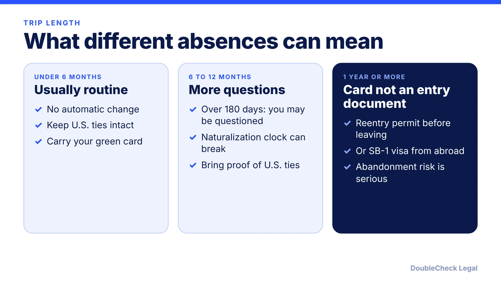
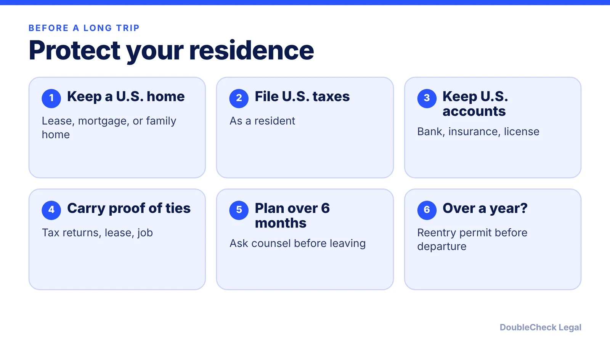

*Trips are not limited by a day count, but longer absences invite questions and can break your path to citizenship.*

**Key takeaways:**

- No fixed day count defines abandonment; intent and U.S. ties are what matter.
- Per Nolo, one year or more abroad means the card is no longer valid for entry; shorter absences can still bring questions.
- A reentry permit must be requested from inside the U.S. before you leave.
- 6-12 month absences disrupt continuous residence for naturalization unless overcome.

## 1. The quick answer

**Quick answer:** There is no single number of days that automatically ends permanent residence. Per Nolo, an absence of one year or more means the green card is no longer valid for entry, and any trip can bring questions about your U.S. ties. The real test is whether you intended to keep the U.S. as your permanent home. For trips that may exceed a year, a reentry permit must be requested from inside the U.S. before you leave.

## 2. How abandonment is judged

Per [Nolo](https://www.nolo.com/legal-encyclopedia/reentry-permits-preparing-green-card-holders-long-absences-the-us.html), after any trip abroad, however short, you should be ready to show evidence of U.S. ties, such as a lease or mortgage, family in the U.S., or employment. Abandonment is not limited to long trips: a permanent resident whose actions show a home has been made elsewhere can be found to have abandoned residence. Factors an officer may weigh include U.S. taxes, a U.S. home, work abroad, family abroad, and the reason for the trip.

The core question is whether you kept valid status, never gave up your intent to return, and made a temporary trip. Longer absences are easier to justify when caused by events beyond your control, such as serious illness or travel restrictions; a voluntary overseas job is more likely to be viewed as within your control. Being admitted at the border does not necessarily end the question, since a later naturalization application can prompt a review.

## 3. Reentry permits and the SB-1 alternative

Per [Nolo](https://www.nolo.com/legal-encyclopedia/reentry-permits-preparing-green-card-holders-long-absences-the-us.html), a reentry permit is valid for no more than two years and cannot be extended, and is limited to one year if you have been abroad more than four years since getting your green card. You apply from inside the U.S. before you leave. Even with a permit, evidence of ties such as a lease or mortgage, family, or employment helps show you have not abandoned residence.

If you are already abroad over a year without a permit, the option is a returning resident (SB-1) visa from a U.S. consulate. Per Nolo, you must show the absence was due to circumstances beyond your control, and it is unlikely to work if you had time to plan. Think carefully before signing Form I-407 at the airport.

## 4. Naturalization and a practical checklist

Long trips can reset your citizenship timeline too. Long absences can also disrupt the continuous residence required for naturalization, and a reentry permit does not necessarily preserve your naturalization timeline. Qualifying employment abroad may allow Form N-470 in some cases. Check USCIS rules or ask counsel before relying on any of this. See [the N-400 eligibility guide](/blog/n-400-naturalization-eligibility-requirements/) and [green card vs citizenship](/blog/green-card-vs-us-citizenship-differences/).

If your green card is conditional, see [removing conditions with Form I-751](/blog/remove-conditions-on-residence-i-751/). If you travel while an application is pending, read [advance parole and EAD](/blog/advance-parole-and-ead-while-i-485-pending/).

## Where DoubleCheck fits

[DoubleCheck](https://www.contactdoublecheck.com) helps businesses and founders start legal work with AI, verify it, and, when professional advice is warranted, connect with an independent attorney, including for immigration questions. Attorney availability and practice areas vary. Attorneys on DoubleCheck are independent professionals; an attorney-client relationship forms only if an attorney accepts your engagement.

**Sources:** [Nolo, Reentry Permits](https://www.nolo.com/legal-encyclopedia/reentry-permits-preparing-green-card-holders-long-absences-the-us.html).

## FAQ

**How long can a green card holder stay outside the U.S.?**

Per Nolo, a green card automatically becomes invalid for entry after an absence of one year or longer. Shorter absences can still raise questions on return, because abandonment depends on intent and U.S. ties.

**What is a reentry permit?**

Per Nolo, a reentry permit is valid for no more than two years and cannot be extended (shorter if you have been abroad more than four years since getting your green card), and it must be requested from inside the U.S. before you leave.

**Should I sign Form I-407 if CBP asks?**

Signing Form I-407 can be treated as voluntarily giving up your status, so do not sign without understanding the consequences. Speak with an immigration attorney if this happens.

**What if I am already abroad for over a year?**

Nolo says you can apply for an SB-1 returning resident visa at a U.S. consulate and must show the absence was temporary and due to circumstances beyond your control. Approval is discretionary.

---

*General information only. This article is not legal, tax, investment, or accounting advice.*
