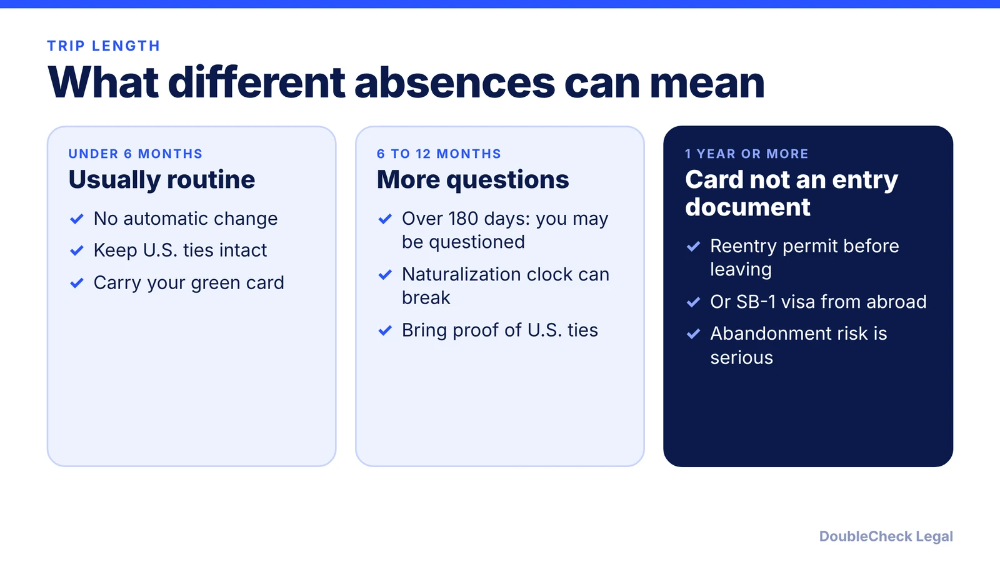
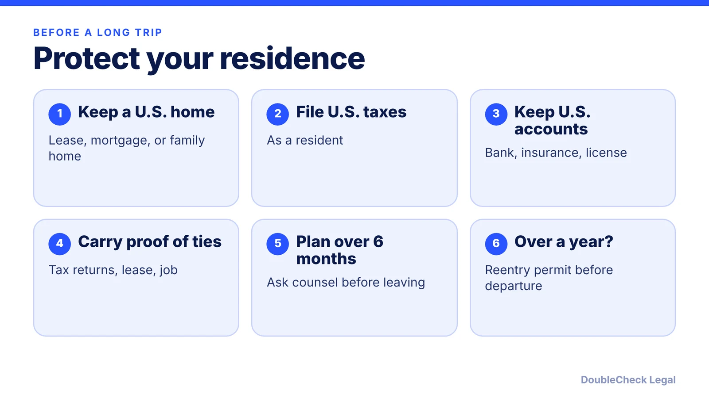

*Trips are not limited by a day count, but longer absences invite questions and can break your path to citizenship.*

**Key takeaways:**

- No fixed day count defines abandonment; intent and U.S. ties are what matter.
- Over 180 days may bring questions; one year or more means the card is no longer an entry document (per Beyond Border).
- A reentry permit must be requested from inside the U.S. before you leave.
- 6-12 month absences disrupt continuous residence for naturalization unless overcome.

## 1. The quick answer

**Quick answer:** There is no single number of days that automatically ends permanent residence. Per Beyond Border (updated August 2026), absences under six months generally cause no automatic change, an absence over 180 days may lead to questions on return, and an absence of one year or more means the green card no longer works as an entry document. The real test is whether you intended to keep the U.S. as your permanent home. For trips that may exceed a year, a reentry permit must be requested from inside the U.S. before you leave.

## 2. How abandonment is judged

Per [Nolo](https://www.alllaw.com/articles/nolo/us-immigration/abandonment-residence-green-card-holders.html), abandonment is not limited to long trips: a permanent resident can be found to have abandoned residence after "any trip in which the person took steps to make a home elsewhere." On return, a CBP officer weighs factors that include whether you pay U.S. taxes, own or long-term lease a U.S. home, worked abroad, moved your family abroad, or hold a one-way or round-trip ticket. Nolo says rumors about needing a fixed number of days in the U.S. each year are largely unfounded.

[Beyond Border](https://www.beyondborderglobal.com/resources/green-card-travel-rules) describes the returning-resident test as: valid status when you left, intent to return that you never gave up, and a temporary trip. Longer absences are acceptable only when caused by events beyond your control, such as serious illness or travel restrictions, and taking an overseas job is treated as within your control. Being admitted at the border does not end the question; Nolo notes a later naturalization application can prompt a review.

## 3. Reentry permits and the SB-1 alternative

Per Beyond Border, a reentry permit (filed on Form I-131, evidenced by Form I-327) is valid for two years from issuance, or one year if you spent more than four of the last five years abroad. You must be physically in the U.S. when you file. [Nolo](https://www.nolo.com/legal-encyclopedia/reentry-permits-preparing-green-card-holders-long-absences-the-us.html) adds that you attend a biometrics appointment in the U.S., can pick up the permit at a U.S. embassy or consulate abroad if requested, and that even with a permit readmission depends on showing ties such as a lease or mortgage, family, employment, or school records.

If you are already abroad over a year without a permit, the option is a returning resident (SB-1) visa from a U.S. consulate. Per Nolo, you must show the absence was temporary and caused by unforeseen circumstances, and approval is discretionary. Beyond Border also says signing Form I-407 abandons status voluntarily and is hard to reverse, so think before signing at the airport.

## 4. Naturalization and a practical checklist

Long trips can reset your citizenship timeline too. Per Beyond Border, absences of 6 to 12 months disrupt continuous residence unless you can overcome that; on the standard five-year track a long absence requires waiting four years and one day after return before reapplying, and two years and one day on the three-year marriage track. A reentry permit does not preserve your naturalization timeline, per the same source. Qualifying employment may allow Form N-470 before one year abroad. See [the N-400 eligibility guide](/blog/n-400-naturalization-eligibility-requirements/) and [green card vs citizenship](/blog/green-card-vs-us-citizenship-differences/).

If your green card is conditional, see [removing conditions with Form I-751](/blog/remove-conditions-on-residence-i-751/). If you travel while an application is pending, read [advance parole and EAD](/blog/advance-parole-and-ead-while-i-485-pending/).

## Where DoubleCheck fits

[DoubleCheck](https://www.contactdoublecheck.com) helps businesses and founders start legal work with AI, verify it, and, when professional advice is warranted, connect with an independent attorney, including for immigration questions. Attorney availability and practice areas vary. Attorneys on DoubleCheck are independent professionals; an attorney-client relationship forms only if an attorney accepts your engagement.

**Sources:** [Beyond Border, Green Card Travel Rules, updated August 26, 2026](https://www.beyondborderglobal.com/resources/green-card-travel-rules); [Nolo, Abandonment of Residence](https://www.alllaw.com/articles/nolo/us-immigration/abandonment-residence-green-card-holders.html); [Nolo, Reentry Permits](https://www.nolo.com/legal-encyclopedia/reentry-permits-preparing-green-card-holders-long-absences-the-us.html).

## FAQ

**How long can a green card holder stay outside the U.S.?**

Beyond Border says absences under six months generally cause no automatic change, over 180 days can lead to questions, and one year or more means the green card no longer works as an entry document. Nolo adds that abandonment depends on intent and U.S. ties.

**What is a reentry permit?**

Per Beyond Border, it is valid for two years (one year if you spent more than four of the last five years abroad) and must be requested while you are physically in the U.S.

**Should I sign Form I-407 if CBP asks?**

Beyond Border says signing I-407 voluntarily abandons status and is hard to reverse, and that some travelers decline and ask for a hearing. Speak with an immigration attorney if this happens.

**What if I am already abroad for over a year?**

Nolo says you can apply for an SB-1 returning resident visa at a U.S. consulate and must show the absence was temporary and due to circumstances beyond your control. Approval is discretionary.

---

*General information only. This article is not legal, tax, investment, or accounting advice.*
