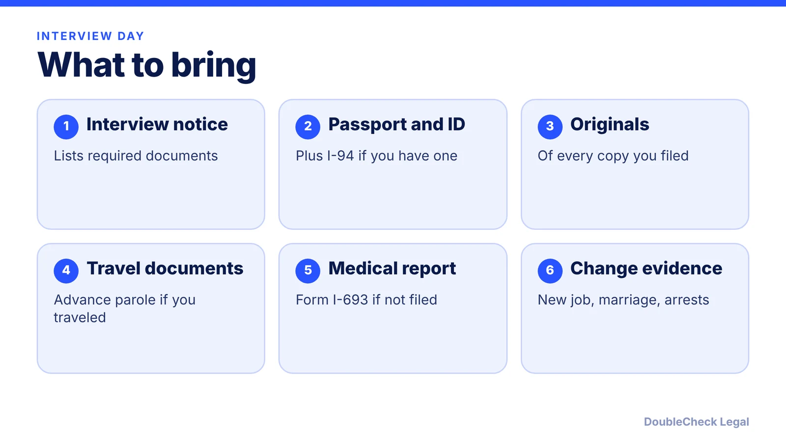
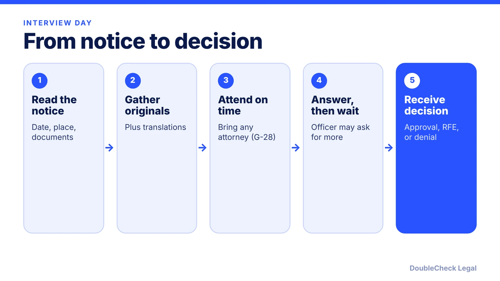

*The interview is mostly verification: your forms, your originals, and anything that changed since you filed.*

**Key takeaways:**

- Not every applicant is interviewed; work-based cases are the most often waived (per Nolo).
- Your interview notice lists the documents to bring.
- Questions depend on whether the case is marriage, family, or employment based.
- Outcomes include approval, a request for more evidence, or denial.

## 1. The quick answer

**Quick answer:** Many green card applicants are interviewed at a USCIS field office, but not all; some cases are decided without one. Per Nolo's guide, a typical interview lasts about 20 minutes (with possibly a long wait), the officer swears you in, checks ID, reviews your forms and original documents, and asks questions that depend on whether your case is marriage-based, family-based, or employment-based. Your interview notice lists exactly what to bring, and it controls over any general checklist.

## 2. Who gets interviewed

Per [Boundless](https://www.boundless.com/immigration-resources/the-green-card-interview-explained), interviews are typically scheduled after initial steps such as the biometrics appointment and medical exam, and the notice names the documents. [Nolo](https://www.alllaw.com/articles/nolo/us-immigration/expect-adjustment-status-interview.html) notes that interviews are a normal part of the process, that work-based interviews are the most often waived, and that in marriage cases the spouse is also called in.

For employment-based adjustment, [Fragomen](https://www.fragomen.com/insights/employment-based-adjustment-interviews-what-foreign-nationals-need-to-know.html) describes interviews of applicants whose I-140 was filed on or after March 6, 2017, with family members applying with them, and says USCIS may waive interviews for children under 14. Fragomen itself flags that article as dated, so treat this as background and follow your notice. For the application itself see [the I-485 guide](/blog/i-485-adjustment-of-status-guide/) and, for marriage cases, [the marriage-based timeline](/blog/marriage-based-green-card-process-timeline/).

## 3. What the officer asks

Per Nolo, the officer confirms personal details (addresses, employers, birthplace) and compares originals to copies. Questions then vary:

- **Marriage-based:** how you met, your relationship, and the marriage.
- **Employment-based:** your job, qualifications, and employer. Fragomen lists work location, duties, salary, education, experience, and whether you still intend to take the job.
- **Family-based:** your relationship with the petitioner.
- **All cases:** changes since filing, such as a new marriage or a criminal conviction, which Nolo says can make you ineligible.

Boundless adds travel history, U.S. residency, and any immigration violations as possible topics. Answer only what is asked, honestly, and ask for clarification if you do not understand. If you traveled, see [advance parole and EAD](/blog/advance-parole-and-ead-while-i-485-pending/).

## 4. After the interview

Per Nolo and Boundless, outcomes include approval, a request for more documents by a deadline, or denial. Nolo says approval can come with an I-551 stamp in the passport and the card arrives by mail weeks later. Fragomen reports that USCIS has 120 days to decide after an employment-based interview and that clean cases are often decided in 30 to 60 days. Nolo notes that if you lack another valid status, a denial may bring a Notice to Appear.

Boundless suggests telling the officer at the start if you forgot a document. For next steps after approval, see [green card vs citizenship](/blog/green-card-vs-us-citizenship-differences/). A lawyer can review your file beforehand; see [finding a good immigration lawyer](/blog/how-to-find-good-immigration-lawyer-startup-founder/).

## Where DoubleCheck fits

[DoubleCheck](https://www.contactdoublecheck.com) helps businesses and founders start legal work with AI, verify it, and, when professional advice is warranted, connect with an independent attorney, including for immigration questions. Attorney availability and practice areas vary. Attorneys on DoubleCheck are independent professionals; an attorney-client relationship forms only if an attorney accepts your engagement.

**Sources:** [Nolo, What to Expect at the Adjustment of Status Interview](https://www.alllaw.com/articles/nolo/us-immigration/expect-adjustment-status-interview.html); [Boundless, The Green Card Interview Explained](https://www.boundless.com/immigration-resources/the-green-card-interview-explained); [Fragomen, Employment-Based Adjustment Interviews](https://www.fragomen.com/insights/employment-based-adjustment-interviews-what-foreign-nationals-need-to-know.html).

## FAQ

**How long is a green card interview?**

Nolo says about 20 minutes, though waiting can take longer. Boundless says most last about 30 to 60 minutes.

**What should I bring to my green card interview?**

Everything on your interview notice, plus your passport and originals of documents you submitted as copies. Nolo also lists travel documents, the I-693 medical report if not filed earlier, and evidence of any changes since filing.

**Can my lawyer attend the interview?**

Yes. Nolo says your attorney may attend by filing Form G-28, and Fragomen recommends it for employment-based interviews.

**What happens if the officer needs more documents?**

Per Nolo, the officer may request additional documents by a deadline, and a decision follows by mail.

---

*General information only. This article is not legal, tax, investment, or accounting advice.*
