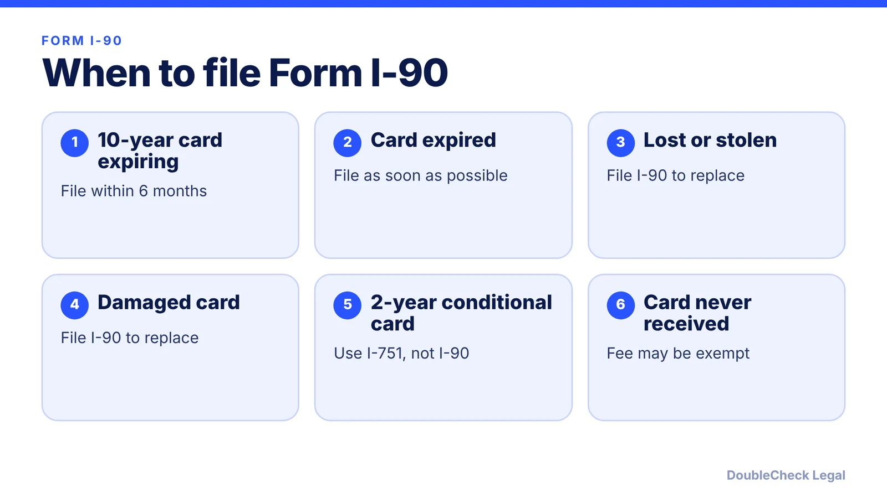
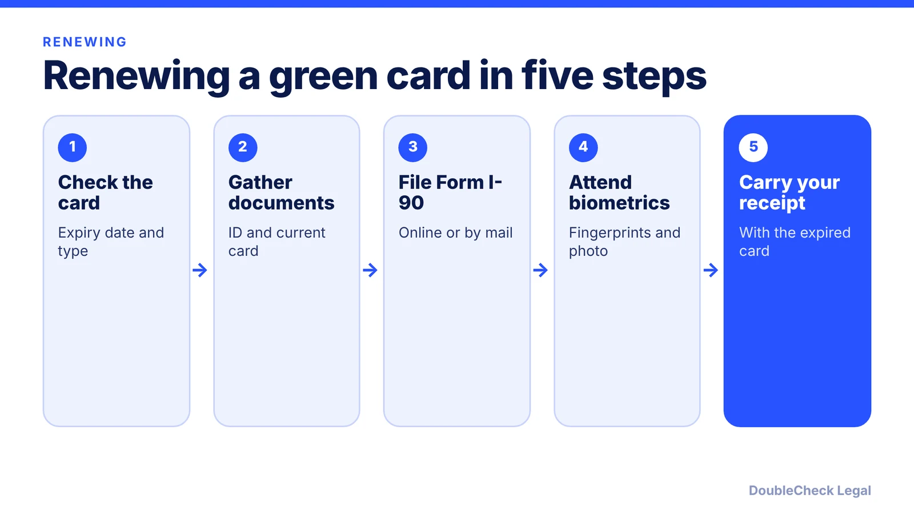

*How to renew or replace a 10-year green card with Form I-90, as of November 2026.*

**Key takeaways:**

- File Form I-90 up to 180 days before your 10-year card expires, or after it has expired.
- As of August 2026, reported fees are $415 online and $465 on paper, with biometrics included.
- Per USCIS, the I-90 receipt notice extends the card's validity by 36 months and serves as proof of status with your expired card.
- Two-year conditional cards use Form I-751 (or I-829), not Form I-90.

## 1. The quick answer

**Quick answer:** If you have a 10-year green card that is expiring, expired, lost, stolen or damaged, you file Form I-90 to renew or replace it. Per Beyond Border Global, you can file up to 180 days (six months) before the card expires or after it has expired. As of August 2026, secondary sources report a filing fee of $415 online or $465 on paper, with biometrics included and no separate fee. Your permanent resident status does not end when the card expires; the card is the proof. Conditional residents with a 2-year card do not use Form I-90; they file Form I-751 instead.

## 2. When to renew, fees, and biometrics

**Who files.** Per [Immigration Direct](https://www.immigrationdirect.com/?p=157676), Form I-90 applies to holders of an expired or expiring 10-year card, and replacement covers lost, stolen or damaged cards.

**Window.** Per [Beyond Border Global](https://www.beyondborderglobal.com/resources/green-card-renewal), file up to 180 days before expiration or after it. Filing earlier may lead to rejection, and fees are not refunded.

**Fees (as of the sources' August to September 2026 updates).** Immigration Direct, last verified August 24, 2026, lists $415 online and $465 on paper and says there is no separate biometrics fee, with no new increase in 2026. Beyond Border Global reports the same figures. Both note that USCIS may still require fingerprints and a photo, with the notice arriving a few weeks after filing. Some older pages still list $455 plus an $85 biometrics fee; that was the structure before April 2024. Check USCIS's G-1055 fee schedule before you send payment.

**Fee exemptions and waivers.** Per Immigration Direct, a $0 fee applies if you reach age 14 and your card expires after age 16, if a card was never received and returned undeliverable, or if DHS made an error. A means-based fee waiver uses Form I-912, filed on paper.

**Filing.** You can file online or by mail. Update your address promptly if it changes, so the card is not sent to an old one. Per Beyond Border Global, a new card takes about 8 to 14 months as of August 2026, though times vary.

## 3. Proof of status and travel while your I-90 is pending

**Your receipt notice is proof.** Per [USCIS](https://uscis.gov/newsroom/alerts/uscis-extends-green-card-validity-extension-to-36-months-for-green-card-renewals), effective September 10, 2024, a properly filed I-90 receipt notice extends the green card's validity by 36 months from the expiration date on the current card, up from 24. The notice can be presented with an expired green card as evidence of continued status and work authorization. [Fragomen](https://www.fragomen.com/insights/united-states-uscis-increases-green-card-validity-extension-to-36-months-for-renewal-applicants.html) adds that USCIS was expected to update the employer I-9 handbook to reflect this; see [I-9 and E-Verify for startups](/blog/i-9-and-e-verify-for-startups/) if you are an employer or employee asked about it.

Beyond Border Global says to carry the receipt notice with the expired card, and that the notice alone is not sufficient. Keep copies.

**Travel while pending.** Per Immigration Direct and Beyond Border Global, you can generally travel with your expired card and receipt notice. If your card will expire while you are abroad, contact the nearest U.S. embassy or consulate before flying, because airlines may not board you without valid proof of status. Beyond Border also warns that long periods abroad may prompt questions about whether you abandoned residency. Our [green card holder travel article](/blog/green-card-holder-travel-abroad-abandonment/) covers abandonment in detail.

**Lost or stolen cards abroad.** Do not assume the I-90 is enough to board a flight. Contact the nearest consulate for guidance on what travel document you need.

Per USCIS (as summarized in the alert above), you may request a Field Office appointment through the USCIS Contact Center if you no longer have your card, and may receive an ADIT stamp after filing Form I-90.

## 4. 10-year card vs conditional residents, and when to get help

**Which form?** A 10-year card renews with Form I-90. A 2-year conditional card, issued for example after a marriage-based green card, does not. Per Beyond Border Global and Immigration Direct, marriage-based conditional residents file Form I-751 and investor-based residents file Form I-829, both within the 90 days before the card expires. Approval results in a 10-year card, and later renewals use Form I-90. See [removing conditions with Form I-751](/blog/remove-conditions-on-residence-i-751/) and [the marriage-based green card timeline](/blog/marriage-based-green-card-process-timeline/).

**Handle it yourself when** the card is a standard 10-year card, your name, birth date and address are unchanged or simply updated, you have no travel or criminal history issues, and you can pay the fee online. Many people file Form I-90 without a lawyer.

**Get an attorney's review when:**

- You have had long absences outside the U.S., or your card expired while you were abroad.
- You have an arrest, charge or past immigration problem you are unsure how to disclose.
- You are considering applying for citizenship soon; see [N-400 eligibility](/blog/n-400-naturalization-eligibility-requirements/) and [green card vs citizenship](/blog/green-card-vs-us-citizenship-differences/).
- You are on a conditional card and the 90-day window is open or has passed.
- You are unsure whether you should file a different form.

If you want a second look at your documents or a quote, see [how to find a good immigration lawyer](/blog/how-to-find-good-immigration-lawyer-startup-founder/) and [immigration lawyer fees](/blog/immigration-lawyer-fees-flat-fee-vs-hourly/).

## Where DoubleCheck fits

[DoubleCheck](https://www.contactdoublecheck.com) helps businesses and founders start legal work with AI, verify it, and, when professional advice is warranted, connect with an independent attorney, including for immigration questions. Attorney availability and practice areas vary. Attorneys on DoubleCheck are independent professionals; an attorney-client relationship forms only if an attorney accepts your engagement.

**Sources:** [USCIS alert on the 36-month extension](https://uscis.gov/newsroom/alerts/uscis-extends-green-card-validity-extension-to-36-months-for-green-card-renewals); [Fragomen on the 36-month extension](https://www.fragomen.com/insights/united-states-uscis-increases-green-card-validity-extension-to-36-months-for-renewal-applicants.html); [Immigration Direct on I-90 fees](https://www.immigrationdirect.com/?p=157676); [Immigration Direct renewal guide](https://www.immigrationdirect.com/immigration-articles/renew-green-card/); [Beyond Border Global](https://www.beyondborderglobal.com/resources/green-card-renewal). The USCIS I-90 page could not be loaded, so fees and timing are attributed to secondary sources.

## FAQ

**When can I file Form I-90 to renew my green card?**

Per Beyond Border Global, up to 180 days before a 10-year card expires, or after it has expired. Filing earlier may be rejected and fees are not refunded.

**How much does Form I-90 cost?**

As of August 2026, Immigration Direct and Beyond Border Global report $415 online or $465 on paper, with biometrics included. Confirm on USCIS's fee schedule, since you may qualify for an exemption or fee waiver.

**Is my status valid while the I-90 is pending?**

Per USCIS, a receipt notice for a properly filed I-90 extends the card's validity by 36 months from the printed expiration date and can be shown with the expired card as evidence of continued status.

**Do conditional residents use Form I-90?**

No. Per Beyond Border Global and Immigration Direct, marriage-based conditional residents file Form I-751 and investor-based residents file Form I-829 within 90 days before the card expires.

---

*General information only. This article is not legal, tax, investment, or accounting advice.*
