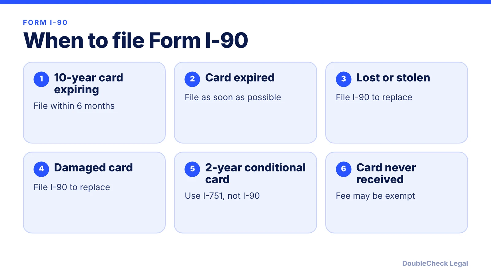
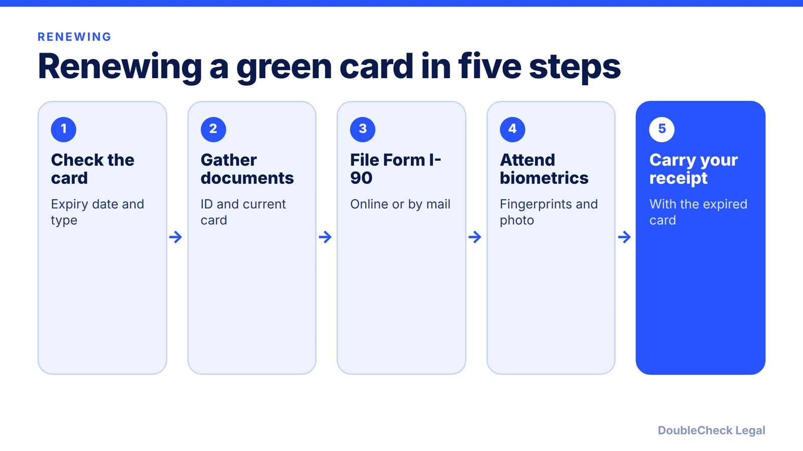

*How to renew or replace a 10-year green card with Form I-90, as of November 2026.*

**Key takeaways:**

- Per USCIS, you can file Form I-90 if your 10-year card will expire within six months or has already expired.
- Fees change; confirm the current amount on the USCIS I-90 page and fee schedule before paying.
- Per USCIS, the I-90 receipt notice extends the card's validity by 36 months and serves as proof of status with your expired card.
- Two-year conditional cards use Form I-751 (or I-829), not Form I-90.

## 1. The quick answer

**Quick answer:** If you have a 10-year green card that is expiring, expired, lost, stolen or damaged, you file Form I-90 to renew or replace it. Per USCIS, you can file if your card will expire within six months or has already expired. Fees change, so confirm the current amount on the USCIS I-90 page and fee schedule before paying. Your permanent resident status does not end when the card expires; the card is the proof. Conditional residents with a 2-year card do not use Form I-90; they file Form I-751 instead.

## 2. When to renew, fees, and biometrics

**Who files.** Per [USCIS](https://www.uscis.gov/i-90), Form I-90 applies to holders of an expired or expiring card, and replacement covers other qualifying reasons such as a lost, stolen or damaged card.

**Window.** USCIS lists "my card will expire within six months or has already expired" as a qualifying reason to file. Filing much earlier may lead to rejection, so check the USCIS page before you send anything.

**Fees and biometrics.** USCIS fees change, and older pages still list a separate biometrics fee, so check the current USCIS I-90 page and the G-1055 fee schedule before you send payment. USCIS may still require fingerprints and a photo after you file.

**Fee exemptions and waivers.** USCIS lists situations with no fee, such as a card that was never received and was returned as undeliverable, or a card with incorrect information because of a DHS error. A means-based fee waiver uses Form I-912.

**Filing.** You can file online or by mail. Update your address promptly if it changes, so the card is not sent to an old one. Processing times vary, so check USCIS case processing times.

## 3. Proof of status and travel while your I-90 is pending

**Your receipt notice is proof.** Per [USCIS](https://uscis.gov/newsroom/alerts/uscis-extends-green-card-validity-extension-to-36-months-for-green-card-renewals), effective September 10, 2024, a properly filed I-90 receipt notice extends the green card's validity by 36 months from the expiration date on the current card, up from 24. The notice can be presented with an expired green card as evidence of continued status and work authorization. [Fragomen](https://www.fragomen.com/insights/united-states-uscis-increases-green-card-validity-extension-to-36-months-for-renewal-applicants.html) adds that USCIS was expected to update the employer I-9 handbook to reflect this; see [I-9 and E-Verify for startups](/blog/i-9-and-e-verify-for-startups/) if you are an employer or employee asked about it.

Carry the receipt notice together with the expired card, and keep copies.

**Travel while pending.** Many green card holders travel with an expired card and the receipt notice, but if your card will expire while you are abroad, confirm your options with USCIS or an attorney before flying, because airlines may not board you without valid proof of status. Long periods abroad may also prompt questions about whether you abandoned residency. Our [green card holder travel article](/blog/green-card-holder-travel-abroad-abandonment/) covers abandonment in detail.

**Lost or stolen cards abroad.** Do not assume the I-90 is enough to board a flight. Contact the nearest consulate for guidance on what travel document you need.

Per USCIS (as summarized in the alert above), you may request a Field Office appointment through the USCIS Contact Center if you no longer have your card, and may receive an ADIT stamp after filing Form I-90.

## 4. 10-year card vs conditional residents, and when to get help

**Which form?** A 10-year card renews with Form I-90. A 2-year conditional card, issued for example after a marriage-based green card, does not. Marriage-based conditional residents file Form I-751 and investor-based residents file Form I-829, both within the 90 days before the card expires. Approval results in a 10-year card, and later renewals use Form I-90. See [removing conditions with Form I-751](/blog/remove-conditions-on-residence-i-751/) and [the marriage-based green card timeline](/blog/marriage-based-green-card-process-timeline/).

**Handle it yourself when** the card is a standard 10-year card, your name, birth date and address are unchanged or simply updated, you have no travel or criminal history issues, and you can pay the fee online. Many people file Form I-90 without a lawyer.

**Get an attorney's review when:**

- You have had long absences outside the U.S., or your card expired while you were abroad.
- You have an arrest, charge or past immigration problem you are unsure how to disclose.
- You are considering applying for citizenship soon; see [N-400 eligibility](/blog/n-400-naturalization-eligibility-requirements/) and [green card vs citizenship](/blog/green-card-vs-us-citizenship-differences/).
- You are on a conditional card and the 90-day window is open or has passed.
- You are unsure whether you should file a different form.

If you want a second look at your documents or a quote, see [how to find a good immigration lawyer](/blog/how-to-find-good-immigration-lawyer-startup-founder/) and [immigration lawyer fees](/blog/immigration-lawyer-fees-flat-fee-vs-hourly/).

## Where DoubleCheck fits

[DoubleCheck](https://www.contactdoublecheck.com) helps businesses and founders start legal work with AI, verify it, and, when professional advice is warranted, connect with an independent attorney, including for immigration questions. Attorney availability and practice areas vary. Attorneys on DoubleCheck are independent professionals; an attorney-client relationship forms only if an attorney accepts your engagement.

**Sources:** [USCIS alert on the 36-month extension](https://uscis.gov/newsroom/alerts/uscis-extends-green-card-validity-extension-to-36-months-for-green-card-renewals); [Fragomen on the 36-month extension](https://www.fragomen.com/insights/united-states-uscis-increases-green-card-validity-extension-to-36-months-for-renewal-applicants.html); [USCIS: Form I-90](https://www.uscis.gov/i-90). Fee amounts are not stated here because they change; confirm them with USCIS.

## FAQ

**When can I file Form I-90 to renew my green card?**

Per USCIS, you can file if your card will expire within six months or has already expired. Check the USCIS I-90 page for current filing guidance.

**How much does Form I-90 cost?**

Fees change, so confirm the current amount on the USCIS I-90 page and fee schedule (Form G-1055) before paying. USCIS lists some situations with no fee, such as a card never received or a DHS error.

**Is my status valid while the I-90 is pending?**

Per USCIS, a receipt notice for a properly filed I-90 extends the card's validity by 36 months from the printed expiration date and can be shown with the expired card as evidence of continued status.

**Do conditional residents use Form I-90?**

No. Marriage-based conditional residents file Form I-751 and investor-based residents file Form I-829 within 90 days before the card expires.

---

*General information only. This article is not legal, tax, investment, or accounting advice.*
