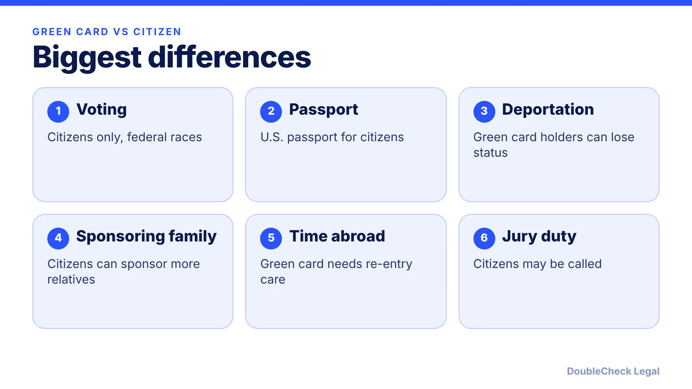
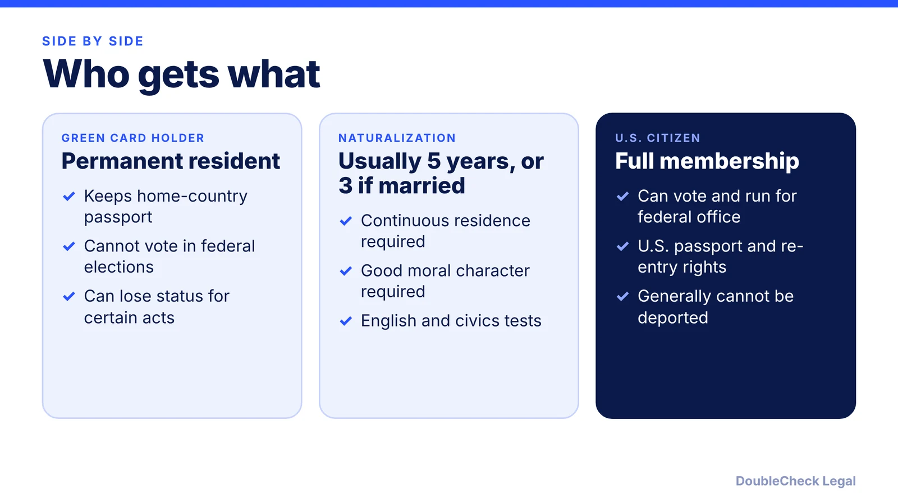

*A green card is permanent residence, not citizenship. Here is what actually changes when you naturalize, and when it makes sense to apply.*

**Key takeaways:**

- Only citizens can vote in federal elections or get a U.S. passport.
- Green card holders can lose status; citizens generally cannot be deported absent fraud.
- Citizens can sponsor a wider range of relatives, some without annual visa limits.
- Naturalization generally needs 5 years as a green card holder, or 3 if married to a citizen.

## 1. The quick answer

**Quick answer:** A green card gives you permanent residence: you can live and work in the U.S. indefinitely, but you keep your home-country passport, cannot vote in federal elections, and can lose status for certain crimes, immigration violations, or long periods abroad. U.S. citizenship adds the right to vote, a U.S. passport, protection from deportation (barring fraud in obtaining citizenship), and the ability to sponsor a wider range of relatives, with the added duty of jury service when called. Most green card holders become eligible to naturalize after five years, or three if married to a U.S. citizen, per the USCIS Policy Manual.

## 2. Rights: voting, passports, deportation, family

RJ Immigration Law and Immigration Direct agree on the main points:

- **Voting:** only citizens can vote in federal elections; green card holders cannot.
- **Passport:** citizens can get a U.S. passport; green card holders travel on their home-country passport.
- **Deportation:** green card holders can lose status for certain crimes, immigration violations, or long periods abroad. Citizens generally cannot be deported unless citizenship was obtained by fraud or is revoked (denaturalization).
- **Sponsoring relatives:** citizens can sponsor spouses, children, parents, married sons and daughters, and siblings, and some immediate relatives are not subject to annual visa limits. Green card holders can sponsor a spouse and unmarried children, often with longer waits.
- **Travel:** RJ Immigration Law says green card holders need a re-entry permit for trips over one year; citizens re-enter without that risk.

If your spouse or parent is waiting on a green card, see the [marriage-based green card timeline](/blog/marriage-based-green-card-process-timeline/) for how immediate-relative cases work.

## 3. Obligations that come with each status

Immigration Direct lists the following:

- **Taxes:** green card holders are generally required to file U.S. taxes. Citizens are taxed on worldwide income, and treaties, exclusions, and credits may reduce double taxation. For founders with income abroad, read our guide to [foreign founder U.S. taxes and the substantial presence test](/blog/foreign-founder-us-taxes-substantial-presence-test/).
- **Selective Service:** men aged 18 to 25, including many immigrants, must register. Failure to register may affect federal student aid, certain federal jobs, and some immigration benefits.
- **Jury duty:** citizens may be called and generally must respond; exemptions or postponements may apply.
- **Residence:** green card holders must keep meeting residency requirements, and long trips abroad can raise abandonment concerns. The card itself must be renewed every ten years (per RJ Immigration Law).
- **Dual citizenship:** Immigration Direct says the U.S. generally allows it, but some home countries limit or prohibit it. Check your country's rules before naturalizing.

## 4. When to naturalize

Our [N-400 guide](/blog/n-400-naturalization-eligibility-requirements/) covers the rules in detail. In short, the USCIS Policy Manual (as summarized there) generally requires being 18 or older, five years as a green card holder (three if married to and living with a U.S. citizen), continuous residence, at least 30 months of physical presence in the five years, good moral character, and passing English and civics tests. An absence of more than six months but under a year is presumed to break continuous residence.

Reasons people apply as soon as they are eligible: voting, a U.S. passport, and no longer worrying about status after trips abroad. Reasons to pause: your home country does not allow dual citizenship, you have taken long trips that may have broken continuous residence, or there are criminal or tax issues that should be reviewed first.

Tech employees who got their green card through an employer should also read the [H-1B to green card timeline](/blog/h-1b-to-green-card-timeline-tech-workers/) and, if relevant, the [I-140 portability](/blog/i-140-portability-ac21-changing-jobs/) rules before planning the next step. A short conversation with an attorney before filing is worthwhile if anything in your history is complicated.

## Where DoubleCheck fits

[DoubleCheck](https://www.contactdoublecheck.com) helps businesses and founders start legal work with AI, verify it, and, when professional advice is warranted, connect with an independent attorney, including for immigration questions. Attorney availability and practice areas vary. Attorneys on DoubleCheck are independent professionals; an attorney-client relationship forms only if an attorney accepts your engagement.

**Sources:** [RJ Immigration Law: green cards and U.S. citizenship](https://rjimmigrationlaw.com/resources/understanding-u-s-green-cards-and-u-s-citizenship/); [Immigration Direct: benefits and responsibilities of U.S. citizenship in 2026](https://www.immigrationdirect.com/?p=6618); [USCIS Policy Manual Vol. 12, Part D](https://www.uscis.gov/policy-manual/volume-12-part-d-chapter-1).

## FAQ

**Can a green card holder vote in U.S. elections?**

No. RJ Immigration Law and Immigration Direct both say only U.S. citizens can vote in federal elections.

**Can a green card holder be deported?**

Yes. Immigration Direct says permanent residents can lose status for certain crimes, immigration violations, or long periods abroad, while citizens generally cannot be deported unless citizenship was obtained by fraud or revoked.

**Do I have to give up my other citizenship to naturalize?**

Immigration Direct says the U.S. generally allows dual citizenship, but some home countries limit or prohibit it, so check your home country's rules first.

**How long before I can apply for citizenship?**

Generally five years as a green card holder, or three if married to and living with a U.S. citizen, per the USCIS Policy Manual as summarized in our N-400 guide.

---

*General information only. This article is not legal, tax, investment, or accounting advice.*
