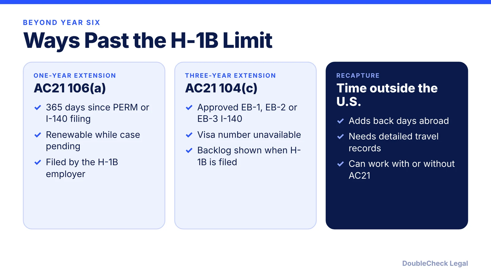
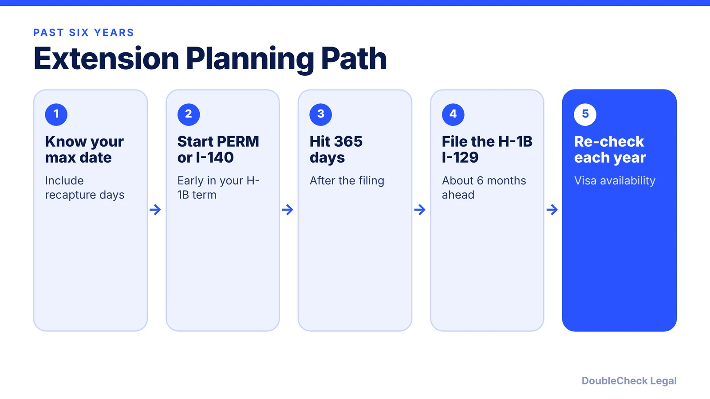

*Reaching year six on H-1B? Here are the rules that let you stay longer while a green card is in process.*

**Key takeaways:**

- H-1B has a six-year maximum, but recapture of time abroad and AC21 extensions can take you past it.
- One-year extensions: 365 days since a PERM or I-140 filing, per RN Law Group and Docketwise.
- Three-year extensions: approved EB-1, EB-2 or EB-3 I-140 and an unavailable visa number.
- Plan early; PERM and I-140 timing drives everything.

## 1. The quick answer

**Quick answer:** H-1B status is generally capped at six years, in increments of up to three. You can go past six years in three main ways, per Clemson University's international office: recapturing time spent outside the U.S., having a green card process underway, or being delayed by per-country visa limits. The two AC21 rules do the heavy lifting. One-year extensions are available once 365 days have passed since a PERM labor certification or I-140 was filed. Three-year extensions are available with an approved I-140 when a visa number is unavailable.

## 2. The six-year limit and recapture

Clemson describes H-1B status as granted in increments of up to three years with a six-year maximum. Recapture lets you add back days spent outside the U.S. to that limit. Per Docketwise, it needs detailed travel records and may allow a new six-year term after reentry, and AC21 extensions can proceed even without recapture. Track your own maximum-stay date, including any recapture days, from the day you start counting, and give your employer's counsel your passport stamps and I-94 history.

If you are still in the first six years, see our guides to [H-1B transfers](/blog/h-1b-transfer-change-of-employer-portability/) and [cap-exempt employers](/blog/h-1b-cap-exempt-employers/).

## 3. One-year extensions under AC21 106(a)

Per RN Law Group, one-year extensions beyond six years are available when at least 365 days have passed since the filing of a qualifying PERM labor certification or, where PERM was not required, an I-140 immigrant petition. The key question is whether 365 days have elapsed since the filing, not whether PERM stayed pending the whole time. The employer may file the H-1B extension before the 365th day as long as it reaches that mark before the requested extension period begins.

Docketwise gives an example: a PERM filed April 20, 2023, and an H-1B expiring April 21, 2024, allows an extension request in January 2024, extending stay to April 2025. After that, one-year extensions can continue while the permanent residence case remains unresolved, subject to limits. RN Law Group cautions that a certified PERM has limited validity for filing the I-140, and letting the case lapse can jeopardize future extensions. Future one-year extensions are generally restricted if you do not apply for adjustment of status or an immigrant visa within one year after a visa has remained continuously available, subject to exceptions.

Timing matters: Docketwise suggests filing the I-129 ideally six months before your status expires. The [PERM process](/blog/perm-labor-certification-green-card-process/) itself takes time, so start early.

## 4. Three-year extensions under AC21 104(c)

Per RN Law Group, three-year extensions are for beneficiaries of approved EB-1, EB-2 or EB-3 I-140s who are eligible for permanent residence but cannot proceed because an immigrant visa is unavailable. No 365-day filing requirement applies, and USCIS regulations require visa unavailability to be shown as of the date the H-1B petition is filed. The employer files Form I-129 with proof of the approved I-140 and the backlog (Docketwise). Check the [visa bulletin](/blog/visa-bulletin-explained-priority-dates-eb-categories/) for your category and country.

Two cautions. A new employer may be able to rely on an I-140 approved for a prior employer, but that does not transfer the green card case, and a withdrawn or revoked I-140 can affect eligibility (RN Law Group). And if your priority date becomes current, the 104(c) basis may no longer apply, though one-year extensions may remain available depending on your history. Because the facts matter so much, review them with immigration counsel. See also the [H-1B to green card timeline](/blog/h-1b-to-green-card-timeline-tech-workers/).

## Where DoubleCheck fits

[DoubleCheck](https://www.contactdoublecheck.com) helps businesses and founders start legal work with AI, verify it, and, when professional advice is warranted, connect with an independent attorney, including for immigration questions. Attorney availability and practice areas vary. Attorneys on DoubleCheck are independent professionals; an attorney-client relationship forms only if an attorney accepts your engagement.

**Sources:** [Clemson University, H-1B time limits](https://clemson.edu/campus-life/campus-services/international/h1b/h1btimelimits.html); [RN Law Group](https://www.rnlawgroup.com/beyond-the-h-1b-six-year-limit-how-perm-and-i-140-approvals-can-provide-additional-h-1b-time/); [Docketwise](https://docketwise.com/blog/extending-h-1b-visa-status-beyond-six-years-with-ac21).

## FAQ

**Can I stay on H-1B after six years?**

Sometimes. Clemson says an extension past six years may be possible through recapture, a green card process in progress, or per-country limits delaying adjustment. The AC21 rules govern the green card cases.

**What is the 365-day rule?**

Per RN Law Group, one-year extensions are available once 365 days have passed since a qualifying PERM or I-140 filing. The employer may file earlier if the 365th day arrives before the extension period starts.

**What is a three-year extension?**

Per RN Law Group, it is for beneficiaries of an approved EB-1, EB-2 or EB-3 I-140 who cannot proceed because an immigrant visa is unavailable, with no 365-day filing requirement.

**What is recapture?**

Per Docketwise, recapture adds back days spent outside the U.S. to your six-year limit. It requires detailed travel records.

---

*General information only. This article is not legal, tax, investment, or accounting advice.*
