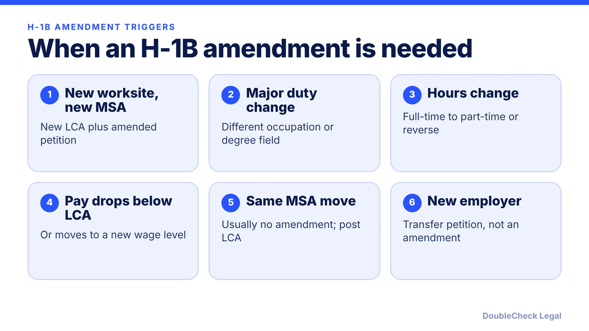
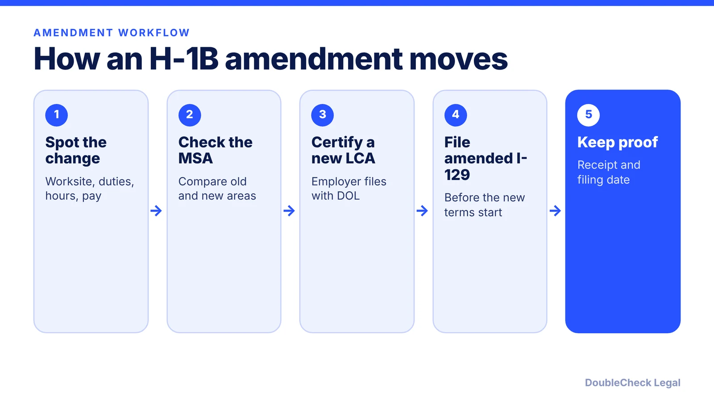

*Moving offices, going remote, or changing roles on an H-1B? Here is when the employer needs an amended petition, and when it does not.*

**Key takeaways:**

- A move to a worksite outside the LCA's MSA requires a new LCA and amended petition under Matter of Simeio Solutions.
- Substantial duty, hours or wage-level changes can also trigger an amendment, per Headman Law.
- File the amendment before the new terms begin; the worker may start once it is filed.
- A new employer is a transfer, not an amendment.

## 1. The quick answer

**Quick answer:** An H-1B worker's employer generally needs to file an amended Form I-129 when there is a material change to the approved job, most commonly a move to a worksite outside the area covered by the certified Labor Condition Application (LCA). Under Matter of Simeio Solutions, a move to a different metropolitan statistical area (MSA) is a material change that requires a new LCA and an amended petition, per the National Law Review. A new employer is a different process: a transfer, not an amendment.

## 2. What triggers an amendment

Headman Law lists the main triggers for an amended petition when a material change affects the approved job:

- **Worksite outside the LCA's area of intended employment.** This is the Simeio rule. The National Law Review explains that the prevailing wage is set by MSA, so a different MSA is a material change.
- **Substantial change in duties,** especially into a different occupational classification or degree field.
- **Change in hours,** such as full-time to part-time.
- **Wage change** that falls below the LCA wage or into a different prevailing wage level.
- **Change of employer** that is not a genuine successor in interest.

Headman Law's examples: Manhattan to Jersey City (same MSA) generally needs no amendment, while Austin to Dallas, or Seattle to Portland, does. It also says a fully remote worker relocating from Denver to Miami is treated as a worksite change requiring an amendment. Those are one firm's illustrations, so confirm yours against the actual MSA definitions on your LCA.

What usually does not trigger one, per Headman Law: a new title with substantially the same duties, a raise (the LCA wage is a floor), a new manager, a move within the same MSA, and short-term placements or visits to non-worksite locations such as conferences.

## 3. Timing, receipts, and what happens next

Per Headman Law and the National Law Review, the order of operations matters:

1. Certify a new LCA for the new location or terms.
2. File the amended Form I-129 with the new LCA before the worker begins the new terms.
3. The worker may start at the new site once the amendment is filed, without waiting for approval. Keep the receipt notice and proof of the filing date.

Premium processing is available for amendments, per Headman Law, and if an amendment is denied while the original petition remains valid, the worker can generally return to the original terms. An amendment keeps the same validity end date and does not add time. An extension adds time, and the two can be combined in one filing.

The National Law Review also notes that for a move within the same MSA, the original LCA must be posted at the new location, and that short-term placements of 30 days, or 60 days in specific situations, do not require an amendment. That article dates from 2015, so verify the current USCIS guidance, or ask counsel, before relying on those day counts.

## 4. Amendment, extension, or transfer: which is it?

The three filings are easy to mix up. Headman Law sorts them this way:

- **Amendment:** same employer, changed terms, same end date.
- **Extension:** same employer, same terms, more time.
- **Transfer:** a new petition from a different employer. Under portability, the worker may generally start the new job upon proper filing, if in lawful status, the petition is non-frivolous, and they have not worked without authorization since their last admission.

For the transfer path, see our [H-1B transfer and portability guide](/blog/h-1b-transfer-change-of-employer-portability/). If time on your status is running out, read the [H-1B six-year limit guide](/blog/h-1b-6-year-limit-extensions-beyond-six-years/). Employers should know that DHS can inspect worksites, covered in [H-1B site visits and compliance](/blog/h-1b-site-visits-employer-compliance-startups/). Layoffs create a different clock, covered in the [60-day grace period guide](/blog/h-1b-layoff-60-day-grace-period/). Dependents in H-4 status should also watch their own timelines; see [H-4 EAD](/blog/h-4-ead-spouses-of-h-1b/).

A missed amendment is easier to prevent than to fix, so a startup that moves staff between offices or to remote work should run each change past [an immigration lawyer](/blog/how-to-find-good-immigration-lawyer-startup-founder/) before the change takes effect.

## Where DoubleCheck fits

[DoubleCheck](https://www.contactdoublecheck.com) helps businesses and founders start legal work with AI, verify it, and, when professional advice is warranted, connect with an independent attorney, including for immigration questions. Attorney availability and practice areas vary. Attorneys on DoubleCheck are independent professionals; an attorney-client relationship forms only if an attorney accepts your engagement.

**Sources:** [Headman Law Group](https://headmanlaw.com/insights/h-1b-amendment-when-a-job-change-requires-one/); [National Law Review on Simeio guidance](https://natlawreview.com/article/uscis-guidance-when-to-file-amended-h-1b-petition-worksite-location-change). The USCIS archive page on Simeio guidance did not load; the National Law Review article dates from 2015.

## FAQ

**When is an H-1B amendment required?**

Per Headman Law and the National Law Review, when a material change affects the approved job, such as a worksite in a different MSA, a substantial change in duties, a change in hours, or a wage change to a different level.

**Do I need an amendment if I move within the same city area?**

Generally no if the new worksite is in the same MSA, per the National Law Review, but the employer must post the original LCA at the new location. Check the specific addresses against the MSA.

**Can I start work at the new location before the amendment is approved?**

Per Headman Law and the National Law Review, the worker may begin at the new site once the amended petition is filed, without waiting for approval. File before the change and keep proof of the filing date.

**Is a job change to a new employer an amendment?**

No. A different employer files a new petition, a transfer. Headman Law says portability may let the worker start upon proper filing if conditions are met.

---

*General information only. This article is not legal, tax, investment, or accounting advice.*
