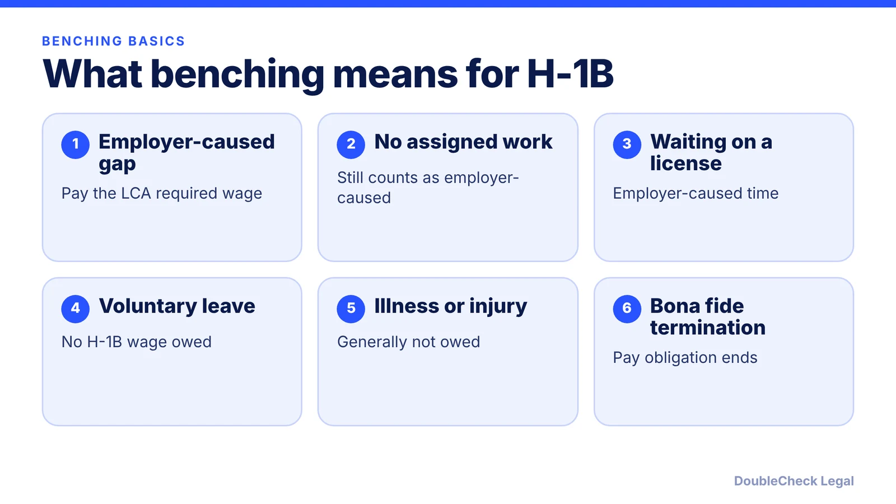
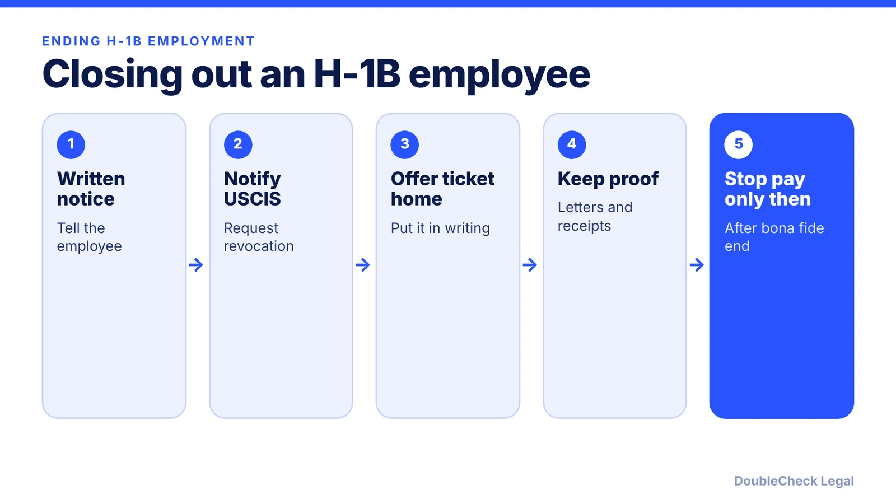

*Short version: if the lack of work is the employer's doing, the H-1B wage keeps running until a bona fide termination.*

**Key takeaways:**

- Employer-caused gaps, like no assigned work, still require the LCA required wage under 20 CFR 655.731(c)(7).
- Employee-requested leave or illness can be unpaid, but document it when it happens.
- Part-time H-1B workers must be paid at least the hours on the petition.
- Ending the obligation means a bona fide termination, notice to USCIS, and offering return transportation; missing steps can mean back wages.

## 1. The quick answer

**Quick answer:** "Benching" means an employer stops paying an H-1B worker who is still employed but has no assigned work. Per the U.S. Department of Labor, H-1B workers "must be paid the required wage rate for all nonproductive time caused by conditions related to employment," such as lack of assigned work, a missing permit or license, or studying for a licensing exam. No payment is required for time off for reasons not related to employment, such as a voluntary absence or hospitalization. The pay obligation also ends after a bona fide termination, and DOL says the best evidence of that is the employer's notice to USCIS. The rule sits in 20 CFR 655.731(c). As of November 2026, an employer with an H-1B employee and no work should treat unpaid leave as a compliance risk, not a cost-saving option.

## 2. What the required wage rule says

The rule is in 20 CFR 655.731(c)(6) and (c)(7). Per [Fragomen's summary of the regulation](https://www.visalaw.com/hce-basics-xix-what-is-benching):

- **When pay starts.** The worker must receive the required wage once they "enter into employment," which under (c)(6)(i) includes making themselves available for work or coming under the employer's control, such as waiting for an assignment, attending orientation or training, or studying for a licensing exam.
- **Employer-caused time (c)(7)(i).** Covers lack of assigned work, a missing permit or license, or any reason not listed as employee-caused. Salaried workers get the full pro-rata amount. Hourly workers get a full-time week, 40 hours or another number the employer can show is full-time, at the wage on the LCA.
- **Employee-caused or unrelated time (c)(7)(ii).** No required wage is owed when the worker is away at their own request and convenience, or cannot work because of a condition such as an incapacitating accident or maternity leave. The regulation's examples include touring the U.S. and caring for an ill relative.

Per [RN Law Group](https://www.rnlawgroup.com/h-1b-wage-compliance-unproductive-time-unpaid-leave-and-benching-rules), the required wage must be paid as guaranteed salary, so discretionary bonuses or commissions do not satisfy it, and the same firm says an employer that cannot show the leave was employee-initiated may be treated as having committed a wage violation.

Agency decisions summarized by Fragomen show how this works in practice: time spent waiting for a license (*Greater Missouri Medical Pro-Care Providers*, ARB 2014) and for a Social Security number while willing and able to work (*University of Miami*, ARB 2012) was compensable, while time away for surgery was treated as voluntary (*Rajan v. International Business Solutions*, ARB 2004).

For how the LCA wage ties into the rest of the filing, see our [LCA public access file guide](/blog/h-1b-lca-public-access-file-employer-requirements-startups/).

## 3. Part-time, leave, and slow periods

**Part-time workers.** Per the [DOL fact sheet on nonproductive time](https://www.dol.gov/agencies/whd/fact-sheets/62i-h1b-nonproductive-time), part-time workers "must be paid for at least the number of hours indicated on the Forms I-129/I-129W petition." If the petition lists a range of hours, the worker must be paid for at least the average hours normally worked, as long as that average falls within the range, and never below the range's minimum. A founder who files for 20 hours and then cuts to 10 has a gap to explain.

**Employee-requested leave.** Unpaid time can be permissible when the employee asks for it for personal reasons. Per RN Law Group, the key issue is whether the employee chose not to work, and it advises keeping a written leave request and internal messages made at the time. DOL also notes employers must still follow other laws, such as the FMLA.

**Slow periods and shutdowns.** An employer-wide slowdown does not make the time employee-caused. Per [SHRM](https://www.shrm.org/in/topics-tools/news/talent-acquisition/h-1b-worker-terminations-must-follow-three-step-process), employers must keep paying the LCA wage even during nonproductive status or company-wide shutdowns. Options that stay inside the rules include assigning internal projects, training, or R&D work, or, if the role really is ending, a proper termination.

Changing hours, duties, or worksite can also require filing changes. See [H-1B amendments](/blog/h-1b-amendment-when-needed-job-change-worksite/) before you change a role on paper.

## 4. Ending employment: notice, return transportation, back wages

DOL's fact sheet says "payment for nonproductive time is not required after a bona fide termination of employment," and that termination is shown best by the employer's notification to USCIS. It ties the end of pay to the employee having been provided payment for transportation home "where required by USCIS regulations."

Per [SHRM](https://www.shrm.org/in/topics-tools/news/talent-acquisition/h-1b-worker-terminations-must-follow-three-step-process), a practical three-step process is:

1. Send the employee clear written notice that employment has ended.
2. Notify the USCIS service center that approved the petition, giving the termination date and requesting revocation.
3. Offer to buy or reimburse the worker's ticket home, in writing, and keep proof.

**Why it matters.** SHRM describes one case in which a health care staffing firm was ordered to pay $55,587 in back wages after waiting nearly five months to send a termination letter, and another in which a chemical manufacturer was ordered to pay $182,943 after failing to notify USCIS, with back wages running until the worker left the U.S. nearly three years later. Capitol Immigration Law Group reports a similar Administrative Review Board holding that an employer that does not terminate and notify USCIS is liable for back wages. These are examples, not predictions.

**When you can handle it yourself vs. get an attorney.**

- *Self-handle:* confirming the LCA wage and hours on file, documenting an employee-requested leave in writing.
- *Get an attorney to review:* any plan to reduce pay or hours, a layoff or termination of an H-1B worker, a dispute over whether leave was voluntary, or a DOL wage inquiry. Also check the worker's options after a layoff in our [60-day grace period guide](/blog/h-1b-layoff-60-day-grace-period/).

## Where DoubleCheck fits

[DoubleCheck](https://www.contactdoublecheck.com) helps businesses and founders start legal work with AI, verify it, and, when professional advice is warranted, connect with an independent attorney, including for immigration questions. Attorney availability and practice areas vary. Attorneys on DoubleCheck are independent professionals; an attorney-client relationship forms only if an attorney accepts your engagement.

**Sources:** [DOL Fact Sheet 62I: H-1B nonproductive time](https://www.dol.gov/agencies/whd/fact-sheets/62i-h1b-nonproductive-time); [Fragomen, benching explained](https://www.visalaw.com/hce-basics-xix-what-is-benching); [RN Law Group](https://www.rnlawgroup.com/h-1b-wage-compliance-unproductive-time-unpaid-leave-and-benching-rules); [SHRM, H-1B terminations](https://www.shrm.org/in/topics-tools/news/talent-acquisition/h-1b-worker-terminations-must-follow-three-step-process); [Capitol Immigration Law Group](https://cilawgroup.com/?p=209). The regulation text itself (20 CFR 655.731) was not fetched; its content is cited via the secondary sources above.

## FAQ

**Can an employer put an H-1B employee on unpaid leave when there is no work?**

Generally no. Per the U.S. Department of Labor, H-1B workers must be paid the required wage for nonproductive time caused by conditions related to employment, including lack of assigned work.

**When is an H-1B employer not required to pay during time off?**

Per DOL, no payment is required for nonproductive time due to reasons not related to employment, such as a voluntary absence or hospitalization. Employers must still follow other laws, such as the FMLA.

**Does the employer have to notify USCIS when an H-1B employee is terminated?**

DOL says the best evidence of a bona fide termination is the employer's notification to USCIS that the petition should be cancelled. SHRM adds that without it an employer may face a back-wage claim.

**Does the employer have to pay the H-1B worker's way home?**

DOL ties the end of pay to the employee having been provided transportation home where required by USCIS regulations. Ask an immigration attorney how that applies to your situation.

---

*General information only. This article is not legal, tax, investment, or accounting advice.*
