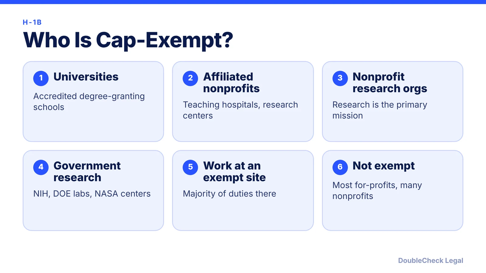
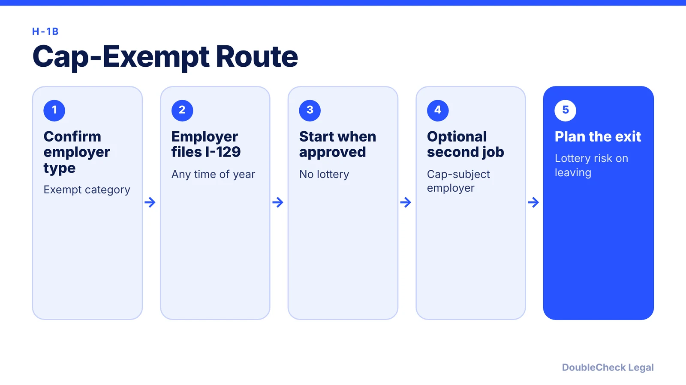

*Which employers can file H-1B petitions outside the lottery, and how tech workers use concurrent employment.*

**Key takeaways:**

- Cap-exempt petitions can be filed any time, with no lottery.
- Universities, affiliated nonprofits, nonprofit research organizations, and government research organizations qualify.
- You can hold a cap-exempt job and a cap-subject job at the same time.
- Leaving cap-exempt work for a private company can put you back in the lottery.

## 1. The quick answer

**Quick answer:** H-1B cap-exempt employers can file H-1B petitions at any time of year without entering the annual lottery. The usual categories are institutions of higher education, nonprofits affiliated with them, nonprofit research organizations, and government research organizations. The annual cap is 85,000 (65,000 regular, 20,000 for U.S. master's degrees or higher), and cap-exempt petitions do not count against it.

## 2. Who qualifies and who does not

Per Beyond Border and Reddy Neumann Brown:

- **Institutions of higher education:** accredited U.S. colleges, universities, and community colleges that grant post-secondary degrees.
- **Nonprofits related to or affiliated with a university:** through ownership, control, or a formal affiliation agreement. Teaching hospitals and research centers are examples. A simple memorandum of understanding may not be enough.
- **Nonprofit research organizations:** research must be the primary mission. Generally the organization is tax-exempt under 501(c)(3). A nonprofit focused on social services or advocacy typically does not qualify on its own. "Not every non-profit organization is cap-exempt."
- **Government research organizations:** for example NIH, Department of Energy national laboratories, and NASA research centers.

A for-profit employer is generally not cap-exempt, but a petition can qualify if the worker performs the majority of the job duties at a qualifying institution and those duties directly further its mission. Example: a data analyst employed by a vendor but stationed full time at a university lab. If the worker is later moved to a non-exempt site, the exemption no longer applies.

## 3. Concurrent employment and moving to a private company

A worker can hold two H-1B jobs, one with a cap-exempt employer and one with a cap-subject employer. A worker can keep the cap-exempt job while the cap-subject employer files a new I-129, without the lottery, per Beyond Border. A professor working part time at a university and part time at a startup is the standard example.

The catch: if you resign from the cap-exempt job and work only for the cap-subject employer, you generally become cap-subject and may need a cap number, unless you were previously counted. Workers whose H-1B employment was entirely cap-exempt cannot use the "previously counted" exemption (Beyond Border). Cap-exempt status is tied to the employer, so if the employer loses qualifying status, your status is affected.

Time in cap-exempt and cap-subject H-1B status both count toward the six-year maximum. See [H-1B beyond six years](/blog/h-1b-6-year-limit-extensions-beyond-six-years/) and the [H-1B transfer rules](/blog/h-1b-transfer-change-of-employer-portability/).

## 4. Why tech workers use it, and what to check

Tech employees use cap-exempt roles to avoid the annual registration lottery, to file year-round, and because many cap-exempt employers support green card sponsorship (Reddy Neumann Brown). Beyond Border's example is a data scientist working full time at a university robotics center. Processing takes roughly 3 to 6 months without premium processing, per Beyond Border.

Check before you accept:

- Is the **employer itself** exempt, or is the exemption based on where you work?
- Will your duties **directly support** the exempt institution's mission?
- What happens if you want to move to a startup later? Plan the concurrent-employment route in advance.
- Fees: Beyond Border lists the Form I-129 base fee at $460 for small employers and qualifying nonprofits or $780 for standard employers, plus an asylum program fee; fees change, so confirm with USCIS.
- A September 2025 proclamation added a $100,000 payment for certain petitions. Beyond Border says it applies to petitions requiring consular processing, not to workers already in the U.S. changing status; confirm with counsel.

For green card timing after a cap-exempt job, see the [H-1B to green card timeline](/blog/h-1b-to-green-card-timeline-tech-workers/).

## Where DoubleCheck fits

[DoubleCheck](https://www.contactdoublecheck.com) helps businesses and founders start legal work with AI, verify it, and, when professional advice is warranted, connect with an independent attorney, including for immigration questions. Attorney availability and practice areas vary. Attorneys on DoubleCheck are independent professionals; an attorney-client relationship forms only if an attorney accepts your engagement.

**Sources:** [Beyond Border, cap-exempt employers](https://www.beyondborderglobal.com/resources/h-1b-cap-exempt-employers-who-qualifies-and-how-to-apply); [Reddy Neumann Brown](https://www.rnlawgroup.com/h-1b-cap-exempt-employers-how-they-work-and-how-beneficiaries-can-qualify/). USCIS and the regulations themselves could not be loaded; confirm at uscis.gov.

## FAQ

**Do cap-exempt H-1B petitions go through the lottery?**

No. Beyond Border and Reddy Neumann Brown say cap-exempt petitions can be filed at any time without registration or selection.

**Is every nonprofit cap-exempt?**

No. Beyond Border says it must be affiliated with a qualifying institution or have research as its primary mission.

**Can I work for a startup and a university at once?**

Yes, via concurrent H-1B employment. A cap-subject employer can file a new petition while you keep the cap-exempt job, per Beyond Border.

**Does cap-exempt time count toward the six-year limit?**

Yes. Beyond Border says time in cap-exempt and cap-subject H-1B status both count.

---

*General information only. This article is not legal, tax, investment, or accounting advice.*
