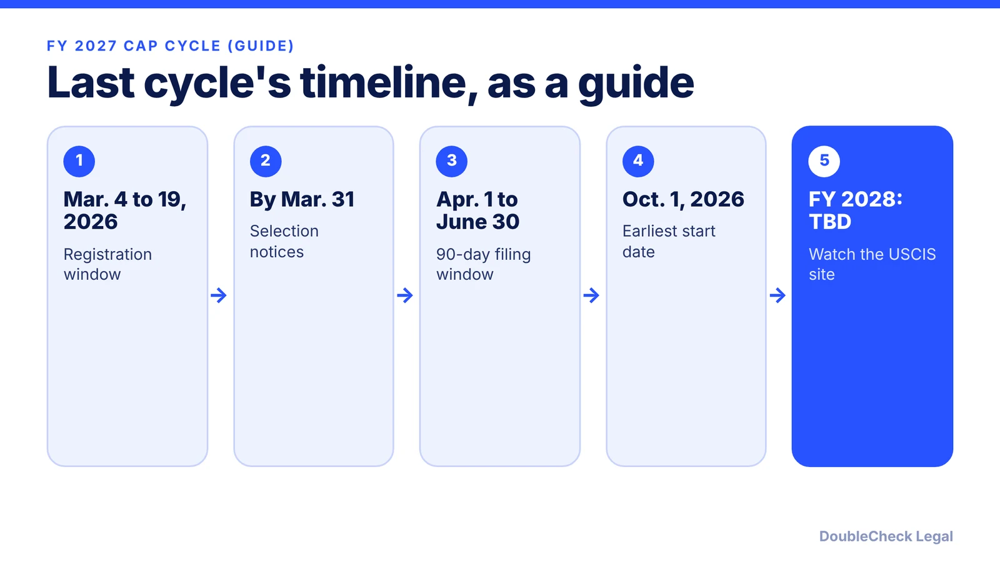
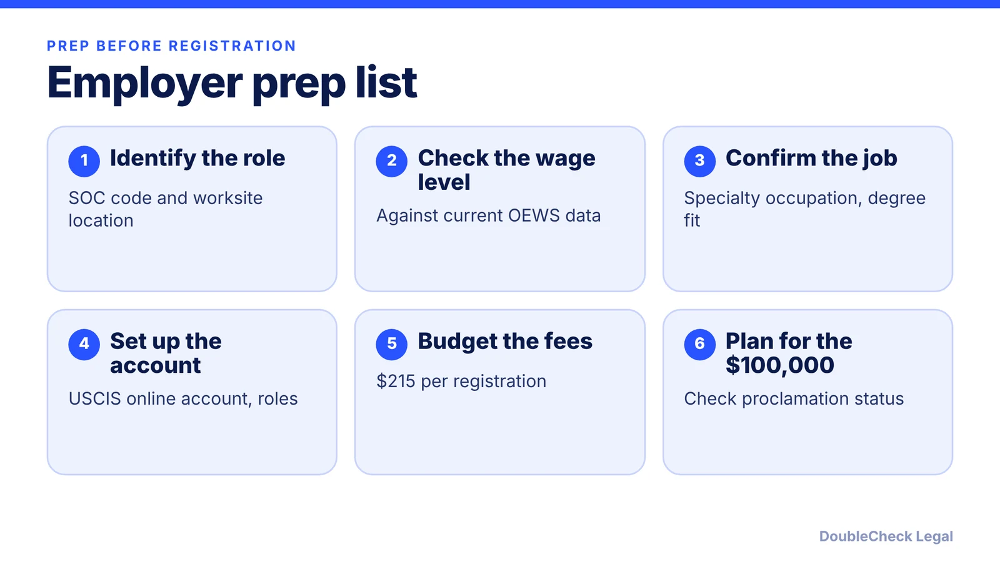

*FY 2028 H-1B dates are not confirmed yet. Here is last cycle's timeline, the weighted selection rule, and how employers should plan.*

**Key takeaways:**

- I found no official FY 2028 registration dates as of November 2026.
- FY 2027 ran March 4 to 19, 2026, with a $215 fee and selection notices by March 31.
- The weighted rule gives 1 to 4 entries by OEWS wage level.
- Selected registrants had 90 days, April 1 to June 30, 2026, to file in FY 2027.

## 1. The quick answer

**Quick answer:** As of November 2026, I could not find an official USCIS announcement of FY 2028 H-1B registration dates, so treat any specific date as unconfirmed. The most recent cycle, FY 2027, is the best guide: registration ran from noon ET March 4 to noon ET March 19, 2026, the fee was $215 per beneficiary, USCIS said it would notify selected registrants by March 31, and selected registrants had 90 days from April 1 to June 30, 2026 to file. FY 2027 was also the first cycle under the new wage-weighted selection, where a higher wage level means more entries.

## 2. What the FY 2027 cycle looked like

Per USCIS's announcement, initial registration ran from noon Eastern on March 4 through noon Eastern on March 19, 2026, with a fee of $215 per registration, paid for each beneficiary. USCIS stated that it intended to notify selected registrants by March 31, 2026.

Per the National Law Review, USCIS announced on March 31, 2026 that it had completed selection and had enough registrations for unique beneficiaries to meet the cap, including the master's cap. Selected registrants had 90 days, April 1 through June 30, 2026, to file complete petitions, and employment under an approved FY 2027 petition could begin no earlier than October 1, 2026. USCIS may hold a second selection round if too few petitions arrive.

If USCIS follows a similar calendar for FY 2028, employers would register in March 2027 and start work no earlier than October 1, 2027. That is an inference from the prior cycle, not an announcement. Confirm on the USCIS H-1B cap season page once it is published.

## 3. The weighted selection rule

Per Faegre Drinker, DHS published the final rule, "Weighted Selection Process for Registrants and Petitioners Seeking to File Cap-Subject H-1B Petitions," on December 29, 2025, effective February 27, 2026. It replaced the random lottery with a system based on the OEWS wage level of the offered position:

- **Level 4 (highest):** 4 entries.
- **Level 3:** 3 entries.
- **Level 2:** 2 entries.
- **Level 1 (lowest):** 1 entry.

Each beneficiary still counts once toward the cap, no matter how many employers register them. Per Faegre Drinker, registrations must include the SOC code, the geographic area of intended employment, and the highest OEWS wage level the proffered wage meets or exceeds, and that data must stay consistent with any petition filed. Entry-level roles can still be selected, but with lower odds than higher-wage roles, per the same source.

For how wage levels are determined, see [the H-1B weighted lottery and wage levels explained](/blog/h1b-weighted-lottery-wage-levels-explained/).

## 4. A planning calendar for employers

USCIS's FY 2027 page also noted that if a petitioner is selected and eligible to file, an additional $100,000 payment may apply under a September 19, 2025 Presidential Proclamation. Whether and how it applies depends on the beneficiary, such as a change of status inside the U.S. versus consular processing, so read [the H-1B $100,000 fee status](/blog/h1b-100000-fee-status-2026/) and confirm with counsel before registering.

A sensible calendar working back from last cycle's pattern:

- **Now through January:** list candidates, check each role's SOC code and wage level, and confirm student employees' work authorization timelines.
- **February:** open or verify USCIS accounts, gather offer details, and decide who the registrant is.
- **March (expected):** register during the window and keep confirmations.
- **April to June (expected):** prepare Labor Condition Applications and petitions for selected beneficiaries.

F-1 students on OPT should also review [the cap-gap and change of status to H-1B](/blog/f-1-cap-gap-change-of-status-to-h-1b/) and [OPT unemployment limits](/blog/opt-unemployment-limit-90-days-stem-opt/). Startups new to sponsorship can start with [what a startup needs to sponsor an H-1B employee](/blog/startup-sponsor-h1b-employee-requirements/) and [H-1B to green card timelines](/blog/h-1b-to-green-card-timeline-tech-workers/). An immigration attorney can confirm the rules on registration day.

## Where DoubleCheck fits

[DoubleCheck](https://www.contactdoublecheck.com) helps businesses and founders start legal work with AI, verify it, and, when professional advice is warranted, connect with an independent attorney, including for immigration questions. Attorney availability and practice areas vary. Attorneys on DoubleCheck are independent professionals; an attorney-client relationship forms only if an attorney accepts your engagement.

**Sources:** [USCIS FY 2027 registration bulletin](https://content.govdelivery.com/accounts/USDHSCIS/bulletins/406da02); [Faegre Drinker on the weighted selection rule](https://www.faegredrinker.com/en/insights/publications/2026/1/department-of-homeland-security-weighted-selection-process-for-h-1b-cap-subject-petitions); [National Law Review on the FY 2027 selection](https://natlawreview.com/article/uscis-completes-fiscal-year-2027-h-1b-lottery); [Buchanan on FY 2027 changes](https://www.bipc.com/fy-2027-h-1b-cap-registration-opens-march-4,-2026-key-changes-and-action-items).

## FAQ

**When is H-1B registration for FY 2028?**

I could not find an official announcement as of November 2026. FY 2027 registration ran March 4 to 19, 2026, per USCIS. Watch the USCIS H-1B cap season page for FY 2028 dates.

**How does the H-1B weighted selection work?**

Per Faegre Drinker, each beneficiary gets 4, 3, 2, or 1 entries for OEWS wage Levels 4, 3, 2, and 1. Each beneficiary still counts once toward the cap.

**How much does H-1B registration cost?**

USCIS set the FY 2027 registration fee at $215 per beneficiary. Check USCIS for the FY 2028 fee. A separate $100,000 payment may apply in some cases under a September 2025 proclamation.

**How long do selected employers have to file?**

In FY 2027, selected registrants had 90 days, from April 1 to June 30, 2026, per the National Law Review. Confirm the FY 2028 window when USCIS announces it.

---

*General information only. This article is not legal, tax, investment, or accounting advice.*
