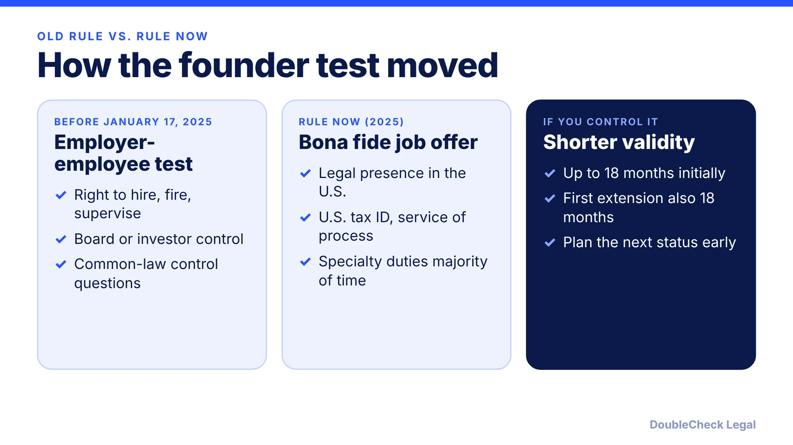
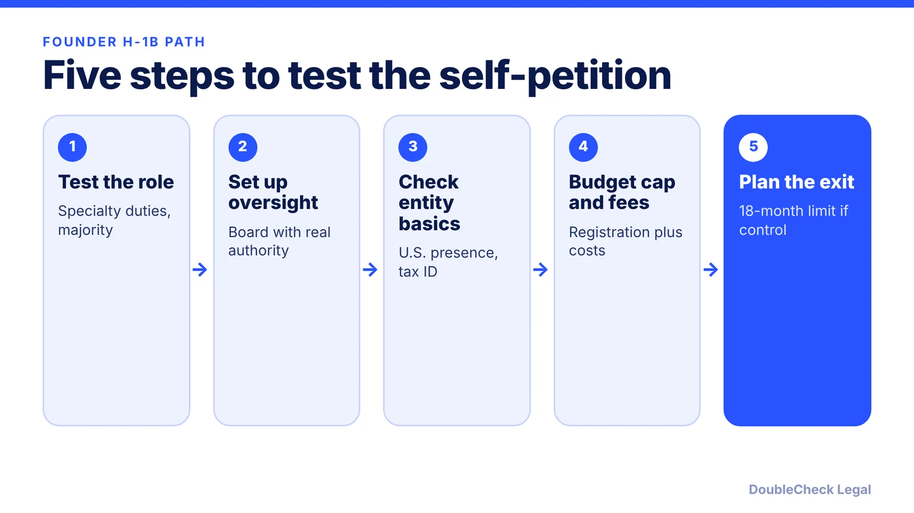

*The 2025 H-1B modernization rule changed the founder test. Here is what it says, what it limits and what to check as of November 2026.*

**Key takeaways:**

- The 2025 rule (petitions filed on or after January 17, 2025) replaced the employer-employee test with a bona fide job offer test (Shusterman).
- The company needs U.S. legal presence, amenability to service of process and a U.S. tax ID.
- If you hold a controlling interest, approval and the first extension are each limited to 18 months (Morgan Lewis).
- Board oversight, a real specialty job, cap registration and fees remain practical hurdles.

## 1. The quick answer

**Quick answer:** A founder can be the H-1B beneficiary of their own company, but the company must be a real U.S. employer with a real specialty-occupation job. Since the H-1B modernization final rule (published December 18, 2024, in effect for petitions filed on or after January 17, 2025, per Shusterman), USCIS no longer requires a traditional employer-employee relationship. It requires a bona fide job offer instead, and the company must have a legal presence in the U.S., be amenable to service of process and have a U.S. tax ID. When the beneficiary has a controlling interest, approvals are limited to 18 months, including the first extension (Morgan Lewis). The rule still applies as of November 2026 in the sources we found, but check before filing.

## 2. What the 2025 modernization rule changed for owners

Per Shusterman, the final rule removed the requirement to show an employer-employee relationship, which previously centered on the employer's ability to hire, fire, supervise and pay the worker. In its place, the petitioner must show a bona fide job offer in a specialty occupation as of the requested start date, and the offer can include telework or other off-site work within the U.S.

Per Taft and Shusterman, the definition of U.S. employer now includes an entity with a legal presence in the U.S., amenable to service of process, with a U.S. tax ID, which Shusterman says lets owner-beneficiaries petition for themselves. Morgan Lewis adds that the rule covers beneficiaries who own a controlling interest, that the initial petition and the first extension are each limited to 18 months, and that the beneficiary must perform specialty occupation duties for a majority of their work time.

Cyrus Mehta's July 17, 2026 analysis, citing 8 C.F.R. 214.2(h)(9)(iii)(E), says founder control alone no longer defeats the petition, the LCA wage requirements are unchanged, and the path is temporary, so founders should expect earlier extensions. Cooley, writing in June 2025, describes owning 50% or more and performing a limited amount of nonspecialized management tasks, while still needing a bona fide employment relationship. Treat that as a practitioner view of how to present the case, not a rule you can read off the regulation.

**Status as of November 2026.** We found no source showing the modernization rule rescinded. DHS's regulatory agenda, per the National Law Review, lists a separate "H-1B Reforms" proposed rule (RIN 1615-AD00) aimed at cap exemptions and third-party placements, planned for August 2026; we could not confirm whether it has been published. Check the USCIS page or counsel for current text.

## 3. Board, control and the practical problems

Even without the old test, USCIS still asks whether the job is real. Fisher Phillips says founder roles are possible only if the U.S. entity has real oversight of the position, and that a board of directors or similar oversight mechanism is key. Ellis, per our [ownership-versus-work post](/blog/start-company-on-h1b-visa-ownership-vs-work/), describes independent board members or investors with the right to control the founder as the typical structure.

Practical issues to raise with an attorney:

- **The job must be a specialty occupation.** A founder who mostly does fundraising, sales and general management may not meet it if specialty duties are not the majority of the role.
- **Wage and LCA.** Pay at least the required wage, keep the public access file and expect site visits: see [LCA public access files](/blog/h-1b-lca-public-access-file-employer-requirements-startups/) and [site visits](/blog/h-1b-site-visits-employer-compliance-startups/).
- **Cap and fees.** A new petition is usually cap-subject, with registration, a weighted selection and fees that have moved in 2026. See the [registration timeline](/blog/h-1b-cap-registration-fy2028-timeline-employers/), the [weighted lottery](/blog/h1b-weighted-lottery-wage-levels-explained/), and the [$100,000 fee status](/blog/h1b-100000-fee-status-2026/). Cap-exempt employers are a separate topic: [cap-exempt H-1B](/blog/h-1b-cap-exempt-employers/).
- **Ownership changes.** New investors, a down round or a board change can alter the control picture. Tell your attorney before closing a financing.
- **Employer obligations.** Sponsoring yourself still means the company takes on employer duties: [sponsoring an H-1B employee](/blog/startup-sponsor-h1b-employee-requirements/).

Do not backdate a role, pay yourself outside payroll to look compliant, or describe duties you do not perform.

## 4. Alternatives, and when to bring in an attorney

If the structure is awkward, other routes exist. Compare them in the [H-1B vs L-1 vs O-1 guide](/blog/h-1b-vs-l-1-vs-o-1-which-visa-for-tech-employees/) and the [founder visa comparison](/blog/us-visa-options-for-startup-founders-compared/):

- **O-1A**, with a company-as-petitioner or a U.S. agent (Beyond Border Global, a provider's view): [O-1A evidence](/blog/o-1a-visa-for-startup-founders-evidence/).
- **E-2** for treaty-country nationals who hold at least 50% (Cooley): [E-2 guide](/blog/e-2-treaty-investor-visa-for-founders/).
- **L-1A** for a foreign company opening a U.S. office: [L-1A guide](/blog/l-1a-visa-new-office-foreign-founders/).
- **International Entrepreneur Rule parole** and permanent routes such as the [national interest waiver](/blog/niw-eb-2-national-interest-waiver-founders/): [IER guide](/blog/international-entrepreneur-rule-startup-parole-2026/).

**Handle yourself vs. get an attorney.** You can gather your corporate documents and draft a role description on your own. Self-petition cases carry more risk than ordinary H-1Bs because the same person is owner, beneficiary and signer, so have an immigration attorney review the board structure, cap-table and job description before you register. See [how to find an immigration lawyer](/blog/how-to-find-good-immigration-lawyer-startup-founder/) and [what it costs](/blog/immigration-lawyer-fees-flat-fee-vs-hourly/); formation steps are in [how to incorporate in the U.S.](/blog/how-to-incorporate-a-company-in-the-us/).

## Where DoubleCheck fits

[DoubleCheck](https://www.contactdoublecheck.com) helps businesses and founders start legal work with AI, verify it, and, when professional advice is warranted, connect with an independent attorney, including for immigration questions. Attorney availability and practice areas vary. Attorneys on DoubleCheck are independent professionals; an attorney-client relationship forms only if an attorney accepts your engagement.

**Sources:** [Shusterman on the H-1B modernization rule](https://www.shusterman.com/h-1b-modernization-rule-1-17-25/); [Morgan Lewis](https://www.morganlewis.com/pubs/2025/01/dhs-issues-final-rules-on-h-1b-petitions-and-ead-applications-effective-mid-january); [Taft](https://www.taftlaw.com/news-events/law-bulletins/important-updates-to-the-h-1b-visa-program/); [Cyrus Mehta, beneficiary-owned company](https://blog.cyrusmehta.com/tag/h-1b-beneficiary-owned-company); [Cooley](https://www.cooley.com/news/insight/2025/2025-06-03-what-foreign-founders-need-to-know-about-us-visas-and-corporate-structure); [Fisher Phillips](https://www.fisherphillips.com/en/insights/insights/visa-pathways-for-international-tech-startups); [Beyond Border Global](https://www.beyondborderglobal.com/resources/o-1-can-founder-sponsor-themselves); [National Law Review, 2026 regulatory agenda](https://natlawreview.com/article/2026-regulatory-agenda-signals-significant-immigration-changes-employers). The Federal Register page and uscis.gov were not fetched, so law-firm summaries are named.

## FAQ

**Can I sponsor myself for an H-1B through my own company?**

Per Shusterman, the modernization rule lets owner-beneficiaries petition for themselves if the company is a qualifying U.S. employer offering a bona fide specialty occupation job. It is fact-specific, so ask an immigration attorney.

**Did the 2025 rule eliminate the employer-employee relationship requirement?**

Yes. Per Shusterman and Morgan Lewis, the final rule removed it from the H-1B employer definition and substituted a bona fide job offer requirement, for petitions filed on or after January 17, 2025.

**How long can a founder with a controlling interest get H-1B approval?**

Per Morgan Lewis, the initial petition and the first extension are each limited to 18 months where the beneficiary has a controlling interest. Plan the next status early.

**Is the founder rule still in effect in November 2026?**

We found no source showing it rescinded, and a July 17, 2026 analysis by Cyrus Mehta still treats it as in force. DHS planned a separate H-1B proposed rule in 2026, so check USCIS or counsel before filing.

---

*General information only. This article is not legal, tax, investment, or accounting advice.*
