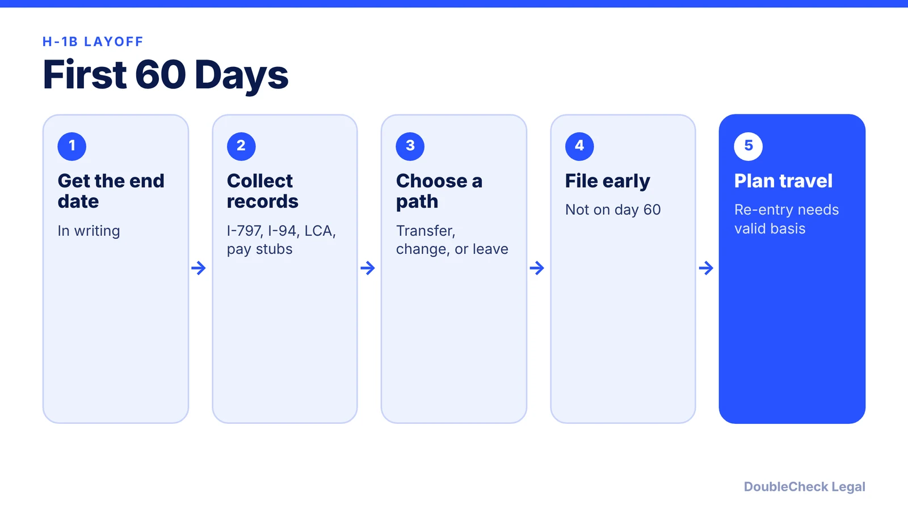
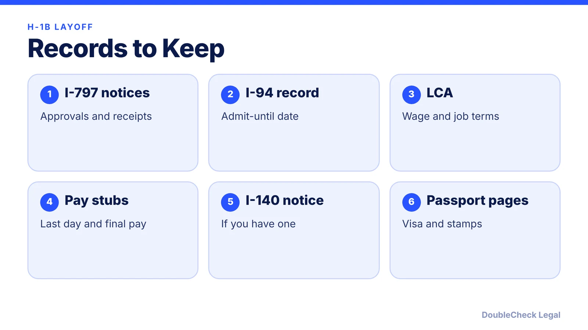

*What the H-1B 60-day grace period allows after a layoff, your main options, and the pending proposal to end it.*

**Key takeaways:**

- You may stay up to 60 consecutive days or until your I-94 ends, whichever is shorter.
- The grace period does not authorize work.
- A new employer's properly filed transfer petition can let you start work.
- DHS has proposed ending the grace period; it is not final as of November 2026.

## 1. The quick answer

**Quick answer:** If your H-1B job ends, you may stay in the U.S. for up to 60 consecutive days, or until your I-94 expires if that is sooner, under 8 CFR 214.1(l)(2), per Beyond Border. The clock starts the day employment ends. You can use the time to have a new employer file a transfer petition, change to another status, or leave. As of November 2026, DHS has proposed eliminating this grace period, but it is not final and the current rule still applies.

## 2. How the grace period works

Per Beyond Border:

- It lasts up to **60 consecutive calendar days** after employment ends, or until the I-94 validity expires, whichever is shorter.
- It is **discretionary**, available once per authorized validity period, and USCIS can shorten or eliminate it.
- It **does not authorize work** for any employer. Separate authorization is needed.

Nolo's attorney-authored guide adds that someone actively job hunting, with documented applications, correspondence, or interviews, is likely to receive the full 60 days, and that filing around day 60 can lead USCIS to deny the extension-of-stay part of a petition, which could require a trip abroad for a new visa.

Because the clock runs from the day employment ends, get the end date in writing. If you are kept on payroll after you stop working, ask your employer and an attorney which date counts before you rely on any count.

## 3. Your options

- **Transfer to a new H-1B employer.** A properly filed transfer petition allows work to begin, and an existing cap count carries over without a new lottery (Beyond Border). Details in [H-1B transfer and portability](/blog/h-1b-transfer-change-of-employer-portability/).
- **Change status** to H-4 (if a spouse keeps H-1B status; see [H-4 EAD](/blog/h-4-ead-spouses-of-h-1b/)), F-1, B-2, or O-1, each with its own eligibility. Nolo calls B-2 problematic: job searching is not a visitor activity, and a pending B-2 application can block USCIS from processing an H-1B extension.
- **Leave the U.S.** and look for work from abroad. Re-entry depends on a valid basis for admission, and an expired visa stamp may require a consular interview and possible administrative processing ([221(g)](/blog/visa-221g-administrative-processing/)).
- **Self-sponsored routes** such as EB-1A or NIW do not need an employer; see [NIW](/blog/niw-eb-2-national-interest-waiver-founders/) and [O-1/EB-1A](/blog/eb-1a-vs-o-1-founder-which-path/).

If you have an approved I-140, see [I-140 portability](/blog/i-140-portability-ac21-changing-jobs/). Nolo warns that unlawful presence can carry serious consequences, particularly beyond six months. Do not stay past the end of your grace period without advice.

## 4. What your employer owes, records, and the proposed rule

**Employer obligations** (Beyond Border): clearly end the employment relationship, notify USCIS and request withdrawal of the H-1B petition, and, if you were dismissed involuntarily, offer to pay reasonable transportation costs to your last foreign residence. That return-cost duty does not apply to voluntary departures. The required wage stays payable during employer-caused nonproductive periods, and an employer cannot stop wages just by declaring the job over.

**Severance:** the sources reviewed do not say how severance affects status, so do not assume it extends the grace period. Ask your attorney which date USCIS will treat as the end of employment.

**Records to keep:** I-797 approval notices, I-94, the Labor Condition Application, any I-140 approval notice, passport and visa pages, and your time used toward the six-year limit.

**The proposed rule.** DHS published "Eliminating the Discretionary 60-day Grace Period" (docket USCIS-2026-0364) on September 11, 2026, per F1Jobs. It would remove 8 CFR 214.1(l)(2) for E-1, E-2, E-3, H-1B, H-1B1, L-1, O-1, and TN workers and dependents; the comment deadline is November 10, 2026. It is a proposal only, and the current grace period applies until a final rule takes effect. Check status before relying on either.

## Where DoubleCheck fits

[DoubleCheck](https://www.contactdoublecheck.com) helps businesses and founders start legal work with AI, verify it, and, when professional advice is warranted, connect with an independent attorney, including for immigration questions. Attorney availability and practice areas vary. Attorneys on DoubleCheck are independent professionals; an attorney-client relationship forms only if an attorney accepts your engagement.

**Sources:** [Beyond Border, H-1B layoff guide](https://www.beyondborderglobal.com/resources/h-1b-layoff-grace-period-options); [Nolo](https://www.nolo.com/legal-encyclopedia/just-got-laid-off-h-1b-job-i-any-grace-period-can-i-another-visa-jobhunt.html); [F1Jobs, comment deadlines](https://www.f1jobs.io/resources/blog/november-2026-comment-deadlines-opt-fee-grace-period-deference); [Federal Register public inspection copy](https://public-inspection.federalregister.gov/2026-18631.pdf); [Seyfarth](https://www.seyfarth.com/news-insights/dhs-strikes-again-proposal-would-eliminate-the-60-day-grace-period-for-certain-nonimmigrant-workers.html).

## FAQ

**How long is the H-1B grace period after a layoff?**

Up to 60 consecutive calendar days, or until your I-94 expires if sooner, under 8 CFR 214.1(l)(2), per Beyond Border. It is discretionary and available once per authorized validity period.

**Can I work during the 60 days?**

No. Beyond Border says the grace period does not authorize work for any employer without separate authorization.

**Does my employer have to pay for my trip home?**

If you were dismissed involuntarily, the employer must offer to pay reasonable return transportation costs to your last foreign residence, per Beyond Border. It does not apply to voluntary departures.

**Is the grace period being eliminated?**

DHS proposed eliminating it in a rule published September 11, 2026, with comments due November 10, 2026, per F1Jobs. It is a proposal only; the current rule remains in effect until a final rule.

---

*General information only. This article is not legal, tax, investment, or accounting advice.*
