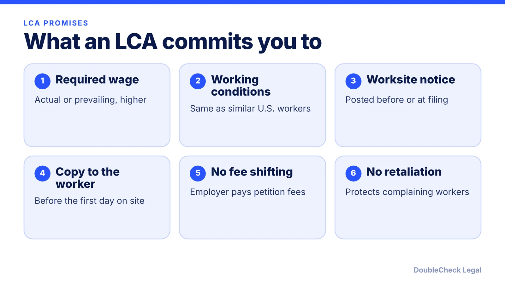
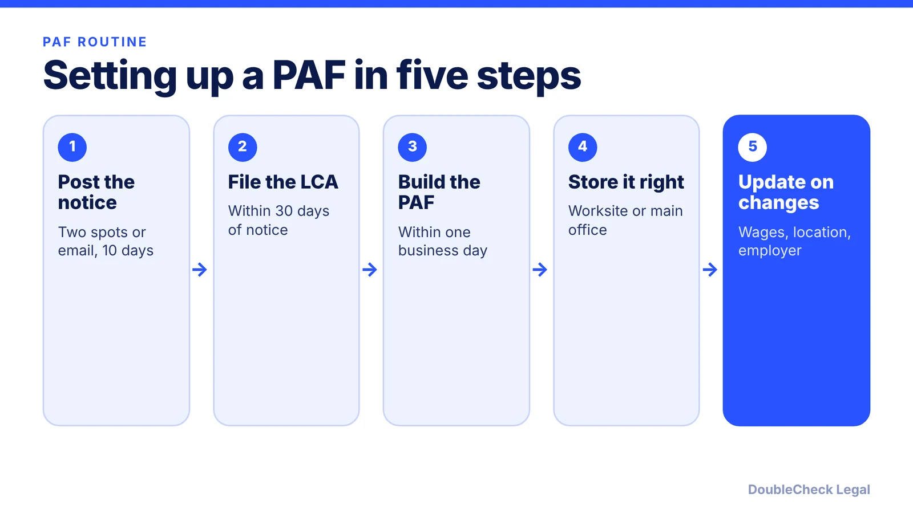

*What an LCA commits an employer to, the worksite notice, the Public Access File, and how DOL enforces them, as of November 2026.*

**Key takeaways:**

- The LCA is a wage and working-conditions promise: the higher of the actual or prevailing wage.
- Notice goes up for 10 days at the worksite, within 30 days before filing.
- Per Reinhart, the PAF must exist within one business day after filing and be kept the LCA term plus one year.
- DOL can investigate on a complaint and can order back wages, penalties, and debarment.

## 1. The quick answer

**Quick answer:** A Labor Condition Application (LCA) is the Department of Labor form in which an employer attests that it will pay an H-1B worker at least the required wage and offer working conditions like those of similar U.S. workers. Per the DOL, the wage promise is the actual wage paid to similar workers or the prevailing wage for the occupation and area, whichever is greater. The employer must also give notice of the filing at the worksite and keep a Public Access File (PAF) for each H-1B worker. Per Reinhart, the PAF must be in place within one business day after the LCA is filed.

## 2. What the LCA promises: wages, notice, and the worker's copy

Per the DOL's [H-1B page](https://www.dol.gov/agencies/whd/immigration/h1b), employers attest on Form ETA-9035 that they will pay at least the actual wage paid to similar workers or the prevailing wage for the occupation in the area, whichever is greater. Per the DOL's [H-1B fact sheet](https://www.dol.gov/agencies/whd/fact-sheets/62-index-h1b), the employer must also:

- offer the same working conditions and fringe benefits as similarly employed U.S. workers;
- not require the worker to pay the USCIS petition filing fee or an early-cessation penalty;
- not retaliate against workers who report violations or cooperate in a proceeding;
- notify USCIS of changes such as work ending or a new LCA being needed.

**Notice at the worksite.** Per the DOL's [notice fact sheet](https://www.dol.gov/agencies/whd/fact-sheets/62m-h1b-notice):

- Notice must be given on or within 30 days before the date the LCA is filed, and at a new worksite on or before the H-1B worker starts there.
- With no union, post it in two conspicuous places at the worksite for 10 days, or notify employees electronically for 10 days (email or an electronic bulletin board).
- It must state the number of H-1B workers sought, occupational classification, wage offered, period of employment, work locations, and that complaints may be filed with a Wage and Hour Division office.
- Each H-1B worker must get a copy of the LCA no later than the day they report to a permanent place of work.

A change of worksite or job can require a new LCA and an amended petition; see [H-1B amendments](/blog/h-1b-amendment-when-needed-job-change-worksite/). For how wage levels interact with the lottery, see [weighted lottery and wage levels](/blog/h1b-weighted-lottery-wage-levels-explained/).

**Wage rules may change.** DOL proposed a rule in the Federal Register on March 27, 2026 that would raise the prevailing wage percentile for each wage level (Level I from the 17th to the 34th percentile, per [Mintz](https://www.mintz.com/insights-center/viewpoints/2806/2026-04-16-department-labor-proposes-rule-increase-wage-levels)). Per R&N Law Group's June 9, 2026 article, it was not yet final, and it would apply to new LCAs filed after the effective date, not to certified ones. As of November 2026, check the DOL and USCIS pages for current status before you set a salary.

## 3. The Public Access File: contents, location, and retention

The PAF is a set of records about each H-1B worker that you keep so that anyone can inspect it. Details below are per [Reinhart](https://www.reinhartlaw.com/news-insights/what-employers-need-to-know-to-ensure-their-records-and-practices-comply-with-h-1b-laws-part-1) and [Barnes & Thornburg](https://natlawreview.com/article/h-1b-public-access-files-are-you-compliance) (April 2025).

**What goes in it:**

- A copy of the certified LCA, with its instruction pages.
- Documentation of the actual wage and how the employer's pay system sets it.
- Documentation of how the prevailing wage was determined.
- Proof the required notices were posted, with dates and locations.
- A summary of benefits offered to U.S. workers in the same occupation.
- If relevant: documents for a corporate restructuring, or extra lists if the employer is H-1B dependent or a willful violator.

The H-1B petition itself and its supporting documents are not part of the PAF, per Reinhart.

**Where and how:**

- Keep it at the employer's principal place of business or at the worker's actual place of employment, separate from the personnel file.
- Label it with the worker's name or a unique file number. A file number needs a separate confidential key tying it to the worker.
- Electronic or paper is fine, per Reinhart.

**How long:** For the LCA's full term, and for one year after the LCA expires or is withdrawn or the employment ends, whichever is longer (Reinhart). Barnes & Thornburg also says to keep records until any complaint is resolved, and that payroll records, which are not part of the PAF, should be kept at least three years.

## 4. Common startup mistakes, DOL investigations, and when to get help

**Mistakes to look for** (inferred from the requirements above, not from a DOL list):

- No PAF exists, or it was built long after the LCA was filed. Reinhart advises creating a missing one immediately.
- The notice was posted late, only in one spot, or no record of dates and places was kept.
- The salary on the LCA is higher than the pay actually delivered, or the pay system is not documented.
- The worker moves to a new city or the role changes and no new LCA or amendment follows.
- The worker is asked to cover the filing fee. The DOL says the worker may not be required to pay it.
- Records are kept in the HR file, not in a separate PAF.

**How DOL enforces it.** Per the DOL's [enforcement fact sheet](https://www.dol.gov/agencies/whd/fact-sheets/62u-h1b-enforcement-authority), the Wage and Hour Division can open an investigation on a complaint from an aggrieved person or organization, credible information from a reliable outside source, a recent willful-violation finding, or reasonable cause. It checks that workers get the wages promised on the LCA and work in the stated occupation and location. Remedies include back wages, civil money penalties, and debarment from H-1B and other programs for at least one year in certain cases. Per the DOL, a September 19, 2025 initiative named Project Firewall targets H-1B abuse, and the agency says to check its penalty page for current amounts. For USCIS visits, see [H-1B site visits](/blog/h-1b-site-visits-employer-compliance-startups/).

**Handle it yourself vs. get a lawyer.**

- *Reasonable to do yourself:* a PAF template, calendar reminders, and a posting log, once an attorney or your HR provider has told you what the LCA says.
- *Get an attorney to look:* before choosing a wage level or job title, when a worker changes location or duties, after a complaint or DOL letter, or if you find a PAF is missing. Also review any plan to place a worker at a customer site.

Related reading: [sponsoring your first H-1B employee](/blog/startup-sponsor-h1b-employee-requirements/), [I-9 and E-Verify](/blog/i-9-and-e-verify-for-startups/), and [immigration lawyer fees](/blog/immigration-lawyer-fees-flat-fee-vs-hourly/).

## Where DoubleCheck fits

[DoubleCheck](https://www.contactdoublecheck.com) helps businesses and founders start legal work with AI, verify it, and, when professional advice is warranted, connect with an independent attorney, including for immigration questions. Attorney availability and practice areas vary. Attorneys on DoubleCheck are independent professionals; an attorney-client relationship forms only if an attorney accepts your engagement.

**Sources:** [DOL H-1B page](https://www.dol.gov/agencies/whd/immigration/h1b); [DOL Fact Sheet 62](https://www.dol.gov/agencies/whd/fact-sheets/62-index-h1b); [DOL notice fact sheet](https://www.dol.gov/agencies/whd/fact-sheets/62m-h1b-notice); [DOL enforcement fact sheet](https://www.dol.gov/agencies/whd/fact-sheets/62u-h1b-enforcement-authority); [Reinhart on the PAF](https://www.reinhartlaw.com/news-insights/what-employers-need-to-know-to-ensure-their-records-and-practices-comply-with-h-1b-laws-part-1); [Barnes & Thornburg](https://natlawreview.com/article/h-1b-public-access-files-are-you-compliance); [Mintz](https://www.mintz.com/insights-center/viewpoints/2806/2026-04-16-department-labor-proposes-rule-increase-wage-levels); [R&N Law Group](https://www.rnlawgroup.com/proposed-2026-h-1b-prevailing-wage-rule-should-employers-file-lcas-now/).

## FAQ

**What is a Public Access File for H-1B?**

Per Reinhart, it is a set of records kept for each H-1B worker, including the certified LCA, wage documentation, proof of notice posting, and a benefits summary. It must be in place within one business day after the LCA is filed.

**Where must the PAF be kept?**

Per Reinhart, at the employer's principal place of business or the worker's actual place of employment, separate from the personnel file, in paper or electronic form.

**How long do I keep the PAF?**

Per Reinhart, for the LCA's term and one year after the LCA expires or is withdrawn or employment ends, whichever is longer. Barnes & Thornburg adds keeping it until any complaint is resolved.

**Can an employer make the H-1B worker pay the filing fee?**

Per the DOL's H-1B fact sheet, the worker may not be required to pay the USCIS petition filing fee or an early-cessation penalty. Ask an attorney how this applies to other costs.

---

*General information only. This article is not legal, tax, investment, or accounting advice.*
