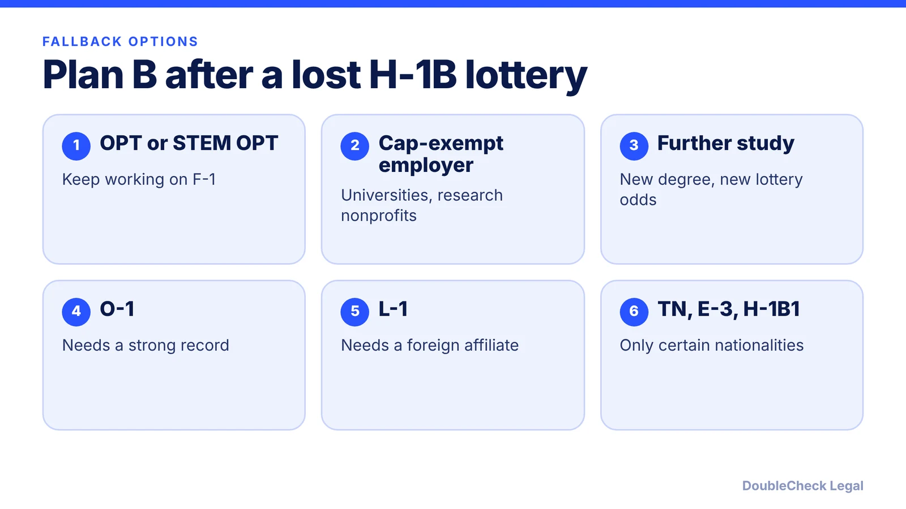
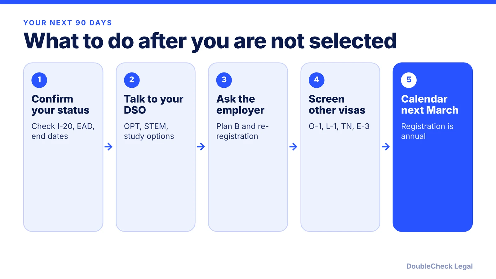

*A realistic Plan B for international students and recent graduates, with the FY 2027 results and the FY 2028 outlook as of November 2026.*

**Key takeaways:**

- FY 2027 filled its 85,000 cap with no second lottery, per Ogletree; the next chance is FY 2028 registration, dates not yet announced.
- OPT and STEM OPT keep you working and give extra registration tries.
- Cap-exempt employers can file H-1B petitions any time of year.
- O-1, L-1, TN, E-3 and H-1B1 each have strict eligibility, so screen them early.

## 1. The quick answer

**Quick answer:** Not being selected in the H-1B lottery is not the end of your U.S. work options. As of November 2026, the main fallback paths are post-completion OPT or the 24-month STEM OPT extension (to buy more lottery tries), a cap-exempt employer such as a university or nonprofit research organization, further study in F-1 status, and, if you qualify, O-1, L-1, TN, E-3 or H-1B1. USCIS said on July 17, 2026 that the FY 2027 cap was filled, and per Ogletree there was no second lottery, so FY 2027 non-selections wait for the next registration season.

## 2. What happened in the FY 2027 lottery and what comes next

Per the National Law Review and Ogletree, FY 2027 was the first cap season under the wage-weighted selection rule effective February 27, 2026: a registration got one to four entries depending on the wage level of the offered salary, and a Level IV wage got four. Per Ogletree, USCIS reported 211,600 properly submitted FY 2027 registrations, about 38.5 percent fewer than the 343,981 for FY 2026. Selected registrants had until June 30, 2026 to file. The cap, 65,000 regular visas plus 20,000 under the U.S. advanced-degree exemption, was reached, and unselected registrations move to "Not Selected."

For FY 2028 (jobs starting October 1, 2027), no official dates exist as of November 2026. Per f1jobs.io, the registration window and fee have not been announced; the FY 2027 fee was $215. Our [FY 2028 timeline for employers](/blog/h-1b-cap-registration-fy2028-timeline-employers/) tracks this, and [how wage levels drive the weighted lottery](/blog/h1b-weighted-lottery-wage-levels-explained/) explains why a higher-wage offer helps.

Two things to check before you plan around H-1B at all: whether a separate $100,000 payment applies, which is covered in [the $100,000 fee status post](/blog/h1b-100000-fee-status-2026/), and whether you are still inside a valid F-1 or OPT period. If your OPT is ending, read [the 60-day grace period options](/blog/f-1-60-day-grace-period-after-opt-ends-options/) right away.

## 3. The practical options, in order of how often they fit

Per [Fragomen](https://www.fragomen.com/insights/not-selected-in-the-h-1b-cap-you-still-have-options.html) (an earlier cycle) and [Klasko via Legal 500](https://www.legal500.com/intelligence/united-states/immigration/not-selected-in-the-h-1b-lottery-%E2%80%93-what-to-do-next) (April 2026), the common fallbacks are:

- **OPT and STEM OPT.** Fragomen says non-STEM graduates get up to 12 months of post-completion OPT and STEM graduates up to 36 months in total. Per Johns Hopkins, the STEM extension is 24 months, needs an E-Verify employer, a signed Form I-983 training plan, and a degree earned within the last 10 years. The extra work-authorized time means more registration seasons. See [how to apply for OPT](/blog/how-to-apply-for-opt-step-by-step-i-765-timeline/), [STEM OPT and the I-983](/blog/stem-opt-i-983-training-plan-startup-employers/) and [the unemployment limits](/blog/opt-unemployment-limit-90-days-stem-opt/).
- **Cap-exempt employers.** Per Fragomen, universities, affiliated nonprofits, nonprofit research organizations and government research organizations can file H-1B petitions any time of year. The job must still be a specialty occupation. See [cap-exempt H-1B employers](/blog/h-1b-cap-exempt-employers/).
- **Further study.** Per Klasko, returning to F-1 status for a U.S. master's or doctorate can improve future lottery odds. Fragomen warns that a new program with CPT can draw an RFE on a later H-1B, so keep proof of genuine enrollment. See [CPT vs OPT](/blog/cpt-vs-opt-f1-students/).
- **O-1.** For people with a record of acclaim; see [O-1A for recent graduates](/blog/o-1-visa-recent-graduates-international-students/).
- **L-1.** Per Fragomen, you need at least one continuous year in the three years before transfer with a qualifying foreign entity, in a managerial, executive or specialized knowledge role. See [L-1B specialized knowledge](/blog/l-1b-specialized-knowledge-visa-tech-employees/).
- **Nationality-based visas.** Per Klasko, TN covers Canadian and Mexican citizens in listed professions, E-3 covers Australians, and H-1B1 covers Chileans and Singaporeans. See [TN visas](/blog/tn-visa-canada-mexico-tech-professionals/) and [E-3 for Australians](/blog/e-3-visa-australians/). Per Dartmouth's international office, E-3 has a 10,500 annual limit on initial applications.

## 4. Re-registering, and what to watch before you commit

**Re-registration.** Not selected means you can be registered again next season by a willing employer. Per Klasko, many entry-level and OPT-based registrations fall into wage Level I or II, so a role with a higher wage level improves the weighted odds. Each registration is a fresh draw; selection in a prior year does not carry over.

**Rules in motion.** As of November 2026, DHS has proposed, but not finalized, a rule that would charge schools $70,000 for a student's first OPT recommendation and $30,000 for later ones including STEM OPT. Per Stony Brook University, it was published October 8, 2026 and is not in effect; OPT eligibility and procedures are unchanged for now. Watch your school's international office for updates. Klasko also warns that leaving the U.S. without a valid visa can bring delays, enhanced vetting and travel risks, so think before traveling; see [H-1B and visa stamping](/blog/h-1b-visa-stamping-travel-abroad-tech-workers/).

**Avoid status mistakes:**

- Do not work without authorization, and file extensions on time.
- Do not let OPT unemployment days run out unnoticed.
- Do not choose a school or program only for work authorization; a bona fide course of study matters.
- Do not buy a "guaranteed" sponsorship. See [how to avoid immigration scams](/blog/immigration-notario-scam-how-to-avoid/).

A good immigration attorney can compare these options against your degree, nationality, employer and timeline; see [how to find a good immigration lawyer](/blog/how-to-find-good-immigration-lawyer-startup-founder/). Founders may also compare [visa options for startup founders](/blog/us-visa-options-for-startup-founders-compared/).

## Where DoubleCheck fits

[DoubleCheck](https://www.contactdoublecheck.com) helps businesses and founders start legal work with AI, verify it, and, when professional advice is warranted, connect with an independent attorney, including for immigration questions. Attorney availability and practice areas vary. Attorneys on DoubleCheck are independent professionals; an attorney-client relationship forms only if an attorney accepts your engagement.

**Sources:** [Fragomen, Not Selected in the H-1B Cap](https://www.fragomen.com/insights/not-selected-in-the-h-1b-cap-you-still-have-options.html); [Klasko via Legal 500, April 2026](https://www.legal500.com/intelligence/united-states/immigration/not-selected-in-the-h-1b-lottery-%E2%80%93-what-to-do-next); [Ogletree, USCIS completes FY 2027 lottery](https://ogletree.com/insights-resources/blog-posts/uscis-completes-fiscal-year-2027-h-1b-lottery/); [RN Law Group, FY 2027 cap reached, no second lottery](https://www.rnlawgroup.com/fy-2027-h-1b-cap-reached-no-second-lottery/); [f1jobs.io on FY 2028 dates](https://www.f1jobs.io/resources/blog/h1b-lottery-2027-fy2028-registration-dates); [Johns Hopkins OIS, STEM OPT](https://ois.jhu.edu/Students/Current_F1_Students/F-1_Training_and_Employment/STEM_OPT_Extension/); [Dartmouth OVIS, E-3](https://ovis-intl.dartmouth.edu/immigration/treaty-visas/e-3-australian-citizens); [Stony Brook, proposed OPT fees](https://www.stonybrook.edu/visa/resources/news-and-events/immigration-policy-updates/dhs%20proposes%20new%20fees%20for%20f1%20opt.html).

## FAQ

**Is there a second H-1B lottery if I was not selected?**

For FY 2027, no. Per Ogletree, USCIS announced on July 17, 2026 that it had received enough petitions to fill the cap, and there would be no second lottery. Registrations not selected get no further chance this season.

**Can I stay in the U.S. if I am not selected?**

Only while you hold valid status, such as F-1 with OPT or STEM OPT, or another status you qualify for. Per Klasko, avoid unauthorized employment and overstays. Talk to your DSO before your OPT or program end date.

**Can I apply for H-1B again next year?**

Yes, an employer can register you again. As of November 2026, FY 2028 dates and the fee are not announced, per f1jobs.io; FY 2027 registration ran March 4 to 19, 2026. Check the USCIS H-1B cap season page.

**Does a cap-exempt employer avoid the lottery?**

Per Fragomen, cap-exempt employers such as universities, affiliated nonprofits and nonprofit or government research organizations can file H-1B petitions at any time of year. The job must still be a specialty occupation.

---

*General information only. This article is not legal, tax, investment, or accounting advice.*
