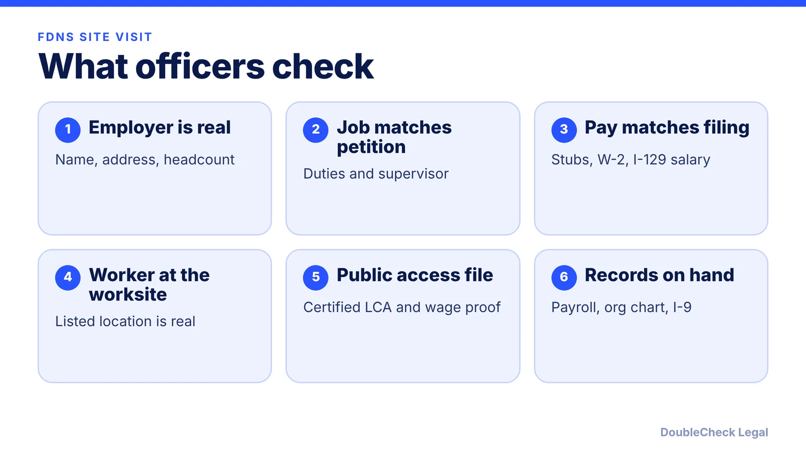
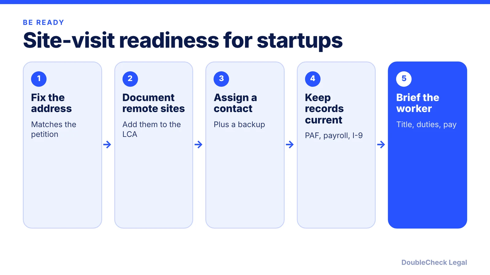

*An unannounced USCIS officer at your door is manageable if the paperwork already matches reality. Here is what H-1B employers, especially startups, should have ready.*

**Key takeaways:**

- FDNS site visits are usually unannounced and can last 30 to 90 minutes (per Fisher Phillips).
- Officers check the employer exists, the job and pay match the petition, and the worker is at the listed location.
- Keep the public access file and every worksite's LCA current, including remote addresses.
- Name and train a point of contact; a worker may ask to meet away from their home.

## 1. The quick answer

**Quick answer:** USCIS's Fraud Detection and National Security (FDNS) officers make H-1B site visits, usually unannounced, to confirm the employer is real, the job and pay match the petition, and the worker is at the listed location. Per Fisher Phillips, participation is technically voluntary but strongly recommended, and a visit can last 30 to 90 minutes. The best preparation is boring: a current public access file, accurate LCAs for every worksite including remote ones, payroll that matches the I-129, and one trained person who knows what to do when an officer arrives.

## 2. What officers verify and how a visit works

Fisher Phillips and RN Law Group describe the same core checks: that the petitioning employer exists, that its representations in the petition are accurate, that the worker performs the described services at the approved location, and that pay is correct. Fisher Phillips adds that officers compare pay stubs with the salary on the I-129, may check whether the worker's tax return income matches, and look for signs the worksite is real, such as a work email or phone.

How visits run, per Fisher Phillips:

- Usually unannounced, though sometimes with notice.
- Officers may interview HR, the worker's supervisor, and the worker, tour the site, and take photos.
- They may ask for W-2s, payroll records, pay stubs, org charts, and, for offsite placements, end-client contracts.
- Counsel may attend if logistically possible, but FDNS will not reschedule for counsel.
- Afterward FDNS writes a Compliance Review Report. Where appropriate, a matter may be referred to ICE for further investigation.

RN Law Group lists third-party placement or consulting arrangements as a risk factor that can trigger a visit, and notes that noncompliance can lead to USCIS investigations and Department of Labor audits.

## 3. Preparing the employer: LCA, public access file, worksite

RN Law Group describes the public access file (PAF) as containing a copy of the certified LCA, the prevailing wage source, how the actual wage was determined, proof of LCA posting, a summary of benefits offered to U.S. and H-1B workers, and documentation of corporate changes affecting the petition. It says the file must be available for public inspection within one working day of the LCA filing and kept at least a year after H-1B employment ends. It also says the LCA notice should be posted for at least 10 business days at the place of employment (or shared electronically), and at secondary and remote worksites too.

A practical checklist, drawn from RN Law Group, Boundless, and Fisher Phillips:

- **Audit the PAF and each LCA** regularly, and keep electronic and paper copies of the I-129 package.
- **Name a point of contact** at each worksite and a backup; tell reception to record the officer's name, title, and contact details and to call that person before anyone is interviewed.
- **Brief the worker** to state their title, duties, salary, and worksite accurately, and to refer detailed questions to the designated representative or attorney.
- **Match payroll to the petition.** Be ready to explain any discrepancy.
- **File an amendment when needed.** RN Law Group says a new worksite in a different metropolitan statistical area requires an H-1B amendment and calls missing one a common violation FDNS finds. Fisher Phillips says to file amended petitions before a visit if duties or locations have materially changed.

Other compliance basics, such as [I-9 and E-Verify for startups](/blog/i-9-and-e-verify-for-startups/), belong in the same binder.

## 4. Startups, founders, and home offices

Startups often have no office, a coworking desk, or employees working from home, which makes the "is this a real worksite" question harder to answer on the spot. Boundless says employers must document all job locations, including remote and hybrid arrangements, and RN Law Group says the LCA must cover all current worksites, including remote addresses where applicable.

On home offices, Fisher Phillips says FDNS may visit a worker's home office. The worker may refuse entry to the home and ask to meet at a nearby public location, may ask for a company representative or counsel to attend in person or virtually, and the company should approve before officers review company documents or laptops.

If the H-1B worker is also a founder or owner, the petition has its own extra requirements; see [starting a company on an H-1B](/blog/start-company-on-h1b-visa-ownership-vs-work/) and the wider [H-1B cap-exempt employers](/blog/h-1b-cap-exempt-employers/) and [foreign founder visa options](/blog/us-visa-options-for-startup-founders-compared/) guides. Incorporation basics are in [how to incorporate a company in the US](/blog/how-to-incorporate-a-company-in-the-us/).

## Where DoubleCheck fits

[DoubleCheck](https://www.contactdoublecheck.com) helps businesses and founders start legal work with AI, verify it, and, when professional advice is warranted, connect with an independent attorney, including for immigration questions. Attorney availability and practice areas vary. Attorneys on DoubleCheck are independent professionals; an attorney-client relationship forms only if an attorney accepts your engagement.

**Sources:** [Fisher Phillips: FDNS site visits](https://www.fisherphillips.com/en/insights/insights/h-1b-employers-beware-an-employers-guide-to-fraud-detection-fdns-site-visits); [Boundless: how to prepare for a USCIS site visit](https://www.boundless.com/blog/how-to-prepare-for-a-uscis-site-visit); [RN Law Group: H-1B employer compliance guide](https://www.rnlawgroup.com/h-1b-employer-compliance-guide-how-to-prepare-for-uscis-fdns-site-visits/).

## FAQ

**What is an FDNS site visit for an H-1B employee?**

Per Fisher Phillips, FDNS officers visit to confirm the employer exists, the petition's representations are accurate, and the worker performs the described services; visits are usually unannounced.

**Can an employer refuse an H-1B site visit?**

Fisher Phillips says participation is voluntary but strongly recommends cooperating. Involve immigration counsel and a designated company representative.

**What belongs in the H-1B public access file?**

RN Law Group lists the certified LCA, the prevailing wage source, how the actual wage was set, proof of LCA posting, a benefits summary, and documentation of relevant corporate changes.

**Can USCIS visit an H-1B worker's home office?**

Yes. Fisher Phillips says FDNS may visit a home office, but the worker may decline entry and propose a nearby public location, and may request that counsel or a company representative attend.

---

*General information only. This article is not legal, tax, investment, or accounting advice.*
