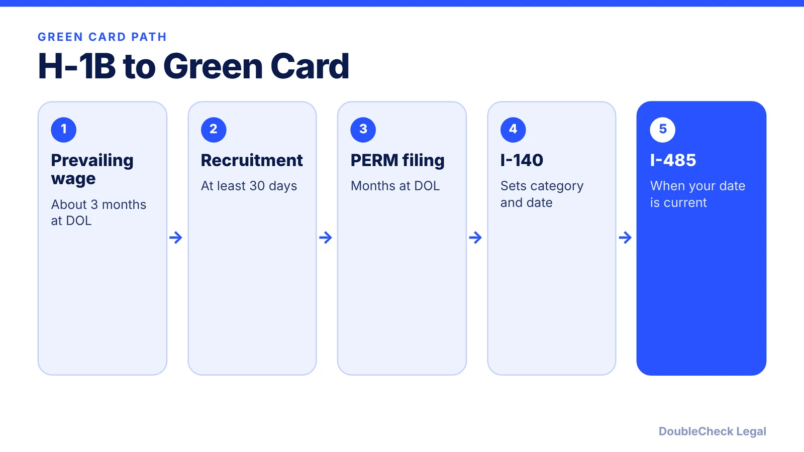
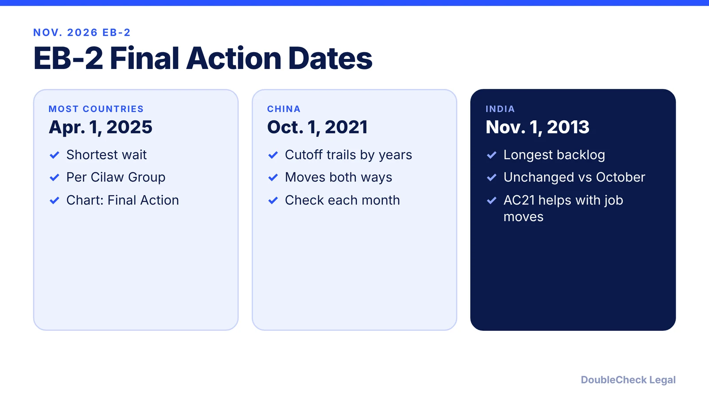

*A realistic sequence and timing for the H-1B to green card route, with the country backlog caveats that decide the real wait.*

**Key takeaways:**

- The standard path is PERM, then I-140, then I-485.
- PERM processing has recently run many months to more than a year; check DOL's current processing times.
- Your country of birth sets the wait: EB-2 cutoffs range from 2025 to 2013.
- You can often keep your priority date and change jobs after I-140 approval.

## 1. The quick answer

**Quick answer:** The usual employer-sponsored path for an H-1B tech worker is PERM labor certification, then an I-140 petition, then Form I-485 once your priority date is current. PERM processing has recently run many months to more than a year, and an employment-based I-485 is often a year or more, so check the current government processing times. The biggest variable is your country of birth: the November 2026 Final Action Date for EB-2 is April 1, 2025 for most countries but November 1, 2013 for India (State Department Visa Bulletin).

## 2. Step by step, with realistic timing

- **Prevailing wage determination.** The employer first requests a prevailing wage determination from DOL, which has taken a few months recently; check DOL's current processing times.
- **Recruitment.** The employer must run DOL-required recruitment of U.S. workers before filing.
- **PERM filing and DOL review.** DOL review has recently run many months to more than a year. Audited cases take longer. See [the PERM process](/blog/perm-labor-certification-green-card-process/).
- **I-140.** Premium processing may be available for some I-140 categories for a faster decision; confirm availability and the current fee with USCIS. The priority date for PERM-based cases is the date DOL accepted the PERM, not the I-140 filing date (National Law Review).
- **I-485.** Possible once your priority date is current under the chart USCIS designates. Timing is often a year or more, so check USCIS's processing times. See the [I-485 guide](/blog/i-485-adjustment-of-status-guide/).

Start early: a PERM or I-140 pending 365 days or more may support a one-year H-1B extension, and a three-year extension may be available once the I-140 is approved and the priority date is not current (ask counsel), which matters for the [six-year H-1B limit](/blog/h-1b-6-year-limit-extensions-beyond-six-years/).

## 3. Per-country backlogs: why the same job can take 2 years or 12+

Visa Bulletin cutoffs follow country of birth. November 2026 Final Action Dates, per the State Department's Visa Bulletin:

- **EB-2:** Apr. 1, 2025 for most countries, Oct. 1, 2021 for China, Nov. 1, 2013 for India.
- **EB-3:** June 15, 2024 for most countries, Jan. 22, 2022 for China, Jan. 22, 2014 for India.

Gaps like these are why timelines differ so much. Any projection of the wait is an estimate, not a prediction, since cutoffs move both ways. For November 2026, USCIS said employment-based adjustment filers use the Dates for Filing chart, where India EB-2 and EB-3 are both Jan. 15, 2015 (Fisher Phillips). Read the full mechanics in the [Visa Bulletin explainer](/blog/visa-bulletin-explained-priority-dates-eb-categories/).

A spouse's country of birth can sometimes be used (cross-chargeability); ask counsel whether it helps you.

## 4. Ways to reduce risk while you wait

- **Keep your priority date.** After an I-140 approval, you can often change employers without losing it. See [I-140 portability](/blog/i-140-portability-ac21-changing-jobs/).
- **After the I-485 is filed,** you may change jobs after 180 days pending if the new role is in the same or a similar occupational field, using Supplement J; confirm eligibility with counsel.
- **Consider self-sponsored routes** if you qualify: [EB-1A](/blog/eb-1a-for-software-engineers-and-tech-employees/) or [NIW](/blog/niw-for-software-engineers-and-researchers/). They have separate requirements and the same country backlogs may apply.
- **Check documents before filing.** Errors cost months; see [checking immigration documents with AI before filing](/blog/check-immigration-documents-with-ai-before-filing/).
- **Spouse work.** An H-4 spouse may be eligible for an EAD; see [H-4 EAD](/blog/h-4-ead-spouses-of-h-1b/).

## Where DoubleCheck fits

[DoubleCheck](https://www.contactdoublecheck.com) helps businesses and founders start legal work with AI, verify it, and, when professional advice is warranted, connect with an independent attorney, including for immigration questions. Attorney availability and practice areas vary. Attorneys on DoubleCheck are independent professionals; an attorney-client relationship forms only if an attorney accepts your engagement.

**Sources:** [U.S. Department of State, November 2026 Visa Bulletin](https://travel.state.gov/content/travel/en/legal/visa-law0/visa-bulletin/2027/visa-bulletin-for-november-2026.html); [Fisher Phillips](https://www.fisherphillips.com/en/insights/insights/the-fp-visa-bulletin-for-november-2026); [National Law Review](https://natlawreview.com/article/how-read-visa-bulletin-step-step-guide-eb-1-and-eb-2-applicants). Confirm processing times with DOL and USCIS.

## FAQ

**How long does PERM take in 2026?**

PERM processing has recently run many months and often more than a year, and audits add time. Check the Department of Labor's published processing times for the current figure.

**What is a priority date for PERM cases?**

The date the Department of Labor accepted the labor certification, not the I-140 filing date, per the National Law Review.

**How long does an I-485 take?**

Timing varies by case and service center and is often a year or more. Check USCIS's published processing times.

**Why do Indian and Chinese applicants wait longer?**

Visa Bulletin cutoffs are set by country of birth. In November 2026 the EB-2 Final Action Date is Nov. 1, 2013 for India and Oct. 1, 2021 for China versus Apr. 1, 2025 for most countries, per the State Department's November 2026 Visa Bulletin.

---

*General information only. This article is not legal, tax, investment, or accounting advice.*
