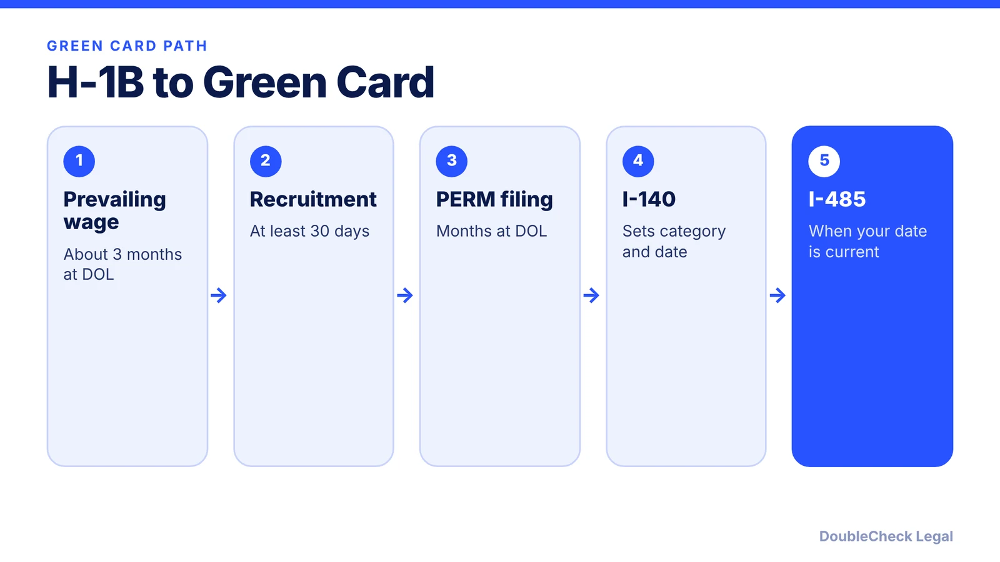
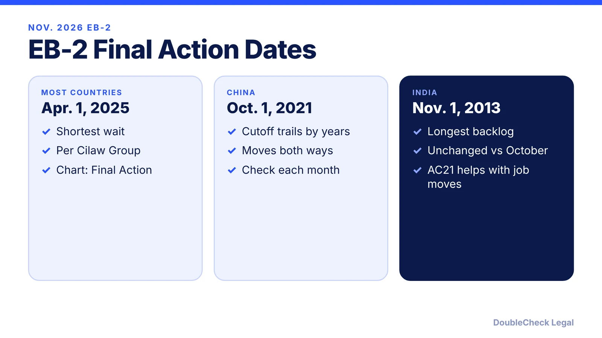

*A realistic sequence and timing for the H-1B to green card route, with the country backlog caveats that decide the real wait.*

**Key takeaways:**

- The standard path is PERM, then I-140, then I-485.
- DOL data posted September 2026 show a 336-day average for PERM.
- Your country of birth sets the wait: EB-2 cutoffs range from 2025 to 2013.
- You can often keep your priority date and change jobs after I-140 approval.

## 1. The quick answer

**Quick answer:** The usual employer-sponsored path for an H-1B tech worker is PERM labor certification, then an I-140 petition, then Form I-485 once your priority date is current. DOL data put average PERM processing at 336 days in September 2026 (Manifest Law), and a typical employment-based I-485 takes 10 to 18 months (Beyond Border). The biggest variable is your country of birth: the November 2026 Final Action Date for EB-2 is April 1, 2025 for most countries but November 1, 2013 for India (Cilaw Group).

## 2. Step by step, with realistic timing

- **Prevailing wage determination.** Reddy Neumann Brown reported PWDs issued in about 3 months in March 2026, improved from roughly 6 months before.
- **Recruitment.** The employer must recruit U.S. workers for at least 30 days (Manifest Law).
- **PERM filing and DOL review.** Reddy Neumann Brown cited an average of about 503 days in March 2026 and 16 to 17 months for non-audited approvals. Manifest Law's later figure, from DOL data posted September 22, 2026, is 336 days. Audited cases take longer. See [the PERM process](/blog/perm-labor-certification-green-card-process/).
- **I-140.** Premium processing is a 15-business-day clock for EB-2 and EB-3, at $2,965, per Immi-USA; confirm with USCIS. The priority date for PERM-based cases is the date DOL accepted the PERM, not the I-140 filing date (National Law Review).
- **I-485.** Possible once your priority date is current under the chart USCIS designates. Beyond Border puts typical employment-based timing at 10 to 18 months. No premium processing is available. See the [I-485 guide](/blog/i-485-adjustment-of-status-guide/).

Start early: Reddy Neumann Brown notes that a PERM pending 365 days or more may support a one-year H-1B extension, and a three-year extension may be available once the I-140 is approved and the priority date is not current, which matters for the [six-year H-1B limit](/blog/h-1b-6-year-limit-extensions-beyond-six-years/).

## 3. Per-country backlogs: why the same job can take 2 years or 12+

Visa Bulletin cutoffs follow country of birth. November 2026 Final Action Dates, per Cilaw Group:

- **EB-2:** Apr. 1, 2025 for most countries, Oct. 1, 2021 for China, Nov. 1, 2013 for India.
- **EB-3:** June 15, 2024 for most countries, Jan. 22, 2022 for China, Jan. 22, 2014 for India.

Gaps like these are why timelines differ so much. One estimate site, US Visa Stack, projects 1.5 to 3 years for rest-of-world, 6 to 8 for China, and 13 to 17+ for India; treat those as estimates, not predictions, since cutoffs move both ways. For November 2026, USCIS said employment-based adjustment filers use the Dates for Filing chart, where India EB-2 and EB-3 are both Jan. 15, 2015 (Fisher Phillips). Read the full mechanics in the [Visa Bulletin explainer](/blog/visa-bulletin-explained-priority-dates-eb-categories/).

A spouse's country of birth can sometimes be used (cross-chargeability), per US Visa Stack and the National Law Review.

## 4. Ways to reduce risk while you wait

- **Keep your priority date.** After an I-140 approval, you can often change employers without losing it. See [I-140 portability](/blog/i-140-portability-ac21-changing-jobs/).
- **After the I-485 is filed,** you may change jobs after 180 days pending if the new role is in the same or a similar occupational field, using Supplement J (Beyond Border).
- **Consider self-sponsored routes** if you qualify: [EB-1A](/blog/eb-1a-for-software-engineers-and-tech-employees/) or [NIW](/blog/niw-for-software-engineers-and-researchers/). They have separate requirements and the same country backlogs may apply.
- **Check documents before filing.** Errors cost months; see [checking immigration documents with AI before filing](/blog/check-immigration-documents-with-ai-before-filing/).
- **Spouse work.** An H-4 spouse may be eligible for an EAD; see [H-4 EAD](/blog/h-4-ead-spouses-of-h-1b/).

## Where DoubleCheck fits

[DoubleCheck](https://www.contactdoublecheck.com) helps businesses and founders start legal work with AI, verify it, and, when professional advice is warranted, connect with an independent attorney, including for immigration questions. Attorney availability and practice areas vary. Attorneys on DoubleCheck are independent professionals; an attorney-client relationship forms only if an attorney accepts your engagement.

**Sources:** [Reddy Neumann Brown, March 2026](https://www.rnlawgroup.com/perm-prevailing-wage-processing-times-march-2026-update/); [Manifest Law](https://manifestlaw.com/blog/perm-dol-processing-times); [Cilaw Group](https://cilawgroup.com/?p=16977); [Fisher Phillips](https://www.fisherphillips.com/en/insights/insights/the-fp-visa-bulletin-for-november-2026); [Immi-USA](https://www.immi-usa.com/premium-processing/); [Beyond Border, Form I-485](https://www.beyondborderglobal.com/resources/form-i-485); [US Visa Stack](https://www.usvisastack.ai/h1b-to-green-card-timeline); [National Law Review](https://natlawreview.com/article/how-read-visa-bulletin-step-step-guide-eb-1-and-eb-2-applicants).

## FAQ

**How long does PERM take in 2026?**

DOL data posted September 22, 2026 show a 336-day average, per Manifest Law. Reddy Neumann Brown cited about 503 days in March 2026. Audits add time.

**What is a priority date for PERM cases?**

The date the Department of Labor accepted the labor certification, not the I-140 filing date, per the National Law Review.

**How long does an I-485 take?**

Beyond Border says employment-based cases typically take 10 to 18 months, and premium processing is not available.

**Why do Indian and Chinese applicants wait longer?**

Visa Bulletin cutoffs are set by country of birth. In November 2026 the EB-2 Final Action Date is Nov. 1, 2013 for India and Oct. 1, 2021 for China versus Apr. 1, 2025 for most countries, per Cilaw Group.

---

*General information only. This article is not legal, tax, investment, or accounting advice.*
