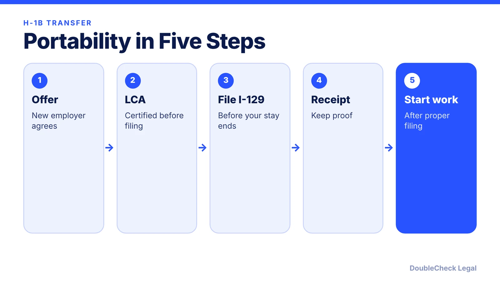
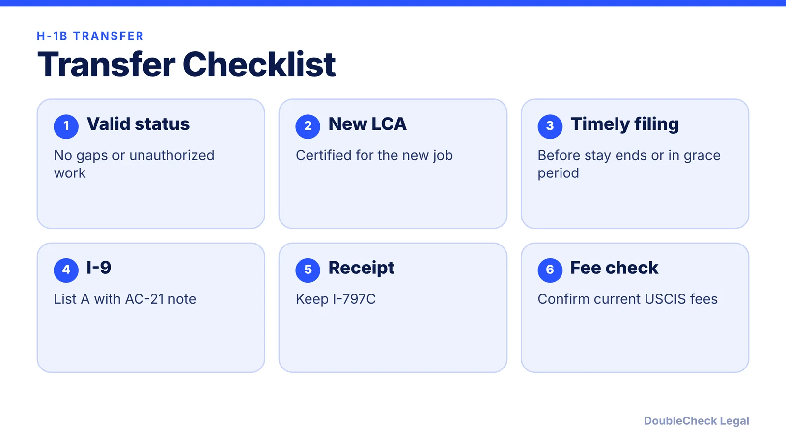

*Switching jobs on an H-1B? Portability may let you start once the new petition is filed. Here are the rules and traps.*

**Key takeaways:**

- You can generally start the new job once a non-frivolous petition is properly filed, per law-firm guidance.
- Each employer files its own petition with a certified LCA; most transfers are cap-exempt.
- If denied, you must stop working; a grace period of up to 60 days may apply.
- BU says the $100,000 fee does not apply to transfers inside the U.S.; it is in litigation.

## 1. The quick answer

**Quick answer:** If you are in valid H-1B status, you can generally start working for a new employer once that employer properly files a change-of-employer petition for you. You do not have to wait for approval, per Davidson Morris and Berardi Immigration Law. Each employer files its own petition, with a certified labor condition application, and most transfers are cap-exempt because you were already counted.

## 2. Rules to watch

- **File before your authorized stay ends.** If you already left the old job, a petition filed within the 60-day discretionary grace period can still be portable (Berardi).
- **No unauthorized work.** Portability assumes your status was maintained.
- **Form I-9:** list your foreign passport and unexpired I-94 as a List A document, and note "AC-21" with the I-129 submission date (Berardi).
- **If the petition is denied,** you must stop working immediately. A discretionary grace period of up to 60 days may let you file again, change status, or leave (Davidson Morris).
- **Wait for the receipt.** Law firms recommend waiting for the I-797C receipt before starting.

## 3. Fees and the $100,000 question

Davidson Morris (page dated November 2025) lists base I-129 at $780 ($460 for small employers and nonprofits), ACWIA $750 or $1,500, a $500 fraud fee, and an Asylum Program Fee of $600 ($300 small employers). Premium processing is $2,965 as of March 2026 per other law-firm pages, not the older $2,805. Boston University's international office says the $100,000 proclamation fee does not apply to H-1B change of employer, extension, or change of status for people inside the U.S., and that the fee is in litigation. See [the current $100,000 fee status](/blog/h1b-100000-fee-status-2026/).

## 4. Founders and startups

A startup hiring you must meet employer requirements too: see [how a startup can sponsor an H-1B employee](/blog/startup-sponsor-h1b-employee-requirements/). If you plan to own a company, read [ownership vs. work on an H-1B](/blog/start-company-on-h1b-visa-ownership-vs-work/), and for spouses see [H-4 EAD](/blog/h-4-ead-spouses-of-h-1b/). Use [AI to check your immigration paperwork](/blog/check-immigration-documents-with-ai-before-filing/) before you sign.

## Where DoubleCheck fits

[DoubleCheck](https://www.contactdoublecheck.com) helps businesses and founders start legal work with AI, verify it, and, when professional advice is warranted, connect with an independent attorney, including for immigration questions. Attorney availability and practice areas vary. Attorneys on DoubleCheck are independent professionals; an attorney-client relationship forms only if an attorney accepts your engagement.

**Sources:** [Davidson Morris](https://www.davidsonmorris.com/h1b-transfer/); [Berardi Immigration Law](https://berardiimmigrationlaw.com/h-1b-portability-for-employers-when-can-a-new-hire-actually-start-work/); [Boston University ISSO](https://www.bu.edu/isso/?p=16166); [F1Jobs](https://www.f1jobs.io/resources/blog/l1-new-office-visa-founders-opening-us-operation).

## FAQ

**Can I start working before my H-1B transfer is approved?**

Generally yes, if you are in valid status and the new employer properly files a petition, per Davidson Morris and Berardi. Ask your attorney before starting.

**Do I go through the H-1B lottery again for a transfer?**

Davidson Morris says most transfers are cap-exempt because you were already counted.

**What happens if my H-1B transfer is denied?**

You must stop working immediately. Up to 60 days of discretionary grace may allow another petition, a change of status, or departure.

**Does the $100,000 H-1B fee apply to transfers?**

Boston University's international office says it does not apply to change of employer for people inside the U.S., and notes ongoing litigation. Confirm the latest status.

---

*General information only. This article is not legal, tax, investment, or accounting advice.*
