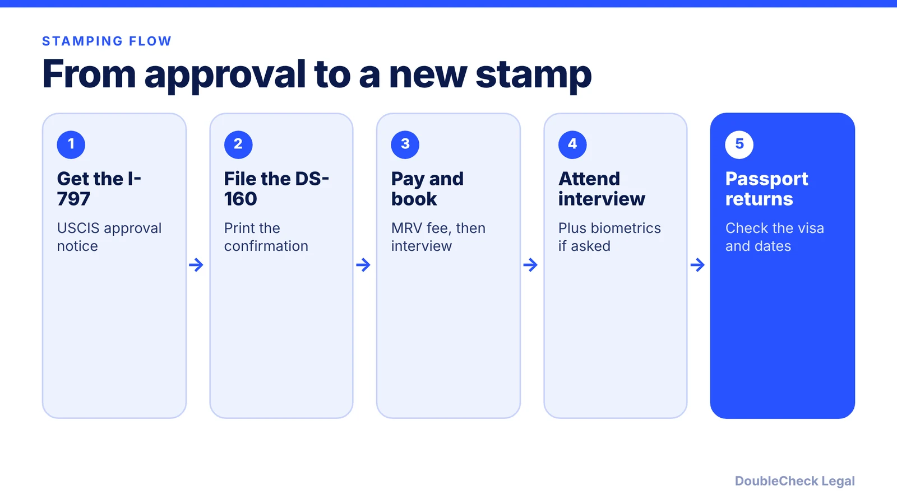
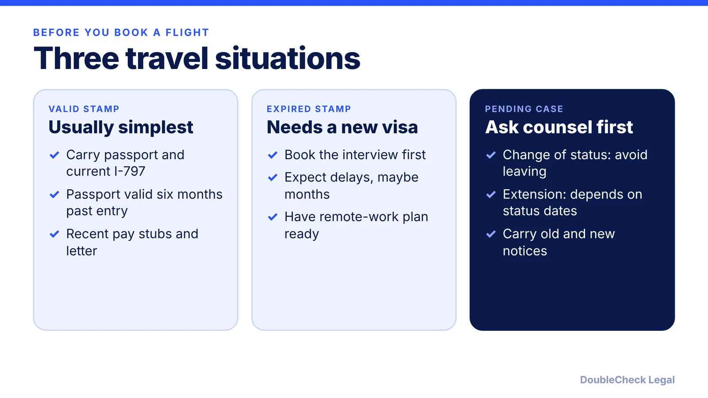

*A new H-1B stamp now means an in-person interview, an online presence review, and possible delays. Here is what to know as of November 2026.*

**Key takeaways:**

- You need a valid visa stamp to re-enter in H-1B status; an expired stamp only matters when you travel.
- Nearly all applicants need an in-person interview since September 2, 2025, and most must apply in their home country or country of residence.
- H-1B and H-4 applicants face online presence review since December 15, 2025; set social media to public.
- Do not leave the U.S. during a pending change of status without counsel's advice; extensions depend on your status dates.

## 1. The quick answer

**Quick answer:** USCIS approval gives you H-1B status, but a visa stamp from a U.S. embassy or consulate abroad is what lets you board a flight and re-enter, per RJ Immigration Law. You only need a new stamp if you travel and your old one has expired (or you never had one). Since September 2, 2025, nearly all nonimmigrant visa applicants must attend an in-person interview, per Boston University's international office, and since December 15, 2025 H-1B and H-4 applicants face an online presence review, per Fragomen. As of November 2026, treat any trip that needs a new stamp as a multi-week or multi-month commitment.

## 2. When you need a stamp and where to get it

You need a valid H-1B visa to enter the U.S. in H-1B status (Canadian citizens are visa-exempt, per [RJ Immigration Law](https://rjimmigrationlaw.com/resources/h-1b-visa-stamping-in-2026-process-documents-and-what-to-expect/)). An expired stamp does not affect your status while you are inside the U.S., but you will need a new one before re-entering after travel, per [Manifest Law](https://manifestlaw.com/blog/h1b-visa-stamping-in-usa/).

Two points that changed in the past year:

- **Interview waivers.** Boston University reports that the State Department narrowed waiver criteria effective September 2, 2025, and that the listed exceptions cover mainly diplomatic and similar categories, plus B-1/B-2 renewals, not H-1B. Consular officers can still require an interview in any case. Rules may have moved again, so check [travel.state.gov](https://travel.state.gov) and your consulate's page. We could not verify any 2026 H-1B waiver change.
- **Where to apply.** Manifest Law says most applicants must now schedule in their home country or country of residence, and Morgan Lewis says the State Department restricted third-country national (TCN) processing in September 2025, with most posts suspending it or limiting it to narrow cases. Do not plan a "vacation stamping" trip to a third country.

Domestic stamping is not something to count on. Manifest Law says the domestic pilot ended, though Yale's page still mentions a limited State Department pilot for certain renewals. Verify with your employer's counsel before relying on either statement.

For appointment-related refusals, see [visa 221(g) administrative processing](/blog/visa-221g-administrative-processing/).

## 3. Delays, vetting and the $100,000 fee question

**Online presence review.** Per [Fragomen](https://www.fragomen.com/insights/united-states-us-consulates-cancelling-some-h-1b-and-h-4-visa-appointments-due-to-new-online-presence-review.html), the State Department began reviewing the online presence of H-1B and H-4 applicants on December 15, 2025. Applicants must set social media privacy settings to "public." The review reportedly focuses on involvement in censorship of U.S. citizens, and expands a policy first applied to F, M, and J applicants in June 2025.

**Delays.** In India, appointments from mid-December 2025 were cancelled and many moved to March 2026, per Fragomen. [Morgan Lewis](https://www.morganlewis.com/pubs/2025/12/postponed-h-1b-h-4-interviews-in-india-enhanced-vetting-and-end-of-tcn-processing-create-delay-at-us-consulates) adds that only one reschedule is allowed, that you should not attend the original date, and that employers should plan for multi-month absences and remote-work requests from abroad. Manifest Law reports that as of March 2026 some appointments were set as far out as summer 2027. Wait times vary by post and change often, so check the live availability.

**The $100,000 fee.** Manifest Law says USCIS stated in October 2025 that it applies only to new petitions for workers outside the U.S. without a valid H-1B, not to extensions, amendments, or in-U.S. changes of status. Litigation has been active; see [H-1B $100,000 fee status](/blog/h1b-100000-fee-status-2026/) and check current guidance before any trip while a new petition is pending.

Plan around [H-1B cap timelines](/blog/h-1b-cap-registration-fy2028-timeline-employers/) and the [weighted lottery](/blog/h1b-weighted-lottery-wage-levels-explained/) if your status depends on them.

## 4. What to carry and travel during a pending case

**Documents** (per Manifest Law and RJ Immigration Law): valid passport, I-797 approval notice, DS-160 confirmation with barcode, interview appointment confirmation, employment verification letter, and for renewals recent pay stubs and the latest petition. Degrees, transcripts, and prior visas are useful extras. Yale adds that your passport should be valid six months beyond re-entry, and to carry an I-612 approval if you were subject to the J-1 home requirement; see [J-1 212(e) waivers](/blog/j-1-two-year-home-residency-requirement-212e-waiver/). The visa fee (MRV) is usually about $190 and non-refundable, per Manifest Law, and varies by country.

**Pending extension or change of status.** The rules differ:

- **Change of status (for example from F-1):** the University of Michigan says leaving the U.S. causes USCIS to treat the petition as abandoned, and you would need an H-1B visa abroad. See [F-1 cap-gap and change of status](/blog/f-1-cap-gap-change-of-status-to-h-1b/).
- **Extension of stay:** Michigan says travel is allowed if you were in the U.S. at filing, but if approval arrives while you are abroad, you re-enter on the new notice. Yale says if your status expires while the extension is pending, you cannot return until it is approved, and need a new stamp.
- **Employer change:** Michigan says travel is possible but not recommended; Yale describes similar risks. See [H-1B transfer](/blog/h-1b-transfer-change-of-employer-portability/).

Also note that a trip can end in administrative processing. Talk to your employer's immigration counsel and your DSO or international office before booking. Spouses should review [H-4 EAD](/blog/h-4-ead-spouses-of-h-1b/).

## Where DoubleCheck fits

[DoubleCheck](https://www.contactdoublecheck.com) helps businesses and founders start legal work with AI, verify it, and, when professional advice is warranted, connect with an independent attorney, including for immigration questions. Attorney availability and practice areas vary. Attorneys on DoubleCheck are independent professionals; an attorney-client relationship forms only if an attorney accepts your engagement.

**Sources:** [Fragomen, online presence review for H-1B and H-4](https://www.fragomen.com/insights/united-states-us-consulates-cancelling-some-h-1b-and-h-4-visa-appointments-due-to-new-online-presence-review.html); [Morgan Lewis, postponed H-1B/H-4 interviews](https://www.morganlewis.com/pubs/2025/12/postponed-h-1b-h-4-interviews-in-india-enhanced-vetting-and-end-of-tcn-processing-create-delay-at-us-consulates); [Manifest Law, H-1B visa stamping](https://manifestlaw.com/blog/h1b-visa-stamping-in-usa/); [RJ Immigration Law, H-1B stamping in 2026](https://rjimmigrationlaw.com/resources/h-1b-visa-stamping-in-2026-process-documents-and-what-to-expect/); [Boston University ISSO, interview waiver change](https://www.bu.edu/isso/?p=3442); [Yale OISS, travel in employment-based status](https://oiss.yale.edu/immigration/h-1b-temporary-worker/maintaining-legal-status/international-travel-in-employment-based-visa-status); [University of Michigan International Center](https://internationalcenter.umich.edu/node/300).

## FAQ

**Do I need H-1B visa stamping if I do not travel?**

No. Per RJ Immigration Law, USCIS approval grants H-1B status, and a stamp is required for travel. Manifest Law adds that an expired stamp does not affect status while you are in the U.S.

**Can I still use a dropbox or interview waiver for H-1B renewal?**

Per Boston University's international office, the State Department narrowed waiver criteria effective September 2, 2025, and nearly all applicants must schedule an interview. We could not verify a 2026 H-1B waiver change, so check travel.state.gov.

**Can I get my H-1B stamped in a third country?**

Per Manifest Law, most applicants must schedule in their home country or country of residence. Morgan Lewis says TCN processing was restricted in September 2025, so do not rely on it.

**Can I travel while my H-1B change of status is pending?**

Per the University of Michigan International Center, leaving the U.S. causes USCIS to treat a pending change of status as abandoned. Extensions are different; ask your employer's counsel before you book.

---

*General information only. This article is not legal, tax, investment, or accounting advice.*
