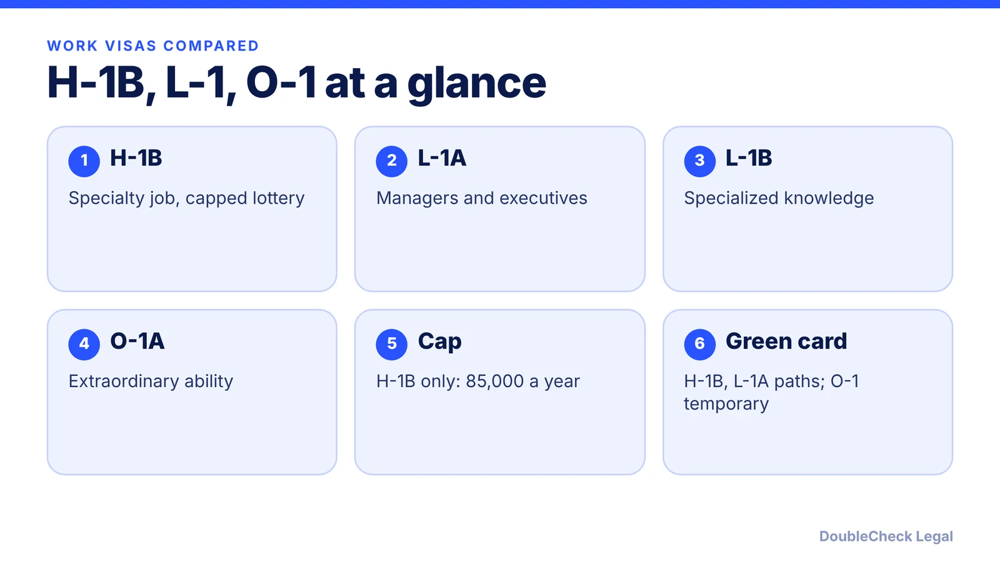
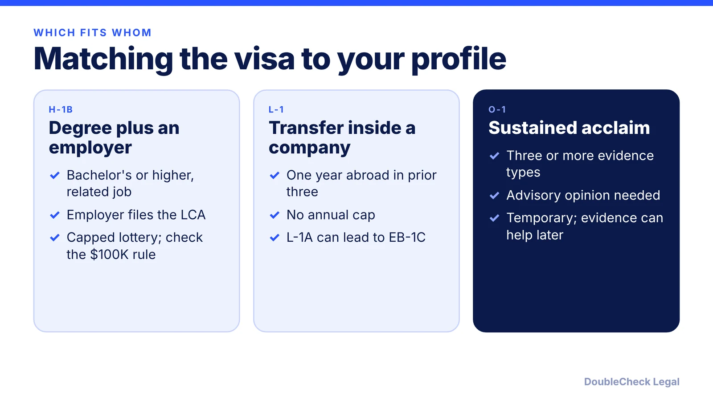

*Three visas, three different gatekeepers: a lottery, a corporate relationship, or a record of acclaim.*

**Key takeaways:**

- H-1B is capped at 85,000 and lottery-selected; L-1 and O-1 have no annual cap (per Alma).
- L-1 needs one continuous year abroad with a related company in the prior three years.
- O-1A needs at least three types of evidence plus an advisory opinion (per USCIS).
- The $100,000 H-1B payment applies to certain new petitions, not to current H-1B holders or approved in-U.S. changes of status.

## 1. The quick answer

**Quick answer:** For a tech employee, the right visa usually turns on three facts: whether you already work for a related company abroad (L-1), whether you have a degree-level job and can win a capped lottery (H-1B), or whether you have a record of sustained acclaim in your field (O-1). Per Alma's April 2026 comparison, H-1B is capped at 85,000 a year and selected by lottery, while L-1 and O-1 are not subject to that annual cap. As of November 2026, the $100,000 H-1B payment also applies to certain new petitions, so the cost gap between these visas has widened.

## 2. How each visa works

**H-1B.** Per [Alma](https://www.tryalma.com/learn/l1-vs-h1b-tech-workers), you need a bachelor's degree or higher in a related field, a specialty occupation, and a U.S. employer that files a labor condition application. There is no prior-employer-abroad requirement. The annual cap is 85,000 (65,000 plus 20,000 for advanced-degree holders), and selection is by lottery.

**L-1.** This is an intracompany transfer. Per Alma, you must have worked for the qualifying foreign organization for one continuous year within the prior three years, and the U.S. and foreign entities need a qualifying relationship (parent, subsidiary, branch, or affiliate). L-1A covers executives and managers; L-1B covers specialized knowledge workers. Alma lists L-1A at 3 years initial and 7 maximum, and L-1B at 3 years initial and 5 maximum, with new offices getting a 1-year initial period. See [L-1A for new offices](/blog/l-1a-visa-new-office-foreign-founders/).

**O-1.** Per [USCIS](https://uscis.gov/o-1), O-1A covers extraordinary ability in the sciences, education, business, or athletics, which is the usual route for tech. A U.S. employer or U.S. agent files Form I-129, the petition needs at least three types of evidence matching the regulatory categories, and a written advisory opinion from a peer group or expert is generally required. Initial stay is up to three years, with extensions in up to one-year increments. Evidence is covered in [O-1A evidence for founders](/blog/o-1a-visa-for-startup-founders-evidence/).

USCIS also notes that O-3 dependents (spouse and children under 21) cannot work but may study.

## 3. Cost, speed, and the $100,000 payment

Premium processing for many I-129 petitions, including H-1B, L-1, and O-1, was $2,965 as of March 1, 2026, per Alma and Beyond Border. Premium processing speeds the review, not the approval odds.

The bigger variable is the Presidential Proclamation payment. Per [Yale's summary of USCIS guidance](https://oiss.yale.edu/node/8018), the $100,000 payment applies to H-1B petitions filed on or after September 21, 2025 for certain beneficiaries, including those outside the U.S. without a valid H-1B visa, and in-U.S. requests that ask for consular processing. Current H-1B holders are exempt, as are in-U.S. change-of-status, amendment, or extension requests that USCIS approves. Alma describes it as applying to new overseas hires and not to L-1 transfers.

Because the rules and fees changed several times in 2025-2026, confirm the current rule on the USCIS page before relying on any number here.

## 4. Choosing between them

Ask these in order:

1. **Do you work for a related company abroad?** If yes for a year or more, L-1 skips the lottery.
2. **Can you document top-of-field recognition?** Press coverage, awards, high-paid roles, judging, and original contributions feed an O-1A. See [O-1A vs EB-1A](/blog/eb-1a-vs-o-1-founder-which-path/).
3. **Are you in the U.S. already, say on F-1?** Then a change of status may avoid the $100,000 payment if approved in the U.S., per Yale's summary; see [F-1 cap-gap and H-1B](/blog/f-1-cap-gap-change-of-status-to-h-1b/).
4. **Do you need a green card?** H-1B and L-1A allow immigrant intent per Alma. O-1 is a temporary status, per Beyond Border, though its evidence can later support a petition. Read [H-1B to green card timeline](/blog/h-1b-to-green-card-timeline-tech-workers/) and the overview in [US visa options compared](/blog/us-visa-options-for-startup-founders-compared/).

If you are a founder, who owns the company and who files also matters; see [starting a company on H-1B](/blog/start-company-on-h1b-visa-ownership-vs-work/).

## Where DoubleCheck fits

[DoubleCheck](https://www.contactdoublecheck.com) helps businesses and founders start legal work with AI, verify it, and, when professional advice is warranted, connect with an independent attorney, including for immigration questions. Attorney availability and practice areas vary. Attorneys on DoubleCheck are independent professionals; an attorney-client relationship forms only if an attorney accepts your engagement.

**Sources:** [Alma, L-1 vs H-1B (Tech Workers), updated April 21, 2026](https://www.tryalma.com/learn/l1-vs-h1b-tech-workers); [USCIS, O-1 Visa](https://uscis.gov/o-1); [Yale OISS, USCIS Clarifies $100,000 H-1B Fee Requirement](https://oiss.yale.edu/node/8018); [Beyond Border, F-1 to O-1](https://www.beyondborderglobal.com/resources/f1-to-o1-visa).

## FAQ

**Which is easier to get, H-1B or O-1?**

Neither is easy. H-1B depends on a capped lottery, while O-1 depends on whether you can document sustained acclaim. Per USCIS, O-1 petitions need at least three types of evidence matching the regulatory categories.

**Does the $100,000 fee apply to L-1 or O-1?**

The proclamation payment is specific to H-1B petitions. Alma describes it as applying to new overseas H-1B hires and not to L-1 transfers. Check the current USCIS guidance for your case.

**Can I get a green card from L-1 or O-1?**

Alma says L-1 permits immigrant intent and L-1A can lead to EB-1C. Beyond Border describes O-1 as temporary, with its evidence potentially supporting EB-1A or EB-2 NIW plans later.

**Can my spouse work on these visas?**

Per USCIS, O-3 dependents cannot work but may study. L-2 and H-4 rules differ; see our post on spouse work rights and check USCIS for your category.

---

*General information only. This article is not legal, tax, investment, or accounting advice.*
