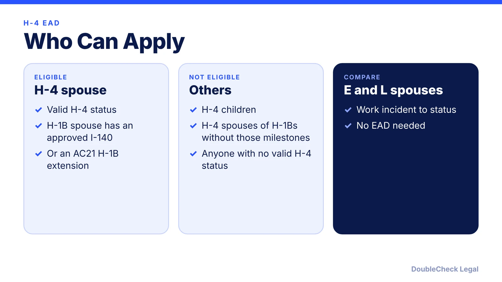
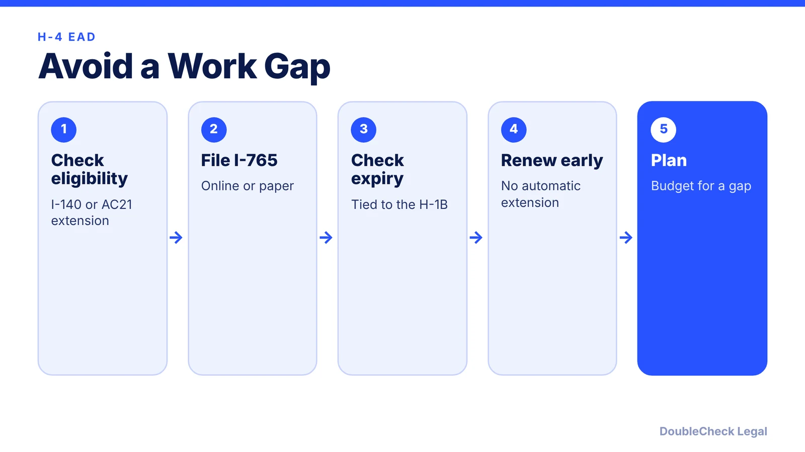

*Can an H-1B spouse work? Only with an H-4 EAD, and only in certain cases. Here are the rules, fees, and the renewal gap.*

**Key takeaways:**

- Only H-4 spouses qualify, and the H-1B spouse needs an approved I-140 or an AC21 extension.
- Fees listed for September 2026: I-765 $520 on paper, $470 online.
- The automatic 540-day extension ended for renewals filed on or after October 30, 2025.
- Processing is roughly 4.5 to 11 months per one source; no premium processing.

## 1. The quick answer

**Quick answer:** Only H-4 spouses of certain H-1B workers can get a work permit (EAD). Your H-1B spouse must have an approved I-140 or an H-1B extension granted under the AC21 provisions (for example, a PERM or I-140 pending 365 days or more), per Beyond Border Global. You file Form I-765 and cannot work until you have the EAD. Children are not eligible.

## 2. Fees and timing

Beyond Border Global lists I-765 fees as of September 2026 at $520 on paper or $470 online, with Form I-539 at $470, and says premium processing is not available for the I-539 or H-4 EAD. Processing was roughly 4.5 to 11 months in its estimate; RN Law Group (April 2026) cites about six months from USCIS and often longer. Confirm fees and times on USCIS's pages before filing.

## 3. The renewal gap

Per Beyond Border Global and RN Law Group, the automatic 540-day extension ended for renewals filed on or after October 30, 2025, so work authorization ends on the card's expiration date while a renewal is pending. The EAD generally expires when the H-1B spouse's status does, and many families file the I-765 together with the H-4 extension. File as early as the rules allow and plan for a possible gap. RN Law Group also says the settlement requirement to process H-4 filings with the H-1B petition expired January 18, 2025, so concurrent processing is now discretionary.

## 4. Other options for the spouse

If the H-4 EAD does not fit, the spouse can explore their own [H-1B](/blog/h1b-weighted-lottery-wage-levels-explained/), [O-1](/blog/o-1a-visa-for-startup-founders-evidence/), or a business route such as an [E-2](/blog/e-2-treaty-investor-visa-for-founders/) if a treaty applies. Related: [H-1B transfers](/blog/h-1b-transfer-change-of-employer-portability/) and [how to find an immigration lawyer](/blog/how-to-find-good-immigration-lawyer-startup-founder/).

## Where DoubleCheck fits

[DoubleCheck](https://www.contactdoublecheck.com) helps businesses and founders start legal work with AI, verify it, and, when professional advice is warranted, connect with an independent attorney, including for immigration questions. Attorney availability and practice areas vary. Attorneys on DoubleCheck are independent professionals; an attorney-client relationship forms only if an attorney accepts your engagement.

**Sources:** [Beyond Border Global](https://www.beyondborderglobal.com/resources/h-4-ead); [RN Law Group](https://www.rnlawgroup.com/h-4-ead-delays-in-2026-why-work-authorization-gaps-are-increasing/); [CitizenPath](https://citizenpath.com/h-4-ead-work-authorization/).

## FAQ

**Can H-4 spouses work in the U.S.?**

Only with an H-4 EAD, and only if the H-1B spouse has an approved I-140 or an H-1B extension under the AC21 provisions, per Beyond Border Global.

**Do H-4 children get a work permit?**

No. Only H-4 spouses qualify for the EAD.

**Is there still an automatic extension for H-4 EAD renewals?**

Per Beyond Border Global and RN Law Group, the 540-day automatic extension ended for renewals filed on or after October 30, 2025.

**How long does an H-4 EAD take?**

Estimates range from about 4.5 to 11 months. Check USCIS processing times.

---

*General information only. This article is not legal, tax, investment, or accounting advice.*
