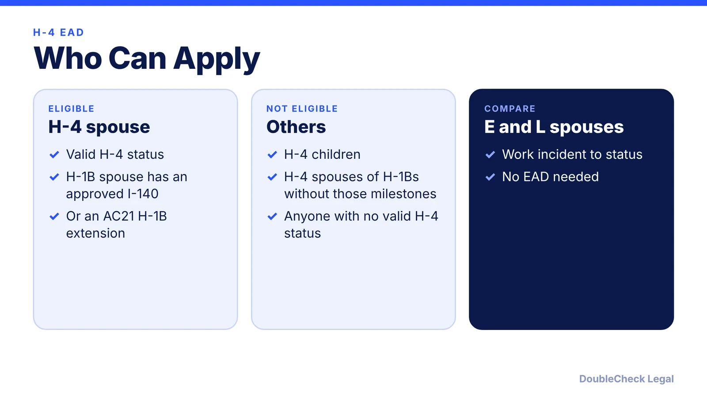
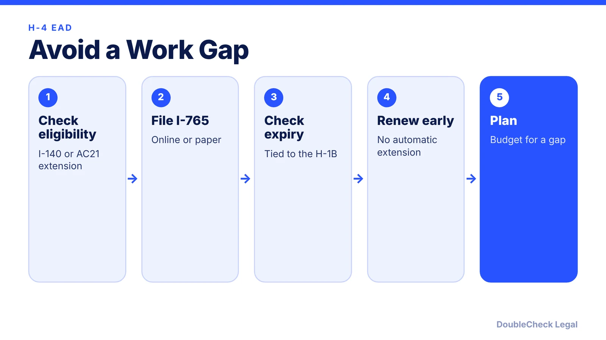

*Can an H-1B spouse work? Only with an H-4 EAD, and only in certain cases. Here are the rules, fees, and the renewal gap.*

**Key takeaways:**

- Only H-4 spouses qualify, and the H-1B spouse needs an approved I-140 or an AC21 extension.
- Fees and processing times change; check USCIS's current fee schedule and processing times before filing.
- The automatic 540-day extension generally no longer applies to renewals filed on or after October 30, 2025.
- Processing can take many months; plan for a possible gap.

## 1. The quick answer

**Quick answer:** Only H-4 spouses of certain H-1B workers can get a work permit (EAD). Your H-1B spouse must have an approved I-140 or an H-1B extension granted under the AC21 provisions (for example, a PERM or I-140 pending 365 days or more). You file Form I-765 and cannot work until you have the EAD. Children are not eligible.

## 2. Fees and timing

Filing fees and processing times change often. Check USCIS's fee schedule and published processing times before filing, and plan for a wait of several months for a first or renewal EAD.

## 3. The renewal gap

The automatic 540-day extension generally no longer applies to renewals filed on or after October 30, 2025, so work authorization ends on the card's expiration date while a renewal is pending. The EAD generally expires when the H-1B spouse's status does, and many families file the I-765 together with the H-4 extension. File as early as the rules allow and plan for a possible gap. Concurrent processing of H-4 filings with the H-1B petition is no longer guaranteed, so ask your attorney how to time filings.

## 4. Other options for the spouse

If the H-4 EAD does not fit, the spouse can explore their own [H-1B](/blog/h1b-weighted-lottery-wage-levels-explained/), [O-1](/blog/o-1a-visa-for-startup-founders-evidence/), or a business route such as an [E-2](/blog/e-2-treaty-investor-visa-for-founders/) if a treaty applies. Related: [H-1B transfers](/blog/h-1b-transfer-change-of-employer-portability/) and [how to find an immigration lawyer](/blog/how-to-find-good-immigration-lawyer-startup-founder/).

## Where DoubleCheck fits

[DoubleCheck](https://www.contactdoublecheck.com) helps businesses and founders start legal work with AI, verify it, and, when professional advice is warranted, connect with an independent attorney, including for immigration questions. Attorney availability and practice areas vary. Attorneys on DoubleCheck are independent professionals; an attorney-client relationship forms only if an attorney accepts your engagement.

**Sources:** No primary USCIS page could be retrieved while preparing this update. Confirm eligibility, fees, and processing times on USCIS's H-4 EAD and Form I-765 pages.

## FAQ

**Can H-4 spouses work in the U.S.?**

Only with an H-4 EAD, and only if the H-1B spouse has an approved I-140 or an H-1B extension under the AC21 provisions, as generally described by USCIS; confirm current rules with USCIS or an attorney.

**Do H-4 children get a work permit?**

No. Only H-4 spouses qualify for the EAD.

**Is there still an automatic extension for H-4 EAD renewals?**

The automatic 540-day extension generally no longer applies to H-4 EAD renewals filed on or after October 30, 2025; confirm current rules on USCIS's website.

**How long does an H-4 EAD take?**

Processing times vary and change often. Check USCIS's published processing times for your service center.

---

*General information only. This article is not legal, tax, investment, or accounting advice.*
