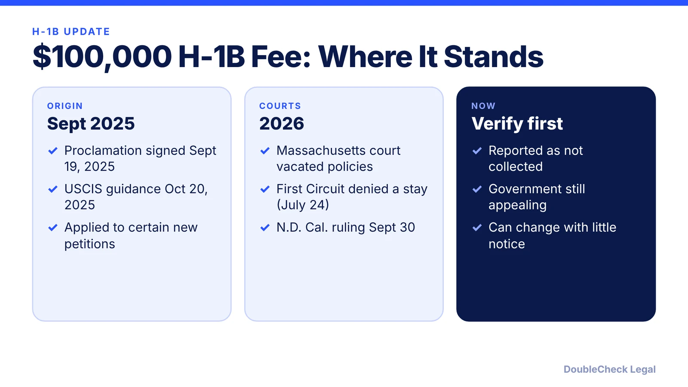
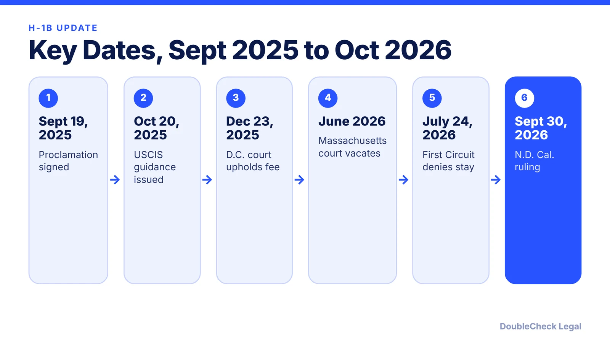
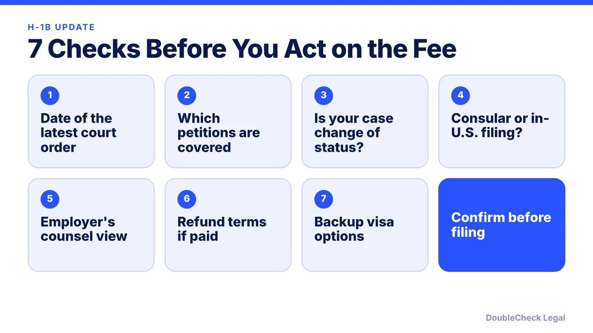

*Is the $100,000 H-1B payment still in effect? Here is the timeline, who it covered, and what to check before you or your employer file.*

**Key takeaways:**

- The fee came from a September 19, 2025 proclamation and applied to certain new petitions.
- Court rulings in 2026 vacated the implementing policies; a university update dated October 1, 2026 says USCIS should not enforce it while appeals continue.
- Reported exemptions covered extensions, amendments, and changes of status for people already in the U.S.
- Status can change with little notice, so confirm with immigration counsel before filing.

## 1. The quick answer

**Quick answer (as of November 3, 2026):** The $100,000 H-1B payment came from a presidential proclamation signed September 19, 2025. Court rulings in 2026 vacated the implementing policies, and a university international-office update dated October 1, 2026 says the fee should not be enforced by USCIS while the government continues to appeal. This area changes with little notice, so confirm the current status with your employer's immigration counsel before you rely on it.

## 2. Who the fee was meant to cover

Law-firm summaries of USCIS's October 20, 2025 guidance say the payment applied to new H-1B petitions filed after 12:01 a.m. EDT on September 21, 2025, for beneficiaries outside the U.S. without a valid H-1B visa, or beneficiaries in the U.S. who could not change status to H-1B. Reported exemptions included extensions, amendments, and changes of status for people already in the U.S., such as F-1 to H-1B. Payment was to be made through pay.gov before filing, and USCIS said it would refund the payment if the petition was denied. A narrow national-interest exemption was described as available only in "extraordinarily rare" circumstances.

If you are a founder or employee already inside the U.S. and your employer is filing a change of status, the reported exemptions are the part to ask your lawyer about.

## 3. Timeline of the court fights

The sequence below is drawn from law-firm and university summaries, which were not all checked against court dockets, so treat dates as a guide.

- **September 19, 2025:** proclamation signed.
- **October 20, 2025:** USCIS guidance on who is covered.
- **December 23, 2025:** a D.C. district court upheld the fee in *Chamber of Commerce v. DHS*; that case is on appeal.
- **June 2026:** a Massachusetts federal court vacated the fee policies, reported as June 8, 2026, and the First Circuit denied a stay on July 24, 2026.
- **September 2026:** a proclamation extended the fee's end date to September 21, 2027.
- **September 30, 2026:** a federal judge in the Northern District of California ruled in *Global Nurse Force v. Trump* against the fee as renewed, reported by Forbes on October 1.

A separate Department of Homeland Security proposal in August 2026 would set a different fee of $103,265 for certain new cap-subject H-1B petitions. Ellis describes it as proposed, not final.

## 4. What founders and candidates should do now

Because the situation can change quickly, build a short routine instead of relying on one headline.

Ask whether another route fits your situation, such as [O-1A for founders](/blog/o-1a-visa-for-startup-founders-evidence/) or the [EB-1A vs. O-1 comparison](/blog/eb-1a-vs-o-1-founder-which-path/). For the cap lottery side of H-1B, see [the wage-weighted selection explained](/blog/h1b-weighted-lottery-wage-levels-explained/). To find counsel, read [how to find a good immigration lawyer](/blog/how-to-find-good-immigration-lawyer-startup-founder/).

## Where DoubleCheck fits

[DoubleCheck](https://www.contactdoublecheck.com) helps businesses and founders start legal work with AI, verify it, and, when professional advice is warranted, connect with an independent attorney, including for immigration questions. Attorney availability and practice areas vary. Attorneys on DoubleCheck are independent professionals; an attorney-client relationship forms only if an attorney accepts your engagement.

**Sources:** [BakerHostetler](https://www.bakerlaw.com/insights/uscis-clarifies-when-100000-h-1b-fee-is-required-exempting-most-f-1-students/); [Ellis](https://www.ellis.com/resources/h1b-100k-fee-extended-2027); [University of Pittsburgh OIS](https://www.ois.pitt.edu/october-1-2026-update-100k-h-1b-fee-currently-vacated); [Forbes](https://www.forbes.com/sites/stuartanderson/2026/10/01/judge-strikes-down-latest-version-of-100000-h-1b-immigration-fee/); [AILA](https://www.aila.org/library/featured-issue-fy2027-h-1b-cap-season).

## FAQ

**Is the $100,000 H-1B fee in effect right now?**

As of November 3, 2026, university and law-firm sources report that court orders block collection and that USCIS should not enforce it, while the government appeals. Confirm the current status with immigration counsel.

**Does the fee apply to F-1 students changing to H-1B?**

USCIS's October 2025 guidance, as summarized by law firms, said changes of status for people already in the U.S., including F-1 to H-1B, were not covered.

**When did the $100,000 H-1B proclamation take effect?**

It was signed September 19, 2025 and applied to petitions filed after 12:01 a.m. EDT on September 21, 2025, per law-firm summaries of USCIS guidance.

**Is there a different H-1B fee proposal?**

Ellis reports that in August 2026 the Department of Homeland Security proposed a $103,265 fee for certain cap-subject petitions. It is described as proposed, not final.

---

*General information only. This article is not legal, tax, investment, or accounting advice.*
