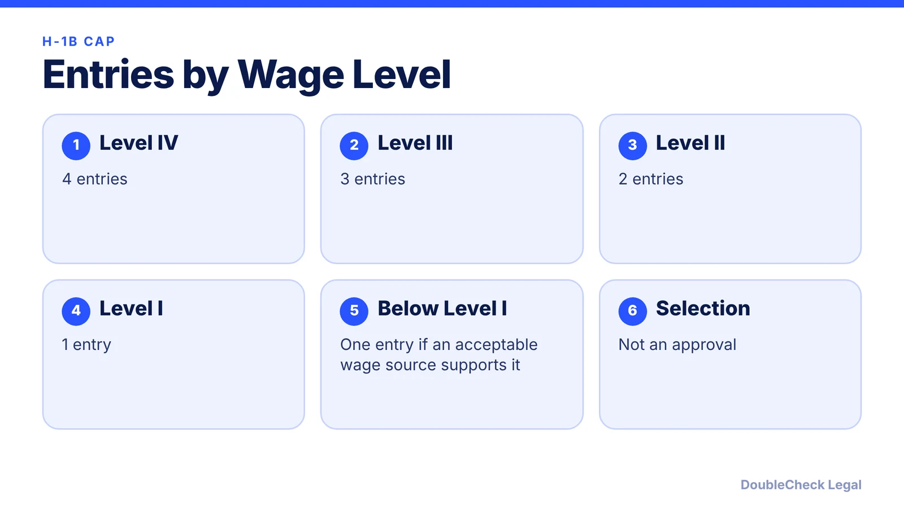
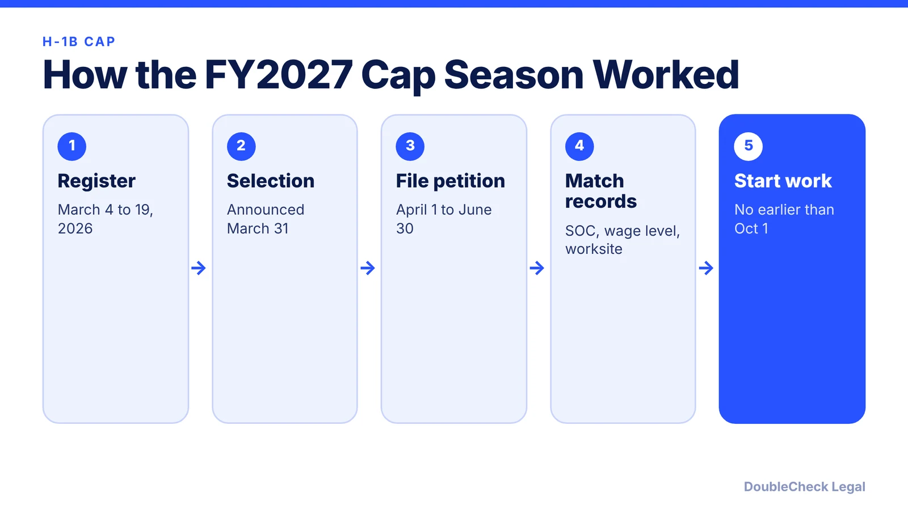

*The H-1B random lottery is now weighted by wage level. Here is how the entries work, the FY2027 dates, and what founders should know.*

**Key takeaways:**

- USCIS gives each beneficiary 1 to 4 entries based on the OEWS wage level of the offered salary.
- The final rule was published December 29, 2025 and took effect February 27, 2026.
- FY2027 registration ran March 4 to 19, 2026, with petition filing April 1 to June 30.
- SOC code, wage level, and worksite must stay consistent between registration, LCA, and petition.

## 1. The quick answer

**Quick answer:** For fiscal year 2027, USCIS replaced the random H-1B cap lottery with a wage-weighted selection. Each beneficiary goes into one pool, but gets one to four entries depending on the highest OEWS wage level the offered salary meets: Level IV gets four, Level III three, Level II two, Level I one. The final rule was published December 29, 2025 and took effect February 27, 2026.

## 2. The FY2027 timeline

Based on summaries from Greenberg Traurig, Ogletree, and AILA:

- **Registration period:** March 4 to March 19, 2026 (AILA reports USCIS agreed to extend the last day to 5 p.m. ET on March 19).
- **Selections:** USCIS announced March 31, 2026 that it had received enough registrations to reach the cap, including the advanced-degree exemption.
- **Filing window:** selected registrants had 90 days, April 1 to June 30, 2026.
- **Earliest start date:** October 1, 2026.
- **Second round:** USCIS may hold another selection if too few petitions are filed.

## 3. What the employer's registration has to match

Greenberg Traurig reports that the SOC code, wage level, and worksite entered at registration must match the labor condition application and the petition, and that USCIS gained explicit authority to deny or revoke petitions where registration information appears engineered to improve selection odds. Changes after registration to location, duties, salary, or level may put approval at risk. Selection also does not guarantee approval: the petition must still meet every eligibility requirement.

Ask the employer's counsel to show you the SOC code, wage level, and worksite used on your registration before filing. Learn how to review paperwork in [using AI to check immigration paperwork](/blog/check-immigration-documents-with-ai-before-filing/).

## 4. If you are a founder or early hire

A weighted system generally favors higher-paid roles, which can matter if a startup pays below the level that would earn more entries. Founders often look at alternatives that are not part of the cap lottery, such as [O-1A](/blog/o-1a-visa-for-startup-founders-evidence/) or the [EB-1A green card](/blog/eb-1a-vs-o-1-founder-which-path/). If your own company would file, see [how to incorporate a company in the U.S.](/blog/how-to-incorporate-a-company-in-the-us/) and talk to counsel about structure first.

## Where DoubleCheck fits

[DoubleCheck](https://www.contactdoublecheck.com) helps businesses and founders start legal work with AI, verify it, and, when professional advice is warranted, connect with an independent attorney, including for immigration questions. Attorney availability and practice areas vary. Attorneys on DoubleCheck are independent professionals; an attorney-client relationship forms only if an attorney accepts your engagement.

**Sources:** [Greenberg Traurig](https://www.gtlaw.com/en/insights/2026/2/uscis-finalizes-wage-weighted-h-1b-cap-selection-rule-effective-feb-27-2026); [Ogletree](https://ogletree.com/insights-resources/blog-posts/uscis-completes-fiscal-year-2027-h-1b-lottery/); [AILA](https://www.aila.org/library/featured-issue-fy2027-h-1b-cap-season).

## FAQ

**How many entries does Level IV get in the H-1B lottery?**

Four. Level III gets three, Level II two, and Level I one, according to Greenberg Traurig's summary of the final rule.

**When was the FY2027 H-1B registration period?**

March 4 to March 19, 2026, with selections announced March 31 and a petition filing window of April 1 to June 30, 2026.

**Does being selected mean approval?**

No. Selection only lets the employer file a petition, which must still meet all eligibility requirements.

**Can an H-1B registration be denied for gaming the system?**

Greenberg Traurig reports USCIS gained explicit authority to deny or revoke petitions where registration information appears engineered to improve selection odds.

---

*General information only. This article is not legal, tax, investment, or accounting advice.*
