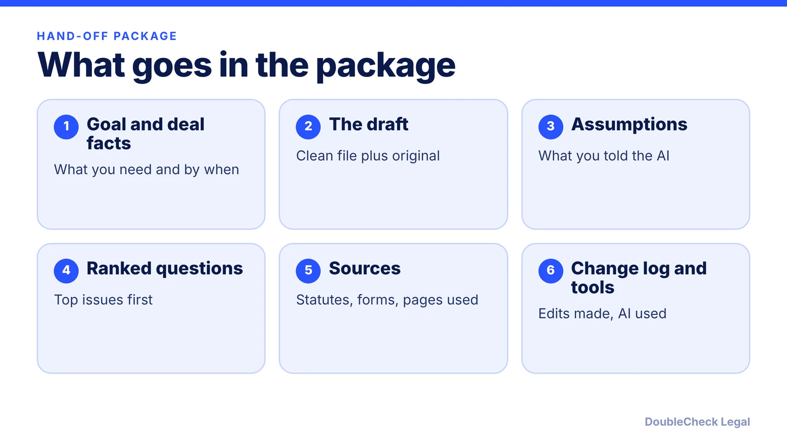
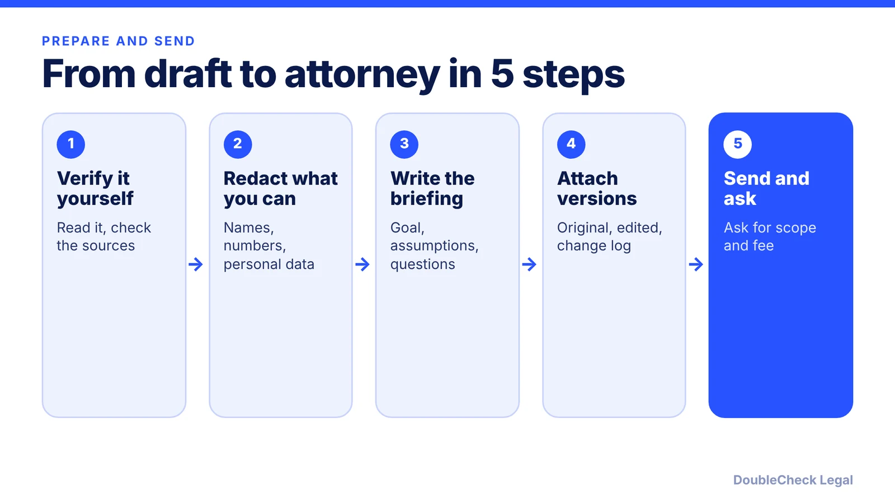

*A one-page briefing and a clean paper trail help an attorney review faster. Here is what to include.*

**Key takeaways:**

- Send a short package: goal, draft, assumptions, ranked questions, sources, change log and AI tools used.
- Keep it focused; do not paste long AI transcripts.
- Redact and check confidentiality before sharing, and do not assume AI chats are privileged.
- Ask about scope, fee and turnaround before you send.

## 1. The quick answer

**Quick answer:** To hand an AI-drafted legal document to an attorney, send a short package: the draft, a one-paragraph goal, your assumptions, a ranked list of questions, the sources you relied on, a change log of edits you made, and a line stating which AI tools you used. Short, focused material is easier to review: a brief first message and a ranked list of questions are usually enough. A clear package lets the attorney spend time on judgment, which can make review faster and may reduce cost, though fees vary by lawyer and matter.

This is a how-to for the step after you have verified the draft yourself; see [how to verify an AI-generated legal document](/blog/verify-ai-generated-legal-document/) first.

## 2. What to put in the package

Think of it as a briefing note, not a data dump. Do not paste long AI transcripts and expect the lawyer to find the issue.

- **Goal and context.** One paragraph: what the document is for, who the parties are, what outcome you want, your deadline and your walk-away points. Describe the outcome you want and let the lawyer draft the clause.
- **The draft, in two versions.** The AI output as generated, and your edited version. Label them clearly.
- **Assumptions.** What you told the AI (state, entity type, amounts, dates) and what you assumed without checking. Wrong assumptions are the fastest way for a clean-looking draft to be wrong.
- **Questions, ranked.** The five to ten things you are least sure of, most important first. Examples: is this limitation of liability enforceable where we operate, does this clause overreach, what is missing.
- **Sources.** Links to the statute, agency form or guidance the draft relies on, and anything the AI cited that you could not confirm. Flag unverified citations explicitly; see [AI hallucinated citations in business use](/blog/ai-hallucinated-citations-business/).
- **Change log.** A running list: clause number, what changed, why, and whether the AI or you made the change.
- **Disclosure of AI use.** One line naming the tools.

## 3. Do the prep work, but not in the wrong places

**Trim before sending.** Read the AI output first and cut anything you would not say on a call.

**Be careful what you feed back into AI.** Do not paste the firm's advice into a chatbot without asking the firm first, and check AI legal claims with the firm before building a negotiation strategy on them. In February 2026, a federal judge in New York held in United States v. Heppner that documents a defendant created with a public AI chatbot about his own case were not protected by attorney-client privilege, and that sending them to his lawyers afterward did not change that, per [DLA Piper](https://www.dlapiper.com/insights/publications/2026/02/are-ai-generated-documents-privileged-key-takeaways-from-heppner). Related reading: [AI chats and privilege](/blog/ai-chats-not-privileged-heppner/).

**Confidentiality.** If the draft includes another party's information or sits under an NDA, check whether you may share it before sending, including with the attorney. Redact personal data and trade secrets where you can; see [what to redact before pasting a contract into AI](/blog/what-to-redact-before-pasting-a-contract-into-ai/).

**Cross-check first if it is cheap.** Running the draft past a second model can surface clauses worth asking about; see the [two-model cross-check method](/blog/cross-check-a-contract-with-two-ai-models-method/). It is not a substitute for the attorney.

**Do not hide the AI.** Being upfront helps the lawyer decide what to double-check. It also avoids surprises if the lawyer must scrutinize invented citations or mismatched clauses.

## 4. Asking about scope and fees

Lawyer fees differ widely, so ask rather than assume. Some lawyers charge a flat fee for document review and others bill hourly, and turnaround varies, so confirm both before you send. Compare with [how much a lawyer charges to review a contract](/blog/how-much-does-a-lawyer-charge-to-review-a-contract/) and [flat fee vs hourly pricing](/blog/how-much-does-a-startup-business-lawyer-cost-flat-fee-vs-hourly/).

Questions to ask before you send:

- Do you review AI-drafted documents, and what do you need from me?
- Is the review a flat fee or hourly, and what does it cover (redline, memo, call)?
- What is your turnaround, and what if I have a signing deadline?
- Which questions are you able to answer, and which fall outside your practice area or state?

**Handle it yourself vs. get an attorney.** A simple, low-stakes document may need only a quick check. For anything that binds you for years, involves equity, IP, employment or immigration, or where you cannot confirm a source, send the package. Also see [how to prepare for a first meeting with a startup lawyer](/blog/how-to-prepare-for-first-meeting-with-startup-lawyer/) and [lawyer review of a ChatGPT contract](/blog/lawyer-review-chatgpt-contract/).

**Related reading:** [Contract Amendment vs New Contract: How to Change a Signed Agreement](/blog/contract-amendment-vs-new-contract-how-to-change-a-signed-agreement/); [Corporate Minutes and Board Consents: Small Corporation Records Guide](/blog/corporate-minutes-and-board-consents-small-corporation-records/); [AI Contract Review Prompts: What to Ask and What to Verify](/blog/ai-contract-review-prompts-what-to-ask-and-what-to-verify/); [Negotiate a Contract With AI: Redline Workflow and What to Verify](/blog/negotiate-a-contract-with-ai-redline-workflow-and-what-to-verify/)

## Where DoubleCheck fits

[DoubleCheck](https://www.contactdoublecheck.com) helps businesses and founders start legal work with AI, verify it, and, when professional advice is warranted, connect with an independent attorney, including for immigration questions. Attorney availability and practice areas vary. Attorneys on DoubleCheck are independent professionals; an attorney-client relationship forms only if an attorney accepts your engagement.

**Sources:** [DLA Piper, Are AI-generated documents privileged? Takeaways from Heppner (Feb. 18, 2026)](https://www.dlapiper.com/insights/publications/2026/02/are-ai-generated-documents-privileged-key-takeaways-from-heppner); [ABA Formal Opinion 512, Generative Artificial Intelligence Tools (hosted by the Minnesota Lawyers Professional Responsibility Board)](https://lprb.mncourts.gov/Pages/Formal%20Opinion%20512%20-%20Generative%20Artificial%20Intelligence%20Tools.pdf); [NCBE Bar Examiner on ABA Formal Opinion 512 (July 29, 2024)](https://thebarexaminer.ncbex.org/article/fall-2024/generative-artificial-intelligence-tools/).

## FAQ

**What should I send a lawyer to review an AI-drafted contract?**

Send the draft (original and edited), a short goal paragraph, your assumptions, a ranked list of questions, the sources you used, a change log and which AI tools you used. Keep the first message short and focused.

**Do I have to tell an attorney that AI helped draft the document?**

It is a good idea. A one-line disclosure of which AI tools you used helps the attorney decide what to verify.

**Will an AI-drafted document make a lawyer review cheaper?**

It may, if you provide a clear, verified draft with focused questions, but fees vary by lawyer and matter, and a messy or unverified draft can take longer to review.

**Can I paste my attorney advice back into a chatbot?**

Be cautious and ask the firm first. In a February 2026 New York federal ruling (United States v. Heppner), a judge held that documents a defendant made with a consumer AI tool were not privileged.

---

*General information only. This article is not legal, tax, investment, or accounting advice.*
