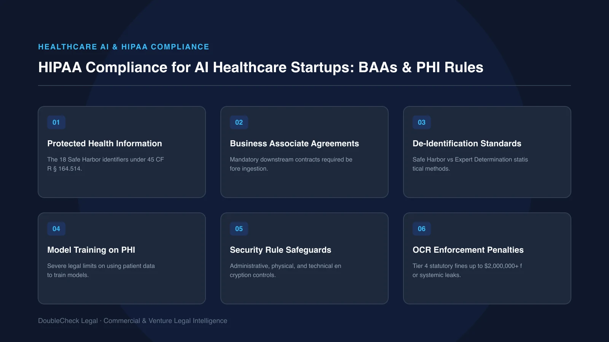
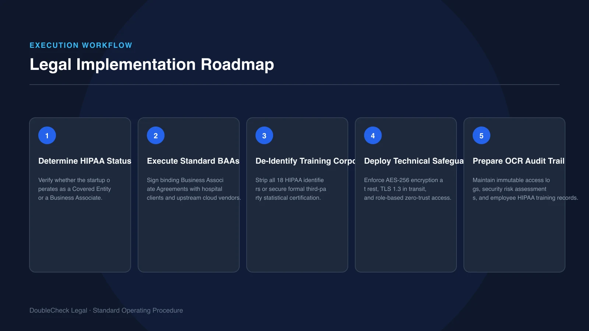

*A definitive legal and regulatory guide to HIPAA compliance for healthcare AI startups, analyzing Business Associate Agreements (BAAs), Protected Health Information (PHI) de-identification, model training constraints, and HHS OCR enforcement.*

**Key takeaways:**
- **Business Associate Classification:** Healthcare AI startups handling clinical records, patient transcripts, or diagnostic imagery automatically qualify as Business Associates under 45 CFR § 160.103.
- **Strict BAA Mandate:** Startups cannot ingest a single patient record until executing a compliant BAA with hospital clients and ensuring all upstream cloud providers (AWS, Azure, OpenAI) sign matching BAAs.
- **Model Training Restrictions:** Ingesting identifiable PHI into foundation models for general commercial training violates the HIPAA Privacy Rule; data must undergo rigorous de-identification.
- **The Threat of Model Extraction:** If an LLM memorizes training data and reproduces patient health records during inference, the startup faces catastrophic federal breach penalties.

## 1. The quick answer: HIPAA rules for healthcare AI

For artificial intelligence startups entering the digital health, clinical workflow, or medical diagnostic space, **HIPAA compliance is a strict binary gateway**:

1. **Business Associate Role:** You are legally a Business Associate. You cannot receive clinical data without a signed **Business Associate Agreement (BAA)**.
2. **De-Identification Requirement:** You cannot use patient data to train or fine-tune commercial models unless the data is stripped of all 18 HIPAA identifiers under the **Safe Harbor Method** or certified under **Expert Determination**.
3. **Upstream Alignment:** Every third-party API or cloud vendor you utilize (e.g., cloud hosting, database, vector stores, LLM endpoints) must also execute a BAA with your company.

## 2. In-depth legal analysis: The statutory mechanics of HIPAA for AI

Understanding the intersection between 45 CFR Parts 160 and 164 and generative artificial intelligence is essential for venture-backed digital health founders.

### A. The Definition of PHI and Business Associate Status
Under 45 CFR § 160.103:
- **Protected Health Information (PHI):** Individually identifiable health information transmitted or maintained in any form, relating to past, present, or future physical or mental health conditions, healthcare provision, or payment.
- **Business Associate:** Any entity that processes PHI on behalf of a Covered Entity (hospitals, doctors, insurers).
- **Direct Statutory Liability:** Under the HITECH Act of 2009, Business Associates are directly liable for statutory penalties enforced by the Department of Health and Human Services (HHS) Office for Civil Rights (OCR).

### B. Safe Harbor vs Expert Determination: De-Identification for AI Training
Startups wishing to train proprietary algorithms on historical medical datasets must eliminate PHI status under 45 CFR § 164.514:

| Requirement | Safe Harbor Method (§ 164.514(b)) | Expert Determination (§ 164.514(a)) |
|---|---|---|
| Methodology | Removal of 18 specific enumerated identifiers | Statistical and scientific mathematical principles |
| Dates & Ages | All dates (except year) removed; all ages over 89 grouped | Dates may be preserved if statistical risk is negligible |
| Geographic Data | All subdivisions smaller than state removed | Zip codes permitted if population threshold > 20,000 |
| Third-Party Validation | Self-executed by internal engineering team | Requires written certification by qualified statistician |
| Feasibility for AI | Fast and inexpensive; degrades longitudinal medical data | Preserves clinical utility; costs $15k-$50k per study |

### C. The Upstream Subprocessor BAA Chain
A common fatal mistake among early-stage healthcare startups is using standard commercial LLM APIs without an executed BAA:
- **The Violation:** Sending clinical patient summaries to an AI endpoint where the vendor has not signed a BAA is an automatic HIPAA breach.
- **The Requirement:** Ensure your cloud infrastructure (e.g., AWS Bedrock, Microsoft Azure OpenAI, or Google Cloud Vertex AI) operates under an executed **HIPAA Business Associate Addendum**, with zero-data-logging guarantees.

## 3. Step-by-step: Building a HIPAA-compliant healthcare AI company

Founding teams should follow a five-stage operational roadmap to achieve institutional healthcare compliance:

### Step 1: Conduct a Comprehensive Security Risk Assessment (SRA)
Under 45 CFR § 164.308, perform and document an initial SRA. Identify all potential vulnerabilities to the confidentiality, integrity, and availability of electronic PHI (ePHI).

### Step 2: Implement Mandatory Technical Safeguards
Deploy core technical controls:
- **Encryption:** AES-256 encryption at rest; TLS 1.3 encryption in transit;
- **Access Controls:** Unique user credentials, multi-factor authentication (MFA), role-based access control (RBAC);
- **Audit Logging:** Immutable audit logs capturing every instance of ePHI access, export, or algorithmic processing.

### Step 3: Standardize the Enterprise BAA Template
Draft a customized, balanced BAA for hospital enterprise clients. Establish clear boundaries confirming:
- The startup acts solely as a data processor;
- Aggregated, de-identified analytical metadata remains the property of the startup;
- Breach notification timelines are realistic (e.g., 5 business days rather than 24 hours).

### Step 4: De-Identification Pipeline Validation
If your software uses medical notes to train models, build an automated de-identification engine using natural language processing (NLP) to scrub patient names, dates, and medical record numbers (MRNs) prior to model ingestion.

### Step 5: Employee Training and Incident Response Protocol
Implement mandatory annual HIPAA training for all engineers and executives. Formulate a written Breach Notification Plan complying with 45 CFR §§ 164.400-414.

## 4. Contractual traps: Indemnification and liability caps in digital health

When negotiating with large hospital networks and health systems:
- **Unlimited Indemnity Demands:** Hospital counsel routinely demand unlimited indemnification for any HIPAA breach. Startups must negotiate a reasonable super-cap (e.g., 2x to 3x annual contract value) and carve out breaches caused by hospital user credential sharing.
- **Audit Rights:** Limit client audits to SOC 2 Type II reports and third-party penetration test summaries rather than allowing hospital IT personnel direct access to proprietary model code.

## 5. Due diligence checklist: Healthcare AI venture audit

1. **Verify Full BAA Coverage:** Ensure every subprocessor in your technical stack has an active, executed BAA on file.
2. **Audit De-Identification Pipelines:** Retain documentation proving how training datasets were scrubbed of all 18 Safe Harbor identifiers.
3. **Verify SOC 2 Type II Certification:** Secure SOC 2 Type II compliance with the HIPAA Security Rule mapping to satisfy enterprise health system procurement.
4. **Confirm Cyber & Regulatory Insurance:** Maintain specialized Cyber Liability insurance including affirmative regulatory defense coverage for HHS OCR inquiries.

## Where DoubleCheck fits

[DoubleCheck](https://www.contactdoublecheck.com) provides digital health startups, healthcare AI founders, and compliance counsel with AI-driven contract analysis. DoubleCheck reviews Business Associate Agreements, flags missing statutory provisions, audits subprocessor indemnification terms, and ensures healthcare tech companies meet stringent enterprise health system standards before closing institutional hospital deals.

**Related reading:**
- [AI Vendor Contract Checklist](/blog/ai-vendor-contract-checklist/)
- [AI Regulation Startups EU AI Act Colorado](/blog/ai-regulation-startups-eu-ai-act-colorado/)
- [What to Redact Before Pasting a Contract Into AI](/blog/what-to-redact-before-pasting-a-contract-into-ai/)
- [Terms and Conditions Generator Small Business](/blog/terms-and-conditions-generator-small-business/)

**Sources:** [Health Insurance Portability and Accountability Act of 1996 (HIPAA), Public Law 104-191](https://www.hhs.gov/hipaa/); [Code of Federal Regulations, 45 CFR Part 160 and Part 164](https://www.ecfr.gov/current/title-45/subtitle-A/subchapter-C); [HHS Office for Civil Rights (OCR), Guidance on De-identification of Protected Health Information](https://www.hhs.gov/hipaa/for-professionals/privacy/special-topics/de-identification/index.html); [National Institute of Standards and Technology (NIST), HIPAA Security Rule Toolkit](https://www.nist.gov/).

## FAQ

**Does an AI healthcare startup need a Business Associate Agreement (BAA)?**

Yes. Any software vendor or AI startup that creates, receives, maintains, or transmits Protected Health Information (PHI) on behalf of a HIPAA-covered entity (like a hospital, clinic, or health plan) is legally classified as a Business Associate and must execute a formal BAA.

**Can an AI startup train machine learning models on patient medical records?**

Under HIPAA, using PHI to train general commercial AI models is generally not considered a permissible "healthcare operations" use without explicit patient authorization. Startups must first de-identify the data under 45 CFR § 164.514 before utilizing it for commercial model training.

**What is the difference between Safe Harbor and Expert Determination de-identification?**

Safe Harbor requires removing 18 specified direct identifiers (such as names, dates, geographic data, and medical record numbers), while Expert Determination requires a formal statistical analysis by an expert certifying that the risk of re-identification is very small.

**What happens if a healthcare AI model memorizes and outputs patient PHI?**

If an AI model regurgitates patient PHI during user inference, it constitutes an impermissible disclosure under the HIPAA Privacy Rule, triggering mandatory breach notifications to affected individuals, the HHS Office for Civil Rights (OCR), and the media.

**How do AI contract tools assist with HIPAA compliance?**

AI contract tools review commercial agreements to verify mandatory BAA provisions, audit subprocessor chains, verify liability caps, and ensure compliance with OCR regulatory standards.

---

*General information only. This article is not legal, tax, investment, or accounting advice.*
