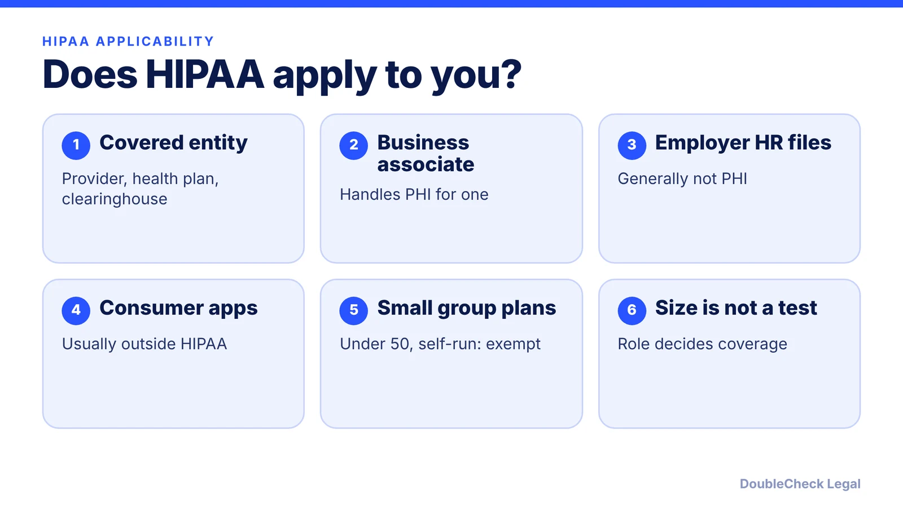
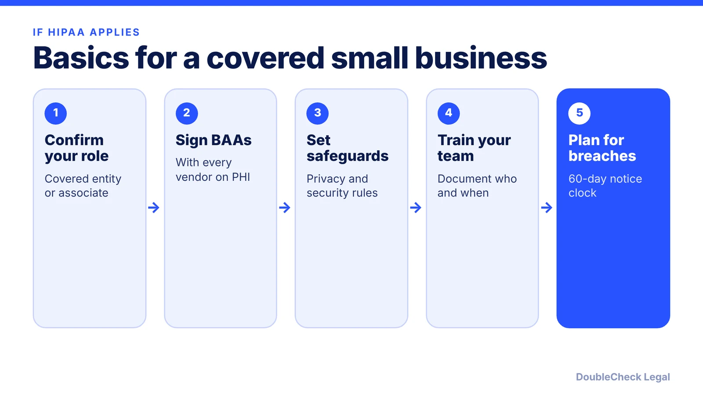

*A plain-English guide to when HIPAA applies to a small business and the basics if it does, as of November 2026.*

**Key takeaways:**

- HIPAA turns on your role (provider, plan, clearinghouse, or business associate), not your size.
- Employer HR files, consumer apps and most wellness programs are generally outside HIPAA, but other privacy laws may apply.
- Covered entities need written BAAs with vendors that handle PHI; cloud providers holding encrypted PHI still count.
- Breach notices are due without unreasonable delay and within 60 days of discovery.

## 1. The quick answer

**Quick answer:** HIPAA applies to a small business only if it is a covered entity (a health care provider that sends certain health transactions electronically, a health plan, or a clearinghouse) or a business associate that handles protected health information for one. Size does not decide it. A small dental office is covered; a gym, a wellness app or an employer's HR files usually are not. If you are covered, you need privacy and security safeguards, business associate agreements, and a breach response plan. This guide is dated as of November 2026.

## 2. Who is a covered entity or business associate

HHS says covered entities are one of three types: health care providers, health plans and health care clearinghouses.

- **Health care providers** include doctors, clinics, psychologists, dentists, chiropractors, nursing homes and pharmacies. A provider is covered only if it transmits health information electronically in connection with a transaction for which HHS has adopted a standard, such as billing insurance.
- **Health plans** include insurers, HMOs, company health plans and programs like Medicare and Medicaid.
- **Clearinghouses** convert nonstandard health information into a standard electronic format, or the reverse.

A **business associate** is, in practice, an organization that handles protected health information for a covered entity or another business associate. HHS's FAQs give examples: cloud service providers that create, receive, maintain or transmit electronic PHI, even if the data is encrypted and they do not hold the key, and accreditation organizations. HHS says these are not business associates: couriers and postal services acting as mere conduits, software vendors without access to PHI, and cloud providers handling only properly de-identified data.

Two limits help small businesses. First, HHS says an employee welfare benefit plan with fewer than 50 participants that is administered by the employer that sets it up is not a HIPAA covered entity. Second, HHS publishes an online decision tool on its small-business resource page for checking whether you are a covered entity.

## 3. When HIPAA usually does not apply

Many small businesses assume HIPAA covers any health-related information. It does not. Per [HHS](https://www.hhs.gov/hipaa/for-individuals/employers-health-information-workplace/index.html) and the [FTC](https://www.ftc.gov/business-guidance/resources/health-breach-notification-rule-basics-business), HIPAA generally does not apply to the following, though a particular fact pattern can change the answer:

- **Employers acting as employers.** HHS says the Privacy Rule does not shield employment records, even when they contain health information, such as a doctor's note supporting sick leave. A group health plan, however, can be covered.
- **Wellness programs** that are not run by or for a group health plan or another covered entity. Whether HIPAA applies depends on who runs the program, and other privacy laws may apply.
- **Consumer health apps and wearables**, unless they act for a covered entity or business associate. The FTC's Health Breach Notification Rule addresses breaches by many apps and connected devices that fall outside HIPAA.
- **Other kinds of records** that follow different statutes, such as student education records under FERPA. Confirm with counsel which regime governs your data.

"Does not apply" is not "no rules." Health data can be covered by state privacy laws, the FTC's rules on unfair practices, breach-notification statutes and your own promises in a privacy policy. See [state privacy laws for small businesses](/blog/state-privacy-laws-2027-small-business-checklist/), [CCPA/CPRA compliance](/blog/ccpa-cpra-compliance-small-business/) and [data breach notification laws](/blog/data-breach-notification-laws-small-business/). If you hire staff, [the first-employee legal checklist](/blog/how-to-hire-first-employee-legal-checklist/) and the [employee handbook guide](/blog/employee-handbook-small-business-what-to-include/) cover the HR side.

## 4. Basics if you are covered: BAAs, breaches and penalties

**Business associate agreements (BAAs).** HHS says a covered entity must have a contract or other written arrangement with each business associate that meets 45 CFR 164.504(e). It also says that using a cloud service provider to maintain electronic PHI without a BAA violates the HIPAA Rules, and that business associates cannot self-certify or be certified by a third party as HIPAA compliant. Electronic contracts can satisfy the requirement if they meet state contract law. If your vendors include AI tools, treat them like any vendor touching PHI and review the terms with the [AI vendor contract checklist](/blog/ai-vendor-contract-checklist/) and [data processing agreement guide](/blog/data-processing-agreement-dpa-ai-vendors-small-business/).

**Breach notification.** Per HHS, covered entities must notify affected individuals and the HHS Secretary, and notify the media when a breach affects more than 500 residents of a state or jurisdiction. Business associates must notify the covered entity. Notices are due without unreasonable delay and within 60 days of discovery. Breaches affecting fewer than 500 people may be reported to the Secretary annually, within 60 days after the end of the calendar year of discovery. A covered entity may delegate individual notices to a business associate but remains responsible for making sure they go out.

**Penalties.** HHS civil penalties are tiered by culpability. Per Mercer, HHS raised the amounts for penalties assessed on or after January 28, 2026, with a top per-violation tier above $2 million for willful neglect not corrected in time. The same source notes that HHS's 2019 enforcement discretion lowered annual caps for most other tiers, so the numbers are not simple; confirm current figures with HHS or counsel.

**Insurance.** A breach can also trigger costs that [business insurance](/blog/business-insurance-types-small-business/) may or may not cover; read the policy.

## 5. Self-handle or ask an attorney, and where AI helps

**You can usually start yourself:** walk through HHS's covered-entity decision tool, list every vendor that sees patient or member data, write a short data map, and ask vendors whether they will sign a BAA.

**Ask an attorney when:**

- you are not sure whether a service you offer is a covered transaction;
- a customer or partner asks you to sign a BAA, or you are the one asking for it;
- you had a suspected breach (the 60-day clock runs from discovery);
- you want to launch an app that handles health data and need to know which rules apply.

**Where AI helps.** AI can summarize a BAA, build a vendor inventory and draft internal policies. It can also invent requirements or miss state law. Verify against HHS pages and have a professional review high-stakes terms; do not paste real patient data into a general chatbot. See [using AI for legal work safely](/blog/small-business-ai-legal-work-safely/), [verifying AI-generated legal documents](/blog/verify-ai-generated-legal-document/), [when to hire a lawyer](/blog/when-to-hire-lawyer-small-business/) and [how to choose a good lawyer](/blog/how-to-choose-good-lawyer/). For the data-protection basics outside HIPAA, see [AI vendor data retention and opt-outs](/blog/ai-vendor-data-retention-and-training-opt-outs-what-to-check-in-settings/).

## Where DoubleCheck fits

[DoubleCheck](https://www.contactdoublecheck.com) helps businesses and founders start legal work with AI, verify it, and, when professional advice is warranted, connect with an independent attorney, including for immigration questions. Attorney availability and practice areas vary. Attorneys on DoubleCheck are independent professionals; an attorney-client relationship forms only if an attorney accepts your engagement.

**Sources:** [HHS, covered entities and business associates](https://www.hhs.gov/hipaa/for-professionals/covered-entities/index.html); [HHS, business associates FAQs](https://www.hhs.gov/hipaa/for-professionals/faq/business-associates/); [HHS, must all small health plans comply](https://www.hhs.gov/ocr/privacy/hipaa/faq/smaller_providers_and_businesses/495.html); [HHS, small business resources](https://www.hhs.gov/ocr/privacy/hipaa/understanding/coveredentities/smallbusiness.html); [HHS, breach notification rule](https://www.hhs.gov/guidance/document/breach-notification-rule); [HHS, employers and health information in the workplace](https://www.hhs.gov/hipaa/for-individuals/employers-health-information-workplace/index.html); [FTC, Health Breach Notification Rule basics](https://www.ftc.gov/business-guidance/resources/health-breach-notification-rule-basics-business); [Mercer, HHS adjusts 2026 HIPAA penalties](https://www.mercer.com/en-us/insights/law-and-policy/hhs-adjusts-2026-hipaa-certain-aca-and-msp-monetary-penalties/).

## FAQ

**Does HIPAA apply to my small business?**

Only if you are a covered entity (a provider sending standard electronic transactions, a health plan or a clearinghouse) or a business associate, per HHS. Size is not the test. HHS offers an online decision tool for covered entities.

**Does HIPAA apply to employers and employee health information?**

Generally not when the employer acts as an employer. Per HHS, the Privacy Rule does not apply to employment records, even when they contain health information, and in most cases does not apply to the actions of an employer. A group health plan may be covered, though a self-administered plan with fewer than 50 participants is not, per HHS.

**Do I need a business associate agreement?**

If you are a covered entity and a vendor creates, receives, maintains or transmits PHI for you, yes. Per HHS, a covered entity must have a written arrangement that meets 45 CFR 164.504(e), and a cloud provider holding PHI without a BAA is a violation.

**How soon must I report a HIPAA breach?**

Per HHS, individual notices and large-breach reports are due without unreasonable delay and within 60 days of discovery. Breaches under 500 people can be reported to HHS annually within 60 days after the year ends.

**Can a vendor say it is HIPAA certified?**

Per HHS, business associates cannot self-certify or be certified by a third party as HIPAA compliant. Ask for a signed BAA and details about safeguards instead of relying on a badge.

---

*General information only. This article is not legal, tax, investment, or accounting advice.*
