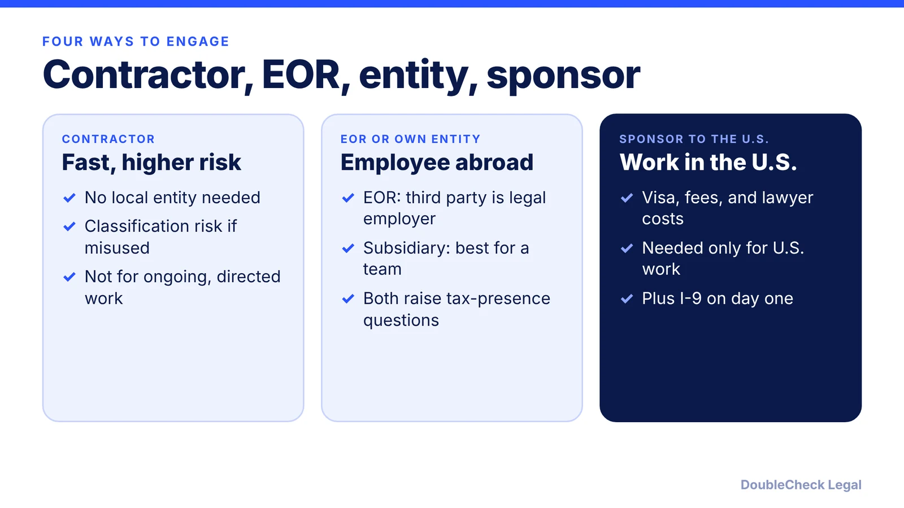
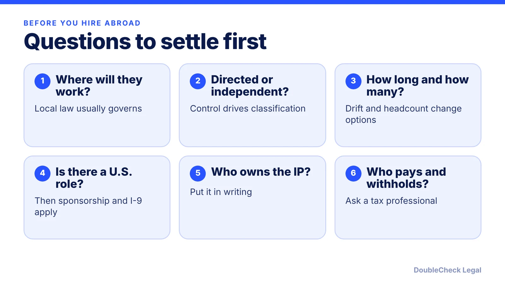

*How should a U.S. startup hire someone abroad? Compare contractors, an employer of record, your own entity, and sponsorship, with the risks of each.*

**Key takeaways:**

- The four routes are contractor, employer of record, own local entity, or sponsoring the person to the U.S.
- Misclassifying an employee as a contractor can mean back taxes and penalties, per Vistra.
- An EOR is often a stopgap; longer use can raise permanent establishment risk.
- Remote workers who stay abroad generally do not need a U.S. work visa, per People Managing People.

## 1. The quick answer

**Quick answer:** A U.S. startup can engage workers abroad four main ways: as independent contractors, through an employer of record (EOR), through its own local entity, or by sponsoring the person to work in the U.S. Vistra's practitioners describe the first three as a trade-off between speed, cost, and risk: contractors are fastest but carry misclassification risk, an EOR is a common bridge, and a subsidiary suits growing headcount. Per People Managing People, a remote worker who stays in their home country generally does not need a U.S. work visa, while U.S. sponsorship applies only if the person will work in the U.S.

## 2. The options in plain English

Based on Vistra and People Managing People:

- **Independent contractor.** You engage the person directly under a written agreement. People Managing People says no visa or benefits are required, which lowers cost, and it suits short-term, project-based work. Misclassification can bring penalties, back taxes, and retroactive benefits.
- **Employer of record (EOR).** A third party already established in the country becomes the legal employer and handles payroll, tax filings, and compliance, while you direct the work, per Vistra. Vistra's experts call it often a short-term or stopgap measure.
- **Own entity (subsidiary or branch).** Best when hiring several people in one country, per People Managing People, but it requires legal work and knowledge of local hiring rules. Vistra notes a branch does not limit liability the way a subsidiary does.
- **Sponsoring to the U.S.** Treated as a cost that arises when the person needs U.S. work authorization: visa fees, lawyer fees, and filing charges. See [sponsoring an H-1B employee](/blog/startup-sponsor-h1b-employee-requirements/), [cap-exempt employers](/blog/h-1b-cap-exempt-employers/), and [the $100,000 H-1B fee status](/blog/h1b-100000-fee-status-2026/).

## 3. Classification and tax risks

**Contractor risk.** Vistra's contributors say workers who should be employees can trigger employee taxes and social security contributions plus penalties, and that short contractor engagements often drift into long ones. They also warn that a misclassified contractor doing business-like activities may create a corporate tax presence, called a permanent establishment, in that country.

**Rules differ by country.** Vistra cites the UK's IR35 off-payroll rules as an example of authorities targeting contractor arrangements. In the U.S., the Department of Labor announced on February 26, 2026 a proposed rule using an "economic reality" test, looking at control over the work and the worker's opportunity for profit or loss, and the comment period closed on April 28, 2026. It was a proposal, not a final rule, so check its current status. The DoubleCheck guide to [independent contractor vs. employee](/blog/independent-contractor-vs-employee/) covers the U.S. factors, and the [freelance contract guide](/blog/how-to-write-a-freelance-contract/) covers the paperwork.

**EOR risk.** Vistra's experts warn that business activity through employees, however few, may trigger permanent establishment obligations, and that "the longer you use an employer of record, the greater your risk." They say Germany allows at most 18 months of EOR use before workers must move to a local entity, and they cite Mexico's 2024 changes to personnel outsourcing rules. Do not assume one country's rules apply elsewhere.

**Paying foreign contractors.** The IRS says nonemployee compensation paid to nonresident aliens is reported on Form 1042-S, not Form 1099-NEC, and withholding may be required (see also the [1099-NEC guide](/blog/1099-nec-2000-threshold-hiring-freelancers/)). Foreign persons who provide Form W-8BEN are exempt from backup withholding and Form 1099 reporting. Ask a tax professional.

## 4. How to choose, and what to put in writing

Vistra's practitioners suggest planning at six, twelve, and eighteen months before picking a route, and say that if headcount will grow quickly, a subsidiary may be better from the start. Review the arrangement regularly because laws change.

A practical order: decide whether the person will really be independent or an employee you direct; check the local rules in their country; choose contractor, EOR, or entity accordingly; and sign agreements that cover scope, payment, confidentiality, and [IP assignment](/blog/confidentiality-ip-assignment-agreements-startups/). For a worker who will come to the U.S., you must complete Form I-9 ([I-9 and E-Verify for startups](/blog/i-9-and-e-verify-for-startups/)). If your company itself is run from abroad, see [starting a U.S. company as a non-U.S. resident](/blog/start-us-company-as-non-us-resident/) and [foreign founder taxes](/blog/foreign-founder-us-taxes-substantial-presence-test/). Use AI to draft, then verify with a local professional; see [drafting an offer letter with AI](/blog/draft-job-offer-letter-with-ai/).

## Where DoubleCheck fits

[DoubleCheck](https://www.contactdoublecheck.com) helps businesses and founders start legal work with AI, verify it, and, when professional advice is warranted, connect with an independent attorney, including for immigration questions. Attorney availability and practice areas vary. Attorneys on DoubleCheck are independent professionals; an attorney-client relationship forms only if an attorney accepts your engagement.

**Sources:** [Vistra](https://www.vistra.com/insights/hiring-workers-another-country-understand-your-options-and-be-ready-change-course); [People Managing People](https://peoplemanagingpeople.com/employee-lifecycle/recruiting-hiring/how-can-a-us-company-hire-a-foreign-employee/); [U.S. Department of Labor, Feb 26, 2026 proposed rule](https://www.dol.gov/newsroom/releases/whd/whd20260226); [IRS: reporting payments to independent contractors](https://www.irs.gov/businesses/small-businesses-self-employed/reporting-payments-to-independent-contractors); [IRS: withholding and reporting obligations](https://www.irs.gov/individuals/international-taxpayers/withholding-and-reporting-obligations).

## FAQ

**What is the difference between an EOR and a contractor?**

Per Vistra, an EOR is a third party that becomes the legal employer locally and handles payroll and compliance while you direct the work. A contractor is engaged directly under an agreement and should run their own work.

**Does a US startup need a visa to hire someone abroad?**

Per People Managing People, a remote worker who stays in their home country generally does not need a U.S. work visa. Sponsorship applies only if the person will work in the U.S.

**What is the risk of misclassifying a foreign contractor?**

Vistra's contributors say it can trigger employee taxes, social security contributions, and penalties, and may create a corporate tax presence in that country. Rules vary by country, so get local advice.

**How do I report payments to a foreign contractor?**

The IRS says nonemployee compensation paid to nonresident aliens is reported on Form 1042-S rather than Form 1099-NEC, and withholding may be required. Ask a tax professional.

---

*General information only. This article is not legal, tax, investment, or accounting advice.*
