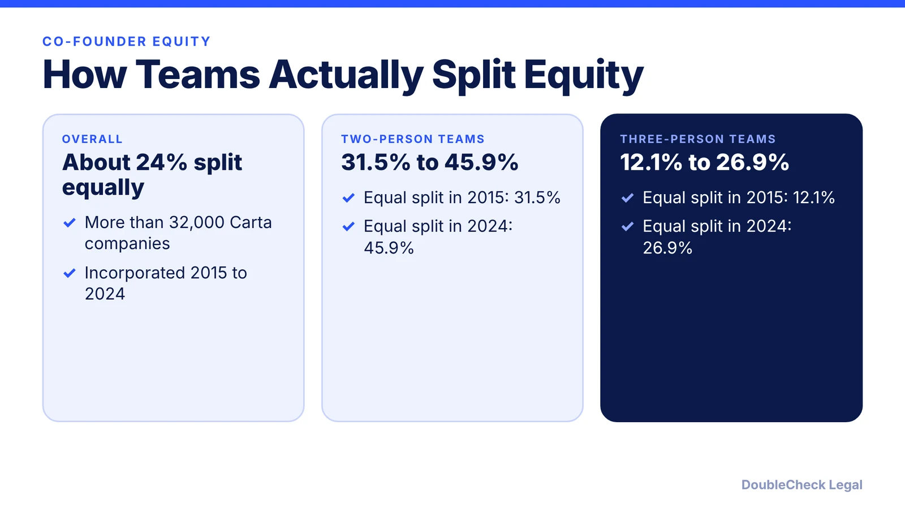
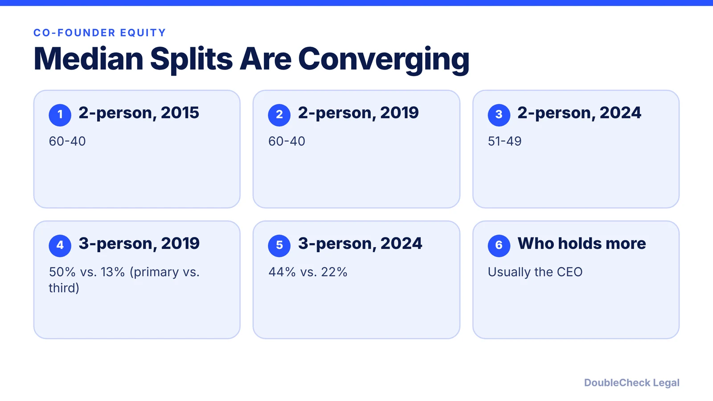
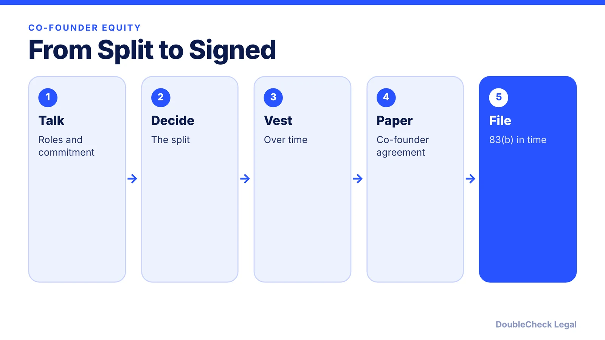

*Should co-founders split equity 50/50? Here is what Carta's data on more than 32,000 companies shows.*

**Key takeaways:**

- About 24% of founding teams in Carta's 2015–2024 data split equity equally.
- Equal splits rose from 31.5% to 45.9% for two-person teams between 2015 and 2024.
- The median two-person split moved from 60-40 to 51-49.
- Whatever you choose, document it with vesting and a co-founder agreement.

## 1. What the data says

Carta analyzed more than 32,000 companies with multiple co-founders that incorporated between 2015 and 2024. About **24%** of these founding teams split equity equally, and two-person teams were much more likely to do so than teams of three to five.

Carta reports that 2024 had the most equal splits of any year it covers.

## 2. The gap is narrowing

Median splits have moved toward equal. For two-person teams that incorporated in 2019, the median split was 60-40, the same as in 2015; by 2024 it was **51-49**. For three-person teams that incorporated in 2019, the primary co-founder held 50% and the third held 13%, nearly 4x; by 2024 these were 44% and 22%, about 2x. In most cases, the co-founder with the larger stake is also the CEO.

## 3. What to do with the data

Data tells you what others did, not what is right for your team. Decide with your co-founders based on role, time commitment, and what each person brings. Then protect the split with [vesting](/blog/cofounder-vesting-cliff-explained/), an [83(b) election](/blog/83b-election-startup-founders/), and a written [co-founder agreement](/blog/co-founder-agreement-startups/).

## 4. Common mistakes

The mistakes we see discussed most are avoiding the conversation and leaving the split undocumented. Put it in writing: see [IP assignment agreements](/blog/confidentiality-ip-assignment-agreements-startups/) so the company, not individuals, owns what founders create.

## Where DoubleCheck fits

[DoubleCheck](https://www.contactdoublecheck.com) is built for businesses that start legal work with AI. Bring your question or draft, use an AI-first workflow to understand and verify it, and when professional advice is warranted, you can connect with an independent attorney. Attorneys on DoubleCheck are independent professionals; an attorney-client relationship forms only if an attorney accepts your engagement.

**Sources:** [Carta: A shift is underway in how startup co-founders split their equity](https://carta.com/data/founder-equity-split-trends-2024/).

## FAQ

**Do most co-founders split equity 50/50?**

No. About 24% of teams in Carta's 2015–2024 data split equally, though two-person teams do so more often, 45.9% in 2024.

**What is the median split for two co-founders?**

Carta reports 51-49 for 2024, down from 60-40 in 2015 and 2019.

**Who usually has more equity?**

In most cases, the co-founder with the larger stake is also the CEO, per Carta.

**How do I protect the split?**

Use vesting, an 83(b) election, and a written co-founder agreement.

---

*General information only. This article is not legal, tax, investment, or accounting advice.*
