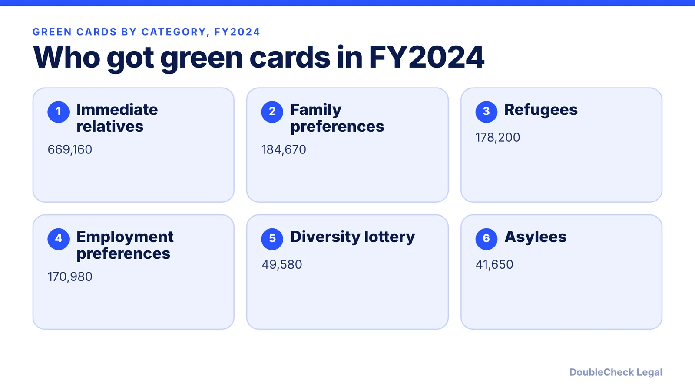
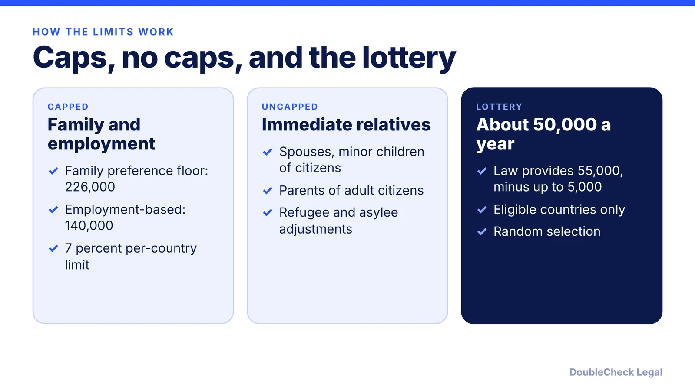

*A sourced look at US green cards, visa limits, and temporary admissions, with the year attached to every number.*

**Key takeaways:**

- About 1.36 million green cards were issued in FY2024, per Pew's analysis of DHS data (June 2026).
- Immediate relatives of US citizens were the largest category (669,160) because they are not capped.
- The law sets a 675,000 worldwide limit for family, employment, and diversity, per CRS (Nov 2024).
- FY2023 nonimmigrant admissions were 68.2 million entries, per OHSS; these count visits, not immigrants.

## 1. The quick answer

**Quick answer:** In fiscal year (FY) 2024, the US issued about 1.36 million green cards, per a Pew Research Center analysis of Department of Homeland Security (DHS) data published June 2, 2026. That is the highest of any year from FY2000 to FY2024 in Pew's table. About 58% went to people already living in the US who adjusted status; the rest were new arrivals. Green cards are only part of the picture: the US also records tens of millions of temporary (nonimmigrant) admissions each year, which are visits, not immigration. Pew notes that its 2023 and 2024 figures are rounded to the nearest 10, and its totals are calculated from DHS figures.

## 2. Green cards per year: the trend since FY2019

Per Pew's table of DHS data (adjustment of status plus new arrivals, totals calculated by Pew):

- **FY2019:** 1,031,765
- **FY2020:** 707,362
- **FY2021:** 740,002
- **FY2022:** 1,018,349
- **FY2023:** 1,172,920
- **FY2024:** 1,356,760

The FY2020 and FY2021 drops coincide with pandemic-era processing and travel limits; new arrivals fell from 459,252 in FY2019 to 227,206 in FY2021. The rebound was driven in part by adjustments of status, which rose from 512,796 in FY2021 to 782,770 in FY2024.

Two cautions. These counts are green cards issued in a fiscal year (October 1 to September 30), not people who arrived that year, because many recipients were already in the US. And they are one data source: MPI's data tool draws on the same DHS Yearbook of Immigration Statistics, whose FY2024 tables were still being posted when we checked the OHSS page. We could not retrieve MPI's own FY2024 figures, so we cite Pew.

## 3. The legal limits behind the numbers

Why does the total move? Because some categories have caps and others do not. Per a Congressional Research Service (CRS) report updated November 2024:

- The law sets an annual worldwide limit of 675,000: family-sponsored (480,000, including immediate relatives), employment-based (140,000), and diversity (55,000).
- Immediate relatives of US citizens are not numerically limited. That is why they were the largest FY2024 category at 669,160 in Pew's table.
- The family preference level may not fall below 226,000.
- Employment-based visas are 140,000: EB-1 and EB-2 each 28.6% (40,040), EB-3 28.6% with "other workers" capped at 10,000, and EB-4 and EB-5 each 7.1% (9,940).
- The 7% per-country limit applies to family preference and employment-based immigrants. CRS says it is not a country quota, and it can be exceeded when extra visas are available.
- Diversity: the law provides 55,000, but since FY1999 it has been reduced by up to 5,000 a year, so about 50,000 are made available. Pew's FY2024 diversity figure was 49,580.
- Refugees and asylees have no numerical limit on green card adjustments.

Pew's FY2024 employment-based figure (170,980) is higher than the 140,000 statutory base. The sources we read do not explain the gap, so we do not speculate. Per MPI, spouses and children of employment-based immigrants count against the cap.

## 4. Temporary admissions and how to use these numbers

Nonimmigrant admissions dwarf green cards, but they count entries, not people. Per the DHS Office of Homeland Security Statistics (OHSS), FY2023 I-94 admissions totaled 68,227,240, up 52 percent from 44,897,660 in FY2022. By class in FY2023:

- Tourists: 52,956,620
- Business visitors: 6,846,860
- Temporary workers and dependents: 4,980,290
- Students and dependents: 1,700,280
- Exchange visitors: 543,280

OHSS says these cover only I-94 records, exclude certain crew members and many short-term Mexican and Canadian visitors, and are rounded to the nearest ten. Per the MPI explainer (undated; it cites older data), H-1B has an annual cap of 85,000, with exceptions, and H-2B 66,000, while L, O, H-2A, and TN have no numerical limit. For the current H-1B rules see [the FY2028 registration timeline](/blog/h-1b-cap-registration-fy2028-timeline-employers/).

**Using the data for your own plan.** National totals say little about your wait. What matters is your category and country of birth, shown in the monthly Visa Bulletin ([how to read it](/blog/visa-bulletin-explained-priority-dates-eb-categories/)). For route options, see [easiest ways to immigrate compared by eligibility](/blog/easiest-ways-to-immigrate-to-the-us-compared-by-eligibility/), [US visa types explained](/blog/us-visa-types-explained-immigrant-vs-nonimmigrant-categories/), and [the diversity visa guide](/blog/diversity-visa-lottery-green-card-lottery-eligibility-how-to-apply/). You can run the first pass yourself. Consider an attorney to verify before you file when your category is capped, a deadline applies, or you have a prior denial or overstay.

## Where DoubleCheck fits

[DoubleCheck](https://www.contactdoublecheck.com) helps businesses and founders start legal work with AI, verify it, and, when professional advice is warranted, connect with an independent attorney, including for immigration questions. Attorney availability and practice areas vary. Attorneys on DoubleCheck are independent professionals; an attorney-client relationship forms only if an attorney accepts your engagement.

**Sources:** [Pew Research Center, June 2, 2026](https://www.pewresearch.org/short-reads/2026/06/02/majority-of-new-green-cards-have-gone-to-immigrants-already-living-in-us/); [CRS, Permanent Legal Immigration to the United States (Nov 2024)](https://www.everycrsreport.com/files/2024-11-04_R42866_45adab25e6609dc1a2884659162539e205019e77.html); [OHSS, Nonimmigrant Admissions FY2023](https://ohss.dhs.gov/sites/default/files/2024-09/2024_0906_ohss_nonimmigrant_fy2023_0.pdf); [MPI, How the US legal immigration system works](https://www.migrationpolicy.org/explainer/how-us-legal-immigration-system-works); [MPI LPR data tool](https://www.migrationpolicy.org/data-tool/legal-permanent-residents-united-states). The MPI 2025 statistics page and the OHSS FY2024 yearbook figures could not be retrieved, so FY2024 numbers are attributed to Pew.

## FAQ

**How many green cards does the US issue each year?**

In FY2024, about 1,356,760, per a Pew Research Center analysis of DHS data published June 2, 2026. Pew's table shows 1,018,349 in FY2022 and 1,172,920 in FY2023. Pew rounds 2023 and 2024 figures to the nearest 10.

**What is the annual limit on green cards?**

Per a CRS report updated November 2024, the law sets a worldwide limit of 675,000: 480,000 family-sponsored, 140,000 employment-based, and 55,000 diversity. Immediate relatives of US citizens are not numerically limited, and refugee and asylee adjustments are uncapped.

**What is the 7% per-country limit?**

Per CRS, no country may receive more than 7% of the annual worldwide level of family preference and employment-based immigrants. It is not a quota for any one country, and it can be exceeded when extra visas are available.

**How many people visit the US on temporary visas each year?**

OHSS reports 68,227,240 I-94 nonimmigrant admissions in FY2023, up 52 percent from FY2022. These are entries, not unique people, and they exclude certain crew and many short-term Mexican and Canadian visitors.

---

*General information only. This article is not legal, tax, investment, or accounting advice.*
