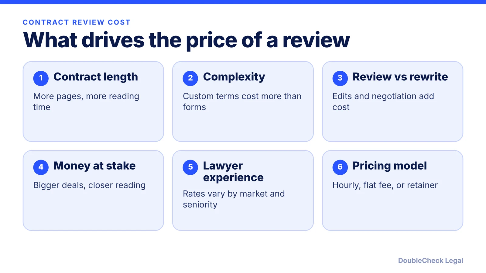
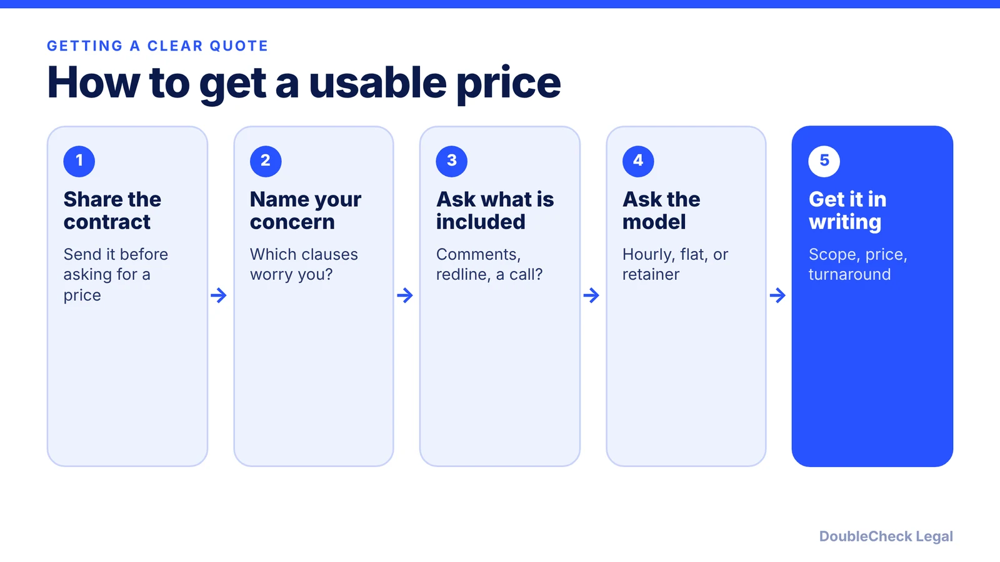

*Published estimates put contract review from about $100 to $3,000, depending on scope and fee model.*

**Key takeaways:**

- BizCounsel cites $300 to $1,000 for a general review and about $150 to $350 for an issue-specific review.
- LegalZoom lists contract drafting and review at $150 to $350 per hour, as of its July 30, 2024 update.
- Ask what is included: comments, a redline, or a call.
- Narrowing the question is the most reliable way to lower the bill.

## 1. The quick answer

**Quick answer:** Published guides put a lawyer's contract review anywhere from roughly $100 to $3,000, because the price depends on the contract and the pricing model. BizCounsel cites $300 to $1,000 for a general review and about $150 to $350 for an issue-specific review, with hourly rates of $100 to $750. LegalZoom lists contract drafting and review at $150 to $350 per hour and a standard employment contract review at a $100 to $200 flat fee. These are third-party estimates, not quotes, so ask for scope and price in writing.

## 2. Published price ranges, with sources

Treat every figure below as a published estimate from the named source, not a guarantee of what your lawyer will charge.

- **General contract review:** $300 to $1,000, per [BizCounsel](https://bizcounsel.com/How-Much-Does%20It-Cost-for-a-lawyer-to-review-a-contract).
- **Issue-specific review** (a lawyer checks one clause or concern): about $150 to $350, per BizCounsel.
- **Drafting and negotiating a contract:** $500 to $3,000, per BizCounsel. The same page says a basic review plus edits can exceed $3,000.
- **Hourly rates for this work:** BizCounsel cites $100 to $750 per hour; [LegalZoom](https://legalzoom.com/articles/how-much-does-a-lawyer-cost) lists $150 to $350 for contract drafting and review, and an overall average of about $260 per hour (page updated July 30, 2024).
- **Flat fees:** LegalZoom lists $100 to $200 for a standard employment contract review and $200 to $800 for a prenuptial or independent contractor agreement.
- **By state:** LegalZoom, citing Statista, shows average hourly rates from $162 in West Virginia to $392 in the District of Columbia, with California at $344 and New York at $358.

The ranges overlap and sometimes disagree. That is normal: the sources measure different things, and the figures are national or general averages. Neither source says what a specific startup contract in your city would cost.

## 3. Hourly, flat fee, or retainer: how the model changes the bill

Ask which model the lawyer is using before you send the document.

- **Hourly:** you pay for time spent. A short, clean contract can cost less than a flat fee, but a messy one can run over. Ask for an estimate and a cap.
- **Flat fee:** a fixed price for a defined task, such as a review of one agreement. It is predictable, but confirm what is included, for example whether the lawyer will mark up the document or only give you comments.
- **Retainer:** an advance deposit billed against hourly work, or a monthly arrangement for ongoing advice. Pandev Law describes both hourly and flat-fee structures and a monthly retainer for ongoing advice.

As [UpCounsel](https://upcounsel.com/contract-review-attorney-fee) puts it, a quote is meaningful only when it identifies the work included. A $200 price for "a look" and a $600 price for a marked-up draft with a call are different products.

## 4. Ways to spend less without cutting corners

You can often reduce cost by narrowing what the lawyer has to do, not by skipping review of a contract that matters.

- **Do a first pass yourself.** Mark the clauses you do not understand: payment, termination, liability, IP ownership, auto-renewal. See [what to check before signing](/blog/ai-contract-review-what-to-check-before-signing/) and [common contract red flags](/blog/contract-red-flags-small-business/).
- **Ask for an issue-specific review** if only one or two clauses worry you. BizCounsel's issue-specific range is lower than its general range.
- **Use AI to prepare, not to replace.** An AI summary can help you write sharper questions, but it can miss things or invent them. Read [how a lawyer can review a ChatGPT-reviewed contract](/blog/lawyer-review-chatgpt-contract/) and [how to save money on legal work with AI](/blog/save-money-legal-work-with-ai/).
- **Match the lawyer to the stakes.** A routine vendor form and a long-term exclusive deal do not need the same level of review. If you are unsure, see [when to hire a lawyer for a small business](/blog/when-to-hire-lawyer-small-business/) and [how to choose a good lawyer](/blog/how-to-choose-good-lawyer/).

## Where DoubleCheck fits

[DoubleCheck](https://www.contactdoublecheck.com) helps businesses and founders start legal work with AI, verify it, and, when professional advice is warranted, connect with an independent attorney, including for immigration questions. Attorney availability and practice areas vary. Attorneys on DoubleCheck are independent professionals; an attorney-client relationship forms only if an attorney accepts your engagement.

**Sources:** [BizCounsel](https://bizcounsel.com/How-Much-Does%20It-Cost-for-a-lawyer-to-review-a-contract); [LegalZoom](https://legalzoom.com/articles/how-much-does-a-lawyer-cost); [UpCounsel](https://upcounsel.com/contract-review-attorney-fee); [Pandev Law](https://www.pandevlaw.com/blog/how-much-does-a-startup-lawyer-cost/).

## FAQ

**How much does a lawyer charge to review a contract?**

Published estimates vary widely. BizCounsel cites $300 to $1,000 for a general review and about $150 to $350 for a review of specific issues. LegalZoom lists $150 to $350 per hour for contract drafting and review. Your actual quote depends on the contract and the lawyer.

**Is contract review usually hourly or flat fee?**

Both are used. LegalZoom lists flat fees for some routine documents, such as $100 to $200 for a standard employment contract review, while BizCounsel notes hourly rates from $100 to $750. Ask which model applies and what the price includes.

**Can a lawyer review just one clause?**

Many lawyers will scope a review to specific issues. BizCounsel cites about $150 to $350 for issue-specific review, lower than its general review range. Confirm the scope in writing.

**Does AI replace paying a lawyer to review a contract?**

Not for high-stakes agreements. AI can help you understand a draft and prepare questions, but its output needs verification. Ask a lawyer when the contract is large, unusual, or hard to reverse.

---

*General information only. This article is not legal, tax, investment, or accounting advice.*
