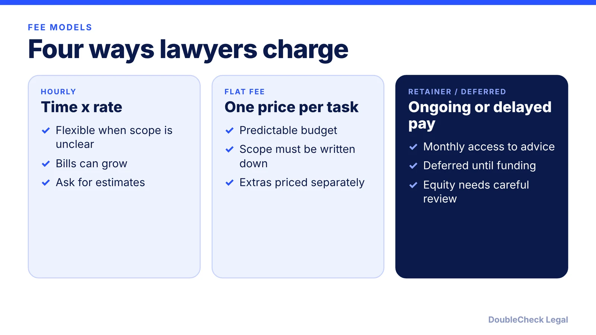
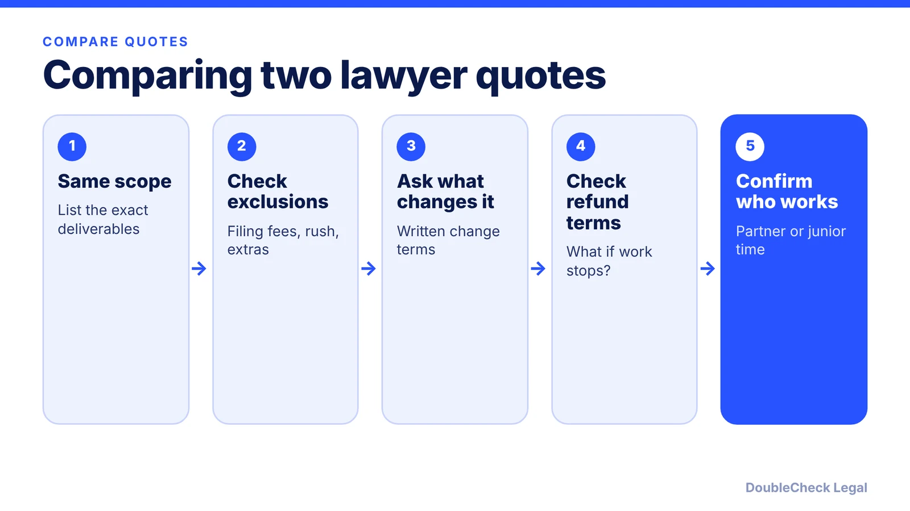

*Hourly vs flat fee vs retainer vs deferred pay for startup legal work, with attributed price ranges and how to compare quotes.*

**Key takeaways:**

- Per Promise Legal (May 2026), startup attorneys typically bill $200 to $500 per hour; formation packages run about $2,500 to $5,000.
- Flat fees suit predictable tasks; hourly suits uncertain or contested work.
- Compare quotes on scope, exclusions, change terms, refund terms and who does the work.
- AI drafting plus attorney review can shrink drafting time, but review time still depends on the risk.

## 1. The quick answer

**Quick answer:** Business lawyers bill hourly, by flat fee for a defined task, by monthly retainer, or occasionally with deferred or equity arrangements. Per Promise Legal (May 2026), startup attorneys typically bill $200 to $500 per hour, routine formation work is often priced flat at roughly $500 to $2,000, and a full formation package runs about $2,500 to $5,000. Flat fees suit predictable work with a clear scope; hourly suits uncertain or contested matters. Prices vary by city, firm and complexity, so treat any range as a starting point and get written quotes.

## 2. What the fee models look like

**Hourly.** You pay for time. Per Promise Legal, $200 to $500 per hour is typical for startup attorneys, so extra negotiation or revisions can add hundreds of dollars. Per the Rapacke Law Group (April 2025), associates commonly bill $200 to $600 per hour and partners can exceed $1,000. Hourly is flexible when scope is uncertain, but bills can be unpredictable.

**Flat fee.** One price for a defined deliverable. Per [Promise Legal](https://blog.promise.legal/startup-legal-costs/):

- Routine formation work: roughly $500 to $2,000, depending on complexity.
- Full-service formation package (certificate, bylaws or company agreement, initial resolutions, founder equity agreements): about $2,500 to $5,000.
- Filing-only package: about $500 to $2,000, without the operating agreement or equity documents.
- Founder NDAs: $500 to $1,500 each. Founder agreements: $2,000 to $5,000 or more.
- Its estimate for a first year of legal spend, excluding a capital raise: roughly $15,000 to $20,000.

Those are one firm's figures, not a market rule. Also note that government filing fees and registered agent costs are separate from attorney fees.

**Retainer.** Per PanDev Law (May 2024), a retainer is a set monthly fee for ongoing advice, which may be more economical over time. Rapacke notes that retainers are held in trust accounts, so ask how yours is handled.

**Deferred or equity.** Per a TechCrunch guide (2019), deferral means payment delayed until an investment closes, or non-cash consideration like equity. It warns these can misalign incentives or create conflicts. Per [Above the Law](https://abovethelaw.com/2025/08/is-it-a-good-idea-to-accept-equity-in-a-company-instead-of-cash-in-exchange-for-legal-services) (August 2025), a lawyer generally cannot take an ownership interest in a client unless terms are fair and reasonable, the client is advised to seek independent counsel, and the client gives informed consent. Equity for services is generally taxable income, so ask your tax advisor.

## 3. Flat fee or hourly: which tasks, and how to compare quotes

Per Rapacke, flat fees tend to suit predictable, well-defined matters such as trademarks and standard contracts, while hourly tends to suit litigation where scope can shift. The TechCrunch guide lists formation, stock issuance, standard IP assignments and employee handbooks as flat-fee candidates.

When you compare quotes, line them up on the same scope:

1. **What is included?** Documents, number of revision rounds, calls, filings.
2. **What is excluded?** Government fees, rush fees, and anything labeled a "scope adjustment."
3. **When do extra fees apply?** Per Rapacke, get change terms in writing.
4. **Refund terms.** Is any of it nonrefundable if the work is not completed?
5. **Who does the work?** Per TechCrunch, paralegals and junior associates bill less than partners, so routine work can go to them.
6. **Estimates and alerts.** Ask for a time and cost estimate per assignment and a notice when the attorney nears it. Ask whether an emerging-company discount exists.

Questions to ask before you hire: Have you done this exact task for companies like mine? What is the total including pass-through costs? What would change the price? See [how to prepare for a first meeting with a startup lawyer](/blog/how-to-prepare-for-first-meeting-with-startup-lawyer/), [how to tell if your lawyer is good](/blog/how-do-i-know-if-my-lawyer-is-good/), and [finding a startup lawyer in San Francisco](/blog/find-startup-lawyer-san-francisco/). Immigration work has its own pricing patterns; see [immigration lawyer fees](/blog/immigration-lawyer-fees-flat-fee-vs-hourly/).

## 4. How AI drafting plus attorney review changes the bill

AI can produce a first draft of a standard document, and a lawyer then reviews it instead of writing from scratch. Rapacke's hypothetical compares 15 hours of associate time at $300 and 3 hours of partner review at $800 ($6,900) with an AI-assisted version of under 2 hours of drafting and 1 hour of partner review. That example is illustrative, not a price list, and it does not mean every review is cheaper. Review time depends on how clean the draft is and how risky the issue is.

Per the TechCrunch guide, drafting from free templates first and having an attorney finalize signals you understand the assignment and can reduce the work. The same logic applies to an AI draft: define what you want, state your facts, then pay a lawyer to check the parts that carry risk. For limits and good prompts, see [AI lawyers for small business](/blog/ai-lawyer-small-business/), [lawyer review of a ChatGPT contract](/blog/lawyer-review-chatgpt-contract/) and [what a lawyer charges to review a contract](/blog/how-much-does-a-lawyer-charge-to-review-a-contract/). For the broader picture of startup legal budgets, see [how much a startup lawyer costs](/blog/how-much-does-a-startup-lawyer-cost/).

**Handle yourself vs get an attorney.** DIY the research, a first draft and your own question list. Bring in an attorney for equity splits, investor documents, employment or IP agreements, and anything where a mistake is expensive to undo. Ask for a flat fee to review a specific draft; it is often the cheapest way to get professional judgment on the risky part.

## Where DoubleCheck fits

[DoubleCheck](https://www.contactdoublecheck.com) helps businesses and founders start legal work with AI, verify it, and, when professional advice is warranted, connect with an independent attorney, including for immigration questions. Attorney availability and practice areas vary. Attorneys on DoubleCheck are independent professionals; an attorney-client relationship forms only if an attorney accepts your engagement.

**Sources:** [Promise Legal, May 2026](https://blog.promise.legal/startup-legal-costs/); [Rapacke Law Group, April 2025](https://arapackelaw.com/intellectual-property/flat-fee-vs-hourly-attorney/); [PanDev Law, May 2024](https://www.pandevlaw.com/blog/how-much-does-a-startup-lawyer-cost/); [Above the Law, August 2025](https://abovethelaw.com/2025/08/is-it-a-good-idea-to-accept-equity-in-a-company-instead-of-cash-in-exchange-for-legal-services); [TechCrunch, 2019](https://techcrunch.com/2019/01/10/how-to-get-your-moneys-worth-from-your-startup-lawyer/).

## FAQ

**How much does a startup lawyer charge per hour?**

Per Promise Legal (May 2026), startup attorneys typically bill $200 to $500 per hour. Per the Rapacke Law Group (April 2025), associates commonly bill $200 to $600 and partners can exceed $1,000. Rates vary by city and firm.

**What tasks are best for a flat fee?**

Per Rapacke, predictable, well-defined matters such as trademarks and standard contracts. A TechCrunch guide adds formation, stock issuance, standard IP assignments and employee handbooks.

**Can a startup pay a lawyer with equity?**

Sometimes, but it is risky. Per Above the Law (August 2025), lawyers generally need fair terms, advice to seek independent counsel and informed consent, and equity for services is generally taxable income.

**What should a flat-fee quote include?**

Per Rapacke, confirm what is covered, any extra or rush charges, written terms for when additional fees apply, whether the fee is refundable, how retainers are held, and get everything in writing before work begins.

---

*General information only. This article is not legal, tax, investment, or accounting advice.*
