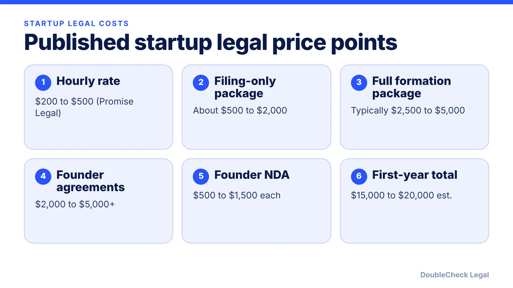
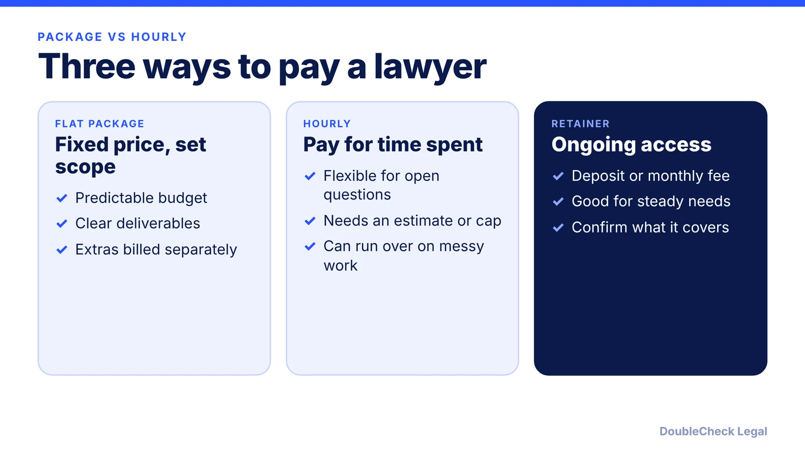

*Published guides put startup attorneys at $200 to $500 per hour and full formation packages at $2,500 to $5,000.*

**Key takeaways:**

- Promise Legal (May 3, 2026): $200 to $500 per hour for startup attorneys.
- Full-service formation packages are typically a flat $2,500 to $5,000, per the same guide.
- Thumbtack's national average flat fee for a corporate lawyer is $290.
- Scope, location, and deal complexity change the price more than the label does.

## 1. The quick answer

**Quick answer:** In a May 3, 2026 guide, Promise Legal puts startup attorneys at $200 to $500 per hour, a filing-only formation package at about $500 to $2,000, and a full-service formation package at typically $2,500 to $5,000. It estimates total first-year legal spend at $15,000 to $20,000, excluding any capital raise. Thumbtack's national flat-fee average for a corporate lawyer is $290. These are published estimates, not quotes.

## 2. What the main services cost, per named sources

All figures here come from [Promise Legal](https://blog.promise.legal/startup-legal-costs/) (published May 3, 2026) unless another source is named.

- **Formation, filing only:** about $500 to $2,000 for an attorney to handle the state filing. State fees are separate.
- **Formation, full service:** typically a flat $2,500 to $5,000, including formation documents, bylaws or company agreement, initial resolutions, and founder equity agreements.
- **Founder agreements** (equity splits, roles, IP assignment): $2,000 to $5,000 or more.
- **Founder NDAs:** $500 to $1,500 each.
- **Hourly rates:** $200 to $500.

Promise Legal also lists state filing fees: $300 for a Texas LLC or corporation, $89 for a Delaware C-Corp certificate of incorporation plus a $175 minimum annual franchise tax, and about $110 for a Delaware LLC plus a $300 annual tax, with registered agents at $50 to $300 per year. Check the state agency before relying on these.

[Thumbtack](https://thumbtack.com/p/small-business-lawyer-cost) reports a national average fixed price of $290 for a corporate lawyer, with a range of $170 to $420, and gives an Illinois example of $500 for the simplest one-person business, excluding state filing fees of $175 to $750. It also gives an example of $10,000 for a larger startup. Thumbtack says its figures come from estimates it receives from local professionals and are for information only.

## 3. Fee structures and what changes the price

Pandev Law describes three common structures: hourly billing, flat fees for specific services such as drafting terms of service or a privacy policy, and a retainer, meaning a set monthly fee for ongoing advice. It also says fees vary with location, legal complexity, and the lawyer's experience.

LegalZoom, citing Statista, shows average attorney hourly rates by state from $162 (West Virginia) to $392 (District of Columbia), with California at $344 and New York at $358. A San Francisco founder should expect the market to sit toward the higher end; see [how to find a startup lawyer in San Francisco](/blog/find-startup-lawyer-san-francisco/).

What typically moves the price up:

- A priced equity round, convertible notes, or a SAFE instead of plain formation. See [SAFE vs convertible note](/blog/convertible-note-vs-safe/).
- Multiple founders with vesting, IP assignment, or different contributions. See [co-founder agreements](/blog/co-founder-agreement-startups/).
- Foreign founders or investors, or regulated industries.

## 4. How to keep the bill under control

- **Do the groundwork yourself.** Know your entity type and state before you call; see [how to incorporate a company in the US](/blog/how-to-incorporate-a-company-in-the-us/) and [Delaware vs California](/blog/incorporate-california-vs-delaware-startup/).
- **Buy scoped packages for routine work** and save hourly time for open questions.
- **Ask what is not included**, such as state fees, registered agent, and follow-up edits.
- **Arrive prepared.** A focused first meeting costs less; see [how to prepare for your first meeting with a startup lawyer](/blog/how-to-prepare-for-first-meeting-with-startup-lawyer/).
- **Use AI to draft questions and summaries, then verify** what matters. See [using AI for legal work as a small business](/blog/ai-lawyer-small-business/).

Whether to spend on a lawyer at all depends on the stakes; [when to hire a lawyer for a small business](/blog/when-to-hire-lawyer-small-business/) covers that decision.

## Where DoubleCheck fits

[DoubleCheck](https://www.contactdoublecheck.com) helps businesses and founders start legal work with AI, verify it, and, when professional advice is warranted, connect with an independent attorney, including for immigration questions. Attorney availability and practice areas vary. Attorneys on DoubleCheck are independent professionals; an attorney-client relationship forms only if an attorney accepts your engagement.

**Sources:** [Promise Legal](https://blog.promise.legal/startup-legal-costs/); [Thumbtack](https://thumbtack.com/p/small-business-lawyer-cost); [LegalZoom](https://legalzoom.com/articles/how-much-does-a-lawyer-cost); [Pandev Law](https://www.pandevlaw.com/blog/how-much-does-a-startup-lawyer-cost/).

## FAQ

**How much does a startup lawyer cost per hour?**

Promise Legal's May 3, 2026 guide puts startup attorneys at $200 to $500 per hour. LegalZoom, citing Statista, shows state averages from $162 to $392 per hour, with California at $344.

**How much does it cost for a lawyer to incorporate a startup?**

Promise Legal puts a filing-only package at about $500 to $2,000 and a full-service package at typically $2,500 to $5,000, excluding state fees. Thumbtack cites an Illinois example of $500 for the simplest one-person business.

**How much should a startup budget for legal costs in year one?**

Promise Legal estimates total first-year legal spend at $15,000 to $20,000, excluding any capital raise. Your own number depends on whether you raise money, hire, or work in a regulated area.

**Are flat fees better than hourly for startups?**

It depends. Pandev Law describes flat fees as useful for specific, defined services and hourly billing as the traditional structure. Flat fees give predictability; hourly suits open-ended questions. Ask what each includes.

---

*General information only. This article is not legal, tax, investment, or accounting advice.*
