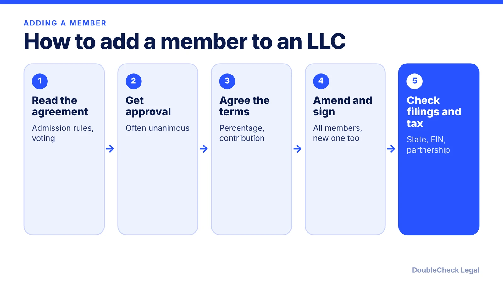
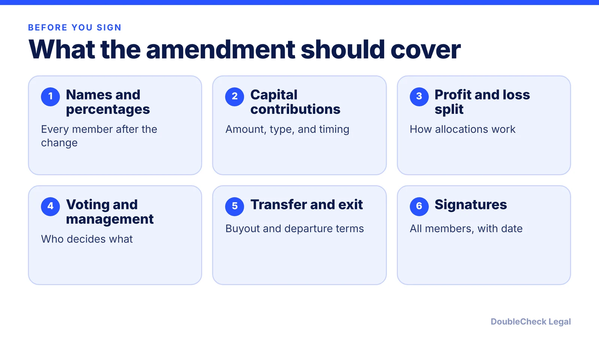

*Admitting a new owner is mostly paperwork, but the order matters. Here is the sequence and what to check.*

**Key takeaways:**

- Follow your operating agreement first; state LLC law fills the gaps if you have none.
- Most states and many agreements require unanimous consent, per Illinois Lawyer Now.
- Amend the agreement in writing, signed by all members including the new one.
- A single-member LLC adding an owner needs an EIN and generally moves to partnership tax filings.

## 1. The quick answer

**Quick answer:** To add a member to an LLC, follow your operating agreement (or your state's LLC law if you have none), get the existing members' approval, agree on the new member's ownership percentage and capital contribution, amend the operating agreement, and check whether your state requires a filing. Per Illinois Lawyer Now, most states and many operating agreements require unanimous consent. Tax steps can follow: a single-member LLC that adds an owner needs an EIN, per both ZenBusiness and Illinois Lawyer Now.

## 2. Approval and the operating agreement

**Start with the operating agreement.** Per [Illinois Lawyer Now](https://www.illinoislawyernow.com/2021/07/how-to-add-a-new-member-to-an-llc/), it usually sets out how to add a member; with none, state LLC law governs. Existing members typically vote on an amendment admitting the new member, and a member's stake cannot be diluted without that member's agreement.

**Agree the terms** before drafting:

- the new member's ownership percentage
- the capital contribution (cash, property, or services)
- the share of profits and losses
- voting rights and whether the LLC is member-managed or manager-managed

Ownership does not have to match each member's capital contribution unless state default rules apply because no agreement exists, per Illinois Lawyer Now.

**Document it.** Prepare an amendment listing the new member's name, ownership stake, contribution, and profit and loss allocation; all members, including the new one, should sign it, and the vote should be recorded in minutes or a resolution. If you do not have a written agreement yet, read [LLC operating agreement with AI](/blog/llc-operating-agreement-with-ai/) first. Owners joining a founding team should also read [co-founder agreement basics](/blog/co-founder-agreement-startups/).

## 3. State filings and tax steps

**State filings.** Per Illinois Lawyer Now, some states require amending the articles of organization, and a change between manager-managed and member-managed structure requires an amendment. The operating agreement generally is not filed with the state. ZenBusiness notes that many states require member names and addresses in formation records, so check whether you must file articles of amendment or your state's equivalent, and watch deadlines. Filing fees vary; one source puts them often around $100, so confirm with your Secretary of State.

**Tax steps.**

- **Single-member to multi-member:** per Illinois Lawyer Now, a federal EIN is required. ZenBusiness says all LLCs with more than one owner must have an EIN.
- **Existing multi-member LLC:** adding a member usually does not change the EIN, per Illinois Lawyer Now.
- **Default tax treatment:** per ZenBusiness, a former sole proprietorship becomes a partnership for tax, files Form 1065, and each member receives a Schedule K-1. Illinois Lawyer Now adds that electing corporate status requires IRS Form 8832.

How the contribution is valued and taxed, and how any existing profits are allocated, are questions for a CPA. For the single-owner starting point, see [single-member LLC taxes](/blog/single-member-llc-taxes-disregarded-entity/).

## 4. Common mistakes and a safe sequence

Mistakes that cause trouble later:

- **Handshake admission.** Adding someone by email or promise, with no signed amendment.
- **Skipping the vote.** If your agreement requires unanimity, a partial vote can invalidate the admission.
- **Vague contribution.** Spell out what the new member contributes and when.
- **Forgetting the tax side.** An EIN, the partnership return, and K-1s follow the change.
- **No exit terms.** Before bringing in a partner, agree what happens if they leave; see [buy-sell agreements](/blog/buy-sell-agreement-small-business-partners/).

Because the answer changes by state and by what your agreement says, have an attorney read the amendment, especially when equity is offered for services or an investor is involved. See [when to hire a lawyer](/blog/when-to-hire-lawyer-small-business/).

## Where DoubleCheck fits

[DoubleCheck](https://www.contactdoublecheck.com) helps businesses and founders start legal work with AI, verify it, and, when professional advice is warranted, connect with an independent attorney, including for immigration questions. Attorney availability and practice areas vary. Attorneys on DoubleCheck are independent professionals; an attorney-client relationship forms only if an attorney accepts your engagement.

**Sources:** [Illinois Lawyer Now, How to add a new member to an LLC](https://www.illinoislawyernow.com/2021/07/how-to-add-a-new-member-to-an-llc/); [ZenBusiness, How to add a member to an LLC](https://www.zenbusiness.com/how-to-add-member-to-llc/).

## FAQ

**How do I add a member to my LLC?**

Check the operating agreement, get existing members' approval, agree the new member's percentage and capital contribution, sign an amendment, and check state and tax filings, per Illinois Lawyer Now and ZenBusiness.

**Do all members have to approve a new member?**

Per Illinois Lawyer Now, most states and many operating agreements require unanimous consent, and a member's stake cannot be diluted without that member's agreement. Your operating agreement controls, so read it.

**Do I need a new EIN when I add a member?**

If a single-member LLC becomes multi-member, yes, per Illinois Lawyer Now and ZenBusiness. Adding a member to an existing multi-member LLC usually does not change the EIN, per Illinois Lawyer Now.

**Do I have to file anything with the state?**

It depends on the state. Per Illinois Lawyer Now, some states require amending the articles of organization, and the operating agreement generally is not filed. Check your Secretary of State's page.

---

*General information only. This article is not legal, tax, investment, or accounting advice.*
