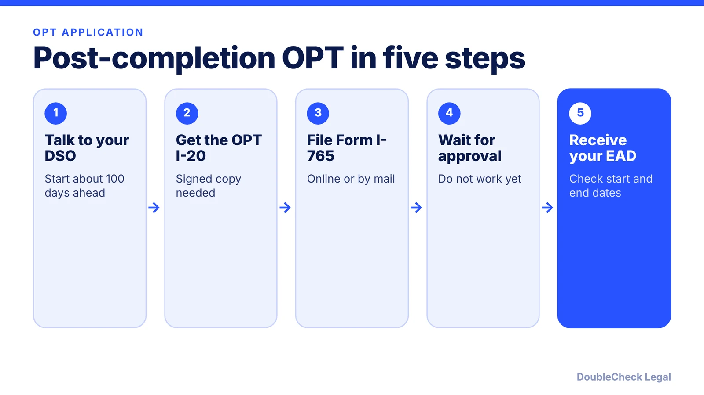
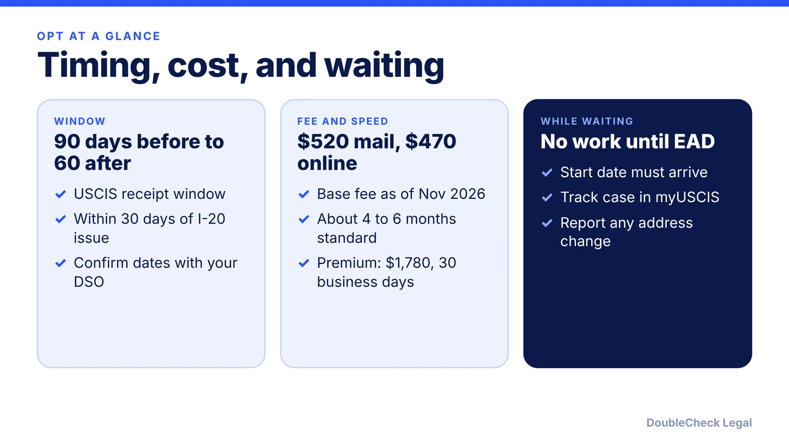

*A step-by-step guide to post-completion OPT, with filing windows, fees, and timing verified as of November 2026.*

**Key takeaways:**

- Your DSO recommends OPT first by issuing a new I-20; do not file Form I-765 until you have it.
- USCIS can receive your I-765 from 90 days before to 60 days after program end, and within 30 days of the I-20 issue date.
- As of November 2026, the base fee is $520 by mail or $470 online; processing was shown as about 4 to 6 months.
- Do not start work until you have the EAD and the start date has arrived.

## 1. The quick answer

**Quick answer:** To apply for post-completion OPT, ask your DSO (designated school official) to recommend you, which results in a new I-20 with the OPT recommendation. Then file Form I-765 with USCIS. USCIS can receive it from 90 days before to 60 days after your program end date, and no later than 30 days after the date your DSO issued the OPT I-20, per the University of Minnesota's international office (ISSS, updated September 2026). As of November 2026, the I-765 fee is $520 by mail or $470 online, per UMass Amherst, and standard processing was shown as roughly 4 to 6 months in a September 2026 data snapshot.

## 2. Step 1 and 2: DSO recommendation and I-20

Your school, not USCIS, starts the process. On the I-765 you select category (c)(3)(B) for post-completion OPT, per ISSS (pre-completion is (c)(3)(A), STEM OPT is (c)(3)(C)).

At the University of Minnesota the steps are: submit an OPT request in the school's portal after an OPT workshop, then the DSO recommends OPT by issuing a new I-20, which takes up to 10 business days there. Other schools set their own procedures, so check yours. ISSS warns not to submit to USCIS until you have the new I-20 with the OPT recommendation.

**The timing rules (ISSS):**

- USCIS can receive your application from 90 days before to 60 days after program completion.
- USCIS must receive it within 30 days of the "date issued" on the OPT I-20, or it is denied.
- Example from ISSS for a December 23, 2026 completion: earliest USCIS receipt September 24, 2026; latest February 21, 2027.

Applying too early or too late can cost you the OPT, so do not rely on estimates. Confirm your dates with your DSO. If you are deciding between work options, see [CPT vs OPT](/blog/cpt-vs-opt-f1-students/), and for how your I-20 and SEVIS record fit together, see [SEVIS and the I-20 explained](/blog/sevis-i-20-explained-maintaining-f-1-status/).

## 3. Step 3: file Form I-765, fee and processing

You can file online through a myUSCIS account or by mail, per ISSS. You will generally need:

- your most recent electronic I-94 and your passport biographical page
- copies of previous I-20s showing CPT or OPT
- the signed OPT I-20 (online filers upload pages 1 and 2)
- the filing fee, paid from a U.S. bank account or credit card, per ISSS

**Fee as of November 2026.** Per [UMass Amherst](https://www.umass.edu/global-affairs/international-students-scholars/i765), the base fee is $520 on paper and $470 online, applying to applications postmarked March 5, 2026 and after. It also says using the wrong form edition or fee results in rejection (the 08/21/2025 edition for mail filing). Optional premium processing on Form I-907 costs $1,780 from March 1, 2026, per UMass. Always check the fee on [USCIS.gov](https://www.uscis.gov/i-765) before filing.

**Processing.** Per [Beyond Border Global](https://www.beyondborderglobal.com/resources/i-765-processing-time-ead), a September 8, 2026 USCIS snapshot listed 4 to 6 months for F-1 OPT cases, and it cautions that this is a general reference only. Premium processing, available for OPT, promises USCIS action within 30 business days, but that action can be an approval, denial, or request for evidence; it does not fix eligibility problems. Check the USCIS processing times page for your category.

**Recent rule changes.** Per ISSS, the DHS duration-of-status rule published July 17, 2026 was preliminarily enjoined on September 14, 2026, and the OPT process was unchanged for now. The order may be appealed, so check your DSO's updates before filing. If you are on a tight timeline, see [the 60-day grace period after OPT ends](/blog/f-1-60-day-grace-period-after-opt-ends-options/).

## 4. Step 4 and 5: while you wait, start and end dates

**While you wait.** Per ISSS:

- Do not work off campus until you have the EAD card in hand and the start date has arrived, even if the start date you requested has passed.
- Stop on-campus work after the completion date on your OPT I-20 (block 3), even if you have not finished your degree.
- Save your receipt number, track the case in myUSCIS, and report a change of address to USCIS.
- If USCIS sends a request for evidence or a biometrics notice, contact your DSO and respond by the deadline.

**Start and end dates.** On the EAD card, "Valid From" is your employment start date and "Card Expires" is your end date, per ISSS. After approval you have reporting duties through your school's SEVIS portal; check the school's page on requirements during OPT.

**Unemployment limit.** Once OPT starts, unemployed days count against your limit. Read [the OPT unemployment limit](/blog/opt-unemployment-limit-90-days-stem-opt/) before planning a gap.

**Starting a company on OPT.** Self-employment and startups have special rules; see [F-1 OPT and STEM OPT for starting your own startup](/blog/f1-opt-stem-opt-start-your-own-startup/). If a job offer needs H-1B sponsorship later, review [F-1 cap-gap](/blog/f-1-cap-gap-change-of-status-to-h-1b/).

## Where DoubleCheck fits

[DoubleCheck](https://www.contactdoublecheck.com) helps businesses and founders start legal work with AI, verify it, and, when professional advice is warranted, connect with an independent attorney, including for immigration questions. Attorney availability and practice areas vary. Attorneys on DoubleCheck are independent professionals; an attorney-client relationship forms only if an attorney accepts your engagement.

**Sources:** [UMN ISSS, Applying for OPT](https://isss.umn.edu/fstudents/employment/opt/apply); [UMass Amherst, Form I-765 for OPT](https://www.umass.edu/global-affairs/international-students-scholars/i765); [Beyond Border Global, I-765 processing time](https://www.beyondborderglobal.com/resources/i-765-processing-time-ead).

## FAQ

**When can I apply for OPT?**

Per the University of Minnesota's ISSS, USCIS can receive your Form I-765 from 90 days before to 60 days after your program end date, and no later than 30 days after the date your DSO issued the OPT I-20.

**How much does the OPT application cost in 2026?**

Per UMass Amherst, the base I-765 fee is $520 filed by mail and $470 filed online for applications postmarked March 5, 2026 and after. Premium processing is an optional $1,780. Confirm the current fee on USCIS.gov.

**How long does OPT take to process?**

Per Beyond Border Global, a September 8, 2026 USCIS snapshot listed 4 to 6 months for F-1 OPT cases, with the caveat that it is a general reference. Premium processing promises USCIS action within 30 business days.

**Can I work while my OPT application is pending?**

Not off campus. Per ISSS, do not work until you have the EAD card and the start date has arrived. On-campus work must stop after the completion date on your OPT I-20.

---

*General information only. This article is not legal, tax, investment, or accounting advice.*
