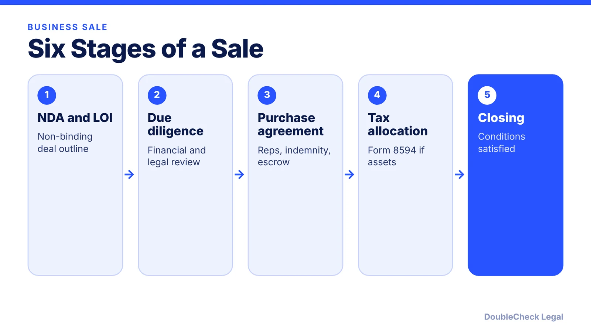
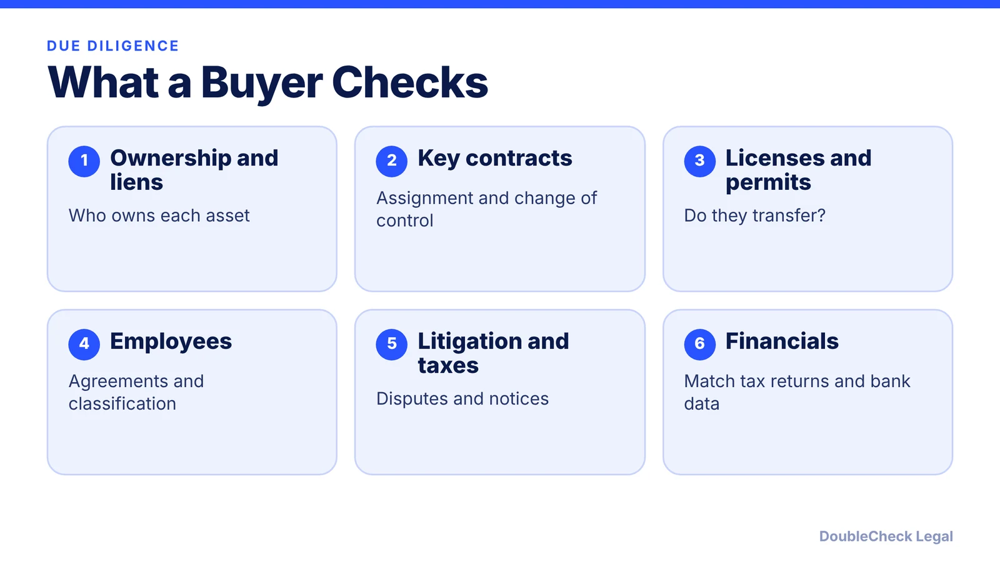

*Most small business deals follow the same path. Know the stages and the terms that matter.*

**Key takeaways:**

- Choose asset or stock structure first; it drives liabilities, contracts, and tax.
- An LOI is generally non-binding, but NDAs and escrow protections can bind.
- Purchase agreements center on reps and warranties, indemnification, escrow, and closing conditions.
- Asset deals require Form 8594 from both sides, and non-compete value affects both parties' taxes.

## 1. The quick answer

**Quick answer:** A small business sale usually runs in six stages: sign an NDA, agree a non-binding letter of intent (LOI), do due diligence, negotiate the purchase agreement, allocate the price for tax (Form 8594 in an asset deal), and close. The biggest early choice is structure. In an asset purchase the buyer picks which liabilities to take; in a stock purchase the buyer takes the whole company, including unknown liabilities, per FindLaw.

## 2. Asset purchase vs. stock purchase

Per FindLaw:

- **Liabilities.** In an asset purchase the buyer specifies the liabilities it will assume. In a stock purchase it acquires the company with any unknown liabilities.
- **Contracts, permits, licenses.** Assets must be retitled to the buyer, and non-assignable contracts or permits may need the other party's consent. In a stock purchase the company stays the same, so these usually stay in place, though change-of-control clauses can still require consent.
- **Tax.** In an asset purchase, a buyer who pays more than the assets' tax basis can get a stepped-up basis, and goodwill can be amortized over 15 years.
- **No stock to buy.** Sole proprietorships, partnerships, and LLCs have no stock, so the choice there is an asset sale or a sale of membership or partnership interests.

Buyers tend to prefer asset deals for liability selection and tax basis; stock deals can avoid retitling and transfer taxes. Sellers often weigh the tax result differently, so model both before signing an LOI. If you are selling, see our [sell-side M&A legal checklist](/blog/sell-side-ma-legal-checklist/).

## 3. LOI and due diligence

**The LOI.** MyCorporation describes it as the first step: a non-binding sketch of basic terms before costly negotiations. It should say whether the deal is a stock or asset purchase and state the price and the assumptions behind it. Funding method (cash, seller financing, or bank financing) and deal breakers, such as key employee retention, a non-compete, or assumption of liabilities, should be raised early. Non-disclosure agreements and escrow funds are the binding safeguards the article mentions. See [reviewing an NDA you received](/blog/review-nda-you-received/).

**Due diligence.** The buyer verifies what the seller claimed. Typical legal items: ownership and liens on assets, contracts and change-of-control terms, licenses and permits, employment and contractor arrangements, litigation, taxes, IP, and the financial statements. In a stock purchase, liabilities such as worker misclassification stay with the company; see [contractor vs. employee](/blog/independent-contractor-vs-employee/) and [business licenses](/blog/business-license-requirements-small-business/).

## 4. Purchase agreement, non-compete, Form 8594, and SBA

**Purchase agreement terms.** Per MPL Law and Pavlik Law, the core terms are: what is bought and the price (including adjustments and earn-outs), **representations and warranties** (statements about the business such as accurate financials and no undisclosed litigation or liens), **indemnification** for breaches, an **escrow or holdback** to cover post-closing issues, **covenants** (including non-compete and non-solicit), and **closing conditions**.

**Non-compete.** Buyers commonly require the seller not to compete for a set period. Porte Brown says terms are usually no longer than five years and that enforceability varies by state; California courts generally reject noncompetes except in limited circumstances. See [non-compete agreements in 2026](/blog/non-compete-agreements-by-state-2026/).

**Form 8594.** In a taxable asset sale, buyer and seller each attach IRS Form 8594 to their tax return for the year of sale, per VJM Global. Consideration is allocated through seven asset classes under the residual method: cash (Class I) through goodwill and going-concern value (Class VII), with non-competes in Class VI. Porte Brown notes amounts allocated to a non-compete are amortized over 15 years by the buyer and are ordinary income to the seller, so the allocation matters and both sides should report consistent numbers. Stock sales are generally not reported on Form 8594.

**SBA financing basics.** If the buyer uses an SBA 7(a) loan, per a July 2026 Beancount summary, SBA SOP 50 10 8 took effect June 1, 2025: a minimum 10% equity injection for a change of ownership, seller notes counting toward up to 50% of that injection if on full standby, and no phased ownership transitions. SBA rules change, so confirm with an SBA lender.

## Where DoubleCheck fits

[DoubleCheck](https://www.contactdoublecheck.com) helps businesses and founders start legal work with AI, verify it, and, when professional advice is warranted, connect with an independent attorney, including for immigration questions. Attorney availability and practice areas vary. Attorneys on DoubleCheck are independent professionals; an attorney-client relationship forms only if an attorney accepts your engagement.

**Sources:** [FindLaw: Asset vs. stock purchase](https://www.findlaw.com/smallbusiness/starting-a-business/asset-purchase-vs-stock-purchase-advantages-and-disadvantages.html); [MyCorporation: Letter of intent basics](https://blog.mycorporation.com/2018/08/buying-a-business-6-must-know-basics-for-a-letter-of-intent/); [VJM Global: Form 8594](https://www.vjmglobal.com/feeds/blog/form-8594); [Porte Brown: Noncompete when buying a business](https://blog.portebrown.com/using-a-noncompete-agreement-when-buying-a-business); [MPL Law: Purchase agreements](https://mpl-law.com/pen-to-paper-or-type-up/); [Pavlik Law: Asset purchase agreements](https://npavliklaw.com/details-of-an-asset-purchase-agreement/); [Beancount: SBA SOP 50 10 8](https://beancount.io/blog/2026/07/29/sba-sop-50-10-8-collateral-equity-injection-rules-guide).

## FAQ

**Should I buy assets or stock?**

Per FindLaw, asset purchases let the buyer choose liabilities and may give a stepped-up basis; stock purchases keep contracts and permits in place but bring all liabilities. Sole proprietorships, partnerships, and LLCs have no stock.

**What is Form 8594?**

An IRS form both buyer and seller generally attach to their returns in a taxable asset acquisition, allocating the price among seven asset classes, per VJM Global.

**Is a letter of intent binding?**

Generally not, per MyCorporation, though confidentiality and escrow provisions may bind. Ask a lawyer to mark which sections are binding.

**Can I finance with an SBA loan?**

Often, subject to SBA rules. A July 2026 Beancount summary says SOP 50 10 8 (effective June 1, 2025) requires a 10% minimum equity injection for change of ownership. Confirm with an SBA lender.

---

*General information only. This article is not legal, tax, investment, or accounting advice.*
