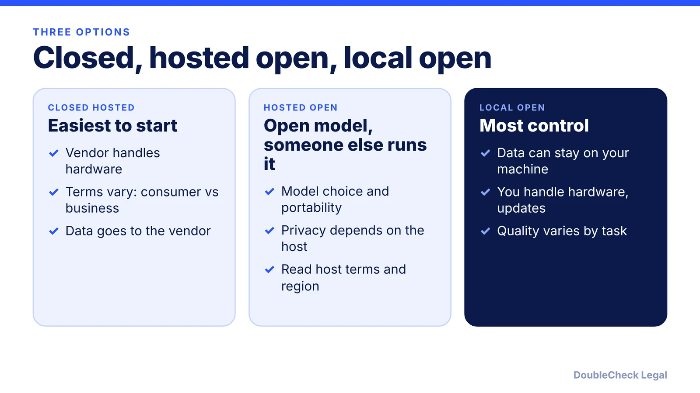
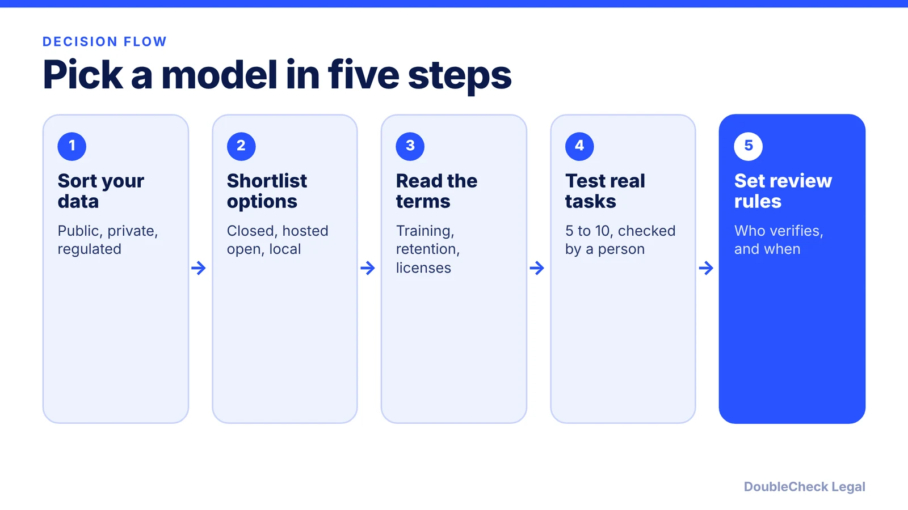

*A practical way to choose between closed hosted, hosted open and local open AI models, as of November 2026.*

**Key takeaways:**

- Sort your data first: public, business confidential, or regulated and privileged. It narrows the choice fastest.
- Consumer and business plans differ; read the written terms for the exact plan, such as Anthropic Commercial Terms (June 17, 2025).
- Test 5 to 10 real tasks instead of trusting rankings, and have a person verify anything you will rely on.
- Mixing options is normal: hosted for low-risk work, local or reviewed hosted for confidential material, advice first for regulated data.

## 1. The quick answer

**Quick answer:** Choose by what you are putting in, not by brand. Start with data sensitivity, because it narrows the options fastest. Public or low-risk material can go to a closed hosted model on a business plan. Confidential material is a fit for a hosted model with written business terms, a hosted open model from a provider whose terms you have read, or a local open model on a machine you control. Then weigh quality on your own sample tasks, ongoing cost, and the effort you can spend on setup and upkeep. As of November 2026, no option wins on every axis: closed hosted models offer convenience and strong terms on business tiers, local open models offer the tightest control over where data goes, and hosted open models sit in between.

## 2. Step one: sort your data

Decide what you will actually type or upload, then sort it into tiers.

- **Public or low risk.** Marketing copy, public research, generic templates. Almost any option works.
- **Business confidential.** Contracts, customer lists, financials, unreleased product plans. You want written terms about training and retention, or a setup where the data does not leave your control.
- **Regulated or privileged.** Health data, children's data, personal data of EU residents, attorney-client communications. You need legal advice on the setup, not just a tool choice. See [state privacy laws 2027 checklist](/blog/state-privacy-laws-2027-small-business-checklist/) and [GDPR for US startups](/blog/gdpr-for-us-startups/).

Consumer and business plans are not the same thing. In United States v. Heppner (S.D.N.Y., Judge Rakoff, February 13, 2026), as summarized by Orrick, the court relied on the consumer privacy policy of a public AI assistant, which allows collection of inputs and outputs and use for training, to find no reasonable expectation of confidentiality. Orrick notes that enterprise platforms with negotiated confidentiality terms "may present a different picture," but that this has not been tested in court. See [AI chats not privileged: Heppner](/blog/ai-chats-not-privileged-heppner/) and [uploading contracts to ChatGPT and confidentiality](/blog/uploading-contracts-to-chatgpt-confidentiality/).

What the business terms say, from sources we could verify:

- **Anthropic.** Its Commercial Terms (effective June 17, 2025) state: "Anthropic may not train models on Customer Content from Services," and that the customer retains rights to its inputs and owns its outputs, to the extent permitted by law.
- **OpenAI.** Per Redress Compliance (a secondary summary, updated September 25, 2026), OpenAI does not train on ChatGPT Enterprise, Business or API data by default, and standard API use may retain inputs and outputs for up to 30 days for abuse monitoring, with zero data retention available only on eligible endpoints after approval. Check OpenAI's own pages for current terms.
- **Ollama cloud models.** Per Ollama's privacy policy (updated March 2026), prompts and responses on its cloud-hosted models are processed transiently and not used to train models, while local use does not send your prompts to Ollama.

Terms change and differ by plan, so read the current policy for the exact plan you will use.

## 3. Step two: compare cost, quality and effort

Once data tiers are clear, compare the three options on what you will really feel day to day.

**Cost.** Hosted models are usually priced per seat or per use; local models have no per-token fee but need a computer capable of running them, plus your time. We do not quote prices here because they change often; get current figures from each provider's pricing page and price a typical month of your own usage.

**Quality.** Do not rely on rankings. Take 5 to 10 real tasks from your work (summarize a contract, extract dates, draft a clause, answer a policy question), run them through each candidate, and compare the answers with a person who knows the subject. Quality gaps can differ by task and shift as models are updated. Every model can still invent facts, so legal output needs checking; see [AI hallucinated citations](/blog/ai-hallucinated-citations-business/) and [verify AI-generated legal documents](/blog/verify-ai-generated-legal-document/).

**Effort.** Closed hosted tools take minutes to start. Local tools such as Ollama and LM Studio are simple to install, but you own the updates, the model choice, the security of the machine and the question of which license applies; see [open-weight vs open-source AI licenses](/blog/open-weight-vs-open-source-ai-licenses-what-businesses-can-do/) and [running AI locally with Ollama or LM Studio](/blog/run-ai-locally-for-privacy-ollama-lm-studio-small-business/).

## 4. A simple decision framework, and mixing options

Many businesses do not pick one. A mixed approach is common and sensible:

- **Low-risk and speed-sensitive work:** a closed hosted model on a business plan.
- **Confidential drafts and documents:** a local open model, or a hosted option whose written terms you have reviewed. Local is a strong choice when you have suitable hardware and want data to stay on your machine, though it is not a guarantee of privacy; see [is local AI private enough for confidential documents](/blog/is-local-ai-private-enough-for-confidential-documents-limits/).
- **Regulated or privileged material:** get advice first on setup and who may use the tool.
- **Anything that will be signed, filed or relied on:** have a qualified person verify it, whatever model produced it.

Questions to ask any vendor: Is customer content used for training? How long is it retained? Where is it processed? What happens on deletion? Who are the subprocessors? Our [AI vendor contract checklist](/blog/ai-vendor-contract-checklist/) and [data processing agreement guide](/blog/data-processing-agreement-dpa-ai-vendors-small-business/) walk through these.

For a side-by-side of the big hosted brands for legal tasks, see [ChatGPT vs Claude vs Gemini for legal work](/blog/chatgpt-vs-claude-vs-gemini-legal-work/). For broader context on the open-versus-closed trade-offs, see [open-source vs closed-source AI models](/blog/open-source-vs-closed-source-ai-models-which-should-you-use/). Write your choice down: model, plan, data allowed, and reviewer. A one-page policy is easier to follow, and easier to show a client or investor.

**Related reading:** [AI Contract Review Prompts: What to Ask and What to Verify](/blog/ai-contract-review-prompts-what-to-ask-and-what-to-verify/); [AI Vendor Data Retention and Training Opt-Outs: What to Check in Settings](/blog/ai-vendor-data-retention-and-training-opt-outs-what-to-check-in-settings/)

## Where DoubleCheck fits

[DoubleCheck](https://www.contactdoublecheck.com) helps businesses and founders start legal work with AI, verify it, and, when professional advice is warranted, connect with an independent attorney, including for immigration questions. Attorney availability and practice areas vary. Attorneys on DoubleCheck are independent professionals; an attorney-client relationship forms only if an attorney accepts your engagement.

**Sources:** [Anthropic, Commercial Terms (effective June 17, 2025)](https://www.anthropic.com/legal/commercial-terms?authuser=0); [Ollama, Privacy Policy (updated March 2026)](https://registry.ollama.ai/privacy); [Orrick, United States v. Heppner (March 2026)](https://orrick.com/en/Insights/2026/03/Court-Rules-AI-Conversations-Are-Not-Privileged-What-United-States-v-Heppner-Means-for-You); [Redress Compliance, OpenAI enterprise privacy terms (secondary, updated Sept 25, 2026)](https://redresscompliance.com/openai-data-privacy-enterprise-agreement-clauses). OpenAI primary pages were not fetched, so OpenAI terms are attributed to the secondary source.

## FAQ

**Should a small business use open or closed AI models?**

It depends on the data and your capacity. Closed hosted models are the easiest to start with, and open models give more control over where data goes. Many businesses use both, matching the tool to data sensitivity, cost and the effort they can spend on setup.

**Do AI companies train on my business data?**

It depends on the plan. Anthropic Commercial Terms (effective June 17, 2025) say it may not train models on Customer Content from its services. Per Redress Compliance, OpenAI does not train on business and API data by default. Consumer plans differ, so read the current policy.

**Is a local model always more private than a hosted one?**

Local use can keep prompts on your machine, and Ollama says its local use does not send prompts or responses to it. But your device, logs, plugins and network settings still matter, so privacy depends on how you set it up.

**How do I test which model is best for my work?**

Run 5 to 10 real tasks from your own work through each candidate and have a person who knows the subject compare the results. Avoid relying on general rankings, which change often and may not reflect your tasks.

---

*General information only. This article is not legal, tax, investment, or accounting advice.*
