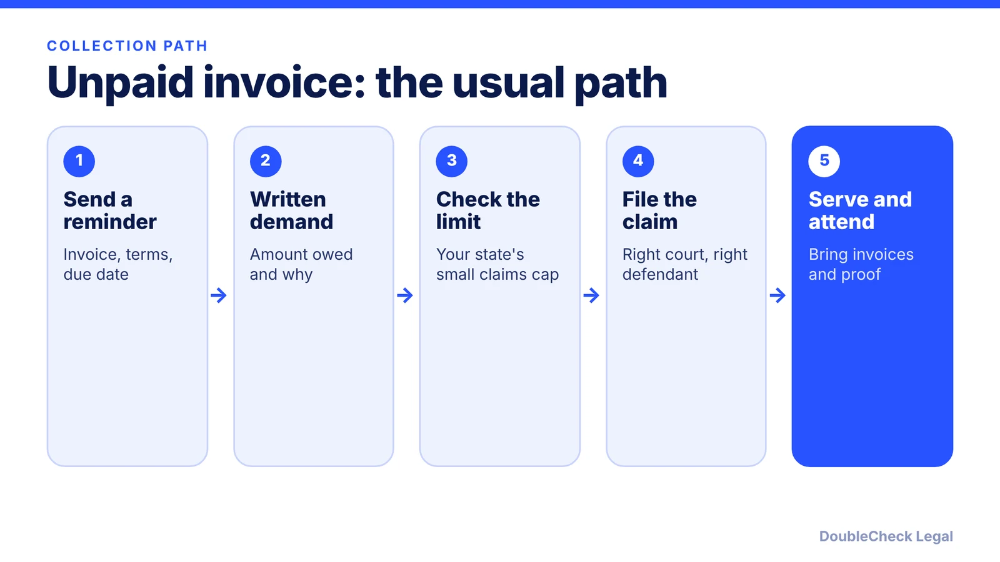
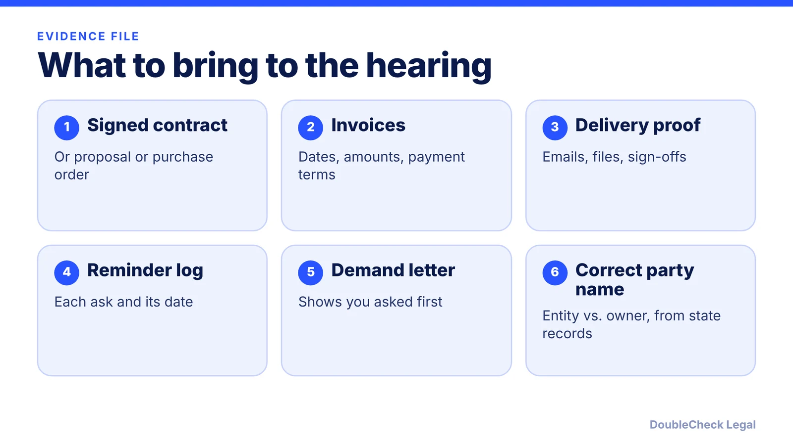

*Ask in writing, check the limit, file in the right court, and bring proof. Here is the path, with real court-page examples.*

**Key takeaways:**

- Ask for the money in writing first; California's courts expect it before you file.
- Small claims limits vary by state: California $12,500 for individuals and $6,250 for businesses; Texas $20,000.
- Bring the contract, invoices, delivery proof, and your reminder log.
- Winning is not the same as being paid; ask the clerk or an attorney about collecting a judgment.

## 1. The quick answer

**Quick answer:** Start by asking for the money in writing, then file in small claims court if the invoice is within your state's limit. Limits vary by state. As examples, California courts say individuals can generally sue for up to $12,500 and businesses are limited to $6,250, while the Texas State Law Library gives a $20,000 maximum for justice court small claims. California also asks you to request payment before you file.

## 2. Before court: ask for the money

California's court self-help site says the court expects you to ask the other side for the money before filing. You can ask in person, by letter, or by email, and you should state how much they owe and why. If they pay, you never need to go to court. The same page says not to wait if a filing deadline is approaching, and it does not list the deadline itself, so check your state's time limit for contract claims separately.

Build your file now:

- the signed contract, proposal, or purchase order
- invoices with dates and payment terms
- emails or messages showing the work was delivered or accepted
- a record of each reminder and the date you sent it

A short, factual demand letter that attaches the invoice is usually enough. If the dispute is about the contract itself, see [contract red flags for small businesses](/blog/contract-red-flags-small-business/), and for freelancers, [how to write a freelance contract](/blog/how-to-write-a-freelance-contract/).

## 3. Small claims limits and who can sue

Dollar limits are set by each state, so confirm yours on your state court's page. Two verified examples:

- **California:** per the [California Courts Self-Help Center](https://selfhelp.courts.ca.gov/small-claims-basics), individuals can generally sue for up to $12,500 and businesses are limited to $6,250. You cannot have a lawyer represent you in court, though you can get advice beforehand. If you lose a case you started, you cannot appeal.
- **Texas:** the [Texas State Law Library](https://sll.texas.gov/faqs/small-claims-maximum) gives $20,000 as the justice court small claims maximum under Texas Government Code section 27.031, and says the cap excludes statutory interest and court costs but includes attorney fees.

If your invoice is over the limit, you may waive the excess to stay in small claims or file in a different court. Which is better depends on your state and amount, a good question for an attorney. In some states a business limit differs from an individual limit, as in California, so check how your business is classified.

## 4. Filing, service, and getting paid

Using Harris County, Texas justice court as a worked example from its [filing guide](https://www.jp.hctx.net/suits/filingSC.html):

1. **File a written petition** with your contact information, the defendant's name and address if known, the amount you seek, and the basis of the claim.
2. **Pick the right venue.** Generally the county and precinct where the defendant lives, where the incident occurred, or where the contract was to be performed.
3. **Pay fees and arrange service.** The plaintiff is responsible for getting the citation served, for example by a constable, a certified process server, or certified mail.
4. **Expect an answer window.** The defendant generally has until the end of the 14th day after service to file a written answer.
5. **If they do not answer,** a judge may enter a default judgment, sometimes without a hearing when your claim rests on a signed written document and a sworn statement.

That Texas page does not describe enforcing a judgment (such as garnishment or liens), so ask the court clerk or an attorney how collection works in your state. A win on paper is not payment. Also see [when to hire a lawyer](/blog/when-to-hire-lawyer-small-business/) for larger or contested claims.

## Where DoubleCheck fits

[DoubleCheck](https://www.contactdoublecheck.com) helps businesses and founders start legal work with AI, verify it, and, when professional advice is warranted, connect with an independent attorney, including for immigration questions. Attorney availability and practice areas vary. Attorneys on DoubleCheck are independent professionals; an attorney-client relationship forms only if an attorney accepts your engagement.

**Sources:** [California Courts Self-Help, Small claims basics](https://selfhelp.courts.ca.gov/small-claims-basics); [California Courts Self-Help, Ask for the money](https://selfhelp.courts.ca.gov/pa/node/227); [Texas State Law Library, small claims maximum](https://sll.texas.gov/faqs/small-claims-maximum); [Harris County Justice Courts, filing small claims](https://www.jp.hctx.net/suits/filingSC.html).

## FAQ

**What is the small claims limit for a business?**

It varies by state. The California Courts Self-Help Center says businesses are limited to $6,250 (individuals can generally sue for up to $12,500). The Texas State Law Library gives a $20,000 justice court maximum. Check your own state's court website.

**Do I need a lawyer for small claims court?**

Not necessarily. In California you cannot have a lawyer represent you in small claims court, though you can get advice beforehand, per the California Courts Self-Help Center. Rules differ by state.

**Do I have to send a demand letter first?**

California's court self-help site says the court expects you to ask for the money before filing, in person, by letter, or by email, and to state how much is owed and why. Other states may differ.

**What if the client does not respond to the lawsuit?**

In Harris County, Texas justice court, the defendant generally has until the end of the 14th day after service to answer, and a judge may enter a default judgment if they do not, per the county's filing guide. Procedures vary by court.

---

*General information only. This article is not legal, tax, investment, or accounting advice.*
