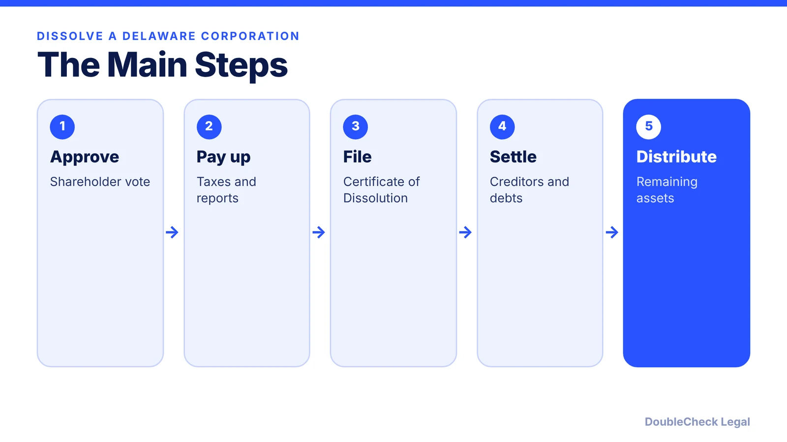
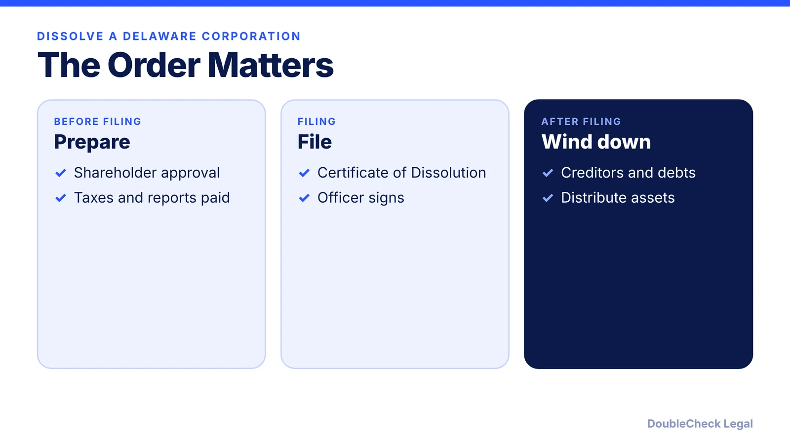
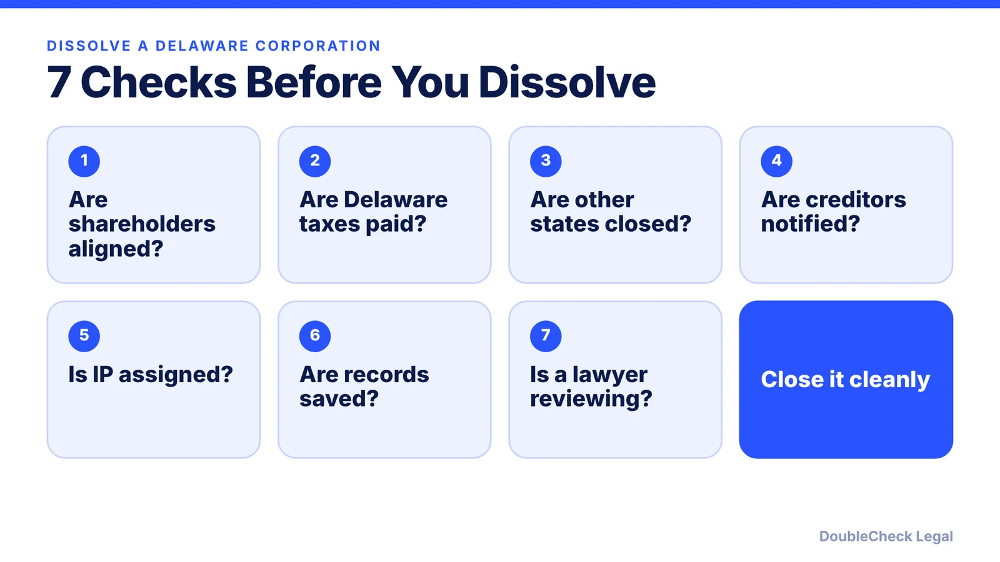

*Dissolving a Delaware corporation takes more than one form. Here are the steps in the right order.*

**Key takeaways:**

- Shareholders approve, then you pay state taxes and file franchise tax reports before filing.
- File the Certificate of Dissolution; fees change, so check the Division's schedule.
- Notify creditors, pay claims, then distribute assets to shareholders.
- Close accounts and withdraw from other states, or fees may keep accruing.

## 1. The big picture

Closing a Delaware corporation is a process, not a single filing. Nolo's guide to voluntary, shareholder-initiated dissolution lays out nine steps. This article summarizes them; confirm current fees and filings with the Delaware Division of Corporations.

## 2. Approval and taxes first

Shareholders entitled to vote approve the dissolution, either by a majority vote at a meeting or by written consent from all voting shareholders. The board gives notice of the meeting 10 to 60 days in advance. Record the vote in the minutes. You must pay state taxes and file franchise tax reports **before** filing the certificate of dissolution; Nolo says a tax clearance certificate is not required.

## 3. The filing

File the certificate of dissolution with the Delaware Department of State. Nolo describes a short form available only if the corporation has issued shares and started business and meets eligibility requirements, and a standard form otherwise. An authorized officer signs. We have not repeated fee amounts because Nolo lists them as of 2023; check the Division's current schedule.

## 4. Creditors, assets, and loose ends

Nolo recommends notifying creditors: send written notice to known creditors by registered or certified mail and publish notice in a newspaper; claims not submitted by the deadline are barred. Pay recognized claims in full if assets allow, or by priority. Distribute remaining assets to shareholders in proportion to ownership, after claims are paid and deadlines expire. Then close the bank account, cancel licenses and permits, and terminate registrations in other states where the corporation qualified. Delaware's creditor rules are complex, so consider a business attorney.

Dissolution alone does not stop actions begun by or against the corporation before dissolution; generally they continue for three years.

## 5. Before you dissolve

Related: [closing a California LLC](/blog/close-california-llc-avoid-800-tax/), [IP assignment agreements](/blog/confidentiality-ip-assignment-agreements-startups/), and [Delaware franchise tax](/blog/delaware-franchise-tax-startups/).

## Where DoubleCheck fits

[DoubleCheck](https://www.contactdoublecheck.com) is built for businesses that start legal work with AI. Bring your question or draft, use an AI-first workflow to understand and verify it, and when professional advice is warranted, you can connect with an independent attorney. Attorneys on DoubleCheck are independent professionals; an attorney-client relationship forms only if an attorney accepts your engagement.

**Sources:** [Nolo: How to dissolve a corporation in Delaware](https://www.nolo.com/legal-encyclopedia/how-dissolve-corporation-delaware.html).

## FAQ

**Do I need to pay Delaware franchise tax before dissolving?**

Per Nolo, you must pay state taxes and file franchise tax reports before filing the certificate of dissolution.

**What vote is needed?**

A majority vote at a meeting or written consent from all voting shareholders, plus any added requirements in your charter or bylaws.

**Do I have to notify creditors?**

It is optional but recommended; claims not submitted by the deadline are barred.

**Does dissolution end lawsuits?**

No. Actions begun before dissolution generally continue for three years.

---

*General information only. This article is not legal, tax, investment, or accounting advice.*
