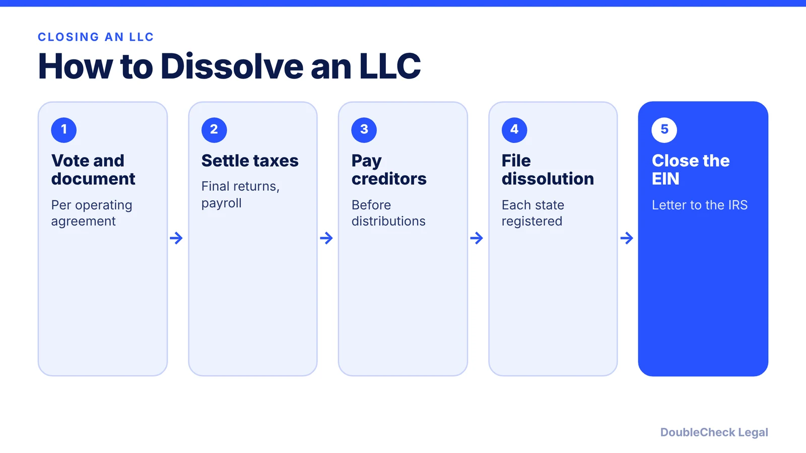
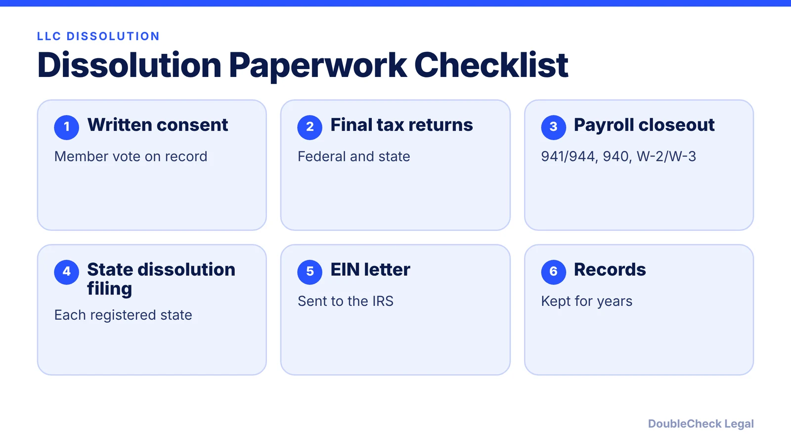

*Closing an LLC properly means more than stopping work. Here are the steps, in order.*

**Key takeaways:**

- Start with the operating agreement vote, then file final tax returns before the state dissolution.
- The IRS cannot close your business account until all returns are filed and taxes paid.
- Pay known creditors before distributing assets to members.
- Cancel the EIN by letter and keep records; do not leave an LLC inactive without filing.

## 1. The quick answer

**Quick answer:** To dissolve an LLC, vote and document the decision under your operating agreement, file final federal and state returns, pay creditors, file articles of dissolution (or the equivalent) with each state where you are registered, cancel your EIN by letter to the IRS, and keep records. The IRS says it cannot close your business account until all required returns are filed and all taxes owed are paid, so tax steps come first.

## 2. Vote, document, and settle taxes

Per Stripe's guide, check your operating agreement for the approval threshold (simple majority, supermajority, or unanimous), record the vote in a signed written consent, and set a dissolution date. Then handle final returns. The IRS says the form depends on how the LLC is taxed:

- **Sole proprietor (single-member LLC):** Schedule C with your individual return.
- **Partnership:** Form 1065, marked final, with final K-1s.
- **C corporation or S corporation election:** Form 1120 or 1120-S, plus Form 966 if dissolving or liquidating.

If you had employees, the IRS lists final wages, the closed-business box on Form 941 or 944, Form 940, and W-2s with Form W-3. File Form 1099-NEC if you paid a contractor $600 or more in the closing year. Also file final sales tax and state franchise returns. See [single-member LLC taxes](/blog/single-member-llc-taxes-disregarded-entity/).

## 3. Creditors, state filing, and the EIN

**Creditors.** Stripe notes members who receive distributions before known debts are paid may have to return that money if a creditor challenges it. Pay or provide for debts first, then distribute what remains according to the operating agreement.

**State filing.** File articles of dissolution (Delaware calls it a certificate of cancellation) in every state where you formed or registered as a foreign LLC. Requirements differ: Stripe notes Texas wants your final tax return on record first, and California approval depends on current tax filings. For California, read [how to close a California LLC and avoid the $800 tax](/blog/close-california-llc-avoid-800-tax/); for Delaware, see the [Delaware LLC annual tax](/blog/delaware-llc-annual-tax-june-1/). If you run a corporation, see [how to dissolve a Delaware corporation](/blog/how-to-dissolve-a-delaware-corporation/).

**EIN.** The IRS says to send a letter with the business's full legal name, EIN, address, and reason for closing, with a copy of the EIN notice if you have it, mailed to the address on its Closing a Business page. Stripe notes the IRS does not reuse EINs, so the account closes but the number is not erased.

## 4. Close accounts and keep records

Close bank accounts only after outstanding checks clear and payment processor payouts settle, cancel licenses and your registered agent after the dissolution is accepted, and distribute remaining assets, per Stripe. The IRS says to keep employment tax records for at least four years and property records until the limitations period ends for the year you dispose of the property. Stripe suggests keeping filings, final returns, your EIN letter, and distribution records for three to seven years depending on your state.

Do not let the LLC simply go inactive. Stripe warns that fees and franchise taxes keep accruing until dissolution is filed, so check [annual report requirements by state](/blog/annual-report-requirements-by-state-llc/). If you are selling rather than closing, use the [buy or sell checklist](/blog/how-to-buy-or-sell-a-small-business-legal-checklist/).

## Where DoubleCheck fits

[DoubleCheck](https://www.contactdoublecheck.com) helps businesses and founders start legal work with AI, verify it, and, when professional advice is warranted, connect with an independent attorney, including for immigration questions. Attorney availability and practice areas vary. Attorneys on DoubleCheck are independent professionals; an attorney-client relationship forms only if an attorney accepts your engagement.

**Sources:** [IRS, Closing a business](https://www.irs.gov/businesses/small-businesses-self-employed/closing-a-business); [Stripe, how to dissolve an LLC](https://stripe.com/resources/more/how-to-dissolve-an-llc).

## FAQ

**How do I dissolve an LLC?**

Vote and document the decision, file final tax returns, pay creditors, file articles of dissolution with each state, and close your EIN, per Stripe and the IRS.

**How do I close my EIN with the IRS?**

Send a letter with the legal name, EIN, address, and reason for closing, per the IRS. It cannot close the account until all returns are filed and taxes paid.

**Do I need to file a final tax return?**

Yes. The IRS says the form depends on how the LLC is taxed: Schedule C, Form 1065, Form 1120, or Form 1120-S, marked as final where applicable.

**What if I just stop using the LLC?**

Fees and franchise taxes can keep accruing until dissolution is filed, per Stripe.

---

*General information only. This article is not legal, tax, investment, or accounting advice.*
