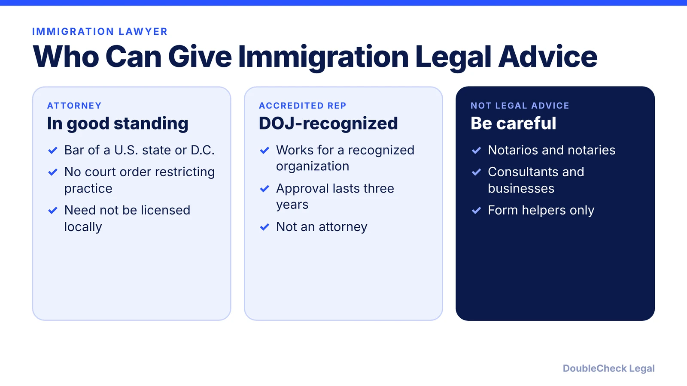
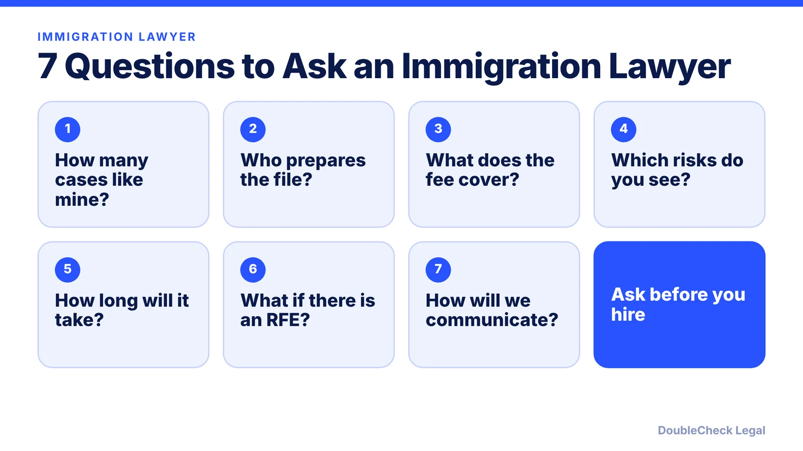
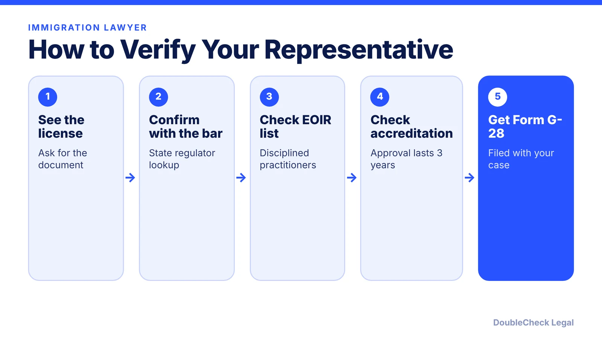

*Need an immigration lawyer for an O-1, H-1B, or green card? Here is who can legally advise you, what to ask, and how to verify before paying.*

**Key takeaways:**

- USCIS says attorneys in good standing with a U.S. state or D.C. bar, or DOJ-accredited representatives, can advise you.
- Confirm the license with the state regulator and check the EOIR disciplined list.
- Notarios, notaries, and consultants cannot give immigration legal advice.
- Ask about experience with your exact visa type and what the fee covers.

## 1. The quick answer

**Quick answer:** For immigration help, USCIS says you can use an attorney in good standing with the bar of the highest court of a U.S. state, territory, or D.C. (they need not be licensed in the state where they practice), or a DOJ-accredited representative working for a recognized organization. Confirm the license with the state regulator, check the EOIR list of disciplined practitioners, and be wary of notarios, notaries, and consultants who offer legal advice.

## 2. Match the lawyer to your visa type

Ask how many cases like yours they handle: an O-1A petition for a founder, an H-1B employer filing, an EB-1A or NIW self-petition. Ask who will actually prepare the file, what the fee covers, and whether premium processing, expert letters, and responses to requests for evidence are included. For a broader checklist, read [how to choose a good lawyer](/blog/how-to-choose-good-lawyer/) and [how to know if your lawyer is good](/blog/how-do-i-know-if-my-lawyer-is-good/).

## 3. Verify before you pay

Follow the USCIS steps: ask to see the current license and confirm it with the state regulator, check the EOIR List of Currently Disciplined Practitioners, and for accredited representatives confirm the approval is still valid. If your attorney is in California, use [how to verify a California attorney license](/blog/verify-california-attorney-license-state-bar/). Your representative must submit Form G-28 with your application, petition, or appeal. An attorney licensed outside the U.S. may represent you only if your case is filed at a USCIS office outside the U.S., using Form G-28I.

## 4. For founders in the Bay Area

If you are in San Francisco, start with [how to find a startup lawyer in San Francisco](/blog/find-startup-lawyer-san-francisco/) for the general approach, and use [how to get a lawyer referral](/blog/how-to-get-lawyer-referral/) to collect names. Immigration attorneys can represent you anywhere in the U.S., so geography matters less than fit and verification.

## Where DoubleCheck fits

[DoubleCheck](https://www.contactdoublecheck.com) helps businesses and founders start legal work with AI, verify it, and, when professional advice is warranted, connect with an independent attorney, including for immigration questions. Attorney availability and practice areas vary. Attorneys on DoubleCheck are independent professionals; an attorney-client relationship forms only if an attorney accepts your engagement.

**Sources:** [USCIS: Find Legal Services](https://www.uscis.gov/avoid-scams/find-legal-services).

## FAQ

**Who can legally give immigration advice?**

Per USCIS, attorneys in good standing with the bar of a U.S. state, territory, or D.C., and DOJ-accredited representatives working for recognized organizations.

**Does my attorney need a license in my state?**

No. USCIS says they do not need to be licensed in the state where they live or practice.

**How do I check an immigration attorney?**

Ask for the license, confirm it with the state regulator, and check the EOIR List of Currently Disciplined Practitioners.

**What is Form G-28?**

The form your legal representative submits with your application, petition, or appeal, per USCIS.

---

*General information only. This article is not legal, tax, investment, or accounting advice.*
