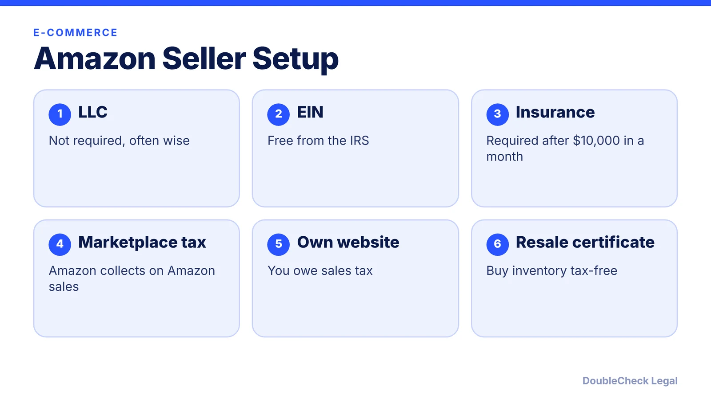
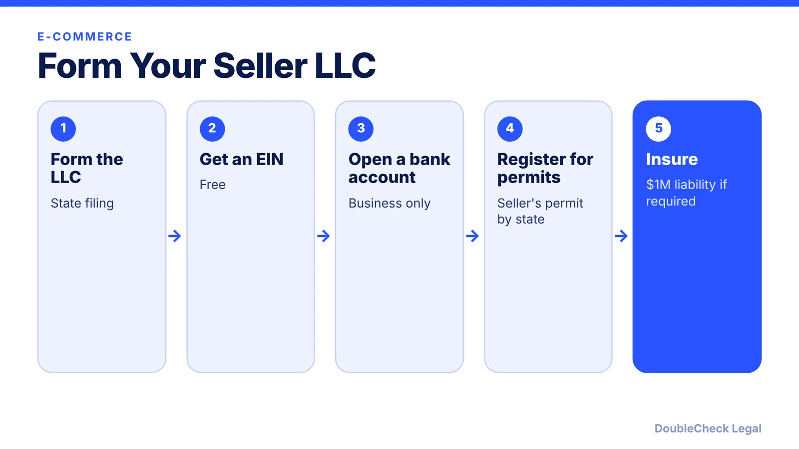

*Selling on Amazon or online? Here is when an LLC helps, what Amazon's insurance rule says, and the sales tax traps.*

**Key takeaways:**

- You do not need an LLC to sell on Amazon, but sole proprietors are personally liable.
- Per Jungle Scout, Amazon requires $1M commercial liability insurance after $10,000 in gross sales in a month.
- Amazon collects sales tax on Amazon sales, but permits and your own channels are still your job.
- The policy name must match your legal entity.

## 1. The quick answer

**Quick answer:** You do not need an LLC to sell on Amazon, but a sole proprietor is personally liable if the business is sued or runs up debts, per Jungle Scout. An LLC generally keeps creditors from reaching assets it does not own, and Jungle Scout recommends one for products that may cause injuries. Amazon also requires commercial liability insurance once you pass a sales threshold, and sales tax rules still apply to you.

## 2. Amazon's insurance requirement

Jungle Scout says Amazon requires commercial liability insurance within 30 days of exceeding $10,000 in gross sales in one month: $1 million per occurrence and in aggregate, covering products liability and bodily injury, with Amazon named as additional insured, a deductible capped at $10,000, and the certificate uploaded to Seller Central. SellerLabs says the policy name must match the legal entity you gave Amazon and be valid at least 180 days from submission. Typical cost cited is about $500 to $1,000 a year. Verify the current policy in Seller Central.

## 3. Sales tax and permits

Repricer says that under marketplace facilitator laws Amazon collects and remits sales tax on Amazon sales in all 50 states and D.C., but sellers keep obligations for their own website and other non-facilitator channels, and a common economic nexus threshold is $100,000 in annual sales to a state. Avalara says marketplace facilitator laws do not excuse you from permits and licenses, and you may still need to file returns. Jungle Scout notes FBA inventory stored in other states can create tax obligations. A resale certificate, per Stripe, lets you buy goods tax-free for resale and is generally valid only in the issuing state.

## 4. Taxes and state fees

A single-person LLC is taxed the same as a sole proprietorship (Jungle Scout), so the LLC itself does not cut income tax. Formation fees vary by state, and Amazon does not require a business license, though your state or city may. See [single-member LLC taxes](/blog/single-member-llc-taxes-disregarded-entity/) and [sole proprietor vs. LLC](/blog/sole-proprietor-vs-llc-solo-founder/). California sellers can also read [how to start an LLC in California](/blog/how-to-start-an-llc-in-california-step-by-step/).

## Where DoubleCheck fits

[DoubleCheck](https://www.contactdoublecheck.com) helps businesses and founders start legal work with AI, verify it, and, when professional advice is warranted, connect with an independent attorney, including for immigration questions. Attorney availability and practice areas vary. Attorneys on DoubleCheck are independent professionals; an attorney-client relationship forms only if an attorney accepts your engagement.

**Sources:** [Jungle Scout: LLC](https://www.junglescout.com/resources/articles/do-you-need-an-llc-to-sell-on-amazon/); [Jungle Scout: insurance](https://www.junglescout.com/resources/articles/amazon-seller-insurance/); [SellerLabs](https://www.sellerlabs.com/blog/amazon-product-liability-insurance); [Repricer](https://www.repricer.com/blog/amazon-sales-tax-compliance/); [Avalara](https://www.avalara.com/us/en/blog/tax-q-a-when-and-where-do-i-need-to-get-a-sales-tax-permit.html); [Stripe](https://stripe.com/en-be/resources/more/resale-certificate); [IRS EIN](https://www.irs.gov/businesses/small-businesses-self-employed/employer-id-numbers).

## FAQ

**Do I need an LLC to sell on Amazon?**

No, but an LLC can separate business debts from personal assets, and Jungle Scout recommends one for products that may cause injuries.

**Does Amazon require insurance?**

Per Jungle Scout, within 30 days of exceeding $10,000 in gross sales in a month. Verify in Seller Central.

**Does Amazon handle all my sales tax?**

Per Repricer, Amazon collects and remits tax on Amazon sales, but you keep obligations on your own website and other channels.

**Do I need a seller's permit if Amazon collects tax?**

Avalara says marketplace facilitator laws do not get you off the hook for permits and licenses. Check each state.

---

*General information only. This article is not legal, tax, investment, or accounting advice.*
