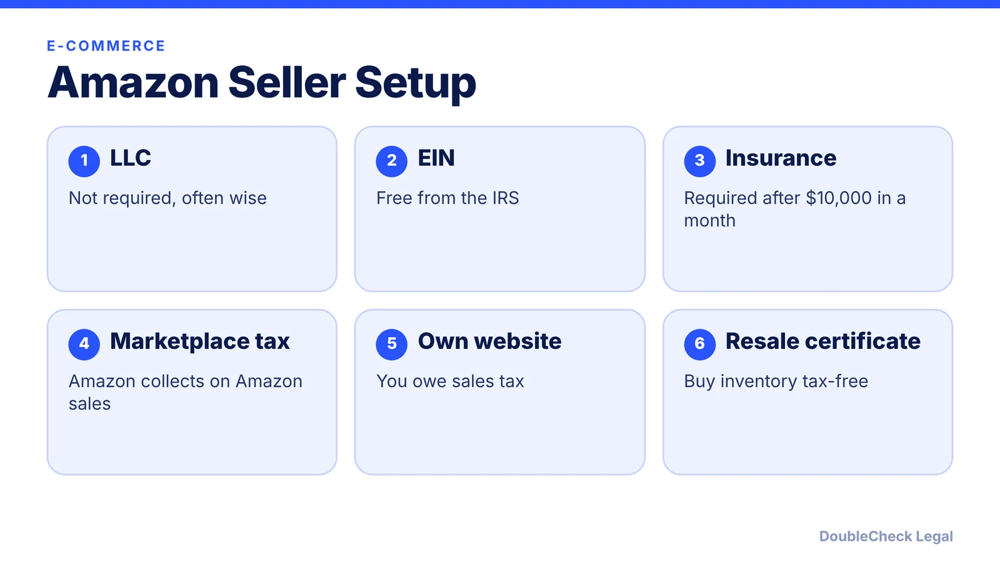
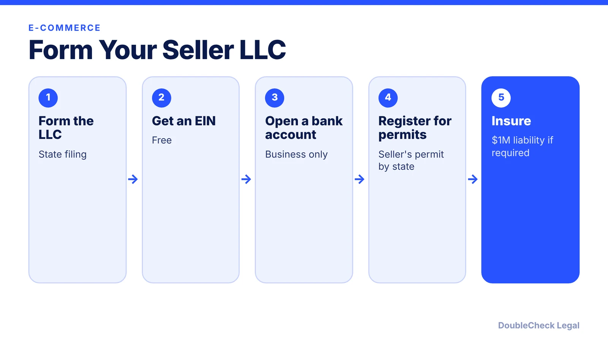

*Selling on Amazon or online? Here is when an LLC helps, what Amazon's insurance rule says, and the sales tax traps.*

**Key takeaways:**

- You do not need an LLC to sell on Amazon, but sole proprietors are personally liable.
- Amazon requires commercial liability insurance once sales pass a threshold; check Seller Central for the current terms.
- Amazon collects sales tax on Amazon sales, but permits and your own channels are still your job.
- The policy name must match your legal entity.

## 1. The quick answer

**Quick answer:** You do not need an LLC to sell on Amazon, but without an entity you are personally responsible for business debts and lawsuits. Per Nolo, an LLC combines a corporation's liability protection with the flexibility of a sole proprietorship, so owners who want to limit personal responsibility should consider one, especially for products that may cause injuries. Amazon also requires commercial liability insurance once you pass a sales threshold, and sales tax rules still apply to you.

## 2. Amazon's insurance requirement

Amazon's seller policies require commercial liability insurance once your sales pass a threshold, with the certificate uploaded to Seller Central. The coverage amount, deadlines, additional-insured wording and other terms change, so read the current policy in Seller Central before you buy coverage, and make sure the policy name matches the legal entity on your seller account. An insurance broker can price a policy for your products.

## 3. Sales tax and permits

Under state marketplace facilitator laws, Amazon generally collects and remits sales tax on sales made through its marketplace in many states, but sellers can keep obligations for their own website and other channels. Those laws do not necessarily remove permit, license or return-filing duties, and economic nexus thresholds differ by state, so confirm the rules with each state's tax agency. Inventory stored in other states through FBA can also create tax obligations. A resale certificate lets you buy goods tax-free for resale, and is generally valid only in the issuing state; check the state's form and rules.

## 4. Taxes and state fees

Per Nolo, a single-member LLC is treated as a disregarded entity, the same as a sole proprietorship for tax purposes, so the LLC itself does not cut income tax. Formation fees vary by state, and per the SBA, local governments set license and permit requirements, so check your state and city. See [single-member LLC taxes](/blog/single-member-llc-taxes-disregarded-entity/) and [sole proprietor vs. LLC](/blog/sole-proprietor-vs-llc-solo-founder/). California sellers can also read [how to start an LLC in California](/blog/how-to-start-an-llc-in-california-step-by-step/).

## Where DoubleCheck fits

[DoubleCheck](https://www.contactdoublecheck.com) helps businesses and founders start legal work with AI, verify it, and, when professional advice is warranted, connect with an independent attorney, including for immigration questions. Attorney availability and practice areas vary. Attorneys on DoubleCheck are independent professionals; an attorney-client relationship forms only if an attorney accepts your engagement.

**Sources:** [Nolo, How to start an LLC](https://www.nolo.com/legal-encyclopedia/form-llc-how-to-organize-llc-30287.html); [SBA, Register your business](https://legacy.sba.gov/business-guide/launch-your-business/register-your-business); [IRS EIN](https://www.irs.gov/businesses/small-businesses-self-employed/employer-id-numbers).

## FAQ

**Do I need an LLC to sell on Amazon?**

No, but per Nolo an LLC can limit your personal responsibility for business debts and lawsuits, which may matter for products that could cause injuries.

**Does Amazon require insurance?**

Amazon's seller policies require commercial liability insurance once sales pass a threshold. The amount and timing change, so verify the current terms in Seller Central.

**Does Amazon handle all my sales tax?**

Under marketplace facilitator laws, Amazon generally collects and remits tax on Amazon sales in many states, but you may keep obligations on your own website and other channels. Check each state's tax agency.

**Do I need a seller's permit if Amazon collects tax?**

Possibly. Marketplace facilitator laws do not necessarily remove permit, license or return-filing duties, and rules vary by state. Check each state's tax agency.

---

*General information only. This article is not legal, tax, investment, or accounting advice.*
