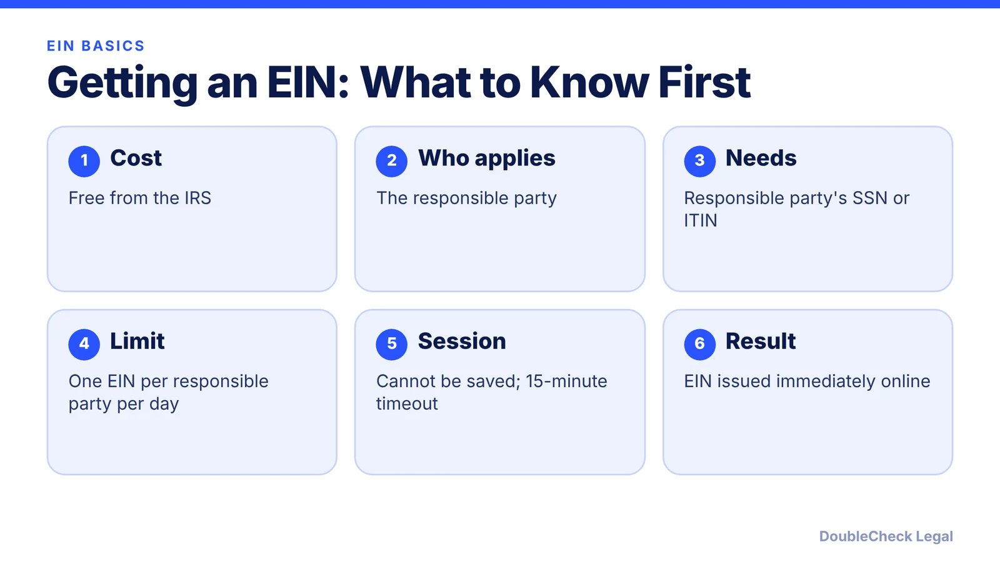
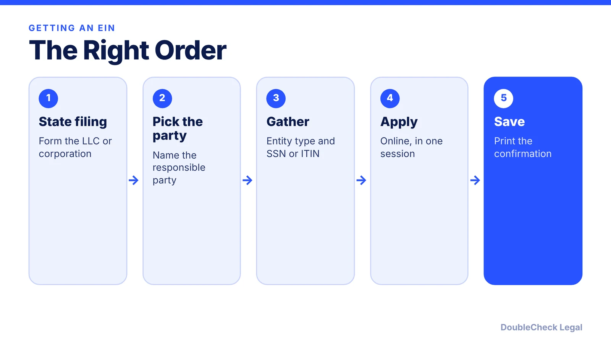
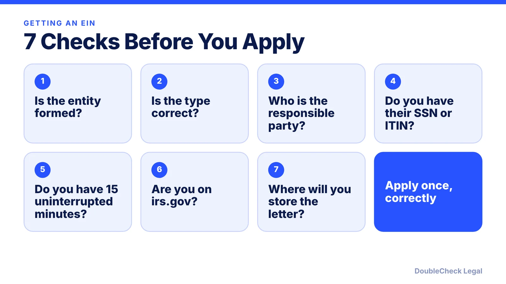

*An EIN is free from the IRS. Here is the order of steps, the online hours, and the rules that trip people up.*

**Key takeaways:**

- The IRS says you never have to pay a fee for an EIN; beware sites that charge.
- Form your LLC or corporation with the state first, then apply.
- You need the responsible party's SSN or ITIN, and can apply for one EIN per responsible party per day.
- The online session cannot be saved and times out after 15 minutes of inactivity.

## 1. What the IRS says about cost

An EIN is the federal tax identification number the IRS issues to businesses. The IRS's EIN page is blunt about cost: "You never have to pay a fee for an EIN," and it warns to beware of websites that charge for one. If a site asks you to pay the IRS fee, you are on the wrong site.

Related: [how to incorporate a company in the U.S.](/blog/how-to-incorporate-a-company-in-the-us/).

## 2. Form the entity first

For a corporation or LLC, the IRS says to form the entity with your state first. Otherwise, the EIN application may be delayed. So the order is: file with the state, then apply for the EIN.

See [LLC vs. C corp for startups](/blog/llc-vs-c-corp-startups/) to settle the entity type before you apply.

## 3. When you can apply online

The IRS lists these online application hours (Eastern Time):

- Monday to Friday: 6:00 a.m. to 1:00 a.m. the next day
- Saturday: 6:00 a.m. to 9:00 p.m.
- Sunday: 6:00 p.m. to midnight

You must be a domestic organization with its principal place of business in the U.S. or a U.S. territory. If your principal place of business is outside the U.S., or you already have an EIN, you cannot use the online tool and apply by phone, fax, or mail instead.

## 4. Who the responsible party is

The responsible party must be in control of the entity or be its authorized representative, and you need that person's SSN or ITIN. A third-party designee needs signed authorization to apply for you.

Because you can apply for only one EIN per responsible party per day, plan to apply for each entity on separate days if one person controls several.

## 5. Seven checks before you apply

Print the EIN confirmation and store it with your formation documents. A mistake in the entity type or responsible party is easier to prevent than to fix.

## Where DoubleCheck fits

[DoubleCheck](https://www.contactdoublecheck.com) is built for businesses that start legal work with AI. Bring your question or draft, use an AI-first workflow to understand and verify it, and when professional advice is warranted, you can connect with an independent attorney. Attorneys on DoubleCheck are independent professionals; an attorney-client relationship forms only if an attorney accepts your engagement.

**Sources:** [IRS: Apply for an EIN online](https://www.irs.gov/businesses/small-businesses-self-employed/apply-for-an-employer-identification-number-ein-online).

## FAQ

**Is an EIN free?**

Yes. The IRS says you never have to pay a fee for an EIN and warns about websites that charge for one.

**Can I get an EIN online?**

Yes, if you are a domestic organization with your principal place of business in the U.S. or a U.S. territory, during the IRS's listed hours (Eastern Time).

**How fast do I get the EIN?**

If approved, the EIN is issued immediately online. Print the confirmation letter.

**How many EINs can I apply for in one day?**

One per responsible party per day, according to the IRS.

---

*General information only. This article is not legal, tax, investment, or accounting advice.*
