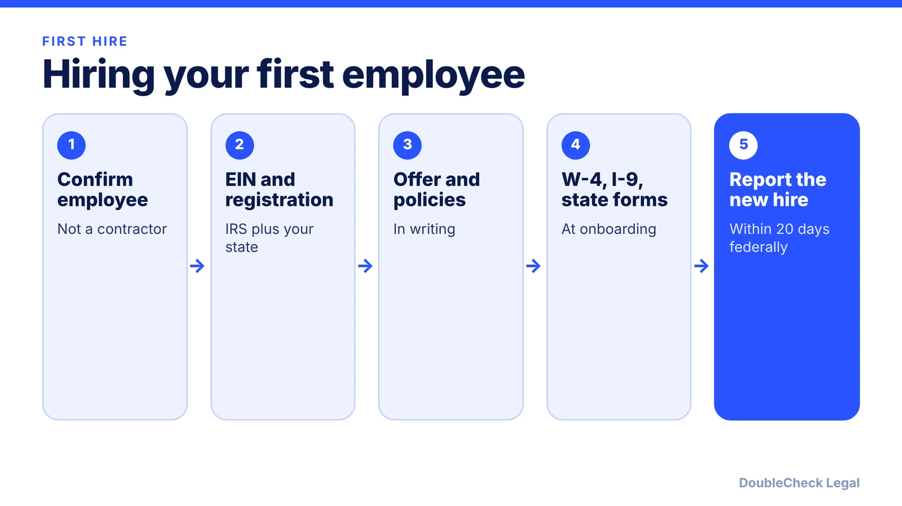
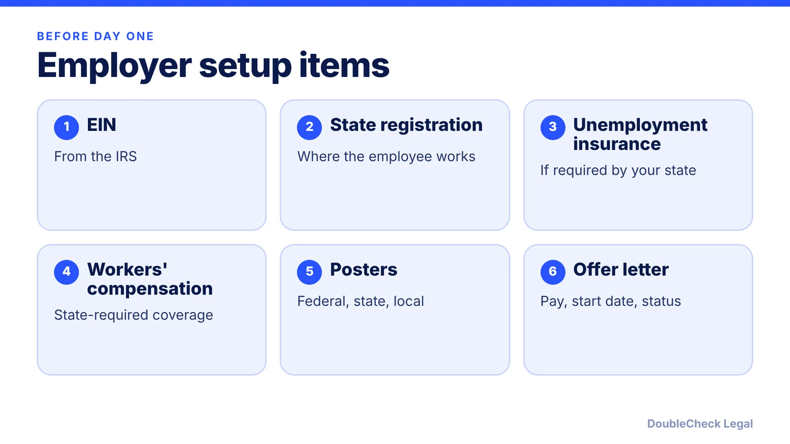

*A first hire triggers federal and state obligations at once. Here is the order to handle them in.*

**Key takeaways:**

- Confirm the person is an employee, not a contractor, before setting up payroll.
- Get an EIN, register with your state, and arrange workers' compensation before day one.
- Collect a W-4 and I-9 at onboarding; federal law requires a new-hire report within 20 days of hire (OnPay).
- State rules differ, so check your state agencies for deadlines and extra forms.

## 1. The quick answer

**Quick answer:** Before your first employee starts, get an EIN, register with your state for payroll and unemployment taxes where required, line up workers' compensation, and collect a Form W-4 and Form I-9 at onboarding. After the hire, report them to your state's new-hire directory. Per [Bernstein Shur](https://bipc.com/hiring-your-team-initial-steps-new-employers-must-take), the federal deadline is 20 days from the hire date, and requirements vary by state, industry, and employer size.

## 2. Before the offer

Start by deciding whether the role is really employment. Calling someone a contractor does not make them one; see [employee vs. independent contractor classification](/blog/employee-vs-independent-contractor-classification-startups/) before you skip payroll.

Then set up the employer side, per Bernstein Shur's checklist for new employers:

- **Federal EIN** from the IRS.
- **State registration** with the agencies where the employee will work, including the state workforce agency for unemployment insurance if required. See [registering for state payroll taxes](/blog/register-for-state-payroll-taxes-new-employer/).
- **Workers' compensation** coverage required by your state. Details are in [workers' compensation insurance requirements](/blog/workers-compensation-insurance-requirements-startups/).
- **Workplace posters:** federal notices plus any state and local ones from your state labor office.

Put the terms in writing. A clear offer letter covering title, pay, start date, and at-will or other status prevents most early disputes; [drafting a job offer letter with AI](/blog/draft-job-offer-letter-with-ai/) shows how to start one and what to verify. Background checks have their own rules, covered in [employee background checks under the FCRA](/blog/employee-background-checks-fcra-small-business/).

## 3. Onboarding paperwork

Three items come up on day one. The dates below come from the secondary sources named, not from the agencies themselves, so confirm them on the IRS, USCIS, and state pages.

- **Form W-4:** per Bernstein Shur, collect it on or before the first day of work. [OnPay](https://onpay.com/hr/basics/new-hire-reporting-requirements) describes it as due before your next payroll run. Many states also want a separate state withholding form.
- **Form I-9:** employment eligibility verification. OnPay says it must be completed within 72 hours of the first day of work. Bernstein Shur says you keep it, do not file it with the government, and retain it three years after hire or one year after termination, whichever is later. See [I-9 and E-Verify for startups](/blog/i-9-and-e-verify-for-startups/).
- **New-hire report:** federal law requires reporting within 20 days of the hire date, per OnPay. Most states allow 15 to 20 days and some require it sooner. Reports go to the state where the employee works. Bernstein Shur notes that multistate employers can use a multistate form to file in one state.

The report includes your business name, address and FEIN, plus the employee's name, address, Social Security number, and hire date. Keep tax records for at least four years (Bernstein Shur).

## 4. Policies, pay, and what to document

Next, make the job rules visible. Write a handbook, or at least a short set of policies on pay periods, time off, harassment reporting, and at-will status; [what to include in a small business employee handbook](/blog/employee-handbook-small-business-what-to-include/) lists the sections. Two other first-hire questions have their own guides: whether the job is overtime-eligible ([exempt vs. nonexempt](/blog/overtime-exempt-vs-nonexempt-small-business/)) and how vacation or sick time is handled ([PTO and vacation pay laws](/blog/pto-vacation-pay-laws-small-business/)).

**A practical order of operations:**

1. Classify the role (employee, exempt or nonexempt).
2. Get the EIN and state accounts, and bind workers' compensation.
3. Send the offer letter and policies.
4. Complete W-4, I-9, and state forms at onboarding.
5. File the new-hire report and keep a personnel file.

Also plan for the end of the relationship from the start. [How to terminate an employee legally](/blog/how-to-terminate-an-employee-legally-small-business/) explains why documentation made now matters later. If your first hire is abroad, the rules change; see [hiring international employees](/blog/hire-international-employees-remote-eor-vs-contractor-vs-sponsorship/).

## Where DoubleCheck fits

[DoubleCheck](https://www.contactdoublecheck.com) helps businesses and founders start legal work with AI, verify it, and, when professional advice is warranted, connect with an independent attorney, including for immigration questions. Attorney availability and practice areas vary. Attorneys on DoubleCheck are independent professionals; an attorney-client relationship forms only if an attorney accepts your engagement.

**Sources:** [Bernstein Shur, Hiring Your Team](https://bipc.com/hiring-your-team-initial-steps-new-employers-must-take); [OnPay, New Hire Reporting Requirements](https://onpay.com/hr/basics/new-hire-reporting-requirements).

## FAQ

**What do I need before hiring my first employee?**

Per Bernstein Shur, an EIN, state registration where the employee will work, workers' compensation coverage, unemployment insurance registration if required, and required workplace posters. Requirements vary by state, industry, and employer size.

**How long do I have to report a new hire?**

Federal law requires reporting within 20 days of the hire date, per OnPay. Most states give employers 15 to 20 days and some require sooner, so check your state's new-hire reporting rules.

**How long do I keep a Form I-9?**

Per Bernstein Shur, keep it for three years after the hire date or one year after employment ends, whichever is later. Do not submit it to the government.

**Do I need a lawyer to hire my first employee?**

Not always, but classification, offer terms, and multi-state issues are common trouble spots. Many owners have an attorney review the offer letter and handbook once.

---

*General information only. This article is not legal, tax, investment, or accounting advice.*
