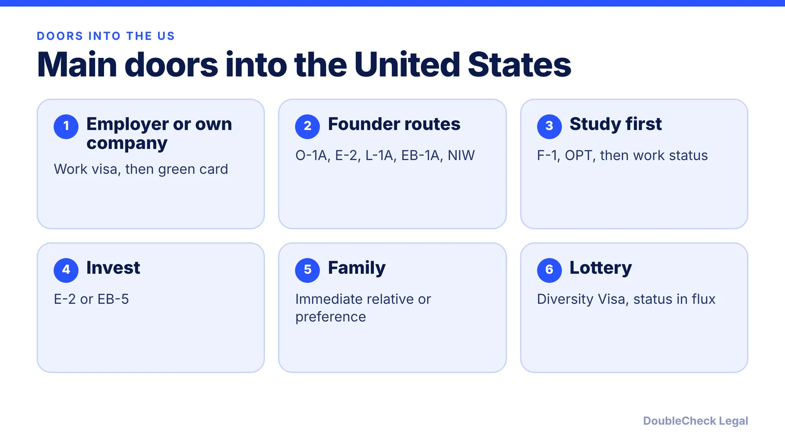
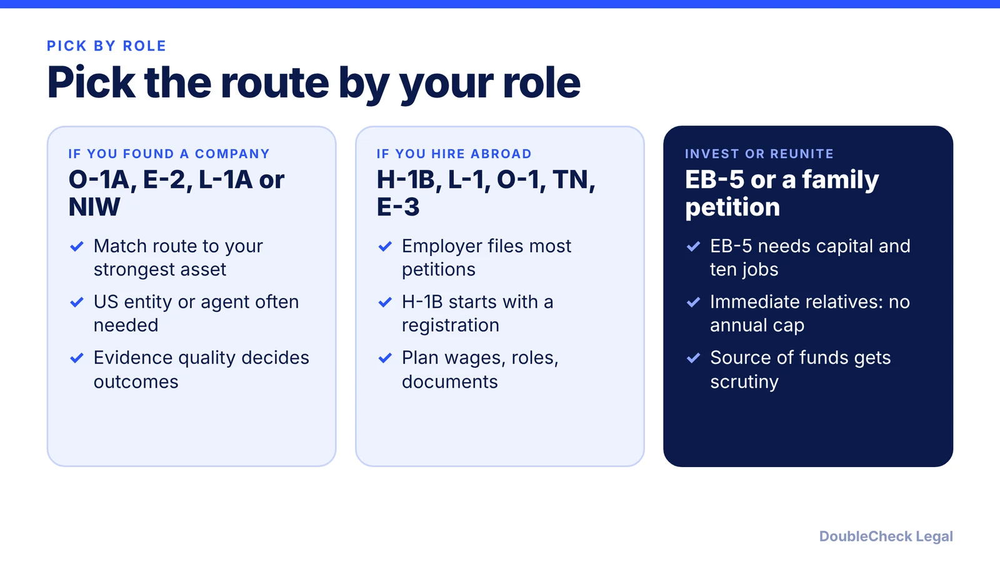
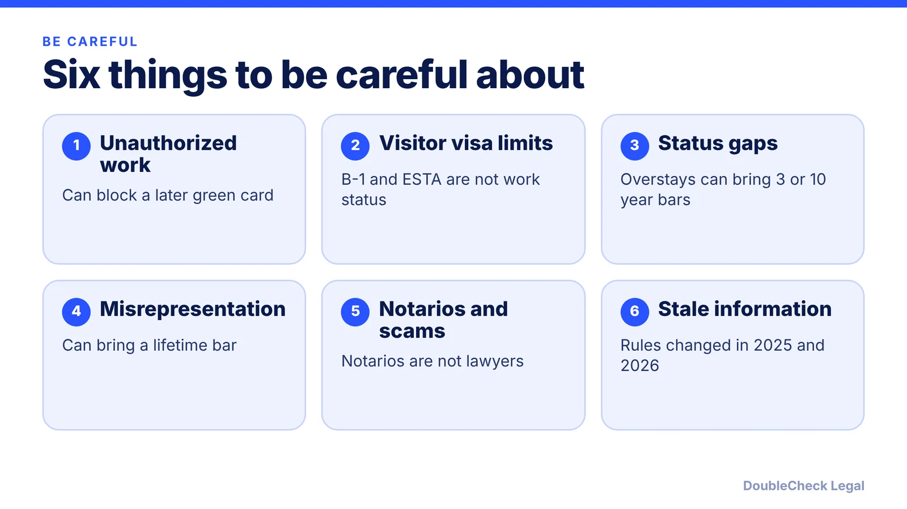
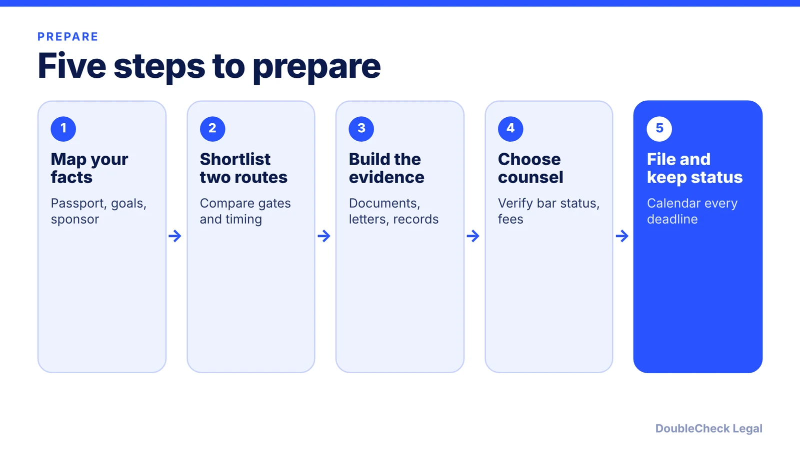

*A practical map of how people actually immigrate to the United States, written for founders, startup teams and the people who hire them, current as of November 2026.*

**Key takeaways:**

- There is no single path and no dedicated startup visa ; founders use O-1A, E-2, L-1A, H-1B, EB-1A, the NIW, EB-5 or other categories that fit their facts.
- Four questions narrow the field: what you want to do, who sponsors you, what your passport allows, and whether you want temporary or permanent status.
- Rules changed in 2025 and 2026 (H-1B payment and weighted selection, duration of status, travel restrictions, adjustment of status memo), so verify every status on the day you act.
- Stay compliant: no unauthorized work, no visitor-status shortcuts, truthful forms, and no notarios.
- Prepare an evidence file, a finance trail and a calendar, then bring it to an independent immigration attorney.

## 1. The quick answer

**Quick answer:** There is no single way to immigrate to the United States. Most people come through one of five doors: an employer or their own company (a work visa, often followed by an employment-based green card), study (F-1 status, then work authorization), investment, a family relationship, or, for a small number, the Diversity Visa lottery. For entrepreneurs, there is no dedicated startup visa. Founders instead use existing routes such as O-1A, E-2, L-1A, H-1B, the International Entrepreneur Rule (which is parole, not a visa), or self-petitioned green cards such as EB-1A and the national interest waiver. Which door fits depends on your passport, your track record, your capital, and who can sponsor you. Rules moved quickly in 2025 and 2026, so this guide dates its facts "as of November 2026" and tells you where to verify.

This is a map, not a filing manual. It explains the options, what each one asks of you, what to watch out for, and how to prepare, so that you can walk into a conversation with an immigration attorney already organized. Building a company, a team or a family life in the United States is a legitimate and well-trodden goal; the work is mostly about choosing the right category and documenting your case honestly.

## 2. What changed in 2025 and 2026 (a November 2026 snapshot)

Older guides still rank well, and many of them describe a system that has moved. Here is what we could verify as of November 2026. Each item names its source; because several of these are in litigation or rulemaking, confirm the current status on the agency page or with an attorney before you rely on one.

- **H-1B $100,000 payment.** Proclamation 10973, signed September 19, 2025, required a $100,000 payment with petitions for new H-1B workers coming from abroad. The payment has been challenged in several federal courts with differing results, and the status has changed repeatedly. Jurist reported in July 2026 on an appeals court decision on the fee. Confirm the current status before you rely on it. Details are in our [H-1B $100,000 fee status guide](/blog/h1b-100000-fee-status-2026/).
- **H-1B wage-weighted selection.** Per Fragomen, USCIS used a weighted selection based on the wage level offered for the FY 2027 H-1B cap, replacing the purely random lottery, and has completed the FY 2027 cap selection process. See [weighted lottery explained](/blog/h1b-weighted-lottery-wage-levels-explained/) and the [FY 2028 registration timeline](/blog/h-1b-cap-registration-fy2028-timeline-employers/).
- **Duration of status for students.** Per Faegre Drinker, DHS published a final rule on July 17, 2026 replacing "duration of status" for F-1, J-1 and I nonimmigrants with a fixed admission period of up to four years (plus a 30-day grace period), with a reported effective date of September 15, 2026 that may be affected by litigation; verify its status. Extensions go through Form I-539.
- **Travel restrictions.** Per Herbert Smith Freehills Kramer, a presidential proclamation expanded entry restrictions effective January 1, 2026; partial suspensions cover B, F, M and J visas and immigrant visas for listed countries, with exceptions including lawful permanent residents. Check the State Department list for your nationality.
- **Adjustment of status memo.** Per Mintz, USCIS issued policy memorandum PM-602-0199 on May 21, 2026, treating adjustment of status as a matter of discretion even when eligibility is met. A USCIS spokesperson later said applications that provide an economic benefit or serve the national interest "will likely be able to continue on their current path" (reported by Mondaq, June 2, 2026). Scope is still unclear, which is a reason to get case-specific advice. See our [adjustment of status guide](/blog/i-485-adjustment-of-status-guide/).
- **Immigrant visa pause.** Miller Canfield reported a State Department pause on immigrant visa processing for nationals of 75 countries effective January 21, 2026. NAFSA reports that, as of August 21, 2026, the pause is no longer in effect following a court order in *CLINIC v. Rubio*. Verify current status for your country.
- **Diversity Visa.** Per WLT Report (October 30, 2026), the State Department had not opened DV-2027 registration, a district court ordered it opened, and the Ninth Circuit stayed that order on October 29, 2026. See our [diversity visa guide](/blog/diversity-visa-lottery-green-card-lottery-eligibility-how-to-apply/).
- **Gold Card.** Created by a September 19, 2025 executive order. Per Fredrikson & Byron (January 14, 2026), USCIS posted Form I-140G with a $1 million minimum contribution and a $15,000 USCIS fee per person. Reporting indicates the program faces legal challenges, so check its current status before relying on it. It is a route into the EB-1 and EB-2 categories, not a new visa type.

The practical lesson: treat any number or rule you read online, including here, as a starting point and confirm it on the day you act.

## 3. How US immigration is organized: four questions that narrow everything

The system looks chaotic until you notice that nearly every option answers the same four questions.

1. **What do you want to do in the US?** Visit, study, work for an employer, run your own company, invest, or join family. Each purpose maps to a different set of categories.
2. **Who sponsors you?** Many categories need an employer, a school, a US citizen or permanent resident relative, or a qualifying company. A few let you petition for yourself, such as EB-1A and the national interest waiver.
3. **What does your passport allow?** Some options depend on nationality: E-2 requires a treaty-country passport, TN is for Canadians and Mexicans, E-3 is for Australians. Visa Bulletin backlogs also differ by country of birth.
4. **Do you want temporary or permanent status?** A nonimmigrant visa is temporary and tied to a purpose. A green card gives lawful permanent residence. Many people start temporary and move to permanent later.

Two structural facts help with planning:

- **Immediate relatives of US citizens are not capped.** USCIS lists them as a spouse, an unmarried child under 21, or a parent of a citizen who is 21 or older, and states that immigrant visas for them are unlimited. Other family categories and employment categories have annual limits and waiting lines.
- **Employment-based green cards are capped.** Under the Immigration and Nationality Act, about 140,000 employment-based visas are available per year, with a per-country limit, which is why applicants from countries with large demand face long waits. The mechanics are in our [Visa Bulletin explainer](/blog/visa-bulletin-explained-priority-dates-eb-categories/).

For a plain-English tour of every visa letter, see [US visa types explained](/blog/us-visa-types-explained-immigrant-vs-nonimmigrant-categories/). For a situation-first filter, use the [decision guide by situation](/blog/which-us-visa-is-right-for-you-by-situation-decision-guide/) and [easiest ways to immigrate, compared](/blog/easiest-ways-to-immigrate-to-the-us-compared-by-eligibility/).

## 4. Options at a glance

Use this list to shortlist, not to decide. Each line gives the core gate and a link to a deeper guide. Facts are attributed and dated where we saw them.

**Work routes (temporary)**

- **H-1B (specialty occupation).** An employer sponsors you for a job that generally needs a bachelor's degree or equivalent. By statute, the annual cap is 65,000 plus 20,000 for US advanced-degree holders; initial validity is up to three years, with a six-year maximum in most cases. Selection starts with an electronic registration. See [startup sponsorship requirements](/blog/startup-sponsor-h1b-employee-requirements/).
- **L-1 (intracompany transfer).** For managers, executives or specialized-knowledge staff moving within a related company. L-1A generally needs one continuous year abroad within the previous three years; a new US office usually gets one year at first, with a seven-year maximum for L-1A. See [L-1A for foreign founders](/blog/l-1a-visa-new-office-foreign-founders/) and [L-1B](/blog/l-1b-specialized-knowledge-visa-tech-employees/).
- **O-1A (extraordinary ability).** Per USCIS, you must show sustained national or international acclaim, supported by at least three types of qualifying evidence, plus a written advisory opinion from a peer group or expert. A US employer, a US agent, or a foreign employer acting through a US agent files the petition. Initial stay is up to three years. See the [O-1A evidence guide](/blog/o-1a-visa-for-startup-founders-evidence/).
- **E-2 (treaty investor).** For nationals of treaty countries who make a substantial investment in a real business and own at least half or control it. No fixed minimum. See the [E-2 guide](/blog/e-2-treaty-investor-visa-for-founders/).
- **TN and E-3.** Narrow, by passport: [TN for Canadians and Mexicans](/blog/tn-visa-canada-mexico-tech-professionals/) and [E-3 for Australians](/blog/e-3-visa-australians/).
- **F-1 student, then OPT.** OPT is 12 months, with a STEM extension that brings the total to 36 months. See [CPT vs OPT](/blog/cpt-vs-opt-f1-students/).

**Permanent routes (green cards)**

- **Employment-based (EB-1, EB-2, EB-3).** Per USCIS, EB-1 covers extraordinary ability, outstanding professors and researchers, and certain multinational managers; EB-2 covers advanced degrees or exceptional ability, including the national interest waiver; EB-3 covers skilled workers and professionals. Many EB-2 and EB-3 cases need a PERM labor certification: see [PERM explained](/blog/perm-labor-certification-green-card-process/).
- **EB-5 (investor).** Per Buchalter (August 19, 2026), current minimums are $1,050,000 for standard projects and $800,000 for targeted employment area, rural or infrastructure projects, with a statutory inflation adjustment scheduled for January 1, 2027. The enterprise must generally create at least ten full-time US jobs. See [EB-5 requirements](/blog/eb-5-investor-visa-requirements-2026/).
- **Family-based.** Immediate relatives have no annual cap (USCIS); other relatives wait in preference categories. See the [I-130 spouse petition guide](/blog/i-130-petition-spouse-green-card-marriage-based-process/) and the [K-1 fiance(e) process](/blog/k-1-fiance-visa-process-timeline-requirements/).
- **Diversity Visa.** About 55,000 visas a year are available by statute, with 2026-27 registration status in flux as described above.

**Not an immigration route**

- **B-1/B-2 and ESTA.** Visitor status is for short visits such as meetings and networking. It is not a way to start working or to live in the US. See [what a B-1 visitor can do](/blog/b-1-b-2-visa-business-visitor-what-founders-can-do/).

If you want the same material sorted by nationality, we have country-specific guides for [China-born](/blog/china-born-founder-us-visa-options-entrepreneur-guide/), [India-born](/blog/india-born-founder-us-visa-options-green-card-backlog-strategy/), [Canadian](/blog/canadian-founder-moving-to-us-tn-o-1-l-1-e-2-options/) and [UK and EU](/blog/uk-and-eu-founder-moving-to-us-e-2-e-1-o-1-options/) founders.

## 5. If you are founding a company: the routes in more depth

There is no founder visa, but there are several real routes. The right one usually follows your strongest asset: a record of achievement, capital, or an existing company abroad. Our overview, [how to move to the US as an entrepreneur](/blog/how-to-move-to-the-us-as-an-entrepreneur-options-compared/), and the [startup visa explainer](/blog/does-the-us-have-a-startup-visa-entrepreneur-visa-usa-explained/) cover the basics. Here is how the main options differ in practice.

**Track record first: O-1A, EB-1A and the national interest waiver.** These routes reward evidence, not investment. O-1A is temporary; EB-1A and the national interest waiver (NIW) are self-petitioned green cards, with no employer sponsor needed (see the USCIS employment-based green card page). The NIW is judged under the three-prong *Matter of Dhanasar* test: the endeavor has substantial merit and national importance, you are well positioned to advance it, and on balance it benefits the US to waive the job offer. National importance is often the hardest part of an NIW petition to show. Compare them in [EB-1A vs NIW](/blog/eb-1a-vs-niw-which-is-better-for-founders/), [EB-1A vs O-1](/blog/eb-1a-vs-o-1-founder-which-path/) and the [NIW guide](/blog/niw-eb-2-national-interest-waiver-founders/).

**Capital first: E-2 and EB-5.** E-2 is a temporary status for treaty-country nationals who invest in a real, operating business; it is renewable while the business and your eligibility continue, but it is not a direct path to a green card. EB-5 is a green card by investment, with the thresholds above and strict source-of-funds review. Per Buchalter, investors generally document seven years of business and personal tax records, and a July 2, 2026 proposed rule would change some EB-5 terms and is not final.

**Existing company abroad: L-1A.** If your foreign business is operating and you have worked for it for the required period, L-1A lets you open or run a US office as a manager or executive. It can lead to the EB-1C multinational manager green card: see [EB-1C](/blog/eb-1c-multinational-manager-green-card/).

**Startup parole: the International Entrepreneur Rule.** This is parole, not a visa, for founders of startups formed within the previous five years. It generally requires a founder ownership stake of at least 10%, a minimum amount of qualified US investment or government grants set by regulation, up to 30 months of parole and one 30-month re-parole, with at most three entrepreneurs per startup. Check USCIS for the current thresholds. It is not a green card route on its own. See the [International Entrepreneur Rule guide](/blog/international-entrepreneur-rule-startup-parole-2026/).

**Owning a company and being employed by it (H-1B).** A December 2024 DHS final rule introduced "beneficiary-owner" rules for owners of more than 50% or those with majority voting rights, with initial petitions and the first extension limited to 18 months. The structure matters; see [H-1B for founders](/blog/h-1b-for-founders-owning-your-own-company-employer-employee-rule/) and [starting a company on an H-1B](/blog/start-company-on-h1b-visa-ownership-vs-work/).

**Students turned founders.** F-1 students can work in a related field on OPT and, with the right structure, build their own company: see [starting your own startup on OPT or STEM OPT](/blog/f1-opt-stem-opt-start-your-own-startup/) and [F-1 to O-1](/blog/f-1-to-o-1-change-of-status-founders/).

The company itself needs to exist correctly. Read [how to incorporate a company in the US](/blog/how-to-incorporate-a-company-in-the-us/), [starting a US company as a non-US resident](/blog/start-us-company-as-non-us-resident/) and the [foreign founder checklist for company formation and visa timing](/blog/foreign-founder-move-to-us-checklist-company-formation-and-visa-timing/). Founders also need to understand US tax exposure: see the [substantial presence test](/blog/foreign-founder-us-taxes-substantial-presence-test/). Not sure the move is right yet? Start with the [reality check](/blog/should-you-move-to-the-us-to-start-a-startup-visa-reality-check/).

## 6. If you are hiring from abroad: what teams should plan for

Most startups meet immigration the first time a great candidate lives overseas or is on a student visa. The employer side has its own rhythm, and it is easier when you plan before the offer letter goes out.

**Start with the decision, not the visa.** For each candidate, ask three questions. Can they already work for you (a green card, an existing work status, OPT)? Is a sponsored status realistic given the role, the wage and the timing? Or is contracting through an employer of record a better fit for now? Our guide to [hiring international employees: EOR vs contractor vs sponsorship](/blog/hire-international-employees-remote-eor-vs-contractor-vs-sponsorship/) walks through the trade-offs, and [H-1B vs L-1 vs O-1](/blog/h-1b-vs-l-1-vs-o-1-which-visa-for-tech-employees/) compares the common work categories.

**If H-1B is the route, plan around the registration calendar.** Per Fragomen (March 31, 2026), in the FY 2027 season petitions for selected registrations could be filed from April 1 to June 30, 2026, a new mandatory version of Form I-129 applied, and cap petitions had to include the source material used to determine the wage level. That is the weighted selection at work: higher offered wage levels improve the odds (Fragomen). Unselected registrations do not carry forward to the next fiscal year, so check the next registration period. Employers who miss out often look at cap-exempt employers, L-1, O-1, TN or E-3. See [H-1B cap-exempt employers](/blog/h-1b-cap-exempt-employers/), the [H-1B lottery-lost alternatives](/blog/h-1b-lottery-lost-alternatives-international-students/) and the [FY 2028 timeline](/blog/h-1b-cap-registration-fy2028-timeline-employers/).

**Keep the $100,000 issue in perspective.** As summarized above, the payment applied to new H-1B workers coming from abroad and was blocked by courts as of the October 2026 reporting we saw; employees already in the US were generally described as not affected; confirm with counsel. Do not build a hiring plan on a legal status that is changing weekly; ask counsel what applies on your filing date.

**Green cards for employees take years, so start the clock sensibly.** For many EB-2 and EB-3 cases, the first step is a prevailing wage determination and PERM labor certification from the Department of Labor. Processing times for prevailing wage determinations and PERM are published by the Department of Labor and change often, so check the current times. That is the labor step alone; the I-140 petition and the green card application follow. Then the Visa Bulletin decides when the final step opens. Per Morgan Lewis on the November 2026 Visa Bulletin Dates for Filing chart, EB-2 for India stood at January 15, 2015, for China at January 1, 2023 and for all other countries at March 15, 2026, a reminder of how much country of birth matters. See [PERM explained](/blog/perm-labor-certification-green-card-process/) and [priority date retrogression for India and China](/blog/priority-date-retrogression-india-china-backlog/).

**Compliance is part of hiring.**

- Complete Form I-9 for every employee, sponsored or not: see [I-9 and E-Verify for startups](/blog/i-9-and-e-verify-for-startups/).
- Sponsoring employers must meet wage, posting and record requirements: see the [H-1B LCA public access file](/blog/h-1b-lca-public-access-file-employer-requirements-startups/) and [site visit preparation](/blog/h-1b-site-visits-employer-compliance-startups/).
- Changes to a worker's job or worksite can need an amendment: see [H-1B amendments](/blog/h-1b-amendment-when-needed-job-change-worksite/).
- Treat a layoff as an immigration event too: see the [60-day grace period](/blog/h-1b-layoff-60-day-grace-period/).

AI can help you assemble job descriptions, org charts and wage evidence into a clean, consistent package. It cannot decide eligibility, and anything that goes to an agency should be reviewed by someone qualified. See [check immigration documents with AI before filing](/blog/check-immigration-documents-with-ai-before-filing/).

## 7. Students, solo founders, remote workers, investors and families

**Students and recent graduates.** The usual ladder is F-1 study, OPT (and STEM OPT where eligible), then a work or ability-based status, then a green card. Per Faegre Drinker, the reported fixed admission period rule (check whether it is in effect for you) may change how F-1 students request more time, so talk to your designated school official before changing programs or schools. The [student to green card roadmap](/blog/student-to-green-card-roadmap-f-1-opt-h-1b-niw-eb-1/) lays out the full path, and [how to apply for OPT](/blog/how-to-apply-for-opt-step-by-step-i-765-timeline/) covers the mechanics. If you are about to graduate without an H-1B, see the [60-day grace period after OPT](/blog/f-1-60-day-grace-period-after-opt-ends-options/) and [O-1 for recent graduates](/blog/o-1-visa-recent-graduates-international-students/).

**Solo founders, freelancers and remote workers.** The US does not currently offer a dedicated remote work or digital nomad visa, and visitor visas and ESTA do not generally permit productive employment, even when your employer or clients are abroad. In other words, you generally cannot relocate on a tourist status and keep working. A freelancer or solo founder who wants to live here typically needs a status that authorizes the activity: for example O-1A, E-2 through a US business, or a green card through a self-petitioned route. See [what status allows when you live in the US and run a startup](/blog/foreign-founder-live-in-the-us-while-running-startup-what-status-allows/). Even a short trip for meetings or an accelerator has limits; read [what a B-1 visitor can do](/blog/b-1-b-2-visa-business-visitor-what-founders-can-do/) and [joining an accelerator as an international founder](/blog/accelerator-in-the-us-international-founders-visa-yc-techstars/).

**Investors.** E-2 and EB-5 are the main investor routes, and the Gold Card is the newest and the most unsettled. In every case, the source of funds is a documentary task in itself. Per Buchalter, intermediaries who moved funds should be disclosed and sanctions rules can apply with strict liability. Plan to show where the money came from, step by step.

**Families.** Spouses and children often travel with the main applicant. Per USCIS, a spouse or an unmarried child under 21 of an employment-based green card applicant may apply as a derivative. For temporary statuses, work rights for spouses vary by category: see [H-4 EAD for H-1B spouses](/blog/h-4-ead-spouses-of-h-1b/) and [spouse work rights for L-2, E and O-3 dependents](/blog/spouse-work-rights-l-2-e-visa-o-3-dependents/). If a US citizen is the family connection, see the [spouse petition](/blog/i-130-petition-spouse-green-card-marriage-based-process/), the [marriage-based green card timeline](/blog/marriage-based-green-card-process-timeline/) and [age-out protections for children](/blog/cspa-age-out-child-green-card/).

**Already inside the US?** Changing status or applying for a green card from inside the US is called adjustment of status; applying at a US consulate abroad is consular processing. The choice has consequences, and the May 2026 adjustment memo adds uncertainty. Compare them in [adjustment vs consular processing](/blog/adjustment-of-status-vs-consular-processing-which-to-choose/).

## 8. From first status to green card and citizenship: typical paths, timing and costs

**The usual shapes of a journey.** Common sequences include F-1, OPT, H-1B, employer-sponsored green card; O-1A, then EB-1A or NIW; L-1A, then EB-1C; E-2 renewed while you build, then a green card route if you qualify; or a family petition on its own. See [O-1 to green card](/blog/o-1-to-green-card-eb-1a-niw-path-after-o-1/) and [H-1B to green card timelines](/blog/h-1b-to-green-card-timeline-tech-workers/). Nothing guarantees a transition. Each step is its own application with its own requirements.

**Timing is the least predictable part.** What we could verify as of November 2026:

- PERM labor certification and prevailing wage processing times change; check the Department of Labor for current times.
- Visa Bulletin position depends on category and country of birth. Per Morgan Lewis, the November 2026 Dates for Filing chart showed EB-1 as current for most countries but July 1, 2024 for China and India. Which chart applies in a given month is announced by USCIS, and "final action" dates differ, so check the current bulletin: [Visa Bulletin explained](/blog/visa-bulletin-explained-priority-dates-eb-categories/).
- Naturalization generally requires five years as a lawful permanent resident, or three if married to and living with a US citizen, plus continuous residence, physical presence, good moral character, and English and civics tests. See the [N-400 guide](/blog/n-400-naturalization-eligibility-requirements/).
- Premium processing can speed some petition decisions but does not change eligibility. Per Fragomen, the premium fee for most I-129 petitions and for I-140 is $2,965 for filings postmarked on or after March 1, 2026. See [premium processing fees and timelines](/blog/premium-processing-fees-and-timelines-2026/).

**Government fees.** USCIS sets filing fees for each form and they change, so check the current USCIS fee schedule before you budget. Government fees are only part of the cost. Legal fees, translations, expert letters and the employer's own time are separate, and they vary widely by firm and complexity; see [immigration lawyer fees](/blog/immigration-lawyer-fees-flat-fee-vs-hourly/) and the [O-1 cost breakdown](/blog/o-1-visa-cost-filing-and-attorney-fees/). For a broader sense of scale, see [how many people immigrate to the US each year](/blog/how-many-people-immigrate-to-the-us-each-year-green-cards-visas-data/).

**Before any green card application, keep the record clean.** Per the USCIS Policy Manual, unauthorized employment can bar adjustment of status under INA 245(c)(2) and 245(c)(8). The bars do not apply to immediate relatives, and employment-based applicants may qualify for a separate exemption under INA 245(k) if the unauthorized employment does not exceed 180 days. That is a technical area where a few details change the answer, which is exactly why an attorney should look before you file.

## 9. What to be careful about: staying on the right side of the rules

Most immigration problems come from small, avoidable choices made early. Immigration status is a set of permissions, and the rules reward people who stay inside them. None of the following is meant to scare you off; it is a list of places where good intentions still go wrong.

- **Working without authorization.** Each status allows specific activity. Whether you can work, and for whom, including for your own company, depends on your status. Visitor visas and ESTA do not generally permit productive employment, and consequences can be serious, including refusal of entry and future visa problems. If you are unsure, ask before you start, not after.
- **Using visitor status as a shortcut.** B-1 and ESTA are for meetings, conferences and negotiating contracts, not for building the company on the ground. Plan networking trips within those limits.
- **Status gaps and overstays.** Under the Immigration and Nationality Act, unlawful presence of 180 days or more can trigger a three-year bar and a year or more a ten-year bar; track your I-94 expiry date. Track every expiry date and every grace period. See [overstay and unlawful presence](/blog/immigration-overstay-unlawful-presence-3-10-year-bars-explained/) and the [F-1 grace period after OPT](/blog/f-1-60-day-grace-period-after-opt-ends-options/).
- **Misrepresentation.** Under INA section 212(a)(6)(C)(i), a finding that you willfully misrepresented a material fact to obtain a visa or benefit can make you inadmissible, with a waiver possible only in limited cases, such as hardship to a qualifying US citizen or permanent resident spouse or parent. Answer every form and interview question truthfully, disclose prior refusals, and correct mistakes early with counsel. Never fabricate or inflate evidence.
- **Scams and unauthorized helpers.** Per the FTC, a *notario* is not a lawyer and cannot give legal advice or speak to USCIS for you. The FTC lists red flags: charging for blank government forms, guaranteeing results, promising Diversity Visa selection for a fee, keeping your original documents until you pay, and asking you to sign blank forms. USCIS says wrong help can delay an application, cost fees or lead to removal proceedings. Report scams to the FTC at ftc.gov/complaint or your state attorney general. See [how to avoid notario scams](/blog/immigration-notario-scam-how-to-avoid/).
- **Outdated advice.** A blog post from 2024, a forum thread or an AI answer that is not grounded in current sources can be wrong in ways that matter. Check the date and the agency page, and note the 2025 and 2026 changes above. See also [social media vetting for visa applicants](/blog/social-media-vetting-visa-applicants-2026-what-to-know/) and, if something goes wrong, [what to do if your US visa is revoked](/blog/visa-revoked-what-to-do-if-your-us-visa-is-revoked-2026/).

The theme is simple: be accurate, be consistent across forms, keep records, and do not act on a rumor. People who treat the process with that kind of care tend to have the smoothest experience, even when the rules change under them.

## 10. How to prepare: documents, evidence, finances and timeline

Good preparation shortens every later step and makes a lawyer's time cheaper and more useful. Whatever route you are leaning toward, build these five piles first.

**1. Identity and history.**

- Passports (current and expired), prior visas, I-94 records and a dated list of every entry and exit.
- Prior immigration applications, refusals, denials or overstays, with the paperwork. These come up in forms and interviews, and consistent answers matter.
- Civil documents your route may need, such as birth and marriage certificates. Documents not in English need certified translations: see [USCIS certified translation requirements](/blog/uscis-certified-translation-requirements-documents/).

**2. Education and work.** Diplomas, transcripts, credential evaluations if needed, offer letters, employment verification letters, pay records and a clean résumé whose dates match everything else you submit.

**3. Evidence of achievement (for ability-based routes).** For O-1A, EB-1A or an NIW, start a running evidence file now: press coverage, awards, judging or reviewing roles, patents, publications, speaking invitations, evidence of high pay or equity, and metrics that show the impact of your company. Per USCIS, O-1A needs at least three types of qualifying evidence plus an advisory opinion. Letters from independent experts carry more weight than from friends: see [recommendation letters and expert opinions](/blog/o-1-recommendation-letters-expert-opinion/) and the [O-1 documents checklist for founders](/blog/o-1-visa-documents-checklist-founder/).

**4. Company and finances (for founder, E-2, L-1 and investor routes).**

- Formation documents, cap table, operating agreements, board and shareholder records, and your own role and ownership. Get the entity right first: [how to incorporate a company in the US](/blog/how-to-incorporate-a-company-in-the-us/).
- Business plan, contracts, customers, revenue and funding evidence.
- For any investment route, a clear, documented trail of the source of funds. Per Buchalter, EB-5 investors generally document seven years of tax records.
- Tax readiness: a US company with foreign ownership can have filing obligations such as [Form 5472 for foreign-owned LLCs](/blog/form-5472-foreign-owned-single-member-llc/) and [getting an EIN without an SSN](/blog/get-ein-without-ssn-foreign-founder/).

**5. A calendar.** List every expiry date (visa, I-94, I-20, EAD, passport), the filing windows that matter (such as the spring H-1B registration), and realistic buffer time for requests for evidence. See [how to respond to a request for evidence](/blog/how-to-respond-to-uscis-request-for-evidence-rfe/). Work backward from the date you need to be in the US, and assume that something will take longer than expected.

## 11. Choosing counsel and using AI as a preparation partner

**You are allowed to file many forms yourself, but complexity is a signal.** The forms are free to download from USCIS, and plenty of straightforward matters are self-filed. Complex or high-stakes situations, such as a status with a short deadline, ownership of the sponsoring company, prior refusals, a criminal or overstay history, a founder or investor structure, or an unusual category, are where a qualified attorney earns their fee. Decisions about which route to take, which order to file in and what to disclose are legal judgments, not form-filling.

**Who can legitimately help.** Per the FTC, lawyers must be members of their state bar in good standing, and you can check status with the state bar. Accredited representatives are not lawyers but are authorized by the government; they must work for a recognized organization, and the Board of Immigration Appeals keeps the official list. Notarios and notaries public generally cannot give legal advice. For a California example of how to verify a license, see [verifying a California attorney](/blog/verify-california-attorney-license-state-bar/).

**How to evaluate an immigration attorney.**

- Ask which categories they file most often and whether they handle startups and founders.
- Ask who will actually do the work, what the fee covers, what costs extra, and how often you will get updates.
- Be wary of anyone who guarantees results. No honest practitioner can promise approval.
- Ask how they handle conflicts if you are a company and an individual at the same time.

See [how to find a good immigration lawyer as a startup founder](/blog/how-to-find-good-immigration-lawyer-startup-founder/), [flat fee vs hourly fees](/blog/immigration-lawyer-fees-flat-fee-vs-hourly/), [how to know if your lawyer is good](/blog/how-do-i-know-if-my-lawyer-is-good/) and [find a startup lawyer in San Francisco](/blog/find-startup-lawyer-san-francisco/).

**Where AI helps, and where it does not.** AI is useful for the organizing work that precedes legal advice:

- Turning your history into a clean, dated timeline and spotting inconsistencies between documents.
- Drafting a checklist of documents for each route you are considering.
- Preparing a concise fact summary and list of questions to bring to your first attorney meeting.
- Comparing drafts of a personal statement or an evidence list for gaps and unclear wording.

AI does not replace a licensed professional for eligibility, strategy or anything that gets filed. It can also state outdated rules confidently, so check dates and sources, and think about confidentiality before you upload sensitive documents to a general chatbot: see [uploading contracts to ChatGPT and confidentiality](/blog/uploading-contracts-to-chatgpt-confidentiality/) and [how to check immigration documents with AI before filing](/blog/check-immigration-documents-with-ai-before-filing/). If you also use AI for company paperwork, see [small business AI legal work, safely](/blog/small-business-ai-legal-work-safely/).

The practical sweet spot is a partnership: you do the organizing with AI, then bring a well-prepared file to an independent attorney who decides, advises and files. That is how DoubleCheck is designed to work, as described next. For first meetings, see [how to prepare for your first meeting with a startup lawyer](/blog/how-to-prepare-for-first-meeting-with-startup-lawyer/).

## Where DoubleCheck fits

[DoubleCheck](https://www.contactdoublecheck.com) helps businesses and founders start legal work with AI, verify it, and, when professional advice is warranted, connect with an independent attorney, including for immigration questions. Attorney availability and practice areas vary. Attorneys on DoubleCheck are independent professionals; an attorney-client relationship forms only if an attorney accepts your engagement.

**Sources:** [USCIS, O-1 visa](https://uscis.gov/o-1); [USCIS, employment-based green cards](https://uscis.gov/green-card/employment-based); [USCIS, immediate relatives of US citizens](https://uscis.gov/green-card/green-card-eligibility/green-card-immediate-relatives-us-citizen); [USCIS Policy Manual, unauthorized employment](https://uscis.gov/policy-manual/volume-7-part-b-chapter-6); [FTC, avoiding scams against immigrants](https://www.consumer.ftc.gov/sites/www.consumer.ftc.gov/files/articles/pdf/800a-avoiding-scams-against-immigrants.pdf); [Jurist, H-1B fee appeal](https://www.jurist.org/news/2026/07/us-appeals-court-continues-ban-on-100k-fee-for-h-1b-visas/); [Fragomen, FY 2027 H-1B selection](https://www.fragomen.com/insights/united-states-uscis-completes-fy-2027-h-1b-cap-selection-process.html); [Fragomen, premium processing fees](https://www.fragomen.com/insights/united-states-reminder-premium-processing-fees-increase-effective-march-1.html); [Faegre Drinker, duration of status rule](https://www.faegredrinker.com/en/insights/publications/2026/7/dhs-final-rule-ending-duration-of-status-effective-september-15-2026); [Herbert Smith Freehills Kramer, travel ban expansion](https://www.hsfkramer.com/insights/2025-12/travel-ban-expanding-to-cover-39-countries); [Mintz, adjustment of status memo (May 26, 2026)](https://www.mintz.com/insights-center/viewpoints/2806/2026-05-26-analysis-uscis-policy-memo-regarding-discretionary); [Mondaq, USCIS clarification (June 2, 2026)](https://www.mondaq.com/unitedstates/work-visas/1795596/uscis-issues-clarification-of-policy-memo-regarding-discretionary-nature-of-adjustment-of-status); [NAFSA, 75-country pause](https://www.nafsa.org/regulatory-information/dos-pauses-immigrant-visa-issuance-nationals-75-countries); [Miller Canfield, 75-country pause](https://www.millercanfield.com/resources-State-Dept-Pauses-Immigrant-Visa-Processing-75-Countries.html); [WLT Report, DV-2027 (Oct 30, 2026)](https://wltreport.com/2026/10/30/ninth-circuit-stops-rubio-green-card-lottery-order/); [Fredrikson & Byron, Gold Card form (Jan 14, 2026)](https://www.fredlaw.com/alert-uscis-posts-new-form-for-gold-card-immigrant-petition-platinum-card-coming-soon); [Buchalter, EB-5 (Aug 19, 2026)](https://www.buchalter.com/insights/eb-5-at-a-crossroads-the-grandfathering-deadline-the-proposed-rule-and-the-rising-bar-on-source-of-funds-scrutiny/); [Morgan Lewis, November 2026 Visa Bulletin](https://www.morganlewis.com/pubs/2026/10/us-department-of-state-releases-november-2026-visa-bulletin). USCIS Green Card category pages loaded; the State Department November 2026 Visa Bulletin PDF did not load, so bulletin dates are attributed to Morgan Lewis.

## FAQ

**What is the easiest way to immigrate to the US?**

There is no universally easiest way; it depends on your facts. Immediate relatives of US citizens (a spouse, an unmarried child under 21, or a parent of a citizen aged 21 or older) face no annual cap, per USCIS. For employment, the route depends on your passport, sponsor and track record. See our comparison of easiest ways to immigrate by eligibility.

**Is there a startup visa or entrepreneur visa for the US?**

No. There is no dedicated startup visa. Founders use categories such as O-1A, E-2, L-1A, H-1B, EB-1A, the national interest waiver or EB-5. The International Entrepreneur Rule is parole, not a visa.

**Can I move to the US without a job offer?**

Sometimes. Self-petitioned routes such as EB-1A and the national interest waiver do not require an employer sponsor, per USCIS, but they require strong evidence. E-2 needs a qualifying investment and treaty-country nationality, and family routes need a qualifying relative.

**Can I work remotely from the US on a tourist visa or ESTA?**

Generally no. The US has no dedicated remote work or digital nomad visa, and visitor visas and ESTA do not generally permit productive employment, even for a foreign employer. Ask an attorney about your facts before you start.

**How long does it take to immigrate to the US?**

It ranges from months to many years. Many employment cases start with prevailing wage and PERM steps at the Department of Labor, and the Visa Bulletin adds waits that vary by category and country of birth. Naturalization generally requires five years as a green card holder, or three if married to a US citizen.

**Do I need a lawyer to immigrate to the US?**

Not legally for every filing, but complex or high-stakes cases benefit from one. The FTC says lawyers must be in good standing with a state bar, accredited representatives are on a Board of Immigration Appeals list, and notarios cannot give legal advice. Avoid anyone who guarantees results.

**What happens if I work without authorization or overstay?**

It can have serious consequences. Per the USCIS Policy Manual, unauthorized employment can bar adjustment of status, with limited exceptions. Under the Immigration and Nationality Act, unlawful presence of 180 days or more can trigger a three-year bar and one year or more a ten-year bar. Speak with an attorney before taking any step.

**How much does it cost to immigrate to the US?**

Costs vary by route. USCIS charges filing fees for each form, and the amounts change, so check the current USCIS fee schedule. Attorney fees, translations and premium processing are extra.

---

*General information only. This article is not legal, tax, investment, or accounting advice.*
