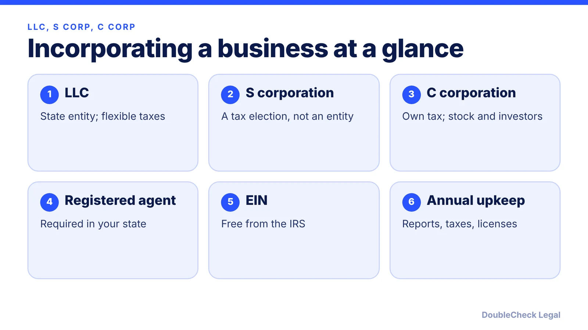
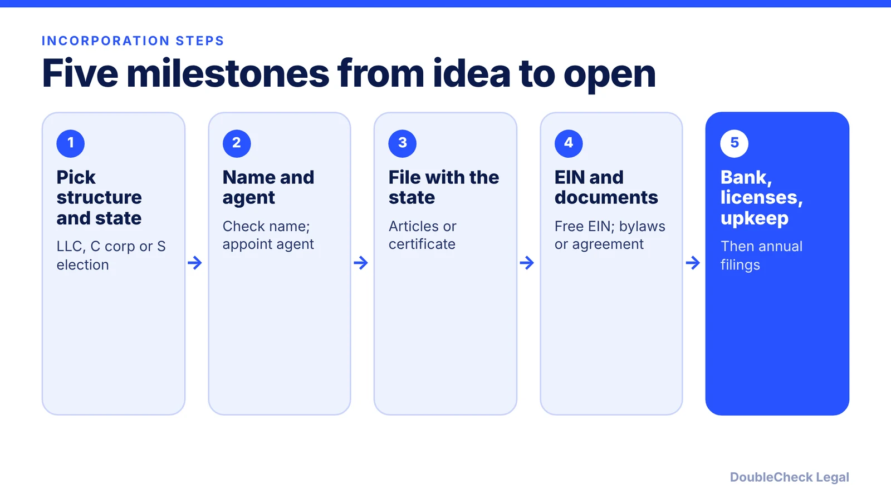

*A plain-English guide to incorporating a business: structure choice, steps, sample costs by state, timelines and pitfalls, as of November 2026.*

**Key takeaways:**

- An LLC and a C corp are state entities; an S corp is a federal tax election that an eligible LLC or corporation makes with Form 2553.
- NerdWallet (March 24, 2026) says incorporating typically takes 1 to 6 weeks and costs roughly $100 to $500 in state fees; real state fees differ.
- The IRS says an EIN is free; do not pay a site for one.
- US-formed companies no longer file federal BOI reports under FinCEN's August 2026 final rule, but state annual filings and elections still apply.

## 1. The quick answer

**Quick answer:** To incorporate a business, you choose an entity type (LLC, C corporation, or an LLC or corporation that elects S corporation tax treatment), pick a state, name a registered agent, file formation documents with the state, then get an EIN, adopt internal documents and open a bank account. NerdWallet (updated March 24, 2026) says the process typically takes 1 to 6 weeks and that state filing fees run roughly $100 to $500, depending on location. Fees, speed and extra rules vary by state, so confirm them with your Secretary of State, as of November 2026.

This guide is the long version of [how to incorporate a company in the US](/blog/how-to-incorporate-a-company-in-the-us/). It compares the three structures people usually ask about, shows what costs real money, and lists the mistakes that cause trouble later. If you are a solo founder, the [order of steps for a solo founder](/blog/incorporate-a-business-as-a-solo-founder-order-of-steps/) is a shorter walkthrough.

## 2. LLC vs S corp vs C corp: how to choose

The first decision is the one people mix up most. An LLC and a corporation are state-law entities you form by filing with a state. An S corporation is a federal tax status. Per the IRS Form 2553 instructions, an LLC can elect S corporation status by filing Form 2553 without a separate Form 8832.

**LLC.** Per Thomson Reuters Tax & Accounting (published 2023, updated June 2025), an LLC has no member cap, members need not be US citizens or residents, and profits are generally taxed once at the owner level unless the LLC elects corporate treatment. An LLC cannot issue stock, which matters for venture funding. Start with [the LLC vs C corp comparison for startups](/blog/llc-vs-c-corp-startups/).

**C corporation.** Thomson Reuters describes a 21% federal corporate tax, with shareholders taxed again on dividends, and says a C corp can issue more than one class of stock. That structure is why venture-backed companies are usually Delaware C corps. See [how to incorporate in Delaware step by step](/blog/how-to-incorporate-in-delaware-step-by-step/) and [QSBS under Section 1202](/blog/qsbs-section-1202-explained-startup-founders/).

**S corporation election.** The IRS lists these eligibility rules:

- A domestic corporation (or eligible entity treated as one) with no more than 100 shareholders.
- Only individuals, estates, certain exempt organizations or certain trusts as shareholders, and no nonresident alien shareholders (with a narrow trust exception).
- One class of stock, where voting rights can differ but distribution and liquidation rights are identical.
- Each shareholder consents, and Form 2553 is filed no more than 2 months and 15 days after the start of the tax year the election takes effect, or during the preceding tax year.

The IRS also says payments to an S corporation officer for services are wages to the extent they are reasonable compensation (a 2008 IRS fact sheet that the IRS marks as historical), so the "save self-employment tax" idea has limits. Read [S corp election and the Form 2553 deadline](/blog/s-corp-election-form-2553-deadline/) and [S corp vs C corp for a venture-backed startup](/blog/s-corp-vs-c-corp-venture-backed-startup/).

**Rule of thumb:**

- Solo or small owner-operated business, no outside investors: an LLC, possibly with an S election later.
- Plan to raise venture capital or issue stock options: a Delaware C corporation. Already an LLC? See [converting an LLC to a C corp before fundraising](/blog/convert-llc-to-c-corp-before-fundraising/).
- Founders who are nonresident aliens: the IRS shareholder rule above generally rules out an S election. See [starting a US company as a non-US resident](/blog/start-us-company-as-non-us-resident/).
- Taxes depend on facts. Have a CPA or attorney confirm before you elect anything.

## 3. The steps to incorporate, in order

1. **Check the name and local rules.** Search the Secretary of State database for name availability. NerdWallet notes that some states let you reserve a name for 60 to 120 days.
2. **Choose the state.** Usually your home state, or Delaware if you expect investors. Compare in [the best state to form an LLC](/blog/best-state-to-form-an-llc-comparison/) and [Texas vs Delaware](/blog/incorporate-in-texas-vs-delaware-for-a-texas-based-startup/).
3. **Name a registered agent.** NerdWallet says this can be an online service, an attorney, or a director, officer or employee who lives in the state.
4. **File the formation document.** Articles of incorporation or a certificate of formation, plus the state fee.
5. **Adopt internal documents.** Bylaws and a first board consent for a corporation, an operating agreement for an LLC ([LLC operating agreement with AI](/blog/llc-operating-agreement-with-ai/)).
6. **Get an EIN.** The IRS says you never have to pay a fee for an EIN, and warns about sites that charge for one (page last reviewed October 16, 2026). Form the entity with your state first. The online tool requires an entity formed in the US with a US principal place of business and a responsible party with an SSN or ITIN; others must apply by phone, fax or mail. See [getting an EIN without an SSN](/blog/get-ein-without-ssn-foreign-founder/).
7. **Open a bank account** and keep money separate.
8. **Handle licenses, tax registrations and after-formation tasks.** See [business license requirements](/blog/business-license-requirements-small-business/) and [the first 30 days checklist](/blog/startup-llc-first-30-days-checklist-after-you-form/).

## 4. What incorporating costs and how long it takes, by state

NerdWallet (updated March 24, 2026) puts the total at roughly $100 to $500 and the timeline at 1 to 6 weeks, mostly the state filing fee and processing. Real numbers differ widely. These examples are attributed to the pages we read and are not a complete schedule:

- **Texas:** the Texas Secretary of State lists a $300 filing fee for an LLC certificate of formation (Form 205 instructions), and says filing online through SOSPortal is faster. See [Texas franchise tax for LLCs and corporations](/blog/texas-franchise-tax-llc-corporation/).
- **California and Florida:** fees, annual taxes and report deadlines differ, so confirm current amounts on the California Secretary of State and Franchise Tax Board and the Florida Division of Corporations websites before you file. See [California LLC annual tax and fee](/blog/california-llc-annual-tax-and-fee/).
- **Delaware:** per Withum, Delaware House Bill 400 (signed May 21, 2026) raises the annual LLC tax from $300 to $400, effective for the 2026 tax year, with other Division of Corporations fees changing August 1, 2026. See [Delaware LLC annual tax June 1](/blog/delaware-llc-annual-tax-june-1/) and [Delaware franchise tax for startups](/blog/delaware-franchise-tax-startups/).

Add these recurring costs to your budget: a registered agent after any first-year offer (ask what renewal costs), state annual reports or franchise taxes, tax return preparation, and any local business license. NerdWallet also notes that Georgia, Pennsylvania, Nebraska and Arizona require newspaper notice for new corporations, and New York has a separate rule for LLCs ([New York LLC publication requirement](/blog/new-york-llc-publication-requirement/)). For a side-by-side look, see [LLC formation cost in California, Texas, Florida and New York](/blog/llc-formation-cost-california-texas-florida-new-york/).

## 5. Pitfalls that cause trouble later

- **Choosing a structure for one tax benefit.** An S election has eligibility limits and a reasonable-compensation rule. A C corp adds a corporate-level tax. Ask which structure fits your next two years, not only this year.
- **Forming in the wrong state.** Operating in a state other than where you formed usually means registering there too. See [foreign qualification](/blog/foreign-qualification-register-llc-in-another-state/) and [California vs Delaware](/blog/incorporate-california-vs-delaware-startup/).
- **Skipping founder paperwork.** Put co-founder agreements, stock terms ([founder stock purchase agreement](/blog/issue-founder-stock-purchase-agreement/), [83(b) elections](/blog/83b-election-startup-founders/)) and [bank-account habits](/blog/llc-startup-bank-account-commingling-liability-protection-habits/) in place early.
- **Missing recurring filings.** Annual reports, franchise taxes and tax elections have dates. See [annual report requirements by state](/blog/annual-report-requirements-by-state-llc/).

**DIY, AI or attorney?** Many simple LLCs are filed by owners with AI help. A lawyer is more valuable when you have co-founders, investors, foreign owners, equity for employees or regulated activity. See [do I need a lawyer to start an LLC](/blog/do-i-need-a-lawyer-to-start-an-llc-diy-ai-or-attorney/).

## 6. Federal ownership reporting and next steps

Many older guides still tell owners to file a beneficial ownership (BOI) report. Per MoFo (August 20, 2026) and Debevoise (September 2026), FinCEN issued a final rule on August 11, 2026, published August 14, 2026, that exempts US-formed companies, along with US-person owners and applicants, from BOI reporting. Foreign-formed entities registered to do business in a US state can still be reporting companies. New York has its own LLC transparency law for foreign LLCs. Details are in [what changed for small business formation in 2026](/blog/incorporate-a-small-business-in-2026-what-changed-boi-annual-reports-and-new-rules/) and [the BOI explainer](/blog/beneficial-ownership-report-boi-2026/).

**Your next step:** list your owners, your state, whether you will raise money and who is not a US tax resident. Draft your answers, let AI help you organize and check them, and then have an attorney or CPA confirm entity type and elections. For a long, startup-specific walkthrough see [the startup LLC complete guide](/blog/startup-llc-complete-guide-formation-taxes-operating-agreement-and-conversion/).

**Related reading:** [S Corp Reasonable Compensation: Owner Salary Rules, Explained](/blog/s-corp-reasonable-compensation-owner-salary-rules/); [How to Open a Business Bank Account for an LLC or Corporation: Documents Banks Ask For](/blog/how-to-open-a-business-bank-account-llc-corporation-documents/)

## Where DoubleCheck fits

[DoubleCheck](https://www.contactdoublecheck.com) helps businesses and founders start legal work with AI, verify it, and, when professional advice is warranted, connect with an independent attorney, including for immigration questions. Attorney availability and practice areas vary. Attorneys on DoubleCheck are independent professionals; an attorney-client relationship forms only if an attorney accepts your engagement.

**Sources:** [NerdWallet, How to Incorporate a Business (updated Mar. 24, 2026)](https://www.nerdwallet.com/business/legal/learn/how-to-incorporate-a-business); [IRS, Instructions for Form 2553, Chapter 1](https://www.irs.gov/instructions/i2553/ch01.html); [IRS, Apply for an EIN online (reviewed Oct. 16, 2026)](https://www.irs.gov/businesses/small-businesses-self-employed/apply-for-an-employer-identification-number-ein-online); [IRS, Wage Compensation for S Corporation Officers (2008, marked historical)](https://www.irs.gov/newsroom/wage-compensation-for-s-corporation-officers); [Thomson Reuters Tax & Accounting, S corp vs C corp vs LLC](https://tax.thomsonreuters.com/blog/s-corp-vs-c-corp-vs-llc-whats-the-difference-and-which-one-is-better-for-your-business/); [Texas SOS, Form 205 instructions](https://www.sos.state.tx.us/corp/instructions/205.shtml); [Withum, Delaware annual taxes and filing costs](https://www.withum.com/resources/delaware-businesses-face-increased-annual-taxes-and-filing-costs/); [MoFo, FinCEN ends BOI reporting (Aug. 20, 2026)](https://www.mofo.com/resources/insights/260820-fincen-ends-beneficial-ownership-reporting); [Debevoise (Sept. 2026)](https://www.debevoise.com/insights/publications/2026/09/fincen-finalizes-narrowed-beneficial-ownership-rep).

## FAQ

**How do I incorporate a business step by step?**

Choose the structure and state, check the name, name a registered agent, file the formation document with the state, get a free EIN from the IRS, adopt bylaws or an operating agreement, and open a bank account. NerdWallet puts the timeline at roughly 1 to 6 weeks as of its March 2026 update.

**Should I choose an LLC, S corp or C corp?**

An LLC suits many owner-operated businesses, a C corp suits companies expecting venture funding or stock options, and an S corp is a tax election with eligibility limits such as 100 shareholders and one class of stock per the IRS. Confirm the choice with a CPA or attorney.

**How much does it cost to incorporate a business?**

NerdWallet estimates roughly $100 to $500 in total state costs as of March 2026. Example: the Texas Secretary of State lists $300 for an LLC certificate of formation. Check your own state.

**Do I still need to file a BOI report when I incorporate?**

Per MoFo and Debevoise summaries of FinCEN's August 2026 final rule, US-formed companies are exempt from federal BOI reporting. Foreign-formed entities registered in a US state may still need to report, and New York has a separate law for foreign LLCs.

**Can I incorporate a business myself?**

Yes, many owners file themselves. Get an attorney involved if you have co-founders, investors, foreign owners, employee equity or a regulated business, since those facts change the documents and elections you need.

---

*General information only. This article is not legal, tax, investment, or accounting advice.*
